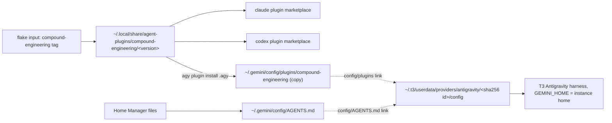

# Antigravity Agent Parity - Plan

## Goal Capsule

- **Objective:** A session in the Antigravity CLI (`agy`) or in T3 Code's Antigravity provider has the same pinned plugins, including compound-engineering, and the same global instructions as a Claude Code or Codex session, on every host kind, and the Antigravity CLI and runtime stay current without manual bumps.
- **Means:** Antigravity becomes a third harness in the agent plugin registry (KTD1), activation links the CLI's plugins and global instructions into each T3 Code Antigravity instance home (KTD3), and the `agy` CLI moves to a repository-owned release pin (KTD4).
- **Product authority:** This plan. It supersedes the deferral of Antigravity wiring in `.compound-engineering/artifacts/plans/2026-09-22-1354-feat-nix-owned-agent-plugin-registry-plan.md` (its R10 and Scope Boundaries).
- **Execution profile:** Autonomous `lfg` run through to a merged PR; merging was granted by the user for this run.
- **Stop conditions:** Stop when the pinned `agy` cannot install the compound-engineering tree even in a throwaway `HOME` on the host, or when T3 Code's instance-home layout differs from KTD3's evidence at the pinned nightly. A failure inside the Nix build sandbox alone takes U6's fallback instead.
- **Open blockers:** None.

---

## Product Contract

### Summary

The agent plugin registry gains an Antigravity harness, so compound-engineering and any later plugin reach `agy` at the same pin as Claude Code and Codex.
Activation also links those plugins and the global instructions into every T3 Code Antigravity instance home.
The repository pins the `agy` CLI itself, and the scheduled update workflow bumps it, as it already does for Claude Code and Codex.

### Problem Frame

Claude Code and Codex sessions get compound-engineering from the Nix-owned plugin registry, and neither `agy` nor T3 Code's Antigravity provider does: `home/h82/agents/agent-plugins.nix` declares only the `claude` and `codex` harnesses, and `agy plugin list` reports no plugins on this host.
T3 Code runs Antigravity in its own home per instance, `~/.t3/userdata/providers/antigravity/<hash>/`, which links only `config/skills` and `antigravity-cli/skills` back to `~/.gemini`.
A T3 Antigravity thread therefore misses the global instructions this repository renders to `~/.gemini/config/AGENTS.md`, as well as any plugin.
The `agy` CLI comes from nixpkgs (1.2.16 at the current lock) and lags the ACP runtime T3 Code already uses (1.3.0). Claude Code, Codex, and T3 Code get repository-owned pins bumped every 30 minutes, and `agy` does not.

### Key Decisions

- **Full parity, not skills alone.** Plugins, the shared registry, whatever plugin components Antigravity supports, and the T3 Code provider are all in scope. (session-settled: user-directed — chosen over a subset limited to compound-engineering skills in the CLI: the user asked for the same experience across both Antigravity entry points.) Governs R1-R7, R10.
- **Plugins reach T3 Code by linking into each instance home.** (session-settled: user-directed — chosen over installing plugin skills loose into the shared skills folder, which loses the plugin unit and leaves the instructions gap, and over linking the whole instance `config` directory to `~/.gemini/config`, which mixes T3 Code's own writes with the CLI's: keeps plugins as units and fixes the missing global instructions in the same step.) Governs R5-R7.
- **In-app T3 Code verification that the CLI cannot reach is split into its own issue.** (session-settled: user-directed — chosen over blocking completion on an in-app check: the T3 implementation ships, and only the verification the CLI cannot perform moves to a GitHub issue.) Governs R12.
- **macOS hosts get `agy` and the same plugin delivery.** (session-settled: user-directed — chosen over Linux-only coverage: the daily driver is a macOS host.) Governs R10.
- **The T3 Code runtime's ceiling is the version T3 Code requires.** T3 Code accepts only the runtime its release table names, by version and exact byte size, so "latest" for it means the version the newest pinned T3 Code nightly requires. Governs R9.

### Requirements

**Plugin delivery to the Antigravity CLI**

- R1. Every plugin the registry delivers to Claude Code and Codex can be delivered to the Antigravity CLI at the same pinned version by a membership row, and compound-engineering has that row.
- R2. After an apply, `agy` lists each delivered plugin as enabled, without a manual `agy plugin` command.
- R3. A plugin moved to the registry's retired list is removed from Antigravity on the next apply, as it is from the other harnesses.
- R4. Each plugin component Antigravity supports (skills, agents, rules, hooks, MCP servers) works as the plugin ships it; this work authors no Antigravity-specific content for compound-engineering.

**T3 Code's Antigravity provider**

- R5. After an apply, each existing T3 Code Antigravity instance home sees the same delivered plugins and the same global instructions file as the CLI.
- R6. An apply on a host where T3 Code has not yet started an Antigravity session succeeds and prepares the home of each declared Antigravity instance, so its first session already sees the plugins and instructions; an instance home created later outside the declared set is covered by the next apply that runs activation.
- R7. The linking leaves files T3 Code writes in an instance home (settings, conversations, tokens) untouched.

**Keeping the CLI and runtime current**

- R8. The repository pins the `agy` CLI from Google's release channel for x86_64-linux, aarch64-linux, and aarch64-darwin, and `.github/workflows/update-dependencies.yml` bumps that pin on its schedule, as it does for claude-code and codex.
- R9. The T3 Code Antigravity runtime keeps following the `antigravity` entry of `packages/t3code-release.json`, which the same workflow refreshes with each T3 Code nightly; nothing pins it ahead of that entry.

**Hosts**

- R10. NixOS, non-NixOS Linux, and macOS hosts all get the pinned `agy` CLI and the plugin delivery of R1-R7.

**Verification**

- R11. Repository checks fail when the Antigravity membership, the plugin delivery, the instance-home linking, or the `agy` pin regresses, and each check is mutation-tested per the repository's check learnings.
- R12. A CLI-level check shows that an Antigravity session sees compound-engineering, such as `agy plugin list` naming it and a non-interactive `agy -p` run listing its skills. Any T3 Code in-app check the CLI cannot perform is filed as a separate GitHub issue that links the PR.

### Acceptance Examples

- AE1. **Covers R5, R6.**
  - **Given:** A host where T3 Code has never started an Antigravity session.
  - **When:** The user applies.
  - **Then:** The apply succeeds and prepares the declared instance's home, and the first T3 Antigravity thread sees compound-engineering and the global instructions without a second apply.
- AE2. **Covers R3.**
  - **Given:** A plugin moved from `sources` to `retired`.
  - **When:** The user applies.
  - **Then:** `agy plugin list` no longer shows it, and no T3 instance home still links it.
- AE3. **Covers R8.**
  - **Given:** Google publishes a newer `agy` release.
  - **When:** The update workflow runs.
  - **Then:** It commits a bump of the `agy` pin after the verify step passes, the same way it commits a claude-code bump.

### Scope Boundaries

- Authoring Antigravity-specific skills, agents, or hooks for compound-engineering. Compound-engineering ships none for Antigravity, and subagent delegation is already covered by the `invoke_subagent` row in the shared instructions.
- Pinning the T3 Code runtime newer than the pinned T3 Code nightly requires, because T3 Code rejects a runtime its table does not name.
- The Antigravity desktop IDE and the Gemini CLI.
- Marketplace distribution (`agy plugin install <plugin>@<marketplace>`, `agy plugin link`). Compound-engineering documents no stable Antigravity catalog.
- Global MCP servers and hooks outside plugins (`~/.gemini/config/mcp_config.json`, `~/.gemini/config/hooks.json`).

### Dependencies / Assumptions

- `agy plugin install <dir>` copies a plugin into `~/.gemini/config/plugins/<name>/` as writable regular files, records it in `~/.gemini/config/import_manifest.json`, and `agy plugin uninstall <name>` removes both. Verified with `agy` 1.2.16 in a throwaway `HOME` against the compound-engineering tree's `.agy/` entry point (37 skills processed).
- T3 Code's Antigravity harness (`localharness_external` in the 1.3.0 runtime) reads `config/plugins/<name>/` relative to `GEMINI_HOME`, which T3 Code points at the instance home. Read from the runtime binary's strings; an in-session check needs a sign-in (R12).
- T3 Code names each instance home `~/.t3/userdata/providers/antigravity/<hex sha256 of instanceId>`, creates it with mode 0700, writes `antigravity-acp/settings.json`, links `config/skills` and `antigravity-cli/skills`, and removes nothing else. Read from `resolveAntigravityInstanceDirectories`, `prepareAntigravityProfile`, and `linkAntigravityUserSkills` in the pinned T3 Code CLI bundle; `sha256("antigravity")` matches the home on this host.
- Google's feed serves the newest `agy` version at `https://storage.googleapis.com/antigravity-public/antigravity-cli/latest` (1.3.4 on 2026-10-14) and a per-version `manifest.json` whose `platforms.{linux-x64,linux-arm,darwin-arm}` carry a `url` (with an embedded build id) and a hex `sha512`.
- `agy` reads `AGY_CLI_DISABLE_AUTO_UPDATE` (present in the binary's strings next to its auto-updater).

### Outstanding Questions

**Deferred to Implementation**

- Whether a reinstall over an existing plugin directory drops files a newer plugin version removed, or whether the adapter must uninstall first on a version change. U3's fake-CLI tests pin the adapter's behavior either way.
- Whether the pinned `agy` runs `plugin validate`/`install`/`list` inside the Nix build sandbox without network. If it cannot, U6 drops the sandboxed check and its CLI-level evidence moves to a host run in a throwaway `HOME`, recorded in the PR.

### Sources / Research

- `home/h82/agents/agent-plugins.nix`, `scripts/agent-plugin-sync` — the registry and its per-harness adapters.
- `home/h82/agents/instructions/default.nix` — renders `~/.gemini/config/AGENTS.md`.
- `home/h82/t3code.nix`, `scripts/t3code-antigravity-install`, `packages/antigravity-acp.nix`, `packages/t3code-release.json` — the T3 Code runtime pin and install.
- `.github/workflows/update-dependencies.yml` — the 30-minute bump workflow.
- `.compound-engineering/artifacts/solutions/integration-issues/t3code-antigravity-runtime-preinstall-managed-layout.md` — why the runtime pin must match T3 Code's table.
- Compound-engineering source `docs/specs/antigravity.md` — the `agy` plugin layout and install model.
- `~/.gemini/antigravity-cli/builtin/skills/agy-customizations/docs/plugins.md` and `json_configs.md` — plugin discovery, enablement in `config.json`, and `plugins.json`.
- `.compound-engineering/artifacts/solutions/best-practices/home-manager-activation-does-not-run-on-every-rebuild.md` — why R6 prepares declared instance homes instead of waiting for a later apply.
- `https://storage.googleapis.com/antigravity-public/antigravity-cli/latest` and its per-version `manifest.json` — the `agy` release feed; nixpkgs `pkgs/by-name/an/antigravity-cli/{package.nix,update.sh}` reads the same feed.

**Product Contract preservation:** changed: R6, AE1 — R6 now prepares each declared instance home at apply instead of waiting for T3 Code to create it, because on NixOS activation reruns only on a new generation and a home created between generations would stay unlinked; the user confirmed this in the plan-time synthesis.

---

## Planning Contract

### Key Technical Decisions

- KTD1. **The CLI receives plugins through `agy plugin install`, driven by `agent-plugin-sync` as a third adapter.** `agy plugin list` reports only plugins it installed, so a link the CLI did not make would fail R2's "lists as enabled". The install copies the tree into writable files, which also removes the store-hardlink question. The adapter installs from the source's `.agy/` entry point when present (only `plugin.json` and `skills/`), reads the installed `plugin.json` version back, reinstalls when it differs, and retires with `agy plugin uninstall`. It never edits `~/.gemini/config/config.json`, so a user's `plugin disable` survives a reinstall, as `agy` documents. Governs R1-R4.
- KTD2. **The Antigravity row shares the existing version-keyed link under `~/.local/share/agent-plugins`.** It adds no exclusions, so the `divergentExclusions` guard stays satisfied and the copy is taken from the same pinned tree Claude Code and Codex read. Governs R1.
- KTD3. **A dedicated activation helper links `config/plugins` and `config/AGENTS.md` into instance homes.** Each link points at the stable `~/.gemini/config/...` path, as T3 Code's own `config/skills` link does, so a new generation needs no relink. The helper prepares the home of every Antigravity instance `home/h82/t3code.nix` declares (directory `sha256(instanceId)`, mode 0700, matching T3 Code) and also links every other existing home under `providers/antigravity/`. It replaces only links it recognizes, never a regular file or a directory, and treats a missing `providers/antigravity` as success. It runs from `t3code.nix` behind the same `my.t3.cli`/`my.t3.desktop` gate as `t3codeAntigravity`. (session-settled: user-directed — chosen over loose skills in `~/.gemini/config/skills` and over linking the whole instance `config/`: keeps plugins as units and fixes the missing instructions.) Governs R5-R7.
- KTD4. **`agy` moves to a repository-owned pin modeled on Codex.** `packages/antigravity-cli.nix` reads `packages/antigravity-cli-release.json` (version, and per system the feed `url` and an SRI `sha512` hash), installs the binary like nixpkgs does (`autoPatchelfHook` on ELF), and wraps `agy` with `AGY_CLI_DISABLE_AUTO_UPDATE=1`. `scripts/antigravity-cli-release` reads `latest`, skips the manifest fetch when the pin is current, refuses a non-newer version, and writes only the three systems this flake builds. Governs R8, R10.
- KTD5. **A feed failure in the update workflow keeps the current pin.** The step follows the T3 Code block's warn-and-restore shape, because a Google outage must not block the other dependency bumps. Governs R8.
- KTD6. **The T3 Code runtime stays on the existing `t3code-release` path.** No code changes; docs state that it follows the pinned T3 Code nightly and cannot run ahead of it. Governs R9.

### High-Level Technical Design

How a plugin reaches both Antigravity entry points after this change:

Activation order: `installPackages` → `agentPlugins` (Claude Code, Codex, Antigravity rows) and `t3codeAntigravityLinks`; the links point at stable paths, so their order relative to `agentPlugins` does not matter.

### Assumptions

- The flake's `nixpkgs` config already allows the unfree packages it uses; the repo-owned `agy` package keeps `license = unfree` like the nixpkgs one.

---

## Implementation Units

### U1. Repository-owned `agy` package and release pin

- **Goal:** `agy` comes from a pinned Google release with its self-updater off, on every host kind.
- **Requirements:** R8, R10 (KTD4).
- **Dependencies:** None.
- **Files:** `packages/antigravity-cli.nix` (new), `packages/antigravity-cli-release.json` (new), `scripts/antigravity-cli-release` (new), `tests/test_antigravity_cli_release.py` (new), `packages/agent-tools.nix`, `flake.nix`, `home/h82/default.nix`.
- **Approach:**
  1. Write the release script by combining `scripts/claude-code-release` (two-step `latest` then manifest fetch, `CLAUDE_CODE_RELEASE_FETCH`-style override as `AGY_RELEASE_FETCH`) with `scripts/codex-release` (validated per-system pin, `hex_to_sri` adapted to sha512, refuse non-newer, `--output`/`--dry-run`).
  2. Map Nix systems to feed platforms: `x86_64-linux` → `linux-x64`, `aarch64-linux` → `linux-arm`, `aarch64-darwin` → `darwin-arm`; fail when any is missing or its digest is not 128 hex characters.
  3. Generate the initial pin for 1.3.4 with the script.
  4. Package it like `packages/codex.nix`: throw for an unpinned system, `meta.platforms` from the pin, `versionCheckHook`, and `makeWrapper --set AGY_CLI_DISABLE_AUTO_UPDATE 1`.
  5. Replace `antigravity-cli` in the `with pkgs;` list of `home/h82/default.nix` with the import, next to `claude-code` and `codex`.
  6. Expose `antigravity-cli-release` and `antigravity-cli` under `packages.x86_64-linux` and register the `antigravity-cli-release` test check and an `antigravity-cli` pin check (version equals the pin on every user entry; the wrapper sets the variable) beside the `codex` check.
- **Patterns to follow:** `scripts/codex-release`, `scripts/claude-code-release`, `packages/codex.nix`, the `codex` check in `flake.nix`.
- **Test scenarios:**
  - A fixture `latest` of a newer version and a full manifest writes a pin with the three systems, their URLs, and SRI `sha512-` hashes.
  - A `latest` equal to the pinned version exits 0 with "already up to date" and fetches no manifest.
  - A `latest` older than the pin is refused without writing.
  - A manifest missing `darwin-arm` fails and leaves the pin unchanged.
  - A malformed digest or a non-numeric `latest` body fails with a message on stderr.
  - `--dry-run` prints the pin and writes nothing.
  - The `antigravity-cli` check fails when the package version differs from the pin, and when the wrapper lacks `AGY_CLI_DISABLE_AUTO_UPDATE`.
- **Verification:** `nix build .#antigravity-cli` runs `agy --version` as 1.3.4, and every Linux host's home packages carry it.

### U2. Scheduled bump of the `agy` pin

- **Goal:** The 30-minute dependency workflow bumps the `agy` pin and commits it as its own commit.
- **Requirements:** R8, AE3 (KTD5).
- **Dependencies:** U1.
- **Files:** `.github/workflows/update-dependencies.yml`, `tests/update-dependencies-push-order.sh` (only if its fixtures enumerate pin files).
- **Approach:**
  1. Add an update line after the T3 Code one, wrapped in the same `if ! …; then ::warning …; git checkout -- <pin>; fi` shape.
  2. Add a push-step block: when the pin changed, commit it as `chore(packages): bump antigravity-cli to $NEW_VER`, before the `git add -A` catch-all.
  3. Keep every existing `- name:` line intact, since the workflow tests extract steps by name.
- **Patterns to follow:** the T3 Code and Codex blocks in the same workflow.
- **Test scenarios:**
  - Covers AE3. The push-order test (or a new case in it) shows a changed `packages/antigravity-cli-release.json` committed under its own subject before the catch-all.
  - The existing workflow script tests still pass with the new lines.
- **Verification:** `nix flake check` passes the `update-dependencies-*` checks.

### U3. Antigravity adapter in `agent-plugin-sync`

- **Goal:** `agent-plugin-sync --harness antigravity` installs, upgrades, and retires a plugin through `agy`.
- **Requirements:** R1-R4 (KTD1).
- **Dependencies:** None.
- **Files:** `scripts/agent-plugin-sync`, `tests/test_agent_plugin_sync.py`.
- **Approach:**
  1. Add an `Antigravity` adapter that supplies its own `sync` and `retire` methods, and make `main()` and `retire()` delegate to them when the adapter defines them. The marketplace prologue, `read_manifests()`'s marketplace check, `registrations()`, and `installed()` stay on the Claude and Codex paths unchanged, because `agy` has no marketplace verbs or JSON listing.
  2. `sync` runs `link_version`, reads the plugin manifest from the source's `.agy/plugin.json` (falling back to the root `plugin.json`), runs `agy plugin validate`, installs from `.agy/` when present, treats "installed `plugin.json` under `$HOME/.gemini/config/plugins/<plugin>/` has the source version" as converged, reads that version back after installing, then prunes.
  3. On a version change, copy the installed tree to a temporary directory, then uninstall and reinstall (or reinstall in place if implementation shows that already replaces the tree, Deferred to Implementation). If the new install fails, reinstall from the copy, report the original failure, and exit non-zero. The copy is the restore source because the Claude Code and Codex rows may already have pruned the superseded version link (KTD2).
  4. Retire with `agy plugin uninstall <plugin>`; a plugin that is already absent is success.
  5. Keep `--dry-run` printing `would run: …` for every `agy` call and update the module docstring's harness list.
- **Patterns to follow:** the `Claude` and `Codex` adapters and `FakeCliCase` in the tests.
- **Test scenarios:**
  - A fresh home: sync validates, installs from `.agy/`, and reads back the installed version.
  - A converged home: a second sync makes no `install` call.
  - A version bump: sync replaces the installed tree so a skill removed upstream is gone.
  - Covers AE2. Retire removes the plugin; retiring an absent plugin succeeds.
  - A failing `install` on a fresh home exits non-zero with the CLI's message.
  - A failing `install` after a version change restores the previous version from the copy and exits non-zero.
  - `--dry-run` runs no mutating `agy` command.
  - The adapter never writes `config.json` (a fake `plugins.<name>.enabled = false` entry survives a reinstall).
- **Verification:** `nix build .#checks.x86_64-linux.agent-plugin-sync` passes.

### U4. Registry membership for Antigravity

- **Goal:** compound-engineering is delivered to `agy` from the registry on every host kind.
- **Requirements:** R1, R3, R10 (KTD1, KTD2).
- **Dependencies:** U1, U3.
- **Files:** `home/h82/agents/agent-plugins.nix`, `tests/agent-plugins.nix`.
- **Approach:**
  1. Add `antigravity` to `harnesses` with `cli` = the U1 package's `bin/agy` and an empty `env` (the wrapper already sets the update variable).
  2. Add `exclude.antigravity = [ ]` and a membership row for compound-engineering.
  3. Keep the retired-row shape working for an Antigravity row.
  4. Update the module comments that name only Claude Code and Codex.
- **Patterns to follow:** the Codex row and `harnessChecks` in `tests/agent-plugins.nix`.
- **Test scenarios:**
  - The rendered activation script holds an `--harness antigravity` invocation whose `--cli` is the pinned `agy` path and whose `--source`/`--segment` match the registry pin.
  - Removing the membership row turns the check red.
  - The `agy` invocation carries no exit-status swallow (`|| true`, `set +e`).
  - No `home.file` targets `.gemini/config/plugins/compound-engineering`.
- **Verification:** `nix build .#checks.x86_64-linux.agent-plugins` passes, and mutating the row or the `--cli` path turns it red.

### U5. Instance-home links for T3 Code's Antigravity

- **Goal:** Every T3 Code Antigravity instance home sees the CLI's plugins and the global instructions.
- **Requirements:** R5-R7, AE1 (KTD3).
- **Dependencies:** None (links point at stable paths).
- **Files:** `scripts/t3code-antigravity-link` (new), `tests/test_t3code_antigravity_link.py` (new), `packages/agent-tools.nix`, `home/h82/t3code.nix`, `tests/t3code-traits.nix`, `flake.nix`.
- **Approach:**
  1. `home/h82/t3code.nix` gains one let binding listing the declared Antigravity instance ids (`[ "antigravity" ]`, the built-in provider's id); `textGenerationModelSelection.instanceId` and the helper's arguments both read it. The helper takes `--base-dir ~/.t3`, `--gemini-config ~/.gemini/config`, and one `--instance <id>` per entry.
  2. For each declared id, create `<base>/userdata/providers/antigravity/<sha256 hex>/config/` (home mode 0700) if missing; then, for every home under that directory, ensure `config/plugins` and `config/AGENTS.md` are symlinks to the stable targets.
  3. Replace an existing symlink with a wrong target through a staged link and `os.replace`; leave a regular file or directory in place and report it on stderr without failing the apply.
  4. Add a `t3codeAntigravityLinks` activation entry beside `t3codeAntigravity`, `entryAfter [ "installPackages" ]`, through Home Manager's `run`.
- **Patterns to follow:** `scripts/t3code-antigravity-install` and its tests, `scripts/tokscale`'s instance-home glob, `checkRuntime` in `tests/t3code-traits.nix`.
- **Test scenarios:**
  - Covers AE1. An empty base dir with one declared instance creates the hashed home (mode 0700) with both links.
  - An existing home created by T3 Code with `config/skills` gets both links and keeps `skills` and `antigravity-acp/settings.json` untouched.
  - An undeclared existing home is linked too.
  - A link pointing elsewhere is replaced; a regular `config/AGENTS.md` is left alone and reported.
  - A missing `providers/antigravity` with no declared instances exits 0 and creates nothing.
  - A second run makes no changes.
  - The activation entry exists exactly when `my.t3.cli` or `my.t3.desktop` is enabled, runs after `installPackages`, passes the declared instance ids, does nothing under `DRY_RUN`, and propagates a failing helper's exit status.
- **Verification:** the new Python check and `t3code-traits` pass, and mutating the declared-id argument or the gate turns them red.

### U6. Sandboxed install check with the pinned `agy`

- **Goal:** CLI-level evidence that the pinned `agy` accepts and lists compound-engineering.
- **Requirements:** R11, R12.
- **Dependencies:** U1, U3.
- **Files:** `tests/antigravity-plugin-install.nix` (new), `flake.nix`.
- **Approach:**
  1. A `runCommand` check with a throwaway `HOME` runs the U1 `agy` through `agent-plugin-sync --harness antigravity` against the pinned compound-engineering tree, then asserts that `agy plugin list` names it and that the installed tree holds the `ce-plan` skill. Add it to `hostClosureChecks` only if its closure carries a host generation.
  2. Outside the sandbox, on the host, run the built `agy` in a throwaway `HOME` (it signs in through the system keyring, as a probe on 2026-10-14 showed): install through `agent-plugin-sync`, then a non-interactive `agy -p` that lists skills must name the compound-engineering skills. Repeat with `GEMINI_HOME` pointing at a throwaway instance home prepared by the U5 helper, to show the `config/plugins` and `config/AGENTS.md` links are read. Record both outputs in the PR body.
- **Execution note:** Probe first whether `agy` runs offline in the sandbox; if it does not, follow the Deferred-to-Implementation fallback.
- **Test scenarios:**
  - The pinned tree installs and `agy plugin list` shows `compound-engineering`.
  - A tree without `plugin.json` makes the check fail (mutation).
- **Verification:** `nix build .#checks.x86_64-linux.antigravity-plugin-install` passes.

### U7. Documentation and follow-up issue

- **Goal:** The docs describe the new delivery and pin, and the unverifiable in-app checks are tracked.
- **Requirements:** R9, R12.
- **Dependencies:** U1-U6.
- **Files:** `docs/provisioning.md`, `docs/verification.md`, `README.md`, `AGENTS.md`, `CONCEPTS.md`, `.compound-engineering/artifacts/plans/2026-09-22-1354-feat-nix-owned-agent-plugin-registry-plan.md`.
- **Approach:**
  1. In `docs/provisioning.md`, add an "Antigravity CLI" subsection (pin, workflow bump, disabled updater, plugin delivery), extend the T3 Code subsection with instance-home links and the runtime ceiling (R9), and note that the shared instructions reach instance homes.
  2. In `docs/verification.md`, add manual items: `agy plugin list` after an apply, an `agy -p` session listing CE skills, and a T3 Antigravity thread seeing CE skills and the global rules.
  3. Add the Antigravity CLI to `README.md`, keep `AGENTS.md`'s `agents/` and `scripts/` bullets accurate, keep the `CONCEPTS.md` "Provider instance home" entry, and add a one-line superseded-by pointer to the 2026-09-22 registry plan.
  4. After the PR opens, file a GitHub issue for the one check the CLI cannot perform, a T3 Code Antigravity thread seeing the compound-engineering skills and the global rules, linking the PR.
- **Test expectation:** none -- documentation; markdownlint runs through the pre-commit hook.
- **Verification:** `markdownlint-cli2` passes on the changed Markdown, and the issue URL is in the PR body.

---

## Verification Contract

| Gate | Command | Applies to |
| --- | --- | --- |
| Formatting | `nix fmt -- --ci` | all units |
| Flake checks | `nix flake check` | U1-U6 |
| VM tests | `nix build --no-link .#vmChecks.all` | regression guard |
| Host outputs | build every `nixosConfigurations`, `homeConfigurations`, `systemConfigs` output per `AGENTS.md`; `darwinConfigurations` and aarch64 outputs are left to CI | U1, U4, U5 |
| Markdown | `mise run lint-staged-markdown` (pre-commit) | U7 |
| CI | `check.yml` on the PR, including `build-darwin` | all units, macOS coverage of R10 |

No `nixos-rebuild switch` or `nr switch` runs as validation.

---

## Definition of Done

- Every unit's verification holds and every gate in the Verification Contract passes, with macOS outputs proven by CI's `build-darwin`.
- Each new check was mutation-tested once: the named mutation turns it red and the restored code turns it green.
- The PR body carries U6's host `agy -p` evidence, and the GitHub issue for the T3 in-app check exists and the PR links it.
- No abandoned-attempt code, probe scripts, or throwaway homes remain in the diff.
