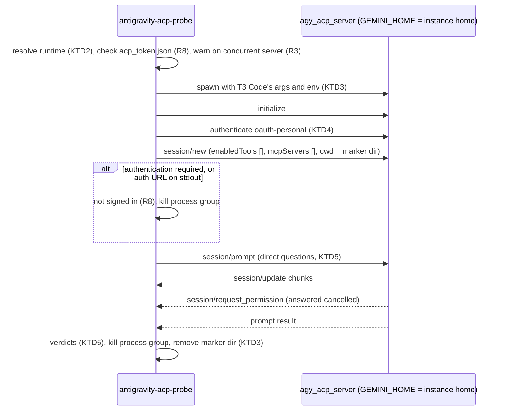

# Antigravity ACP Probe - Plan

## Goal Capsule

- **Objective:** The user can tell, from one command on a desktop, which of the shared plugin skills, global instructions, and auto-memories a T3 Code Antigravity instance actually receives under a given ACP runtime version, and the repository documents the answer for runtime 1.3.0 and 1.4.0.
- **Product authority:** This plan owns the manual probe utility, the documentation of its results, and closing [#208](https://github.com/hyperlapse122/nix-config/issues/208). Changing how instructions reach the runtime, bumping the runtime pin, and upstream requests are not active scope.
- **Means:** A stdlib Python ACP client in `scripts/antigravity-acp-probe` that launches the runtime the way T3 Code does (KTD1, KTD3).
- **Open blockers:** None.
- **Stop conditions:** Stop and report when neither runtime version gives the probe a model answer on the desktop (U2), because R10 and R12 then have no results to record. When only one version answers, R13 says what to record instead of stopping.
- **Execution profile:** A new script, a manual run on the desktop, and documentation edits. No Nix module, package, or check changes.
- **Finishes and ships:** `lfg` implements, reviews, and opens the pull request; the user merges.

---

## Product Contract

### Summary

Add a manual ACP probe utility that starts a chosen Antigravity ACP runtime version outside T3 Code against a T3 Code instance home and reports what that session loaded. Record the 1.3.0 and 1.4.0 results in the docs, keep the linker as it is, move the remaining manual checks to `docs/verification.md`, and close #208.

### Problem Frame

T3 Code starts `agy_acp_server.par` with `GEMINI_HOME` set to a per-instance home, and `scripts/t3code-antigravity-link` links the shared plugin skills and `config/AGENTS.md` into it. The repository's checks prove the links exist but cannot prove the runtime reads them, because the `agy` CLI ignores `GEMINI_HOME` and the runtime needs an OAuth token only the app's sign-in creates. So #208 asked for checks by hand in the app.

Running those checks on the MS-7D91 desktop's `antigravity` instance with runtime 1.3.0 gave a split answer. The runtime loads every model-invocable plugin skill from `antigravity-cli/skills`. The nine skills it does not list carry `disable-model-invocation: true`. It shows no sign of loading `config/AGENTS.md`: asked to answer without tools, it could quote no sentence of the global rules, no GPG fingerprint, and no replacement for `sed -i`. That answer alone is not proof, because the [agy CLI learning](../solutions/integration-issues/agy-cli-ignores-gemini-home-cannot-verify-t3-instance-homes.md) records a probe where the model quoted no marker from a workspace `AGENTS.md` either. The runtime's own `acp_server/paths.py` says it lists every path the server reads, and the list holds hooks, skills, settings, and tokens but no rules file. Hooks support only `PreToolUse` and `PostToolUse`, and `injectSteps` is unsupported. The instance home holds no auto-memory store after dozens of conversations.

The docs still describe the `config/AGENTS.md` link as if it reached the session. Whether 1.4.0 behaves differently is unknown. Each future runtime bump would raise the same question with no tool to answer it.

### Key Decisions

- **Keep the `config/AGENTS.md` link and only record the gap.** The link costs nothing and takes effect as soon as a runtime reads it. Governs R9, R10. (session-settled: user-directed — chosen over removing the link with an upstream request, and over a skill- or hook-based workaround: keep the link in place for a future runtime and document today's gap)
- **A reusable probe utility, not a one-off test.** The same question returns at every runtime bump. Governs R1, R4. (session-settled: user-approved — chosen over a one-off run recorded on the issue: a rerunnable utility also serves later runtime versions)
- **The probe uses the T3 Code instance home directly.** Governs R2, R3. (session-settled: user-directed — chosen over copying the token into a temporary home and over a dedicated probe home with its own sign-in: simplest path to a signed-in home, accepting that probe conversations land in that home)
- **Manual, interactive desktop use only.** The probe needs a signed-in T3 Code home, which no check or CI runner holds. Governs R7. (session-settled: user-directed — chosen over registering the utility or its tests in `nix flake check`: the user scoped it to a manual test utility)
- **This change closes #208.** The macOS and second-instance checks move to `docs/verification.md` as procedures that use the probe. Governs R11, R12. (session-settled: user-approved — chosen over leaving #208 open until the manual checks finish and over splitting them into a new issue)

### Requirements

**Probe utility**

- R1. The utility starts a named ACP runtime version, at least 1.3.0 and 1.4.0, with an ACP client of its own and without T3 Code.
- R2. The utility runs the runtime with `GEMINI_HOME` set to a T3 Code Antigravity instance home, and the declared `antigravity` instance is the default.
- R3. When T3 Code may be using the same instance, the utility warns and continues.
- R4. The utility runs the session with every tool disabled, asks it for every loaded skill name, for the specific facts R5 checks, and for any loaded memories, and reports a verdict for skills, global instructions, and memories.
- R5. The instructions verdict is loaded only when the answer contains a fact found only in the rendered global instructions, such as the GPG fingerprint. It is not loaded only when the answer misses that fact but returns a control fact the session is known to hold in its context. With neither, it is undetermined.
- R6. The utility takes the runtime version as an argument and fetches a version the repository does not pin from Google's release location.
- R7. The utility runs by hand from a repository checkout in an interactive desktop session, is not installed on hosts, and neither it nor any test of it is registered in `nix flake check`, a check shard, or CI.
- R8. When the instance home is not signed in, the utility fails with a message that says so, instead of hanging, and never prints a token.

**Linker and documentation**

- R9. `scripts/t3code-antigravity-link` keeps linking `config/AGENTS.md` into every instance home, unchanged.
- R10. `docs/provisioning.md`, `docs/verification.md`, the linker's docstring, and the [agy CLI learning](../solutions/integration-issues/agy-cli-ignores-gemini-home-cannot-verify-t3-instance-homes.md) state for runtime 1.3.0 and 1.4.0 whether plugin skills, global instructions, and auto-memories reach a session, and say that the `config/AGENTS.md` link takes effect once a runtime reads it.
- R11. `docs/verification.md` replaces the "ask it in the app" item with a probe procedure. The procedure covers the NixOS desktop, the macOS host, and a second Antigravity instance added in the app.
- R12. The pull request closes #208 and carries the desktop results for both runtime versions.

**ACP run**

- R13. This change runs the probe on the NixOS desktop against runtime 1.3.0 and 1.4.0, and the verdicts it reports are the results R10 and R12 record. When one version gives no answer after its failure is shown not to be a probe defect, that version's result is the handshake step and error where it failed, and R10 and R12 state its load behavior as unknown.

### Acceptance Examples

- AE1. **Covers R4, R5.** **Given** a signed-in instance home under runtime 1.3.0, **when** the probe runs, **then** it reports plugin skills loaded and no memories, and reports global instructions as not loaded when the control fact comes back without the fingerprint, matching the results from the app checks.
- AE2. **Covers R5.** **Given** a session that claims to have global rules but cannot give the GPG fingerprint, **when** the probe judges it, **then** it reports instructions not loaded.
- AE3. **Covers R8.** **Given** an instance home without `antigravity-acp/acp_token.json`, **when** the probe runs, **then** it exits with a not-signed-in message and does not wait on `session/new`.
- AE4. **Covers R3.** **Given** T3 Code running with the same instance, **when** the probe runs, **then** it prints a warning and still reports its verdicts.
- AE5. **Covers R6, R13.** **Given** runtime 1.4.0 is not installed anywhere on the desktop, **when** the probe runs with version 1.4.0, **then** it downloads the archive, reports its sha256, and reports the three verdicts for 1.4.0.
- AE6. **Covers R5.** **Given** an answer that contains neither the fingerprint nor the control fact, **when** the probe judges it, **then** it reports the instructions verdict as undetermined, not as not loaded.

### Scope Boundaries

- Delivering global instructions to T3 Code Antigravity sessions by a skill, a hook, or any other workaround.
- Removing or changing the `config/AGENTS.md` link.
- Bumping the runtime pin in `packages/t3code-release.json`; T3 Code's bundle decides the runtime version.
- Filing upstream requests with T3 Code or the runtime.
- Cleaning the probe's conversations out of the instance home.
- Automated regression tests for the probe.

### Dependencies / Assumptions

- A runtime given an existing `acp_token.json` answers a headless session. The provisioning docs record this for 1.3.0 against a signed-in home. For 1.4.0 it is assumed.
- Google publishes 1.4.0 at the same release location and naming as the pinned 1.3.0 archive. Checked on 2026-10-15: the `linux` x86_64 and `macos` darwin-arm64 1.4.0 archives both answer HTTP 200.
- The rendered `~/.gemini/config/AGENTS.md` keeps a distinctive fact R5 can test for. Today it carries the GPG fingerprint once.

### Outstanding Questions

**Deferred to Implementation**

- Whether 1.4.0 changes the ACP handshake, such as the `protocolVersion` it accepts or the auth method ids it advertises. U2 finds out by running it, and R13 says what to record when it fails.

### Sources / Research

- `scripts/t3code-antigravity-link` and commit `5bf8c1a`, which replaced the `config/plugins` link with per-skill links into `antigravity-cli/skills`.
- `docs/provisioning.md` (Antigravity paragraph) and `docs/verification.md` (`t3code-antigravity-link` description and the #208 manual item).
- [agy CLI ignores GEMINI_HOME](../solutions/integration-issues/agy-cli-ignores-gemini-home-cannot-verify-t3-instance-homes.md).
- `packages/t3code-release.json`, which pins runtime 1.3.0.
- The 1.3.0 runtime's embedded `acp_server/paths.py` docstring, which lists every path the server reads, and `acp_server/hooks.py`, which supports only `PreToolUse` and `PostToolUse`.
- The pinned T3 Code bundle (`t3code-cli` package, `libexec/t3code/t3`): `buildAntigravityAcpSpawnInput` and `antigravityEnvironment` give the launch arguments and environment KTD3 mirrors, the ACP session code with `authenticateEagerly: true` gives the `initialize`, `authenticate`, `session/new` order KTD4 follows, and `removedEnvironmentKeys` and `ANTIGRAVITY_AUTH_STDOUT_PREFIX` give the environment scrub and the sign-in line KTD3 and KTD4 handle.
- The 1.3.0 runtime's `acp_server/tool_filter.py` docstring, which documents `_meta.agy.enabledTools` on `session/new` and that an empty list disables every built-in tool (KTD5).
- [T3 Code's Antigravity ACP server finds no CA bundle on NixOS](../solutions/integration-issues/t3code-antigravity-acp-openssl-missing-ca-bundle-hangs-sessions.md), which records the `SSL_CERT_FILE` requirement, the `ANTIGRAVITY_HARNESS_PATH` variable, and server processes left running after a client stops.

---

## Planning Contract

**Product Contract preservation:** changed: R13 and AE5 added, because the user asked during planning to put the ACP run itself in scope. R4, R5, R13, AE1, and the Problem Frame were then tightened and AE6 added after document review showed that a missing fingerprint alone cannot prove the instructions were not loaded, and that one runtime version may fail to answer. The deferred questions were resolved in place by KTD1 through KTD6.

### Key Technical Decisions

- KTD1. **A stdlib Python ACP client in `scripts/`, run from the checkout.** The other T3 Code helpers (`scripts/t3code-antigravity-link`, `scripts/t3code-antigravity-install`) are stdlib Python, and ACP over stdio is newline-delimited JSON-RPC, so no client library is needed. The script is not wrapped in `packages/agent-tools.nix` and has no flake check, per R7.
- KTD2. **Runtime resolution by version.** The probe first uses a T3 Code managed version directory whose `.install-complete.json` names the requested version. Otherwise it downloads `https://dl.google.com/agy-extensions/releases/<linux|macos>/agy-acp-server-<version>-<linux-x86_64|linux-arm64|darwin-arm64>.zip` into a per-version cache under `~/.cache`, and reports the archive's sha256 (R6). It never writes into `~/.t3/tools`, which T3 Code owns. Integrity:
  1. When the version is the one `packages/t3code-release.json` pins for the platform, the archive's sha256 must equal the pinned value, or the probe refuses to run it.
  2. For an unpinned version, the probe records the sha256 in the cache entry only after a complete download and extraction, and recomputes it on every reuse, so a partial or changed entry never runs.
  3. An unpinned version is trusted on its HTTPS origin alone. No trusted digest exists for one: T3 Code's own `apps/server/src/provider/antigravityRelease.ts` pins only 1.3.0 today. Refusing unpinned versions would make R6 and R13 impossible, so the probe prints the digest and the report carries it.
- KTD3. **Launch the runtime the way T3 Code does.** The probe builds the child environment the way the bundle's `antigravityEnvironment` does:
  1. Start from the caller's environment minus the bundle's `removedEnvironmentKeys`: `GEMINI_API_KEY`, `GOOGLE_API_KEY`, `GOOGLE_APPLICATION_CREDENTIALS`, `GOOGLE_CLOUD_PROJECT`, `GOOGLE_CLOUD_LOCATION`, `GOOGLE_CLOUD_QUOTA_PROJECT`, `GOOGLE_GENAI_USE_VERTEXAI`, `GCLOUD_PROJECT`, `CLOUDSDK_CORE_PROJECT`, `AGY_ACP_CCPA_PROJECT`, `AGY_ACP_ENABLE_OAUTH`, `BROWSER`, and the variables set below.
  2. Set `GEMINI_HOME`, `AGY_ACP_FORCE_FILE_STORAGE=1`, `PYTHONUNBUFFERED=1`, `ANTIGRAVITY_HARNESS_PATH` to the sibling `localharness_external`, a private `TMPDIR`, and `BROWSER` to a command that opens nothing, so a stale token can never open a sign-in page or write a new token into the T3 Code home.
  3. When `SSL_CERT_FILE` is unset, point it at the system bundle, because the runtime's embedded OpenSSL finds none on NixOS.

  It passes `--uid=` on Linux. It starts the server in its own process group and kills the group on every exit path, because a stopped client leaves `agy_acp_server.par` and `localharness_external` running.
- KTD4. **Handshake order follows T3 Code.** T3 Code's Antigravity runtime sets `authenticateEagerly: true`, so the probe sends `initialize`, then `authenticate` with `oauth-personal`, then `session/new`. Three conditions mean the home is not signed in, and each ends the run with the R8 message: no `antigravity-acp/acp_token.json` before anything starts, `session/new` reporting authentication required, or a stdout line starting with `Open the following link to authenticate the ACP server:` (the bundle's `ANTIGRAVITY_AUTH_STDOUT_PREFIX`, which ends in a space). In that case the probe kills the process group and does not print the URL. It skips any other stdout line that is not JSON-RPC instead of failing on it. Every request has a timeout, so nothing hangs.
- KTD5. **Verdicts come from evidence the probe computes, not from the answer alone.** Tools stay out of the session:
  1. `session/new` carries `_meta: {agy: {enabledTools: []}}` and an empty `mcpServers`. The runtime's `tool_filter.py` treats an empty allowlist as every built-in disabled. Without it, `view_file` is auto-approved over the home and the model could read the fingerprint from disk.
  2. Its `cwd` is a fresh directory under the private `TMPDIR`, holding only an `AGENTS.md` with a random marker. The probe removes the directory on exit.
  3. The probe advertises no file system or terminal capability and answers any `session/request_permission` with a cancelled outcome.

  The probe sends one prompt that asks directly for every loaded skill name, for the description of one named expected skill, for the GPG fingerprint its instructions name for a new SOPS setup, for any marker its workspace rules carry, and for any memories it holds. The verdicts:
  1. Skills: the expected set is every skill under the home's `config/skills` and `antigravity-cli/skills` whose `SKILL.md` does not set `disable-model-invocation: true`. The verdict is loaded when the answer names every expected skill, and the report lists any that are missing.
  2. Instructions (R5): the fingerprint is the 40-hex value in the file the home's `config/AGENTS.md` resolves to. The control fact is a distinctive phrase from the named skill's `description`, which the session holds because the skill list is in its context. Loaded when the fingerprint comes back. Not loaded when the control phrase comes back without the fingerprint. Undetermined otherwise, or when the file or fingerprint is missing. The report also states whether the workspace marker came back, as a separate line.
  3. Memories: no memory store when the home has no `implicit/` or `knowledge/` directory. Loaded when the answer states a fact found only in a store the probe lists. Not loaded otherwise. The report lists the stores it found.
- KTD6. **Concurrency check without blocking.** On Linux the probe reads `/proc/*/environ` for `agy_acp_server` processes whose `GEMINI_HOME` equals the home. On macOS, where another user's environment is not readable that way, it warns when any `agy_acp_server` process is running. Either way it warns and continues (R3).
- KTD7. **No automated tests.** The user excluded the probe and its tests from every check (Key Decision "Manual, interactive desktop use only"). U2's desktop runs are its verification.

### High-Level Technical Design

### Assumptions

- `lfg` runs this plan without a scoping confirmation, so these bets are recorded instead of asked.
- The probe uses the session's default model and prints which model answered.
- The probe exits 0 whenever it reports verdicts, whatever they are, and non-zero only when it cannot get an answer. The verdicts are findings, not a pass or fail.
- Probe conversations stay in the instance home's `conversations/` and `brain/` (Key Decision "The probe uses the T3 Code instance home directly").

### Sequencing

U1 builds the probe. U2 runs it and needs U1. U3 writes U2's results into the docs and needs U2.

---

## Implementation Units

### U1. ACP probe utility

**Goal:** A manual command that reports what a T3 Code Antigravity instance loads under a chosen runtime version.

**Requirements:** R1, R2, R3, R4, R5, R6, R7, R8; AE1, AE2, AE3, AE4, AE5, AE6.

**Dependencies:** None.

**Files:**

- Create `scripts/antigravity-acp-probe`.

**Approach:**

1. Arguments: a required runtime version, an instance id defaulting to `antigravity` that maps to the home the way T3 Code derives it (hex SHA-256 of the id under `~/.t3/userdata/providers/antigravity/`), and an explicit home path that overrides the instance.
2. Resolve and, when needed, download the runtime (KTD2).
3. Check sign-in and warn about a concurrent server (R8, KTD6).
4. Launch and run the handshake and prompt (KTD3, KTD4).
5. Compute and print the verdicts, the runtime version and path, the archive sha256 when downloaded, and the answering model (KTD5).
6. Keep the module docstring in the style of `scripts/t3code-antigravity-link`: what the probe proves, what it cannot prove, and that it is manual by design.

**Execution note:** No automated tests (KTD7). Prove the unit through U2's runs and the failure cases below, run by hand.

**Patterns to follow:**

- `scripts/t3code-antigravity-link` for the stdlib Python shape, the docstring, and stderr reporting.
- `tests/host-name-guard.nix` scans `scripts/`, so the script names no host directory or fixture host.

**Test scenarios:** Run by hand, not registered anywhere (KTD7).

- Covers AE1. With the `antigravity` home and version 1.3.0, the report says skills loaded, instructions not loaded, and no memory store.
- Covers AE2. An answer that lacks the fingerprint gives instructions not loaded, even when the answer claims rules are loaded.
- Covers AE3. With `--home` pointing at a temporary directory that has no `antigravity-acp/acp_token.json`, the probe exits non-zero within seconds with a not-signed-in message and prints no token.
- Covers AE4. With T3 Code running an Antigravity thread on the same instance, the probe prints the concurrency warning and still reports.
- Covers AE5. With version 1.4.0 and an empty cache, the probe downloads, prints the sha256, and reports. A second run reuses the cache.
- Covers AE6. An answer with neither the fingerprint nor the control phrase gives instructions undetermined.
- With a home whose `acp_token.json` is present but invalid, the probe exits non-zero with the not-signed-in message, prints no sign-in URL, and opens no browser.
- With version 1.3.0, the answer shows no tool call, and the session's prompt result contains no `tool_call` update.
- A cache entry whose archive was changed after download makes the probe refuse to reuse it.
- Requesting 1.3.0 with no T3 Code managed copy downloads the archive and refuses to run it when its sha256 differs from the pin.
- An unknown version, such as 9.9.9, fails with the download URL and HTTP status, not a traceback.
- After the probe exits, normally or by Ctrl-C, no `agy_acp_server` or `localharness_external` process it started remains, and its marker directory is gone.

**Verification:** Each scenario above gives the stated outcome on the desktop.

### U2. Run the ACP probe on the desktop

**Goal:** Real verdicts for runtime 1.3.0 and 1.4.0 on the NixOS desktop, which U3 and the pull request record.

**Requirements:** R13; AE1, AE5.

**Dependencies:** U1.

**Files:** None. The results go into U3's files and the pull request body.

**Approach:**

1. Run the probe against the `antigravity` instance with version 1.3.0, then 1.4.0.
2. Capture each report's verdict lines and runtime metadata verbatim for the pull request body, with no token or other credential in it. Review the model's free-text answer before it goes in, because the repository is public. Where it quotes or summarizes conversation or memory content, replace that content with a one-line description, such as the store's path and entry count.
3. When 1.4.0 differs from 1.3.0 in any verdict, record which, since it decides what R10 says about the `config/AGENTS.md` link.
4. When a version gives no answer, first rule out a probe defect, then record that version's result as R13 defines.

**Execution note:** This unit needs the signed-in desktop session this run has. Stop per the Goal Capsule when neither version answers.

**Test expectation:** none -- this unit produces evidence and changes no file.

**Verification:** Both reports exist and each carries three verdicts.

### U3. Record the results and the manual procedure

**Goal:** The docs say what each runtime version delivers to a T3 Code Antigravity instance and how to check it again.

**Requirements:** R9, R10, R11, R12.

**Dependencies:** U2.

**Files:**

- Modify `docs/provisioning.md` (the Antigravity paragraph that says whether the runtime reads `config/AGENTS.md` is checked in the app).
- Modify `docs/verification.md` (the `t3code-antigravity-link` description, which says the runtime load was observed once, and the manual item that points at #208).
- Modify `scripts/t3code-antigravity-link` (module docstring only; R9 keeps its behavior).
- Modify `.compound-engineering/artifacts/solutions/integration-issues/agy-cli-ignores-gemini-home-cannot-verify-t3-instance-homes.md`.
- Check `CONCEPTS.md`, whose "Provider instance home" entry already names checking through the runtime and the 1.3.0 instructions gap, against U2's 1.4.0 result.

**Approach:**

1. In each file, state the U2 verdicts per runtime version and that the `config/AGENTS.md` link takes effect once a runtime reads it (R10).
2. Replace the "ask it in the app" manual item under `### Every host` in `docs/verification.md` with the probe procedure for the NixOS desktop and a second instance added in the app, and add the matching item under `### macOS hosts`, which that file says macOS hosts follow instead (R11). Say there that the probe is a manual utility outside every check.
3. In the learning, add the probe as the way to check what an instance loads, keeping its `agy` finding.
4. Keep the edits in English and pass the Markdown lint the pre-commit hook runs.

**Test expectation:** none -- documentation and a docstring.

**Verification:** No file still says the runtime's instruction load is unchecked, or checked only in the app, and every one gives the same per-version results.

---

## Verification Contract

| Gate | Applies to | Done signal |
| --- | --- | --- |
| `python3 -c 'import ast,sys; ast.parse(open(sys.argv[1]).read())' scripts/antigravity-acp-probe` | U1 | Parses |
| U1 test scenarios, run by hand on the desktop | U1 | Each gives its stated outcome |
| Probe runs for 1.3.0 and 1.4.0 | U2 | Two reports with three verdicts each |
| `mise run lint-staged-markdown` (pre-commit hook) | U3 | No findings |
| `nix fmt -- --ci` | all | No changes |
| `nix flake check` | all | Passes, including `host-name-guard` over `scripts/` |
| Every output the `AGENTS.md` build commands list, built before shipping | all | Each builds; macOS outputs left to CI's `build-darwin` job |

---

## Definition of Done

- U1 through U3 meet their verification.
- The pull request body says `Closes #208` and carries U2's two reports (R12).
- No Nix file, package, or check registers the probe (R7).
- `scripts/t3code-antigravity-link` behavior is unchanged (R9).
- No dead-end or experimental code from abandoned approaches remains in the diff.
