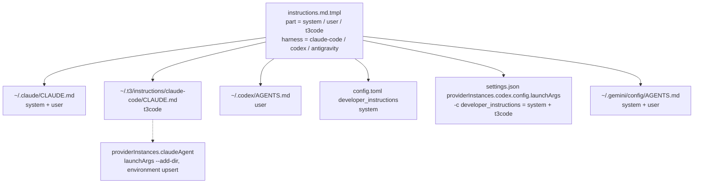

# Split Agent Instructions by Delivery Path and T3 Code - Plan

## Goal Capsule

- **Objective:** A coding-agent session started from a terminal no longer reads the T3 Code rules, and Claude Code and Codex sessions that T3 Code launches still get them. Every session gets each shared rule exactly once, through the strongest channel its delivery path offers. T3 Code Antigravity sessions stay outside this outcome until a runtime reads an instruction channel (see Scope Boundaries).
- **Means:** Split `instructions.md.tmpl` into a system part, a user part, and a T3 Code part, and render one bundle per delivery path (KTD1, KTD2). Deliver the T3 Code part only through T3 Code provider settings (KTD3–KTD6). Audit the prose with `ce-noslop` and tune it per harness before the check pins the wording (KTD9).
- **Product authority:** GitHub issues #223 and #221.
- **Open blockers:** None.
- **Stop conditions:**
  - Stop when no T3 Code setting can deliver the T3 Code part to Claude Code sessions: the U4 probes show that neither `--add-dir` with `CLAUDE_CODE_ADDITIONAL_DIRECTORIES_CLAUDE_MD` nor any other `launchArgs` or `environment` route loads it exactly once. Report this as `settled-decision-invalidated` for KTD3.
  - Stop when Codex rejects the `-c developer_instructions=…` launch argument T3 Code passes, or when that argument replaces Codex's base instructions.
- **Execution profile:** Nine units in one pull request, implemented by `ce-work` and shipped through `lfg`. U9 is a wide prose audit that parallel workers may split by directory.

---

## Product Contract

### Summary

The single instruction template becomes three parts:

- the **system part**: rules that must hold every turn in every workspace;
- the **user part**: workflow preferences;
- the **T3 Code part**: rules that only apply inside T3 Code.

Each delivery path receives the system and user parts through its strongest channel. Where a path has no system-prompt channel, it gets them merged into its user-level instruction file. Only Claude Code and Codex sessions that T3 Code launches receive the T3 Code part, and it reaches them through T3 Code's own provider settings. Checks pin which channel carries each part on each path. The template is tuned per harness and audited with `ce-noslop` before those checks pin it, and the repository's Markdown gets the same audit.

### Problem Frame

Today one rendered file per harness (`~/.claude/CLAUDE.md`, `~/.codex/AGENTS.md`, `~/.gemini/config/AGENTS.md`) carries every rule, so a terminal session also reads Cross-model delegation and the T3 Code pull request rules. Those rules open with "when inside T3 Code" conditions, but a terminal session still spends context on them. A terminal session that happens to load the T3 Code MCP server could act on them. Every rule also arrives as user context, even where the harness could take an added system prompt, and that weakens rules that must hold every turn.

### Requirements

**Instruction parts**

- R1. The template yields a system part, a user part, and a T3 Code part. A comment in the template states the rule that assigns each section to a part.
- R2. Neither the system part nor the user part mentions T3 Code. Where a shared rule needs a terminal fallback, such as babysitting with `ce-babysit-pr` unchanged, the fallback is written without naming T3 Code. The T3 Code part states how it overrides those fallbacks.

**Delivery per path**

- R3. Claude Code from a terminal gets the system and user parts merged in `~/.claude/CLAUDE.md`, and no T3 Code part.
- R4. Claude Code launched by T3 Code gets the same `~/.claude/CLAUDE.md` plus the T3 Code part, loaded through the `claudeAgent` provider instance's T3 Code settings.
- R5. Codex from a terminal gets the system part as `developer_instructions` in `~/.codex/config.toml` and the user part in `~/.codex/AGENTS.md`, and no T3 Code part.
- R6. Codex launched by T3 Code gets the user part from `~/.codex/AGENTS.md`, and the system part plus the T3 Code part as `developer_instructions` through the `codex` provider instance's `launchArgs`.
- R7. Antigravity from a terminal (`agy`) gets the system and user parts merged in `~/.gemini/config/AGENTS.md`, and no T3 Code part.
- R8. T3 Code Antigravity sessions receive no instructions yet, because the runtime reads no instruction file and T3 Code offers no channel. The existing `config/AGENTS.md` instance-home link stays as it is. The docs record the gap, and the probe gains markers for the rule paths not yet probed.
- R9. On every path, each rule reaches the session exactly once.

**Checks**

- R10. A flake check fails when the T3 Code part reaches a terminal channel, or when any part is missing from, or duplicated on, a path. It reads the materialized outputs: the `home.file` texts and the rendered declared-settings files.

**Prose quality**

- R11. Every Markdown document in the repository passes a `ce-noslop` audit with commands, identifiers, and link targets preserved. Those documents are `README.md`, `AGENTS.md`, `CONCEPTS.md`, `docs/`, `secrets/README.md`, and `.compound-engineering/artifacts/` plans and solutions.
- R12. Every rendered part and merged file passes a `ce-noslop` audit, and the templates are tuned for each harness and its latest model, branching on `.harness.id` where they differ.

### Key Decisions

- **The T3 Code part reaches sessions only through T3 Code settings or T3 Code instance homes.** (session-settled: user-directed — chosen over hooks, `PATH` shims, or runtime environment checks: the delivery should come from T3 Code itself, not from detection.) Governs R4, R6, R8.
- **The split is per delivery path, with a merged fallback.** (session-settled: user-directed — chosen over a per-harness split: one harness can have both kinds of path.) Governs R3–R9.
- **Claude's T3 Code instance keeps the shared `~/.claude`.** (session-settled: user-directed — chosen over a separate `homePath`/`CLAUDE_CONFIG_DIR`: it would split credentials, sessions, plugins, and settings from `~/.claude`.) Governs R4.
- **Codex never receives `model_instructions_file`.** (session-settled: user-directed — chosen over `model_instructions_file`: it replaces Codex's base instructions.) Governs R5, R6.
- **The Antigravity instance-home link is left alone until a channel exists.** #223 says to replace the dead link only once a working channel is chosen, and pointing it at a new file nothing reads would add code with no effect. Governs R8.

### Scope Boundaries

- No hook, `PATH` shim, wrapper flag, or environment detection selects instructions.
- Terminal Claude Code gets no system-prompt channel. The flake's `claude` package is a bare override with no wrapper, and a wrapper would apply to every launch.
- Delivering instructions to T3 Code Antigravity sessions waits for T3 Code and the runtime to adopt ACP `systemPrompt`, or for a probe to find a rules path the runtime reads. This plan extends the probe and does not run it against a signed-in instance in CI.
- Considered and not built: a merged system, user, and T3 Code file for the Antigravity instance-home link, with a new linker argument. No runtime reads the link today, and the linker change is cheap to add once one does.
- The plan does not change the coding-agent settings themselves (models, permissions, plugins). Only instruction delivery changes, plus the `providers` → `providerInstances` move KTD7 needs.

---

## Planning Contract

### Key Technical Decisions

- KTD1. **One template, three parts, selected by context.** The gomplate context gains a `part` key (`system`, `user`, or `t3code`), and the template wraps each section in a branch on it. A merged file is the concatenation of rendered parts in a fixed order: system, user, then T3 Code. Section assignment rule:
  - A rule that must hold every turn in every workspace goes in the system part: tool use, GPG and encryption, model routing.
  - A workflow preference goes in the user part: review findings, learning refresh, branch names, commit hooks, pull and merge requests, issue media.
  - A rule that only applies inside T3 Code goes in the T3 Code part. That includes the whole Cross-model delegation section, because every rule in it runs through the T3 Code MCP tools.

  One template keeps `.harness.id` branching and the `--missing-key error` guard in one place, rather than three templates drifting apart.

- KTD2. **A delivery-path table in Nix decides the channels.** `home/h82/agents/instructions/default.nix` declares, per harness, the terminal instruction file and which parts it carries (merged or user-only), plus the rendered system part and the T3 Code bundles other modules consume. `codex.nix` and `t3code.nix` read those derivations from one shared function, `home/h82/agents/instructions/render.nix`, so no module renders the template on its own.

- KTD3. **The Claude Code T3 Code part loads through `--add-dir` plus `CLAUDE_CODE_ADDITIONAL_DIRECTORIES_CLAUDE_MD=1`, not `--append-system-prompt-file`.** Research against the pinned nightly and claude 2.1.300 found the following:
  - T3 Code always sends `systemPrompt: {preset: "claude_code", append: …}` in the SDK's `initialize` request. That append replaces any `--append-system-prompt(-file)` given on the command line: four probes saw only the initialize text.
  - `parseCliArgs` keeps `--add-dir <path>` as an extra arg, and the SDK emits it as `--add-dir <path>` after its own `--add-dir` entries for the thread directory and the attachments directory.
  - Claude Code loads `CLAUDE.md` from an added directory when `CLAUDE_CODE_ADDITIONAL_DIRECTORIES_CLAUDE_MD=1`. The variable goes in the instance's `environment` list, so terminal sessions never see it.

  The file is installed at `~/.t3/instructions/claude-code/CLAUDE.md`, a stable path that does not change with each store path. This replaces #223's planned `--append-system-prompt-file`, an unexamined directive, on that evidence, and keeps the settled channel, T3 Code settings. With the variable set, the thread directory is also an added directory, so U4 proves the project's own `CLAUDE.md` still loads once (R9). Consequence for #221: T3 Code gives Claude Code no added-system-prompt channel, so Claude Code is merged on both of its paths. (session-settled: user-directed — chosen over a separate Claude `homePath`: it splits `~/.claude` state.)

- KTD4. **The Codex T3 Code part rides in `developer_instructions` through `launchArgs`.** `codex app-server` accepts `-c key=value`, and T3 Code's tokenizer respects quotes. T3 Code sends no thread-level `developerInstructions` of its own: its collaboration-mode text is per turn, and a probe showed the two coexist with the base instructions intact. A `-c` value overrides the `config.toml` key, so the launch value is the system part plus the T3 Code part.

  Encoding is a TOML basic string, wrapped in single quotes:
  - `\` becomes `\\`, and this escape is applied first;
  - `"` becomes `\"`;
  - a newline becomes `\n`;
  - `'` becomes the TOML Unicode escape `\u0027`. TOML basic strings have no `\'`, and T3 Code's tokenizer ends a single-quoted token at the first bare `'`.

  The template holds dozens of apostrophes, so the wrapped value contains no bare `'` and no bare `"`. `-c` also reaches T3 Code's `codex exec` text generation, which then carries the instructions too; that is accepted. (session-settled: user-directed — chosen over `model_instructions_file`: it replaces Codex's base instructions.)

- KTD5. **The Codex system part goes to `developer_instructions` in `~/.codex/config.toml`.** `codex.nix` already merges declared keys there. A probe found `developer_instructions` is additive to the base instructions. `agent-settings` writes a multi-line string as an escaped TOML basic string, which U2 pins with a test.

- KTD6. **`agent-settings` gains keyed list upserts.** The instance `environment` is a list of `{name, value}` entries, and `setPaths` refuses non-scalar leaves. A new `upsertPaths` entry names a list path, a key field, and one entry. It replaces the entry whose key matches, or appends one when none does, and leaves every other entry alone. So an environment variable a user added to the Claude instance in the T3 Code UI survives activation. `driver` and `config.launchArgs` stay scalar `setPaths` leaves, so the app's other instance fields survive too. (session-settled: user-directed — chosen over owning whole provider entries: the merge owns only declared leaves.)

- KTD7. **Settings move from `providers.*` to `providerInstances.*`.** The pinned nightly migrates `providers.<kind>` into `providerInstances.<kind>` once, lets an existing instance win, and then deletes `providers`. Today's `providers.antigravity.enabled = true` is therefore a no-op on machines where `providerInstances.antigravity` exists. The declaration becomes `providerInstances.antigravity.{driver, enabled}` leaves. `providers` joins `retiredKeys` so activation stops writing it back.

- KTD8. **The probe gains rule-path markers, and the instance-home link stays.** `scripts/antigravity-acp-probe` gains markers in `<cwd>/.agents/rules/` and `<GEMINI_HOME>/config/rules/`, the paths not yet probed, so the next manual probe can find a channel. `scripts/t3code-antigravity-link` is unchanged (R8).

- KTD9. **Tuning and the template audit run on the split template before the check pins it.** `ce-noslop` and per-harness tuning edit the template right after U1 splits it. That meets #221's "against the split result" ordering, because only U1 changes template prose. U6 then pins and mutation-tests the shipped wording once. The repository-wide Markdown audit runs last, after the docs change.

- KTD10. **Instruction text reaches declared settings at build time, not evaluation time.** The rendered parts are gomplate derivations. Reading them into `builtins.toJSON` or `builtins.replaceStrings` would need import-from-derivation. The declared-settings files in `codex.nix` and `t3code.nix` that carry instruction text are therefore built in a `pkgs.runCommand` with `python3`. It reads the rendered parts from the store, applies the KTD4 encoding, and writes the declared JSON. The checks read those built files.

### High-Level Technical Design

| Path | Instruction file | System channel | T3 Code part |
| --- | --- | --- | --- |
| Claude Code, terminal | system + user | none | none |
| Claude Code, T3 Code | system + user (same file) | none, since T3 Code's append replaces the flag | `--add-dir` `CLAUDE.md` |
| Codex, terminal | user | `config.toml` system | none |
| Codex, T3 Code | user | launch `-c`: system + T3 Code | inside the launch `-c` |
| Antigravity, terminal | system + user | none | none |
| Antigravity, T3 Code | none read (link unchanged) | none | none yet |

### Assumptions

- The section assignment follows #221's candidate rule as KTD1 states it, because the user offered that rule and left it open.
- The full `ce-noslop` audit covers the plans and solutions too, because #221 names them. Plans are point-in-time records, so the audit rewrites their prose without changing their decisions, dates, IDs, quoted strings, or line references.
- Per-harness tuning stays within the instruction templates. It does not touch harness settings files.
- The `my.t3.cli` and `my.t3.desktop` traits gate every T3 Code file and settings leaf, as `t3code.nix` already gates its activation.

### Risks

- A T3 Code nightly bump could change `parseCliArgs`, the `environment` envelope, or the `providers` migration. A Claude Code bump could drop `CLAUDE_CODE_ADDITIONAL_DIRECTORIES_CLAUDE_MD`. Mitigation: U4 adds bundle and binary string checks beside the existing `t3code-antigravity-layout` pattern.
- A long `-c` value could hit a tokenizer edge case. Mitigation: U6's check decodes the rendered `launchArgs` with POSIX shell-word splitting and a TOML parser, and compares the result to the rendered system and T3 Code parts.

---

## Implementation Units

### U1. Split the template into parts and render per delivery path

- **Goal:** One template yields the system, user, and T3 Code parts, and the delivery-path table renders every file R3, R5, and R7 name, plus the parts R4 and R6 consume.
- **Requirements:** R1, R2, R3, R5, R7, R9; KTD1, KTD2.
- **Dependencies:** None.
- **Files:** `home/h82/agents/instructions/instructions.md.tmpl`, `home/h82/agents/instructions/default.nix`, `home/h82/agents/instructions/render.nix` (new).
- **Approach:**
  1. Add the section assignment rule as a template comment, and wrap each section in a `.part` branch. Fail rendering on an unknown part, the way an unknown harness fails today.
  2. Move Cross-model delegation, the T3 Code rows and lines of Model routing, and every T3 Code rule under Pull and merge requests into the T3 Code part. Rewrite the shared lines that mention T3 Code as harness-neutral fallbacks, and give the T3 Code part sentences that override them inside T3 Code (R2).
  3. Fix cross-references that would point across parts, such as "Cross-model delegation below" in Tool use and Model routing.
  4. Expose `render { harness, parts }` from `render.nix`. `default.nix` installs the terminal files: Claude Code and Antigravity merged, Codex user only.
- **Patterns to follow:** the existing `render` in `home/h82/agents/instructions/default.nix` and its `--missing-key error` guard.
- **Test scenarios:** covered by U6.
- **Verification:** each terminal file renders, and none contains `T3 Code`.

### U8. Tune the split templates per harness

- **Goal:** R12, the tuning half.
- **Requirements:** R12; KTD9.
- **Dependencies:** U1.
- **Files:** `home/h82/agents/instructions/instructions.md.tmpl`.
- **Approach:**
  1. Review each harness's rendered parts against its current tools, subagent primitives (`Agent` model override, `spawn_agent`, `invoke_subagent`), and how literally its latest model follows rules.
  2. Branch on `.harness.id` only where the harnesses differ.
- **Test expectation:** none -- prose only; U6 pins the result.
- **Verification:** every part still renders for every harness.

### U10. Audit the split template with ce-noslop

- **Goal:** R12, the audit half.
- **Requirements:** R12; KTD9.
- **Dependencies:** U8.
- **Files:** `home/h82/agents/instructions/instructions.md.tmpl`.
- **Approach:** Render every part and merged file for every harness, audit them with `ce-noslop`, and apply the rewrites in the template. Keep tool names, commands, fingerprints, and identifiers verbatim.
- **Test expectation:** none -- prose only; U6 pins the result.
- **Verification:** every part still renders for every harness.

### U2. Add keyed list upserts and multi-line TOML strings to agent-settings

- **Goal:** `agent-settings` can upsert one keyed entry in a list, and writes a multi-line string to TOML correctly.
- **Requirements:** R4, R6; KTD5, KTD6.
- **Dependencies:** None.
- **Files:** `scripts/agent-settings`, its existing test file under `tests/`.
- **Approach:** Add an `upsertPaths` list of `{path, key, value}`. It replaces the list entry whose `key` field equals `value[key]`, or appends `value` when none matches, creating missing parent objects and an empty list the way `setPaths` creates parents. Keep `setPaths` scalar-only.
- **Patterns to follow:** the existing `own` and `setPaths` handling in `scripts/agent-settings`.
- **Test scenarios:**
  - `upsertPaths` on `providerInstances.claudeAgent.environment` that holds a user entry `FOO=1` appends `CLAUDE_CODE_ADDITIONAL_DIRECTORIES_CLAUDE_MD=1` and keeps `FOO=1`.
  - A second run with the same declaration leaves the list unchanged, with no duplicate entry.
  - An existing entry with the same name and value `0` is replaced with `1`.
  - `upsertPaths` creates the path when `providerInstances` is absent.
  - Sibling fields such as `config.launchArgs` and other instances are untouched.
  - A TOML merge of a `developer_instructions` value holding newlines, `"`, `'`, and `\` reads back byte-identical through a TOML parser, with the file's other keys unchanged.
  - A non-scalar value under `setPaths` is still refused.
- **Verification:** the agent-settings tests pass.

### U3. Wire Codex: system part in config.toml, T3 Code part in launchArgs

- **Goal:** Codex gets R5 and R6.
- **Requirements:** R5, R6, R9; KTD4, KTD5, KTD10.
- **Dependencies:** U1, U2, U10.
- **Files:** `home/h82/agents/codex.nix`, `home/h82/t3code.nix`, `tests/codex.nix`.
- **Approach:**
  1. `codex.nix` declares `developer_instructions` as the rendered Codex system part. The declared JSON is built per KTD10.
  2. `t3code.nix` declares `providerInstances.codex.driver = "codex"` and `providerInstances.codex.config.launchArgs = "-c '<encoded>'"`, where `<encoded>` is `developer_instructions=` followed by the KTD4 TOML string holding the system part and then the T3 Code part.
  3. Build `<encoded>` in the KTD10 builder.
- **Execution note:** Before declaring the unit done, run `codex app-server` with the rendered launch argument through `T3CODE_CODEX_LAUNCH_ARGS`, or start a T3 Code Codex thread. Confirm the session quotes a sentence from the T3 Code part that contains an apostrophe, and that it keeps its shell tool.
- **Test scenarios:**
  - `tests/codex.nix`: the declared `developer_instructions` equals the rendered system part and does not contain `T3 Code`.
  - U6 covers the `launchArgs` decoding.
- **Verification:** the Codex checks pass and the runtime probe in the execution note succeeds.

### U4. Wire Claude Code and move providers to providerInstances

- **Goal:** Claude Code under T3 Code loads the T3 Code part exactly once (R4, R9), and the `providers` declaration stops being a no-op (KTD7).
- **Requirements:** R4, R9; KTD3, KTD6, KTD7, KTD10.
- **Dependencies:** U1, U2, U10.
- **Files:** `home/h82/t3code.nix`, `tests/t3code-traits.nix`, the flake check that reads the T3 Code bundle (`t3code-antigravity-layout` in `flake.nix`, or a sibling check beside it).
- **Approach:**
  1. Install the Claude Code T3 Code part at `~/.t3/instructions/claude-code/CLAUDE.md` through `home.file`, gated on either T3 trait.
  2. Declare `providerInstances.claudeAgent.driver = "claudeAgent"` and `config.launchArgs = "--add-dir <home>/.t3/instructions/claude-code"`.
  3. Upsert `{ name = "CLAUDE_CODE_ADDITIONAL_DIRECTORIES_CLAUDE_MD"; value = "1"; }` into `providerInstances.claudeAgent.environment`, keyed by `name`.
  4. Replace `providers.antigravity.enabled` with `providerInstances.antigravity.{driver, enabled}`, and add `providers` to `retiredKeys`.
  5. Extend the bundle check: the Claude instance config still has `launchArgs`, the instance envelope still has `environment`, and `parseCliArgs` still feeds `extraArgs`.
  6. Add a check that the pinned `claude-code` package's binary still contains `CLAUDE_CODE_ADDITIONAL_DIRECTORIES_CLAUDE_MD` and `--add-dir`.
- **Execution note:** Prove the channel before any Nix change, in two probes:
  1. Run `claude` in stream-json mode the way T3 Code does. Start it from a project directory whose `CLAUDE.md` holds codeword A. Send an `initialize` request with an `appendSystemPrompt`. Pass `--add-dir <that cwd>` and then `--add-dir <instructions dir>`, where the instructions directory's `CLAUDE.md` holds codeword B. Proceed only when, with the variable set, both codewords are visible and Claude's memory-file debug output shows each file loaded once, and when, without the variable, B is absent. A duplicated project file is a U4 failure to resolve before the Nix changes, or a stop per the Goal Capsule.
  2. After activation, start a Claude Code thread in T3 Code from the merged `settings.json` and confirm the session quotes a sentence from `~/.t3/instructions/claude-code/CLAUDE.md`.
- **Test scenarios:**
  - `tests/t3code-traits.nix`: for a host with a T3 trait, the rendered declaration carries the `claudeAgent` driver and `launchArgs` leaves, the environment upsert, the antigravity instance leaves, and `providers` under `remove`.
  - `tests/t3code-traits.nix`: `~/.t3/instructions/claude-code/CLAUDE.md` exists when either T3 trait is on and is absent when both are forced off, as its `bothOff` evaluation already does for other T3 Code outputs.
  - The bundle check fails when the pinned bundle's Claude settings schema lacks `launchArgs`.
  - The binary check fails when the expected string is changed to one the binary lacks.
- **Verification:** the T3 Code checks pass, and both probes succeed. Record their results in the pull request body.

### U5. Extend the Antigravity probe with rule-path markers

- **Goal:** R8 and KTD8.
- **Requirements:** R8.
- **Dependencies:** None.
- **Files:** `scripts/antigravity-acp-probe`.
- **Approach:** Add rule markers in the probe's `<cwd>/.agents/rules/` and `<GEMINI_HOME>/config/rules/` paths, and report a verdict for each, in the same shape as the existing global-instructions verdict.
- **Test expectation:** none -- a manual utility outside every check, as `docs/provisioning.md` records.
- **Verification:** the probe's argument parsing and marker setup run without a signed-in instance up to the point where it needs the runtime.

### U6. Pin the delivery-path contract in the agent-instructions check

- **Goal:** R10.
- **Requirements:** R9, R10.
- **Dependencies:** U1, U3, U4, U10.
- **Files:** `tests/agent-instructions.nix`, `flake.nix` (check arguments only, if the interface changes).
- **Approach:**
  1. Keep the materialized-file lookup by resolved `target`.
  2. For each user entry, gather each path's channels: the terminal file, the Codex declared `developer_instructions`, the decoded `launchArgs` value, and the `~/.t3/instructions` file.
  3. Add entries with both T3 traits forced off (`lib.mkForce false`), the way `tests/t3code-traits.nix` builds `bothOff`. On `aarch64-linux` the only fixture enables `my.t3.cli`, so the trait-off side would otherwise be empty. Guard that both the T3-on and T3-off sides are non-empty on every builder.
  4. Split the pinned sentence lists by part. Assert that each part's sentences appear in exactly the channels the table names and appear once per path. Assert that no terminal channel and no T3-off entry contains a T3 Code sentence or the string `T3 Code`.
  5. Keep the sentence-start and negation guards.
  6. Decode `launchArgs` with POSIX shell-word splitting and a TOML parser.
- **Execution note:** Mutation-test every new assertion as `.compound-engineering/artifacts/solutions/best-practices/mutation-testing-reveals-decorative-nix-check-assertions.md` describes, mutating materialized inputs rather than option values. Read `.compound-engineering/artifacts/solutions/best-practices/removing-a-host-empties-one-side-of-a-partitioned-check.md` before writing the two-sided guard.
- **Test scenarios:**
  - Each mutation below makes the check fail:
    - a T3 Code sentence moved into the user part;
    - the system part appended twice to the Claude file;
    - the Codex `-c` value missing the system part;
    - the `'` escape removed from the encoding;
    - the `claudeAgent` `--add-dir` path changed.
  - A T3-off entry passes with no T3 Code channels and fails when one appears.
  - The guard fails when the T3-off side is empty.
- **Verification:** `nix flake check` passes and every mutation fails it.

### U7. Update the docs for the new delivery

- **Goal:** The docs describe where each part goes and the Antigravity gap.
- **Requirements:** R8, R11.
- **Dependencies:** U3, U4, U5.
- **Files:** `docs/provisioning.md`, `AGENTS.md`, `CONCEPTS.md`.
- **Approach:**
  1. Replace the provisioning text that calls `providerInstances` app state with the declared leaves.
  2. Describe the delivery-path table, the Claude `--append-system-prompt-file` finding, and the still-unread Antigravity link.
  3. Add a `CONCEPTS.md` entry for "delivery path" and the three instruction parts.
- **Test expectation:** none -- documentation only.
- **Verification:** `mise run lint-staged-markdown` passes.

### U9. Audit the repository's Markdown with ce-noslop

- **Goal:** R11.
- **Requirements:** R11.
- **Dependencies:** U7.
- **Files:** every Markdown file under the repository root, `docs/`, `secrets/`, `.compound-engineering/artifacts/plans/`, and `.compound-engineering/artifacts/solutions/`.
- **Approach:**
  1. Run `ce-noslop` per directory batch in rewrite mode.
  2. Preserve commands, identifiers, link targets, frontmatter, dates, plan IDs, quoted strings, and line references.
  3. Compare each file before and after the rewrite: its inline code spans, fenced blocks, link targets, and frontmatter must be byte-identical. Revert any file where they are not.
- **Execution note:** Parallel workers may each take a directory batch; the main session reviews each batch's diff for meaning changes before keeping it.
- **Test expectation:** none -- prose only; markdownlint and the before-and-after comparison guard it.
- **Verification:** `mise run lint-staged-markdown` and `nix flake check` pass, and the comparison finds no changed code span, fenced block, link target, or frontmatter.

---

## Verification Contract

| Gate | Command | Applies to |
| --- | --- | --- |
| Formatting | `nix fmt -- --ci` | all units |
| Flake checks | `nix flake check` | U1–U10 |
| Markdown lint | `mise run lint-staged-markdown` | U7, U9 |
| Host outputs | build every `nixosConfigurations`, `homeConfigurations`, `systemConfigs`, and `darwinConfigurations` output per `AGENTS.md`; on macOS, leave Linux-only outputs to CI | all units |
| Runtime probes | the U3 probe and both U4 probes | U3, U4 |

Units run in this order: U1, U8, U10, U2, U3, U4, U5, U6, U7, U9. VM checks are unaffected, and CI's `vm-checks` jobs cover them.

## Definition of Done

- R1–R12 hold, and U6's check enforces R3–R7, R9, and R10.
- The U3 probe and both U4 probes passed, and their results are recorded in the pull request body.
- The pull request names the Antigravity T3 Code gap and the evidence that `--append-system-prompt-file` has no effect under T3 Code.
- No abandoned attempt, such as an `--append-system-prompt-file` declaration, remains in the diff.
