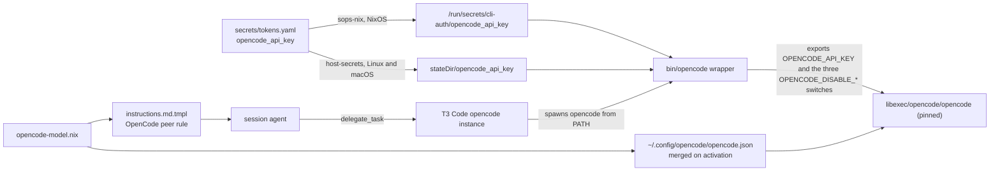

# OpenCode GLM Flash Cross-Reviewer - Plan

## Goal Capsule

- **Objective:** A skill's cross-model review pass run from T3 Code gets a third, independent reviewer from a different model family (GLM 5.3 Flash through OpenCode).
- **Means:** Install OpenCode from a repository pin on every host kind (KTD1), deliver its API key through the existing CLI-auth secret path into a run-time wrapper (KTD2), register an enabled `opencode` T3 Code instance (KTD5), and extend the shared Cross-model delegation instructions with an OpenCode peer that follows the Antigravity peer's rules (KTD6).
- **Authority:** GitHub issue #229 is the source of scope and acceptance criteria. The settled decisions below outrank research preferences; `AGENTS.md` outranks this plan on repository conventions.
- **Stop conditions:** Stop and report if the pinned OpenCode release cannot run on a supported system after the patching KTD1 allows, if the pinned T3 Code's OpenCode driver rejects the instance shape KTD5 declares, if `opencode/glm-5.3-flash-free` is not a model OpenCode lists, or if the built `opencode` does not take the `opencode` provider's credential from `OPENCODE_API_KEY`. Stop and report, never writing a placeholder into `secrets/tokens.yaml`, if the key file the caller supplied is missing or empty, or if `SOPS_AGE_KEY_CMD` cannot decrypt the bootstrap identities (card absent, PIN rejected, or prompt timed out).
- **Execution profile:** Nix packaging, Home Manager modules, SOPS secret, shell wrapper, Python release script, and Nix checks; mostly packaging, so build and check evidence is the primary proof.
- **Finish and ship:** `ce-work` implements and verifies locally; the caller (`lfg`) reviews, commits, and opens the PR.

---

## Product Contract

### Summary

Add OpenCode as a pinned agent CLI on NixOS, non-NixOS Linux, and macOS hosts, with `opencode/glm-5.3-flash-free` as its default model and self-update and sharing turned off. An `opencode` wrapper exports `OPENCODE_API_KEY` from the SOPS-delivered `opencode_api_key` file at run time. T3 Code gets an enabled `opencode` instance, and the shared agent instructions add an OpenCode peer to every cross-model pass that runs through T3 Code.

### Problem Frame

Cross-model review through T3 Code currently runs on Codex with an Antigravity (Argon) peer. Both peers come from large proprietary families, so a review gets at most two outside opinions. GLM 5.3 Flash is free through OpenCode Zen and comes from another family. The free tier is rate-limited without a key; a key raises the limits, but it must be stored the way the other CLI tokens are, not in T3 Code's plain-text settings or OpenCode's `auth.json`.

### Key Decisions

- **Install OpenCode from a repository pin, not nixpkgs.** Governs R1, R2. (session-settled: user-directed — chosen over nixpkgs' `opencode`: pins stay current and testable like the other agent CLIs)
- **Deliver the key as a SOPS file read by a wrapper at run time.** Governs R5, R6, R7. (session-settled: user-directed — chosen over the T3 Code instance `environment` list or `auth.json`: both keep the key in plain text outside SOPS)
- **The OpenCode peer follows the Antigravity peer's rules.** Governs R11. (session-settled: user-directed — chosen over a separately designed peer policy: one rule set for every extra peer)

### Requirements

**Package and pin**

- R1. `opencode` on `PATH` on every host kind is built from `packages/opencode-release.json`, for `x86_64-linux`, `aarch64-linux`, and `aarch64-darwin`, and evaluation fails for any other system.
- R2. `scripts/opencode-release` resolves the newest upstream release and writes the pin. It exits non-zero and leaves the pin unchanged on a prerelease or draft, or on a release missing any pinned asset or its digest. It exits zero without rewriting the pin when the resolved version is not strictly newer than the pin. `update-dependencies.yml` runs it and commits a change as `chore(packages): bump opencode to <version>`.
- R3. OpenCode never updates itself outside the store, under any config directory or inline config T3 Code supplies.

**Configuration**

- R4. `~/.config/opencode/opencode.json` carries `model = "opencode/glm-5.3-flash-free"`, `autoupdate = false`, and `share = "disabled"`, reasserted on activation while keys OpenCode or its CLI wrote stay as written. No project-level `opencode.json` or `.opencode/` directory in a checkout can override these keys, because the wrapper turns project config off (KTD9).

**API key**

- R5. `opencode_api_key` is in `secrets/tokens.yaml`, encrypted to every recipient of that file's rule. Production NixOS outputs decrypt it to `/run/secrets/cli-auth/opencode_api_key`, owner h82, mode 0400. Non-NixOS and macOS production applies publish it to `${config.my.secrets.stateDir}/opencode_api_key` at mode 0400 inside the mode 0700 state directory.
- R6. The `opencode` wrapper exports `OPENCODE_API_KEY` from that file on each run unless the caller already exported a non-empty value, and runs without it when the file is missing, unreadable, or malformed.
- R7. The key never appears in the Nix store, in `settings.json`, in `auth.json`, in any config file, or in a command argument; `publish-cli-auth` never reads it; and no checkout-supplied OpenCode config or plugin is loaded while it is in the environment.

**T3 Code and delegation**

- R8. T3 Code's `settings.json` declares an `opencode` instance with `driver = "opencode"` and `enabled = true`, with `serverUrl` left blank and no `binaryPath`.
- R9. Bootstrap outputs decrypt no OpenCode secret.
- R10. A check fails when any of these breaks:
  - the installed `opencode` version differs from the pin;
  - the wrapper loses the self-update, project-config, or Claude Code switch;
  - the wrapper's key file path differs from its host kind's path in R5, on NixOS, non-NixOS Linux, and macOS outputs;
  - the sops manifest drops the key or changes its owner or mode;
  - `host-secrets` stops publishing the key at mode 0400;
  - T3 Code's declared settings lose the enabled `opencode` instance.
- R11. Every rendered instruction set tells the agent to add an OpenCode peer on `opencode/glm-5.3-flash-free` (provider instance `opencode`) to a skill's cross-model pass run through T3 Code, under the same conditions as the Antigravity peer:
  - it runs only when the skill's own peer runs;
  - it mirrors that peer's brief, scope, and output shape;
  - its findings fold in under provider name `opencode`;
  - it obeys recipient restrictions;
  - it is announced before dispatch as a further recipient, saying it is a free-tier model whose provider may keep or use the reviewed content;
  - it is skipped with a one-line reason when excluded or not runnable;
  - a failed OpenCode peer is never retried on another provider, and a failed skill peer is never retried on `opencode` while an OpenCode peer of the same pass runs.

**Documentation**

- R12. `docs/provisioning.md` and `secrets/README.md` describe the new token, its delivery, and rotation; `docs/verification.md` describes the new checks and the post-apply OpenCode checks; `AGENTS.md`'s project-structure summary names OpenCode among the agent CLIs.

### Scope Boundaries

- Not built: adding `opencode` to `home/h82/agents/agent-plugins.nix`. `scripts/agent-plugin-sync` drives each agent's own marketplace CLI, and OpenCode has no Claude-style marketplace; Compound Engineering reaches OpenCode only through a separate converter. A reviewer peer receives a self-contained brief and needs no CE skills. This changes if CE ships a plugin install path that OpenCode's own CLI can drive.
- Not built: a separate memory or telemetry switch. OpenCode documents no implicit-memory feature and no telemetry key; `share = "disabled"` is the only data-leaving switch in its config schema. This changes if a pinned release adds such a key.
- Not built: OpenCode instruction files rendered from `instructions.md.tmpl`. The peer runs on a self-contained brief, and KTD9 stops OpenCode from loading Claude Code's instruction and skill files.
- Not built: a usage-limit display in T3 Code with the key. T3 Code reads `OPENCODE_API_KEY` from its own environment for that display, and putting the key there would break R7.
- Not built: `OPENCODE_DISABLE_LSP_DOWNLOAD` or the other `OPENCODE_DISABLE_*` switches beyond the three in KTD3 and KTD9. None of them guards the key or the reviewed content.

### Success Criteria

- After a rebuild and a T3 Code restart, `orchestrator_capabilities` lists the `opencode` instance with `opencode/glm-5.3-flash-free`, and a `ce-code-review` run with its cross-model pass dispatches an OpenCode peer whose findings fold in under provider `opencode`. Hardware verification is reported separately from build evidence, per `docs/verification.md`, because `nr switch` is not run as validation.

### Sources

- GitHub issue #229.
- OpenCode config docs (`https://opencode.ai/docs/config/`): global config `~/.config/opencode/opencode.json`; project `opencode.json` and `.opencode` directories outrank it; inline `OPENCODE_CONFIG_CONTENT` overrides both; `opencode plugin -g` and `opencode mcp add` write config.
- OpenCode config schema (`https://opencode.ai/config.json`): `share` accepts `manual`, `auto`, or `disabled`; `autoupdate` accepts `false` and is marked deprecated.
- OpenCode CLI docs (`https://opencode.ai/docs/cli/`): `OPENCODE_DISABLE_AUTOUPDATE`, `OPENCODE_DISABLE_CLAUDE_CODE`; `auth login` writes `~/.local/share/opencode/auth.json`.
- `anomalyco/opencode` at `v1.19.3`: `packages/core/src/flag/flag.ts` reads `OPENCODE_DISABLE_AUTOUPDATE` and `OPENCODE_DISABLE_PROJECT_CONFIG`; `packages/opencode/src/effect/runtime-flags.ts` reads `OPENCODE_DISABLE_CLAUDE_CODE` for both the Claude Code prompt and skills.
- `anomalyco/opencode` release `v1.19.3` assets: `opencode-linux-x64.tar.gz`, `opencode-linux-arm64.tar.gz`, their `-musl` variants, and `opencode-darwin-arm64.zip`, each with a GitHub `sha256:` digest.

---

## Planning Contract

### Key Technical Decisions

- KTD1. Package the glibc Linux builds with `autoPatchelfHook`, `stdenv.cc.cc.lib` in `buildInputs`, and `dontStrip = true`; unpack the macOS zip with `unzip` and install it as-is. OpenCode ships a Bun-compiled single executable whose JS payload sits at the end of the file; nixpkgs' `claude-code` packages the same kind of binary this way, and stripping makes it run the bare Bun runtime. The `-musl` builds link the musl loader dynamically rather than statically, so they do not run unpatched on NixOS the way Codex's static musl builds do. If execution finds a musl build that is static, prefer it and drop the patching (session-settled: user-directed — chosen over nixpkgs' `opencode`: pins stay current and testable like the other agent CLIs; governs R1).
- KTD2. One derivation, `packages/opencode.nix`, takes a `tokenFile` argument defaulting to `/run/secrets/cli-auth/opencode_api_key`, installs the binary under `libexec/opencode/`, and installs `scripts/opencode` as `bin/opencode` with `@TOKEN_FILE@` and `@OPENCODE@` substituted, as `packages/tokscale.nix` does. A path guard rejects a token path that could break out of the script's single quotes. The home module passes `${config.my.secrets.stateDir}/opencode_api_key` on non-NixOS and macOS hosts. (session-settled: user-directed — chosen over the T3 Code instance `environment` list or `auth.json`: both keep the key in plain text outside SOPS; governs R5, R6, R7).
- KTD3. The wrapper exports `OPENCODE_DISABLE_AUTOUPDATE=true` unconditionally and prepends ripgrep to `PATH`. The variable holds under T3 Code's inline config and any `OPENCODE_CONFIG_DIR`, which never see the declared `autoupdate = false`; this mirrors the Codex wrapper flags. Governs R3.
- KTD4. Manage `~/.config/opencode/opencode.json` through the shared `agent-settings` merger from `home.activation`, not a store symlink, because `opencode mcp add` and `opencode plugin -g` rewrite it. Declared keys: `$schema` (`https://opencode.ai/config.json`), `model`, `autoupdate`, `share`. The published schema accepts `share = "disabled"` and still accepts `autoupdate = false` though it marks the key deprecated, which is why KTD3's variable carries the self-update guarantee. The activation is unguarded and ordered after `installPackages`, as `home/h82/agents/gemini.nix` does. Governs R4.
- KTD5. Add the `opencode` instance to `settings.providerInstances` in `home/h82/t3code.nix` with only `driver` and `enabled`. `instanceMigration.kinds` derives from `providerInstances`, so it picks the kind up. T3 Code already finds `codex` and `claude` on `PATH` without `binaryPath`, so `opencode` needs none. Governs R8.
- KTD6. Add the OpenCode peer as its own ungated bullet in the Cross-model delegation section of `home/h82/agents/instructions/instructions.md.tmpl`, beside the Antigravity bullet, and rewrite the retry bullet so both extra peers are never retried elsewhere and a retried skill peer never lands beside either. No harness is OpenCode, so the bullet needs no harness gate. (session-settled: user-directed — chosen over a separately designed peer policy: one rule set for every extra peer; governs R11).
- KTD7. Mirror the Tokscale token gate on NixOS: a `my.cliAuth.enableOpencodeApiKey` option, default `false`, set to `true` with `lib.mkDefault` in `modules/nixos/profile.nix`, adding `opencode_api_key` to the `cli-auth/` secrets list. On non-NixOS and macOS hosts, `scripts/host-secrets` adds it to its always-decrypted token list, which already publishes each token at 0400 in a 0700 directory. Governs R5, R9.
- KTD8. Write the real key into `secrets/tokens.yaml` with `sops set --value-stdin`, piping the JSON-encoded contents of the key file the caller supplied through a `SOPS_AGE_KEY_CMD` that decrypts the bootstrap identities, per `AGENTS.md`. Never print it, read it with file tools, or pass it as an argument. Governs R5, R7.
- KTD9. The wrapper also exports `OPENCODE_DISABLE_PROJECT_CONFIG=true` and `OPENCODE_DISABLE_CLAUDE_CODE=true`. The first keeps a reviewed checkout's `opencode.json`, `.opencode/` plugins, and provider overrides out of a process that holds the key and must keep `share = "disabled"`. The second keeps Claude Code's `~/.claude/CLAUDE.md` standing orders and skills out of a review peer that should run on its brief alone. Interactive OpenCode loses per-repository config and Claude Code skills as a result; this run chose that over leaving the key and the review content exposed to checkout code. Governs R4, R7.
- KTD10. Define the peer model id `opencode/glm-5.3-flash-free` once, in `home/h82/agents/opencode-model.nix`. `home/h82/agents/opencode.nix` reads it for the declared `model`, and `home/h82/agents/instructions/render.nix` passes it to the template as a gomplate context value, beside the existing `harness` context. When OpenCode Zen withdraws the free model, a replacement is a one-line change. Governs R4, R11.

### High-Level Technical Design

### Assumptions

- `opencode/glm-5.3-flash-free` is the model id OpenCode Zen exposes for GLM 5.3 Flash, as the issue states; U1 confirms it with the built binary's model listing.
- OpenCode's `opencode` provider reads `OPENCODE_API_KEY` from the environment; U1 confirms it, and the Goal Capsule stops the run if it does not.
- The pinned T3 Code's OpenCode driver accepts `driver = "opencode"` and `enabled = true` as the whole instance declaration, as the issue's research of `packages/provider-opencode/src/settings.ts` reports.

### Deferred Implementation Notes

- Whether the `-musl` assets are static (KTD1) is checked on the downloaded files; the pin script's asset list follows the outcome.
- The exact sentences added to `instructions.md.tmpl` are written at execution and pinned verbatim in `tests/agent-instructions.nix`.
- Where OpenCode Zen's free-model data terms are published is looked up at execution and cited in `docs/provisioning.md`.

---

## Implementation Units

### U1. Pinned OpenCode package, release script, and wrapper

**Goal:** Build `opencode` from a repository pin with a wrapper that reads the API key and sets the self-update, project-config, and Claude Code switches.

**Requirements:** R1, R2, R3, R6, R7; KTD1, KTD2, KTD3, KTD9.

**Dependencies:** none.

**Files:**

- `packages/opencode-release.json` (new)
- `packages/opencode.nix` (new)
- `scripts/opencode` (new)
- `scripts/opencode-release` (new)
- `packages/agent-tools.nix`
- `flake.nix` (`opencode` and `opencode-release` under `packages.${system}`; `opencode-release` and `opencode-wrapper` checks)
- `.github/workflows/update-dependencies.yml`
- `tests/test_opencode_release.py` (new)
- `tests/opencode.sh` (new)

**Approach:**

1. Write `scripts/opencode-release` from `scripts/codex-release`: source `https://api.github.com/repos/anomalyco/opencode/releases/latest`, tag prefix `v`, one asset per system (KTD1), fetch command overridable through `OPENCODE_RELEASE_FETCH`, exit behaviour per R2.
2. Generate `packages/opencode-release.json` by running the script against the live API, which pins `v1.19.3` or newer.
3. Write `packages/opencode.nix` per KTD1: `fetchurl` per system with a `throw` for an unpinned system, binary under `libexec/opencode/`, substituted wrapper as `bin/opencode`, and `versionCheckHook` with a writable home.
4. Write `scripts/opencode` from `scripts/tokscale`'s token-reading block: caller value wins, else read the file with the same size and character checks. Then export the switches from KTD3 and KTD9, prepend ripgrep, and `exec` the pinned binary with `"$@"`.
5. Register `opencodeRelease` in `packages/agent-tools.nix`, `opencode-release` and `opencode` under `packages.${system}` in `flake.nix` (an x86_64-linux output, as `codex` is), and an update step plus commit block in `update-dependencies.yml` beside Codex's.

**Patterns to follow:** `packages/codex.nix`, `scripts/codex-release`, `tests/test_codex_release.py`, `packages/tokscale.nix`, `scripts/tokscale`, `tests/tokscale.sh`, and the `codex-release` and `tokscale-wrapper` checks in `flake.nix`.

**Test scenarios:**

- Release script: a complete stable release writes a pin with `version`, and per system the asset name, lowercase `sha256`, and SRI `hash`.
- Release script: a prerelease, a draft, a missing asset, a duplicated asset, a malformed digest, and a tag without the `v` prefix each exit non-zero and leave the pin unchanged.
- Release script: a resolved version equal to or older than the pin exits zero and leaves the file unchanged; a newer one rewrites it.
- Wrapper: with the token file holding a fake key, the stub `opencode` sees `OPENCODE_API_KEY` equal to it, and `OPENCODE_DISABLE_AUTOUPDATE`, `OPENCODE_DISABLE_PROJECT_CONFIG`, and `OPENCODE_DISABLE_CLAUDE_CODE` set to `true`.
- Wrapper: a caller-exported non-empty `OPENCODE_API_KEY` wins over the file.
- Wrapper: a missing file, an unreadable file, an empty file, and a file with embedded whitespace each leave `OPENCODE_API_KEY` unset and the stub still runs with the original arguments.
- Wrapper: the key never appears in the stub's recorded argv.
- Wrapper: the exit status of the stub passes through.
- Package: a token path with a quote or a relative path fails evaluation; a plain absolute path builds.

**Verification:**

- The `opencode-release` and `opencode-wrapper` checks build.
- On the Mac, the `opencode` that h82's Home Manager profile carries in each built `darwinConfigurations.<host>.system` prints the pinned version for `--version` and lists `opencode/glm-5.3-flash-free` among its models.
- With a fake `OPENCODE_API_KEY` exported and no `auth.json`, the built binary reports the `opencode` provider's credential as coming from the environment, with the value never printed.

### U2. API key secret and its delivery

**Goal:** Store `opencode_api_key` in SOPS and decrypt it to the CLI-auth file on every production host kind.

**Requirements:** R5, R7, R9, R10; KTD7, KTD8.

**Dependencies:** none.

**Files:**

- `secrets/tokens.yaml`
- `modules/nixos/system/secrets.nix`
- `modules/nixos/profile.nix`
- `scripts/host-secrets`
- `tests/lib/fake-secrets.nix`
- `tests/host-secrets.nix`
- `tests/auth-provisioning.nix`

**Approach:**

1. Pipe the JSON-encoded contents of the key file the caller supplied into `sops set --value-stdin secrets/tokens.yaml '["opencode_api_key"]'` under the `SOPS_AGE_KEY_CMD` from `AGENTS.md` (KTD8), then confirm the key exists by listing key names only.
2. Add `enableOpencodeApiKey` beside `enableTokscaleToken` and the `lib.mkDefault true` line in the profile (KTD7).
3. Add `opencode_api_key` to `tokens=(...)` in `scripts/host-secrets`, and to the fake token documents and the per-token mode loop in the tests.

**Patterns to follow:** `enableTokscaleToken` in `modules/nixos/system/secrets.nix` and `modules/nixos/profile.nix`; the `tokscale_token` lines in the test fixtures.

**Test scenarios:**

- `host-secrets` stage then publish installs `opencode_api_key` at mode 0400 in the 0700 state directory, twice in a row.
- A failure after the first decrypt leaves no plaintext and prints no fake OpenCode key.
- `auth-provisioning` publishes gh and glab while `/run/secrets/cli-auth/opencode_api_key` exists, and `publish-cli-auth` does not read it.
- Mutation: dropping `opencode_api_key` from the `host-secrets` token list turns the `host-secrets` check red.

**Verification:** `host-secrets` and `auth-provisioning` checks build; `sops` lists `opencode_api_key` among the key names of `secrets/tokens.yaml` without printing values.

### U3. Home Manager module and its checks

**Goal:** Put the wrapper on `PATH` on every host kind and keep the declared OpenCode config merged.

**Requirements:** R1, R4, R5, R9, R10; KTD2, KTD4, KTD10.

**Dependencies:** U1, U2.

**Files:**

- `home/h82/agents/opencode-model.nix` (new)
- `home/h82/agents/opencode.nix` (new)
- `home/h82/agents/default.nix`
- `tests/opencode.nix` (new)
- `tests/non-nixos-outputs.nix`
- `tests/darwin-outputs.nix`
- `flake.nix` (`opencode` package-and-pin check beside `codex`; `opencode-settings` check from `tests/opencode.nix`, left out of `hostClosureChecks`)

**Approach:**

1. Write `home/h82/agents/opencode-model.nix` holding the model id (KTD10).
2. Write `home/h82/agents/opencode.nix` from `home/h82/agents/tokscale.nix`: import `packages/opencode.nix` with `tokenFile` from `config.my.secrets.stateDir` when `config.my.kind != "nixos"`, add it to `home.packages`, and add `home.activation.opencodeSettings` running the merger on `~/.config/opencode/opencode.json` (KTD4).
3. Write `tests/opencode.nix` from `tests/tokscale.nix` over `tests/lib/configurations.nix`, whose entries are the NixOS configurations, and register it as `opencode-settings`, as `codex-settings` is. Its `.drv` closure carries `home-manager-path` but no NixOS `system-path` or Home Manager generation, the criterion `flake.nix` states for `hostClosureChecks`, so it stays in a light shard, as `codex-settings` and `tokscale` do.
4. Add the non-NixOS Linux token-path assertion beside `tokscale` in `tests/non-nixos-outputs.nix`, and the macOS one in `tests/darwin-outputs.nix`, which CI's `build-darwin` job builds.
5. Add an `opencode` flake check beside `codex` that compares `userPackageOf "opencode"` with the pin and greps the installed `bin/opencode` for the three switch exports.

**Patterns to follow:** `home/h82/agents/tokscale.nix`, `tests/tokscale.nix`, the `tokscale` assertions in `tests/non-nixos-outputs.nix`, the `codex` and `antigravity-cli` checks in `flake.nix`; the mutation-testing learnings in `.compound-engineering/artifacts/solutions/best-practices/`.

**Test scenarios:**

- Every NixOS configuration's `home-path/bin/opencode` resolves to the packaged wrapper with `TOKEN_FILE='/run/secrets/cli-auth/opencode_api_key'`.
- Each non-NixOS Linux fixture's and the macOS fixture's wrapper carries `TOKEN_FILE=` set to its state-directory path.
- `home.activation.opencodeSettings` runs after `installPackages`, invokes the packaged merger without swallowing its status, targets `~/.config/opencode/opencode.json`, and passes a declared document equal to literals stated in the test.
- Running that merger on a seeded divergent `opencode.json` restores `model`, `autoupdate`, and `share` and keeps an `mcp` entry and other keys the seed carries.
- No Home Manager file targets `.config/opencode/opencode.json`.
- A production NixOS configuration's sops manifest carries `cli-auth/opencode_api_key` with key `opencode_api_key`, owner h82, and mode 0400; a bootstrap configuration carries no OpenCode secret.
- The installed `opencode` package version equals the pin, and `bin/opencode` contains the three switch exports.
- Mutation pass: deleting any switch export, changing a token path on any host kind, dropping a declared key, changing the secret mode, and removing the secret each turn the matching check red.

**Verification:** the checks build, or for `darwin-outputs` evaluate on the Mac and build in CI; each listed mutation, applied in a scratch copy per `copied-git-worktree-writes-the-real-index.md`, fails its check.

### U4. T3 Code `opencode` instance

**Goal:** Declare an enabled OpenCode instance in T3 Code's settings.

**Requirements:** R8, R10; KTD5.

**Dependencies:** U3.

**Files:**

- `home/h82/t3code.nix`
- `tests/t3code-traits.nix`

**Approach:** Add `opencode = { driver = "opencode"; enabled = true; };` to `settings.providerInstances` and extend the literal expectations in `tests/t3code-traits.nix`: the declared `setPaths` and the `migrateInstances.kinds` list. Before writing, confirm the field names against `packages/provider-opencode/src/settings.ts` at the pinned T3 Code tag.

**Patterns to follow:** the `antigravity` instance in `home/h82/t3code.nix` and its expectations in `tests/t3code-traits.nix`.

**Test scenarios:**

- The declared settings document carries `providerInstances.opencode.driver = "opencode"` and `providerInstances.opencode.enabled = true`.
- The declared document sets no `binaryPath`, `serverUrl`, `serverPassword`, or `environment` under `providerInstances.opencode`.
- `migrateInstances.kinds` includes `opencode`.
- Mutation: removing `enabled` or changing the driver turns the check red.

**Verification:** the `t3code-traits` check builds.

### U5. OpenCode peer in the shared agent instructions

**Goal:** Make every cross-model pass run through T3 Code add the OpenCode peer under the Antigravity peer's rules.

**Requirements:** R11; KTD6, KTD10.

**Dependencies:** U3, U4.

**Files:**

- `home/h82/agents/instructions/instructions.md.tmpl`
- `home/h82/agents/instructions/render.nix`
- `tests/agent-instructions.nix`

**Approach:**

1. Pass the model id from `home/h82/agents/opencode-model.nix` to the template as a gomplate context value in `render.nix` (KTD10).
2. Add a bullet after the Antigravity peer bullet that states every R11 condition for the OpenCode peer, with the model id taken from that context value.
3. Rewrite the retry bullet per KTD6.
4. Pin the new and changed sentences in `tests/agent-instructions.nix`. Update its Antigravity sentence list for the changed retry sentence, and extend its Antigravity-or-Argon sentence filter to OpenCode so the new sentences are pinned rather than rejected.

**Patterns to follow:** the Antigravity bullet and its pinned sentences; `substring-sentence-check-passes-a-negated-instruction.md`.

**Test scenarios:**

- The rendered Claude Code, Codex, and Antigravity instruction sets each contain the OpenCode peer sentences verbatim, including the provider fold-in name and the free-tier disclosure.
- The rendered retry sentence names both extra peers as never retried elsewhere and never landed beside.
- The rendered model id equals the value in `home/h82/agents/opencode-model.nix`.
- Mutation: negating the peer sentence, dropping the model id, or dropping the fold-in name turns the check red.

**Verification:** the `agent-instructions` check builds.

### U6. Documentation

**Goal:** Document the package, the token, its rotation, and the new checks.

**Requirements:** R12.

**Dependencies:** U1 through U5.

**Files:**

- `docs/provisioning.md`
- `secrets/README.md`
- `docs/verification.md`
- `docs/adding-a-host.md` (only where it lists the decrypted tokens)
- `AGENTS.md`

**Approach:**

1. Add an OpenCode subsection beside Tokscale in `docs/provisioning.md`. It covers what the wrapper exports and why it turns off project config and Claude Code files, the token path per host kind, the `sops set --value-stdin` rotation command, the behaviour without the file, the declared config keys, the free-tier data terms, and how to replace the model id in `home/h82/agents/opencode-model.nix`.
2. Add `opencode_api_key` to the token schema and the non-NixOS always-decrypted list in `secrets/README.md`.
3. Describe the `opencode`, `opencode-settings`, `opencode-wrapper`, and `opencode-release` checks under `docs/verification.md`'s repository checks, and add post-apply hardware checks: `opencode` runs, `orchestrator_capabilities` lists the instance, and a cross-model pass dispatches the peer.
4. Name OpenCode in the `home/h82/` agents line of `AGENTS.md`.

**Test expectation:** none -- documentation; markdownlint through the pre-commit hook.

**Verification:** every file that lists `tokscale_token` among decrypted tokens also lists `opencode_api_key`, and every new check name appears in `docs/verification.md`.

---

## Verification Contract

- `nix fmt -- --ci`.
- `nix flake check` on the Mac evaluates every check; build the new and changed Linux-only checks from the Mac only where a builder allows, and otherwise verify their inputs per `verify-linux-only-nix-check-inputs-on-macos-through-derivation-show.md` and leave the build to CI.
- `nix build .#darwinConfigurations.<host>.system` for each macOS host, production and bootstrap, then the U1 Mac verification on the built profile's `opencode`. `.#opencode` is an x86_64-linux package output that CI builds.
- `python3 tests/test_opencode_release.py` and `bash tests/opencode.sh scripts/opencode`.
- Every NixOS, Home Manager, system-manager, and darwin output listed in `AGENTS.md`'s shipping loop builds; outputs this Mac cannot build are left to CI and reported as such.
- Mutation evidence for the checks added in U2, U3, U4, and U5.

## Definition of Done

- Every requirement R1 through R12 is met and traced to a unit.
- `secrets/tokens.yaml` holds `opencode_api_key`, and no plaintext key exists in the repository, the store, logs, or command history.
- All checks listed above pass or are explicitly left to CI with the reason.
- Abandoned attempts, scratch copies, and debug output are removed from the diff.
- The live T3 Code verification in Success Criteria is listed for the user as a post-merge step.
