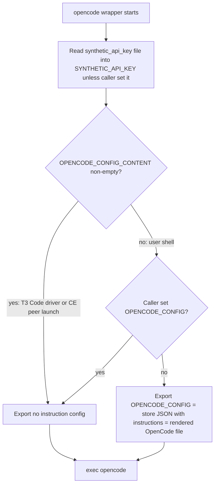
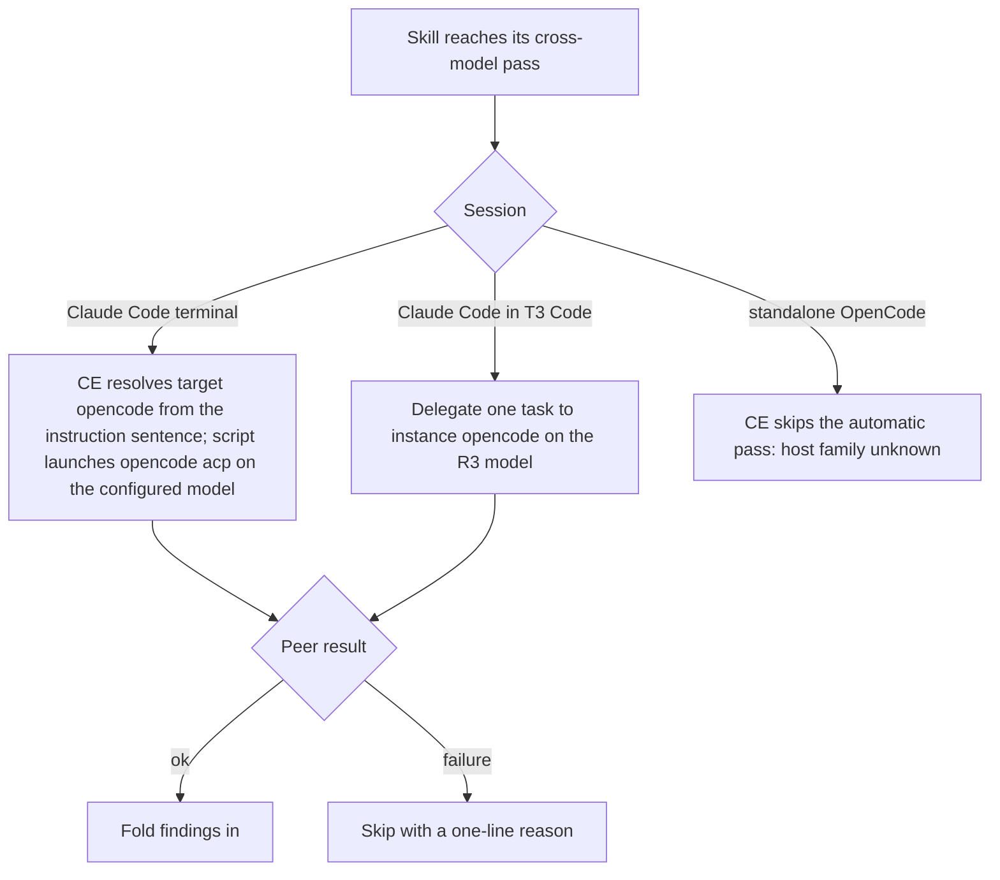

# Synthetic Cross-Reviewer and Instruction Diet - Plan

## Goal Capsule

- **Objective:** Cross-model review in Compound Engineering (CE) runs on one reviewer, a Synthetic model served through OpenCode, by CE's stock rules in both terminal sessions and T3 Code; the agent instructions carry no reviewer overrides and read lean.
- **Means:** Point OpenCode's declared model at Synthetic's `syn:large:text` alias with a SOPS-delivered key (KTD1, KTD2), name `opencode` as the peer in the instructions (KTD3), remove Codex and every Antigravity mention (KTD5–KTD7), and rewrite the template (KTD8).
- **Product authority:** The Product Contract's Key Decisions were made by the user in the brainstorm and outrank research preferences; `AGENTS.md` outranks this plan on repository conventions.
- **Stop conditions:** Stop and report if the live probe in U1 shows Synthetic rejects `syn:large:text` through OpenCode's `synthetic` provider, if the GPG card cannot decrypt the bootstrap identities for the SOPS write (PIN rejected, timeout, card missing), or if `~/Downloads/synthetic-key.txt` is missing or empty. Never write a placeholder into `secrets/tokens.yaml`.
- **Execution profile:** Nix modules, packaging, a shell wrapper, Python helpers, a Go template, Nix checks, and docs. This Mac builds the darwin outputs; the Linux checks and VM checks run in CI.
- **Finish and ship:** `ce-work` implements and verifies locally; the caller (`lfg`) simplifies, reviews, commits, and opens the PR.

---

## Product Contract

Product Contract preservation: unchanged in meaning; the Outstanding Questions it deferred to planning are answered by KTD1–KTD9 and removed in place.

### Summary

OpenCode becomes a Synthetic-only harness and the single CE cross-model peer, running the `syn:large:text` alias.
Codex is removed from the repository, Antigravity disappears from the agent instructions, the Model routing section and every extra-peer override go, and the instruction template is rewritten to say the same rules in fewer words.
OpenCode also gains its own instruction file so it can be used standalone.

### Problem Frame

Cross-model review today is spread across three providers: Codex as the CE default peer, OpenCode Zen's free GLM 5.3 Flash as an added peer, and Antigravity's Argon as another added peer.
The T3 Code part of the instructions holds long rules that bolt the added peers onto every pass, mirror the skill's brief to each, retry across providers, and disclose each recipient.
The user now pays for Synthetic's Standard plan and no longer wants the Codex subscription or the free-tier peers.
The instruction template has grown with each peer, and much of it now restates what CE already does.

### Key Decisions

- **OpenCode is the harness for Synthetic.** It is the only CE peer target that can serve a non-Claude model behind a Claude host; Claude Code pointed at Synthetic's endpoint would attest as the `claude` family and be excluded as same-family, and Crush or Octofriend are not CE targets. Governs R1. (session-settled: user-directed — chosen over replacing OpenCode with another harness: OpenCode already works under both CE and T3 Code)
- **One peer, stock CE behavior.** The review runs the skill's own single peer; no second Synthetic model, no added peers. Governs R2, R5. (session-settled: user-directed — chosen over two Synthetic peers per review: the user wants CE's stock principle with only the model chosen by alias)
- **The model is the `syn:large:text` alias.** Synthetic retargets aliases to its current recommendation, so the served model can change without a repository change. Governs R3. (session-settled: user-directed — chosen over pinning a model id such as GLM-5.3 or Kimi-K3)
- **T3 Code keeps delegating the pass.** Inside T3 Code the skill's peer runs as one delegated task on the `opencode` instance rather than through the skill's own launch route. Governs R6. (session-settled: user-directed — chosen over running CE's stock OpenCode route inside T3 Code: T3 Code's OpenCode driver is already proven, the stock route inside T3 Code's sandbox is not)
- **A failed peer is skipped, not replaced.** Governs R7. (session-settled: user-directed — chosen over one retry and over an Antigravity fallback)
- **Codex is removed entirely.** Governs R9. (session-settled: user-directed — chosen over removing only its reviewer role)
- **The Antigravity CLI stays; the instructions never mention it.** Governs R10. (session-settled: user-directed — chosen over removing the Antigravity CLI and over keeping its harness branch and routing column)
- **The Model routing section is removed.** The rows that would remain only restate CE's own tier mapping, and Synthetic alias rows would have no reader: the Synthetic models serve only the reviewer, whose model comes from OpenCode's configuration. Governs R11. (session-settled: user-approved — chosen over keeping the section with Claude and Synthetic alias rows, after a ce-pov judgment)
- **OpenCode Zen is dropped.** Governs R4. (session-settled: user-directed — chosen over keeping the Zen key for standalone use)
- **No outbound-content disclosure in the instructions.** The user finds it obvious and unnecessary. Governs R8. (session-settled: user-directed)
- **OpenCode receives instructions only in standalone sessions.** Governs R13, R14, R15. (session-settled: user-directed — chosen over loading them in reviewer runs too: a reviewer would otherwise inherit rules such as applying every finding, asking with the question tool, and delegating subagents)
- **The template diet keeps rule meaning.** Every surviving rule says the same thing in fewer words; only R5, R7, R8, and the removals in R9–R12 change behavior. Governs R16. (session-settled: user-directed — chosen over limiting cleanup to text the removals touch)

### Requirements

**Synthetic reviewer**

- R1. OpenCode runs Synthetic models through Synthetic's provider, with the Synthetic API key delivered as a SOPS secret that a wrapper reads at run time, the same way the current OpenCode key is delivered.
- R2. In every session that reads these instructions, CE's cross-model passes (`ce-code-review`, `ce-doc-review`, and any other skill that resolves a cross-model peer) resolve their peer to `opencode`, never to Codex or Antigravity, without per-repository CE config.
- R3. The OpenCode peer runs on `syn:large:text`, defined in one place that both OpenCode's configuration and anything else naming the reviewer model read.
- R4. The OpenCode Zen key and every reference to the Zen free tier, the `opencode/glm-5.3-flash-free` model, and Zen's data terms are removed.
- R5. A review runs exactly one cross-model peer, the one the skill resolves.
- R6. Inside T3 Code, the skill's peer runs as one delegated task on the `opencode` instance on the R3 model, and the skill's procedure continues with that result.
- R7. When the Synthetic peer fails (rate limit, exhausted credits, provider error, or OpenCode not runnable, as on a bootstrap generation without the key), the pass is skipped with a one-line reason; no retry on another provider and no fallback reviewer.
- R8. The instructions contain no sentence announcing or disclosing that reviewed content goes to an outside provider; CE's own announce line stays as the skill emits it.

**Removals**

- R9. Codex is removed from the repository: its package and release tooling, Home Manager module and settings merge, T3 Code launch argument (its provider instance is declared disabled, because T3 Code enables an unconfigured `codex` instance by default), instruction harness branch and delivery target, checks, tests, update workflow entries, and documentation.
- R10. The rendered instructions for every harness mention neither Antigravity nor Gemini models: no reviewer peer, no broad-scout rule, no retry target, no harness branch, no routing column, and no Gemini model names. The Antigravity CLI and T3 Code's `antigravity` instance stay installed and enabled.
- R11. The Model routing section is removed from the system part, and every sentence that cited it is reworded to follow the tier the invoked skill names.
- R12. In T3 Code, a delegated job that is not a cross-model pass and fails is retried on the native subagent tool with a one-line notice, since no second routing provider remains.

**OpenCode as a standalone harness**

- R13. OpenCode receives the system and user parts of the instructions in standalone sessions, with a tool table that names OpenCode's own tools.
- R14. When OpenCode runs as a reviewer peer, launched by a CE script or by T3 Code, it loads none of these instructions.
- R15. In a standalone OpenCode session, the R2 peer rule does not apply, so it never names the session's own harness as its peer.

**Template diet**

- R16. Every part of the instruction template (system, user, t3code) is rewritten without duplication or padded sentences, and each surviving rule keeps its meaning.
- R17. Repository checks that pin instruction text are updated to the new wording, the checks that guarded removed rules go with them, and checks still fail when a surviving rule is dropped or negated.

**Secret migration**

- R18. The Synthetic key is imported from the user-supplied plaintext file `~/Downloads/synthetic-key.txt` into SOPS without being printed, passed as a command argument, or read with file tools, and the plaintext file is deleted once the encrypted value is confirmed present.

### Acceptance Examples

- AE1. **Covers R2, R3, R5.** Given a Claude Code terminal session in any repository with no CE config, when `ce-code-review` runs its cross-model pass, it resolves the `opencode` target and runs one peer on `syn:large:text`.
- AE2. **Covers R6.** Given a Claude Code session inside T3 Code, when `ce-doc-review` runs its cross-model pass, exactly one task is delegated, to the `opencode` instance, and no Antigravity or second OpenCode task starts.
- AE3. **Covers R7.** Given the Synthetic key is absent or the weekly credits are exhausted, when a cross-model pass runs, it reports a one-line skip and the review finishes with its local reviewers only.
- AE4. **Covers R14.** Given a CE script launches OpenCode as the peer, the reviewer's context holds the skill's brief and none of the user's instruction text.
- AE5. **Covers R15.** Given a standalone OpenCode session runs `ce-code-review`, it does not try to use OpenCode as its own peer.

### Scope Boundaries

- Removing the Antigravity CLI, `gemini.nix`, or T3 Code's `antigravity` instance is out of scope (R10 keeps them).
- Guarding Synthetic's extra-usage billing after credits run out is out of scope by the user's choice.
- Running two Synthetic reviewers per review is out of scope (R5).
- Making CE's automatic cross-model pass run inside standalone OpenCode sessions is out of scope; CE treats an OpenCode host's family as `unknown` and skips the automatic pass.
- Delivering instructions to the Antigravity CLI is out of scope; with no Antigravity branch, its sessions receive no file from this repository.
- Delivering instructions to OpenCode threads opened in T3 Code is out of scope: T3 Code's driver always sets `OPENCODE_CONFIG_CONTENT`, and a delegated review and a user's own thread run on the same `opencode` instance, so the wrapper cannot tell them apart. T3 Code's OpenCode threads therefore run without these instructions; only OpenCode started outside T3 Code receives them (R13).
- Keeping per-repository OpenCode config in standalone sessions is out of scope: the wrapper's existing `OPENCODE_DISABLE_PROJECT_CONFIG` switches stay unconditional, as today.
- Rewording upstream template text in `.compound-engineering/config.example.yaml` that names Codex is out of scope; it documents CE itself.

### Dependencies / Assumptions

- Synthetic exposes an OpenAI-compatible endpoint at `https://api.synthetic.new/openai/v1`; OpenCode 2.0.32 ships a built-in `synthetic` provider keyed by `SYNTHETIC_API_KEY` whose catalog lists only `hf:` ids, so `syn:large:text` must be declared as a model (KTD1).
- CE's default peer order is `codex → claude → grok → antigravity` and excludes `opencode`; CE reads a peer preference from the user's conversation, `cross_model_peer` config, or instructions in context (KTD3).
- CE's OpenCode route requests model `auto`, so it runs OpenCode's configured default model; it takes no effort override and attests the peer family as `unknown`. The peer's artifact therefore records `independence_verified: false`: its findings fold in, but they never promote a finding's confidence or license CE's validator skip, which a Codex peer could.
- The review lens stays covered when the peer is skipped, because CE always runs its in-process `adversarial-reviewer`.
- The user disables or accepts Synthetic's extra usage in the account; nothing in the repository enforces it.
- Assumption (planning default, no user check during the autonomous run): the `agent-settings` TOML mode and its `tomlkit` dependency are deleted with Codex, since no other declaration uses them (KTD7).
- Assumption: removing Antigravity's instruction file also retires the `config/AGENTS.md` link that `scripts/t3code-antigravity-link` makes in each T3 Code Antigravity home (KTD6).

### Sources / Research

- `home/h82/agents/opencode-model.nix`, `home/h82/agents/opencode.nix`, `scripts/opencode`, `packages/opencode.nix`: current OpenCode model pin, config, and key wrapper.
- `home/h82/agents/instructions/instructions.md.tmpl`, `home/h82/agents/instructions/default.nix`, `home/h82/agents/instructions/render.nix`, `home/h82/agents/instructions/declare.py`: template parts, delivery targets, and the Codex launch encoding.
- `home/h82/t3code.nix`: T3 Code provider instances, `retiredKeys`, the instruction `leaves`, and instance migration.
- `tests/agent-instructions.nix`: pinned sentences, `peerPattern`, harness channel rules, and the Antigravity t3code absence checks.
- `secrets/README.md`, `modules/nixos/system/secrets.nix`, `scripts/host-secrets`, `docs/provisioning.md` (OpenCode section and its `sops set --value-stdin` recipe): `opencode_api_key` delivery on every host kind.
- `.compound-engineering/artifacts/plans/2026-10-17-0020-feat-opencode-cross-reviewer-plan.md`, `.compound-engineering/artifacts/plans/2026-10-14-0201-feat-gemini-argon-cross-model-review-plan.md`, `.compound-engineering/artifacts/plans/2026-10-17-1350-feat-delegate-via-t3-code-plan.md`: the plans that added the peers and T3 Code delegation this plan removes or narrows.
- Learnings: `.compound-engineering/artifacts/solutions/integration-issues/opencode-v2-shared-background-server-keeps-first-client-env.md`, `.compound-engineering/artifacts/solutions/integration-issues/t3code-settings-json-value-outranks-repository-t3-json.md`, `.compound-engineering/artifacts/solutions/best-practices/substring-sentence-check-passes-a-negated-instruction.md`, `.compound-engineering/artifacts/solutions/best-practices/mutation-testing-reveals-decorative-nix-check-assertions.md`, `.compound-engineering/artifacts/solutions/best-practices/unguarded-derivation-interpolation-defeats-nix-check-mutation-testing.md`, `.compound-engineering/artifacts/solutions/best-practices/copied-git-worktree-writes-the-real-index.md`, `.compound-engineering/artifacts/solutions/best-practices/verify-linux-only-nix-check-inputs-on-macos-through-derivation-show.md`.
- CE `ce-code-review/references/cross-model-review.md` and `scripts/cross-model-adversarial-review.sh`: peer resolution order and the OpenCode route (`auto` model, `opencode acp` launch, `OPENCODE_CONFIG_CONTENT` permission block).
- Pinned T3 Code bundle: `resolveOpenCodeConfigContent` always sets `OPENCODE_CONFIG_CONTENT` (default `"{}"`) for its OpenCode driver.
- OpenCode docs: <https://opencode.ai/v2/docs/instructions> (global `AGENTS.md` is always loaded; `instructions` array), <https://opencode.ai/docs/providers/> (custom models under `provider.<id>.models`), <https://opencode.ai/v2/docs/tools>; models.dev `providers/synthetic/provider.toml`.
- Synthetic docs: <https://dev.synthetic.new/>, <https://dev.synthetic.new/docs/api/models>, <https://dev.synthetic.new/docs/guides/opencode>.

---

## Planning Contract

### Key Technical Decisions

- KTD1. **Declare `syn:large:text` as a `synthetic` provider model and set `model = "synthetic/syn:large:text"`.** OpenCode's built-in `synthetic` catalog has no `syn:` ids, so `home/h82/agents/opencode.nix` adds a `setPaths` entry `{ path = [ "provider" "synthetic" "models" "syn:large:text" "name" ]; value = "syn:large:text"; }` (it uses only `set` today), so user-added providers survive. The leaf must be the scalar `name`: `agent-settings` rejects an object value in `setPaths`, and the `leaves` helper drops an empty attrset without error, which would leave OpenCode with no such model. OpenCode 2.0.32 loads the model from that `name` leaf (checked with `opencode debug config`). `home/h82/agents/opencode-model.nix` stays the single source of the model string for the OpenCode config, the instruction render context, and the tests. Instantiates R3.
- KTD2. **Rename the secret to `synthetic_api_key`, the option to `my.cliAuth.enableSyntheticApiKey`, and the wrapper's exported variable to `SYNTHETIC_API_KEY`.** The wrapper keeps its read-at-run-time shape, caller precedence, and validation. U1 adds `synthetic_api_key` beside the old key; `secrets/tokens.yaml` loses `opencode_api_key` in U2, in the same commit as the rename, because `scripts/host-secrets` and sops-nix fail on a missing key. `scripts/host-secrets publish` only moves the names in its token array, so it gains a retired-token list (`opencode_api_key`) whose files it deletes from the state directory; otherwise the decrypted Zen key stays on macOS and non-NixOS hosts. Instantiates R1, R4, R18.
- KTD3. **Name the peer with one system-part sentence: CE skills use `opencode` as the cross-model peer.** CE consumes a peer preference from instructions in context, so this reaches every repository without `cross_model_peer` config. The sentence renders for Claude Code only; the OpenCode branch omits it. Instantiates R2, R15.
- KTD4. **The wrapper tells a reviewer run from a standalone run by `OPENCODE_CONFIG_CONTENT`.** T3 Code's driver always sets it, and CE's peer launch sets it; a user's shell does not. When it is empty or unset, the wrapper exports `OPENCODE_CONFIG` pointing at a store JSON whose `instructions` names the rendered OpenCode file; otherwise it exports nothing extra. A caller-set `OPENCODE_CONFIG` is left alone. Nothing is written to `~/.config/opencode/AGENTS.md`, which OpenCode v2 always loads and cannot disable. The per-run branch holds because `service.json` `disabled: true` (kept in U2) gives every run its own server from its own environment, so a standalone run's `OPENCODE_CONFIG` never carries over into a later reviewer launch. Instantiates R13, R14.
- KTD5. **Disable T3 Code's `codex` provider instance rather than drop it.** An instance id with no `providerInstances` entry is not off in T3 Code: the pinned bundle enables `codex` and `claudeAgent` by default when unconfigured (`DEFAULT_ENABLED_DEFAULT_INSTANCES`), so removing the entry would leave an enabled Codex provider with no binary. `home/h82/t3code.nix` declares `codex = { driver = "codex"; enabled = false; };` and drops only its `config.launchArgs` leaf, the same `enabled` leaf that turns the built-in Antigravity and OpenCode instances on. `codex` stays in `instanceMigration.kinds`, so a legacy `providers.codex` block cannot recreate an enabled instance. `agent-settings remove` stays top-level only. Instantiates R9.
- KTD6. **Drop Antigravity's instruction delivery and the link to it.** The `antigravity` entry leaves `home/h82/agents/instructions/default.nix` and `render.nix`, and `scripts/t3code-antigravity-link` stops linking `config/AGENTS.md` and removes a link it made earlier that now points at the missing file. Instantiates R10.
- KTD7. **Delete Codex-only machinery rather than keep it generic.** This covers `agent-settings --format toml` and its `tomlkit` dependency, the `codex-launch` encoding in `declare.py`, and `tests/agent-instruction-channels.py`'s Codex modes. The Codex launch argument is the only instruction leaf in `home/h82/t3code.nix`, so U4 also deletes `instructions.declare` and `declare.py` and writes the T3 Code declaration with `pkgs.writeText`, as the client-settings merge already does. Instantiates R9.
- KTD8. **Keep the template's three-part shape and header contract.** System and user parts still never mention T3 Code; the t3code part keeps T3 Code delegation and PR watching. Harness branches remain for `claude-code` and a new `opencode`. Instantiates R13, R16.
- KTD9. **T3 Code delegation keeps one tier sentence in place of Model routing.** `delegate_task` needs a concrete model, so the t3code part states that a delegated job runs on the model its skill's tier names (cheapest capable: Haiku; mid-tier: Sonnet; no tier: the session model). A cross-model pass runs on `{{ .opencode.model }}` on instance `opencode`. A failed pass is skipped (R7); any other failed job falls back to the native subagent tool (R12). Instantiates R6, R7, R11, R12.

### High-Level Technical Design

How one OpenCode wrapper serves both roles (KTD4):

How a review resolves its peer after this change (KTD3, KTD9):

### Sequencing

U1 runs first because its live probe can stop the plan before anything is removed. U2 needs U1's secret. U3 depends on U2's wrapper. U4 can proceed after U2; U5 follows U3 and U4; U6 follows U3–U5 because it pins their final text. U7 runs last.

---

## Implementation Units

### U1. Probe Synthetic through OpenCode and import the key

**Goal:** Prove the alias works through OpenCode's `synthetic` provider, then move the key into SOPS and delete the plaintext file.

**Requirements:** R1, R3, R18; KTD1, KTD2.

**Dependencies:** None.

**Files:**

- `secrets/tokens.yaml` (add `synthetic_api_key`; `opencode_api_key` stays until U2)

**Approach:**

1. Run the installed `opencode` once with `SYNTHETIC_API_KEY` filled from the plaintext file by shell redirection (never printed or passed as an argument) and an `OPENCODE_CONFIG_CONTENT` that declares `provider.synthetic.models."syn:large:text".name`; confirm `opencode models` lists `synthetic/syn:large:text` and one short `opencode run` on it returns text. A rejection is a stop condition.
2. Set `SOPS_AGE_KEY_CMD` as `AGENTS.md` describes and pipe the JSON-encoded key into `sops set --value-stdin secrets/tokens.yaml '["synthetic_api_key"]'`.
3. Confirm the stored value before deleting anything: pipe `sops decrypt --extract '["synthetic_api_key"]' secrets/tokens.yaml` straight into a comparison with the plaintext file, ignoring trailing whitespace as the wrapper does, so the value is never printed or passed as an argument. A mismatch is a stop condition that keeps the plaintext file. On a match, delete `~/Downloads/synthetic-key.txt`.
4. Tell the user in the final report that the OpenCode Zen key U2 removes stays decryptable from git history by every host identity, so it must be revoked in the OpenCode Zen console.

**Patterns to follow:** `docs/provisioning.md` OpenCode section (`sops set --value-stdin` recipe); `AGENTS.md` "Security and lifecycle constraints".

**Test scenarios:** Test expectation: none -- operational step; its evidence is the probe result and the key list of `secrets/tokens.yaml`.

**Verification:** The probe returned model output; the decrypted `synthetic_api_key` matched the plaintext file; the plaintext file no longer exists.

### U2. Switch OpenCode to Synthetic

**Goal:** OpenCode reads `SYNTHETIC_API_KEY` from the renamed secret on every host kind and defaults to `synthetic/syn:large:text`.

**Requirements:** R1, R3, R4, R7; KTD1, KTD2.

**Dependencies:** U1.

**Files:**

- `home/h82/agents/opencode-model.nix`, `home/h82/agents/opencode.nix`
- `packages/opencode.nix`, `scripts/opencode`
- `modules/nixos/system/secrets.nix`, `modules/nixos/profile.nix`, `scripts/host-secrets`
- `tests/opencode.nix`, `tests/opencode.sh`, `tests/auth-provisioning.nix`, `tests/host-secrets.nix`, `tests/lib/fake-secrets.nix`, `tests/non-nixos-outputs.nix`, `tests/darwin-outputs.nix`, `flake.nix` (`opencode` and `opencode-wrapper` checks)
- `secrets/README.md`, `docs/provisioning.md`, `docs/verification.md`, `docs/adding-a-host.md`

**Approach:**

1. Replace the model string in `opencode-model.nix` and add the KTD1 `setPaths` leaf.
2. Rename the token file default, option, host-secrets array entry, and fake-secret fixtures per KTD2; the wrapper exports `SYNTHETIC_API_KEY` and no longer exports `OPENCODE_API_KEY`. In the same commit, remove `opencode_api_key` from `secrets/tokens.yaml` with `sops unset` and add the retired-token list to `scripts/host-secrets`.
3. Rewrite comments and docs that describe Zen's free tier or anonymous limits: with no key, Synthetic serves nothing, so the peer is skipped (R7).
4. Keep `service.json` `disabled: true` and `opencodeServiceStop` unchanged.

**Patterns to follow:** The existing `opencode_api_key` path end to end; `opencode-v2-shared-background-server-keeps-first-client-env.md` for why the key stays per run.

**Test scenarios:**

- The declared OpenCode settings set `model` to the literal from `opencode-model.nix`, the merged file holds `provider.synthetic.models."syn:large:text".name`, and a seeded user provider survives the merge.
- With the token file holding a fake key and no caller value, the wrapper exports that key as `SYNTHETIC_API_KEY`.
- A non-empty caller `SYNTHETIC_API_KEY` wins over the file; an empty caller value falls back to the file.
- A token file with whitespace inside, control characters, or over the size limit is rejected as today.
- The wrapper exports no `OPENCODE_API_KEY` in any case.
- The NixOS VM fixture decrypts `synthetic_api_key` to `/run/secrets/cli-auth/synthetic_api_key` owned by `h82` with mode `0400`; a host with `my.cliAuth.enableSyntheticApiKey = false` gets no such file.
- `scripts/host-secrets` stops when `synthetic_api_key` is missing from a fake `tokens.yaml`.
- `scripts/host-secrets publish`, run on a state directory seeded with `opencode_api_key`, deletes that file and publishes `synthetic_api_key`.
- No rendered output, test, or doc contains `opencode_api_key`, `glm-5.3-flash-free`, or `opencode.ai/docs/zen`, except the retired-token list in `scripts/host-secrets` and the test that seeds it.

**Verification:** The OpenCode, wrapper, host-secrets, and darwin output checks pass; the VM check `auth-provisioning` passes in CI.

### U3. Give OpenCode standalone instructions

**Goal:** A standalone OpenCode session loads the system and user parts; a reviewer run loads none.

**Requirements:** R13, R14, R15; KTD3, KTD4, KTD8.

**Dependencies:** U2.

**Files:**

- `home/h82/agents/instructions/render.nix`, `home/h82/agents/instructions/instructions.md.tmpl` (OpenCode tool branch only; the diet is U5)
- `home/h82/agents/opencode.nix`, `packages/opencode.nix`, `scripts/opencode`
- `tests/opencode.sh`, `tests/agent-instructions.nix`, `flake.nix` (`opencode-wrapper` check)

**Approach:**

1. Add `opencode = "OpenCode"` to the render harnesses and an `opencode` tool-table branch naming the tool ids the installed binary reports (confirm `edit` and `question` against a session or `opencode debug`, since the binary's strings and the v2 docs disagree).
2. Render `opencode` with parts `[system user]` into a store file, wrap it in a store JSON carrying `instructions`, and pass its path to the wrapper as a new substituted constant, validated like `tokenFile`.
3. Implement the KTD4 branch in `scripts/opencode`.
4. Expose a stable handle to the rendered file (for example a passthru attribute on the wrapper package) so `tests/agent-instructions.nix` can read it.

**Patterns to follow:** `@TOKEN_FILE@` substitution and its plain-path assertion in `packages/opencode.nix`; the `claude-code` channel in `tests/agent-instructions.nix`.

**Test scenarios:**

- Covers AE4. With `OPENCODE_CONFIG_CONTENT='{}'`, the wrapper exports no `OPENCODE_CONFIG`.
- With `OPENCODE_CONFIG_CONTENT` unset or empty and no caller `OPENCODE_CONFIG`, the wrapper exports `OPENCODE_CONFIG` equal to the packaged instructions config path.
- A caller-set `OPENCODE_CONFIG` is passed through unchanged in both modes.
- The packaged instructions config names exactly one file, and that file is the rendered OpenCode instructions.
- `opencode debug config` run through the packaged wrapper in standalone mode lists the instructions file, and in driver mode does not.
- Covers AE5. The rendered OpenCode file contains the system and user rules once each, its tool table names only OpenCode tools, and it contains no peer sentence, no T3 Code text, and no `{{` or `<no value>`.
- Nothing is installed at `~/.config/opencode/AGENTS.md`.

**Verification:** The wrapper and agent-instructions checks pass, including the mutation rounds in U6.

### U4. Remove Codex

**Goal:** No Codex package, setting, enabled instance, channel, check, workflow step, or doc remains.

**Requirements:** R9; KTD5, KTD7.

**Dependencies:** U2.

**Files:**

- Delete: `packages/codex.nix`, `packages/codex-release.json`, `scripts/codex-release`, `home/h82/agents/codex.nix`, `tests/codex.nix`, `tests/test_codex_release.py`, `tests/t3code-codex-launch.py`
- Edit: `flake.nix` (packages `codex`, `codex-release`; checks `codex-settings`, `codex`, `codex-release`; the packaged TOML merge block; the Codex fragments in `t3code-instruction-channels`), `packages/agent-tools.nix`, `packages/t3code.nix` (description), `home/h82/default.nix`, `home/h82/agents/default.nix`, `home/h82/agents/agent-plugins.nix`, `scripts/agent-plugin-sync`, `scripts/agent-settings`, `home/h82/t3code.nix`, `home/h82/agents/instructions/default.nix`, `home/h82/agents/instructions/render.nix`, `home/h82/agents/instructions/declare.py`
- Tests: `tests/test_agent_plugin_sync.py`, `tests/agent-plugins.nix`, `tests/test_agent_settings.py`, `tests/agent-instruction-channels.py`, `tests/t3code-traits.nix`, `tests/darwin-config.nix`, `tests/tokscale.nix`
- CI and docs: `.github/workflows/update-dependencies.yml`, `README.md`, `AGENTS.md`, `docs/macos.md`, `docs/provisioning.md`, `docs/verification.md`

**Approach:**

1. Delete the files above and every import, package export, and check registration that names them.
2. Declare `providerInstances.codex` with `enabled = false` and drop its launch-argument leaf in `home/h82/t3code.nix` per KTD5.
3. Remove the TOML mode, `codex-launch` encoding, and `declare` machinery per KTD7, keeping the shared helpers T3 Code and Claude still use.
4. Remove the Codex step and its commit block from the dependency-update workflow.
5. Update the docs and `AGENTS.md` agent list to Claude Code, OpenCode, and the Antigravity CLI.

**Patterns to follow:** `.compound-engineering/artifacts/plans/2026-09-21-1748-chore-remove-codex-plan.md` (an earlier Codex removal); `t3code-settings-json-value-outranks-repository-t3-json.md` for retiring declared keys.

**Test scenarios:**

- The agent-plugin sync lists only the remaining harnesses, and a run with a stale Codex membership row neither fails nor recreates it.
- T3 Code's merged settings, seeded with an enabled `providerInstances.codex` entry carrying a `config.launchArgs` value, come out with `enabled: false`, while `antigravity`, `claudeAgent`, and `opencode` keep their declared state; instance migration kinds still include `codex`.
- No `darwinConfigurations` or `homeConfigurations` output installs a `codex` binary or writes `~/.codex/`.
- `agent-settings` rejects `--format toml` as an unknown format.
- `rg -i codex` over the repository finds only historical plans, learnings, upstream CE template text, and the disabled `codex` instance in `home/h82/t3code.nix` with its test.

**Verification:** `nix flake check --no-build` evaluates with no missing-attribute errors; every remaining check is in a shard; the darwin outputs build.

### U5. Rewrite the instruction template

**Goal:** The template drops Antigravity, Model routing, and the extra-peer rules, names `opencode` as the peer, and says each surviving rule once.

**Requirements:** R2, R5, R6, R7, R8, R10, R11, R12, R16; KTD3, KTD6, KTD8, KTD9.

**Dependencies:** U3, U4.

**Files:**

- `home/h82/agents/instructions/instructions.md.tmpl`, `home/h82/agents/instructions/default.nix`, `home/h82/agents/instructions/render.nix`
- `scripts/t3code-antigravity-link`, `tests/test_t3code_antigravity_link.py`, `scripts/antigravity-acp-probe` (comment)

**Approach:**

1. System part: Tool use (Claude Code and OpenCode tables), GPG and encryption, and the KTD3 peer sentence, conditional on `ne .harness.id "opencode"`. Delete Model routing and the Gemini, Codex Terra, and Fable model guard.
2. User part: keep each section's rules, cut repetition and padded clauses, keep every command, field name, and threshold verbatim.
3. T3 Code part: delegation rules with the KTD9 tier sentence, the cross-model pass delegated once to `opencode`, skip-on-failure, native fallback for other jobs; delete the Antigravity and OpenCode extra-peer bullets, the broad-scout rule, the class lists, the disclosure, and cross-provider retries. Keep the PR-watching section's rules.
4. Remove the `antigravity` delivery and harness name, and the GEMINI.md comment; apply KTD6 to the link script.

**Patterns to follow:** The template's header contract and `fail` branches; `substring-sentence-check-passes-a-negated-instruction.md` for wording that checks can anchor.

**Test scenarios:**

- Covers AE1. The rendered Claude Code file contains the peer sentence once, in the system part.
- Covers AE2. The rendered T3 Code part names `opencode` as the only cross-model delegation target and contains no retry onto another provider for a cross-model pass.
- Covers AE2's model clause (R6). The T3 Code part's cross-model delegation names the model string from `opencode-model.nix`, rendered from `{{ .opencode.model }}`, and no other model for that pass.
- Covers AE3. The T3 Code part states that a failed cross-model pass is skipped with a one-line reason.
- No rendered channel contains `Antigravity`, `Gemini`, `gemini-`, `Argon`, `Codex`, `Zen`, `Model routing`, or a disclosure that content leaves the machine.
- The link script, run on a home holding a `config/AGENTS.md` link it made, removes that link and still links every plugin skill; a real file at that path is left and reported.

**Verification:** Rendering every harness and part succeeds with no `fail`; the link-script tests pass.

### U6. Rewrite the instruction checks

**Goal:** `tests/agent-instructions.nix` pins the new text and still catches dropped, negated, reversed, moved, and duplicated rules.

**Requirements:** R17; KTD8.

**Dependencies:** U3, U5.

**Files:**

- `tests/agent-instructions.nix`, `tests/agent-instruction-channels.py`, `flake.nix` (`t3code-instruction-channels`)

**Approach:**

1. Replace the required-sentence lists with the new wording; delete `routingSentences`, `supersededDirectives`, the Antigravity and Codex harness rows, and the `antigravityT3` checks.
2. Narrow `peerPattern` to the OpenCode peer and pin its sentences so `onlyPinnedSentences` still allowlists the delegation section.
3. Add the `opencode` harness row reading U3's handle, with its parts and channel rules.
4. Add the R10 absence assertions over every rendered channel.

**Execution note:** Mutation-test every new or changed pin in a scratch copy built without the `.git` link, and confirm each failure happens inside the builder, not at evaluation.

**Patterns to follow:** The existing helpers (`requireSentences`, `onlyPinnedSentences`, `sentencesInOrder`); `mutation-testing-reveals-decorative-nix-check-assertions.md`; `unguarded-derivation-interpolation-defeats-nix-check-mutation-testing.md`; `copied-git-worktree-writes-the-real-index.md`.

**Test scenarios:**

- Deleting any pinned sentence from the template turns the check red.
- Prefixing a pinned sentence with "Do not" turns it red.
- Adding a bullet that names a second cross-model peer to the T3 Code part turns it red.
- Reintroducing the word `Antigravity` or `Gemini` in any part turns it red.
- Rendering the peer sentence into the OpenCode channel turns it red.
- Duplicating a pinned sentence or moving it to another part turns it red.

**Verification:** The check passes on the new template and fails on every mutation above, each inside the builder.

### U7. Refresh documentation and learnings references

**Goal:** Docs, `AGENTS.md`, and learnings describe the new setup, and every learning that cites a removed identifier is refreshed.

**Requirements:** R4, R9, R10, R17.

**Dependencies:** U1–U6.

**Files:**

- `AGENTS.md`, `docs/provisioning.md`, `docs/verification.md`, `README.md`
- Learnings refreshed through `ce-compound-refresh` at push time: `t3code-settings-json-value-outranks-repository-t3-json.md`, `substring-sentence-check-passes-a-negated-instruction.md`, `verify-linux-only-nix-check-inputs-on-macos-through-derivation-show.md`, `opencode-v2-shared-background-server-keeps-first-client-env.md`

**Approach:**

1. `AGENTS.md`: the `home/h82/` agents list, the instruction delivery paths, and any check or path this change removed.
2. `docs/provisioning.md`: the delivery table and the OpenCode section for the Synthetic key, standalone instructions, and reviewer mode.
3. The learning refresh runs per the user's Learning refresh rule before the push, as its own commit.

**Test scenarios:** Test expectation: none -- documentation; `markdownlint-cli2` through the pre-commit hook is the gate.

**Verification:** `rg` for `codex`, `opencode_api_key`, `glm-5.3-flash-free`, `Argon`, and `Model routing` finds no live doc reference outside historical plans, refreshed or stale-marked learnings, and the exceptions U2 and U4 name (upstream CE text in `.compound-engineering/config.example.yaml`, the disabled `codex` instance, the host-secrets retired-token list).

---

## Verification Contract

| Gate | Command or evidence | Where |
| --- | --- | --- |
| Formatting | `nix fmt -- --ci` | this Mac |
| Flake evaluation | `nix flake check --no-build` | this Mac |
| Darwin outputs | `nix build --no-link .#darwinConfigurations.<host>.system` for every host and bootstrap twin, and `nix build --no-link .#checks.aarch64-darwin.darwin-outputs` | this Mac |
| Python helpers | `python3 tests/test_agent_settings.py`, `python3 tests/test_agent_plugin_sync.py`, `python3 tests/test_t3code_antigravity_link.py` | this Mac |
| Wrapper | `bash tests/opencode.sh scripts/opencode` | this Mac |
| Linux checks | `nix build --no-link .#checkShards.<name>` for each shard; inputs inspected with `nix derivation show -r` on this Mac | CI `check-shards` |
| NixOS and Linux outputs | every `nixosConfigurations`, `homeConfigurations`, and `systemConfigs` output, production and bootstrap | CI |
| VM checks | `nix build --no-link .#vmChecks.all` (includes `auth-provisioning`) | CI `vm-checks` |
| Live reviewer | U1's probe, plus one `opencode run` on `synthetic/syn:large:text` through the built wrapper, with `SYNTHETIC_API_KEY` set from a piped `sops decrypt --extract` (the decrypted token file appears only after an apply, which is not validation here) | this Mac |
| Peer resolution | Not checkable before the generation is applied: after the user applies it, the first cross-model pass in a Claude Code session resolves target `opencode` (reported to the user as a post-apply check) | user, post-apply |

## Definition of Done

- Every requirement R1–R18 holds and each U-ID's Verification is met.
- `secrets/tokens.yaml` holds `synthetic_api_key` and no `opencode_api_key`; `~/Downloads/synthetic-key.txt` is deleted; the final report tells the user to revoke the Zen key.
- No live code, check, workflow, or doc references Codex, OpenCode Zen, Antigravity in the instructions, or Model routing, except the exceptions U2, U4, and U7 name.
- The instruction checks fail on each mutation listed in U6.
- Abandoned-attempt code and scratch copies from mutation testing are removed; the diff holds only the planned change.
