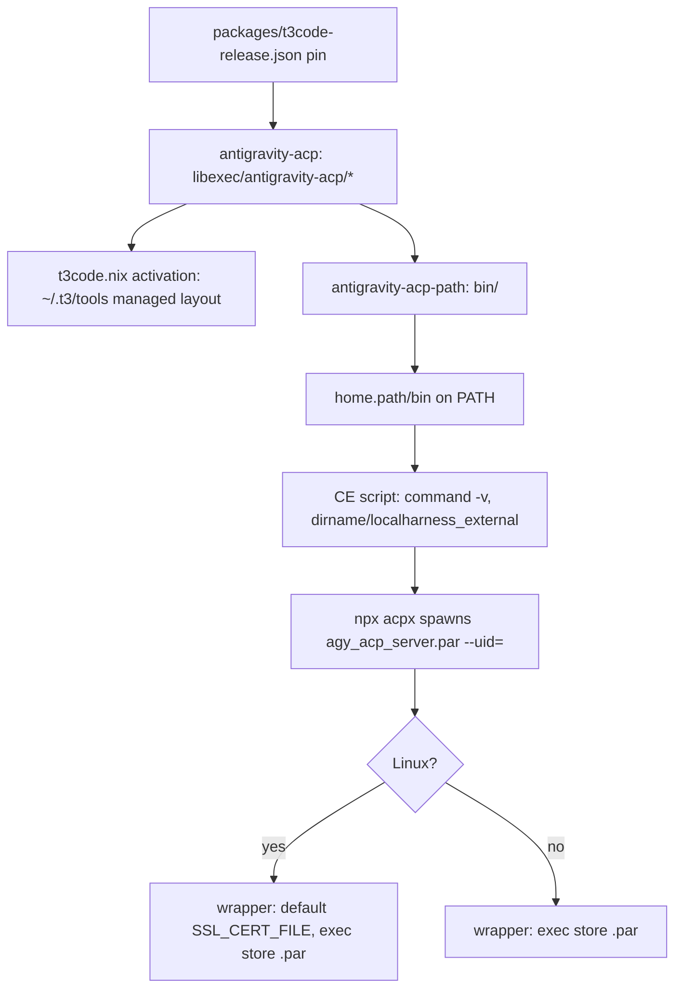

# Antigravity ACP Runtime on PATH - Plan

## Goal Capsule

- **Objective:** On every host, Compound Engineering's Antigravity route for cross-model review and `ce-work` delegation finds the Antigravity ACP runtime and its helper, and on Linux the runtime's model requests verify TLS instead of hanging, with no change to what T3 Code runs or reports.
- **Means:** A small package that exposes the pinned runtime's two binaries in its own `bin/`, through an exec wrapper for the `.par` that also supplies a CA bundle on Linux, installed beside the Antigravity CLI (KTD1, KTD2, KTD3).
- **Product authority:** GitHub issue #251. Planning resolves HOW only.
- **Stop conditions:** Stop if the `.par` refuses to run through the wrapper (argv[0] or appended-archive failure) and no wrapper shape fixes it, if `t3code-antigravity-pin` or any host output fails to build, or if the PATH package would need a second runtime pin.
- **Execution profile:** Nix packaging, Nix checks, Markdown. No `nr switch`. The probe in U6 and the live CE runs in U5 put a scratch or built `bin/` first on `PATH` for one command each. Their results are reported apart from check evidence.
- **Open blockers:** None. The Linux sign-in question (OQ1) is answered by U6 and decides what the PR reports to the user, not the scope of the change.

---

## Product Contract

### Summary

A new package puts `agy_acp_server.par` and `localharness_external` together in one `bin/` directory on the user's PATH on every host kind, built from the runtime `packages/t3code-release.json` already pins. The `.par` entry is a wrapper that starts the real runtime, and on Linux it also supplies `SSL_CERT_FILE` when the caller has none. T3 Code's managed layout stays as it is.

### Problem Frame

Compound Engineering 3.31.0 enables its Antigravity route only when `command -v agy_acp_server.par` succeeds, and it takes `localharness_external` from the same directory. The flake installs both binaries only under `$out/libexec/antigravity-acp/` of `packages/antigravity-acp.nix`, and only T3 Code's activation links them, into `~/.t3/tools/antigravity-acp/`. Neither directory is on PATH, so the route is unavailable on every host, and the hosts without a T3 Code trait do not even carry the runtime.

The Linux `.par` embeds an OpenSSL whose compiled-in CA path does not exist on NixOS, and a session without `SSL_CERT_FILE` hangs after `session/prompt` with no error. Only T3 Code's AppImage sandbox sets the variable today, so a CE run from a terminal Claude Code session would hang even once the binary is found.

### Requirements

**Exposure**

- R1. `agy_acp_server.par` and `localharness_external` resolve on the user's PATH from the same profile directory on every host kind (NixOS, non-NixOS Linux, macOS), production and bootstrap outputs alike.
- R2. Both entries lead to the runtime package `packages/antigravity-acp.nix` builds from the pin in `packages/t3code-release.json`, the same store path `home/h82/t3code.nix` links into T3 Code's managed layout.
- R3. The runtime binaries are not copied, stripped, or patched; `antigravity-acp` keeps `dontFixup` and its `libexec/antigravity-acp/` layout.

**Runtime environment**

- R4. On Linux, the runtime started through PATH gets `SSL_CERT_FILE` pointing at an existing CA bundle when the caller left it unset or empty, and keeps the caller's value otherwise.
- R5. Starting the runtime through PATH passes arguments, stdin, stdout, and the process itself through unchanged: the real `.par` runs as the same process with its own store path as argv[0].

**Compatibility**

- R6. T3 Code's managed layout, its activation installer, and the `t3code-antigravity-pin` check stay as they are, and keep passing.

**Documentation**

- R7. `docs/provisioning.md` describes the PATH package, the CE route's requirements (Node and `npx`, the first-run download of `acpx@0.19.5`, a Google sign-in), and what is verified by checks versus by hand; `docs/verification.md` lists the live CE run as a hardware check.

### Scope Boundaries

- Pinning `acpx` in the flake instead of `npx acpx@0.19.5` is out of scope; the docs note it (issue #251, Open questions).
- Copying or linking any sign-in token into CE's private `GEMINI_HOME` is not built: it would move a credential into a scratch directory CE deletes and defeats CE's isolation. OQ1 records the consequence.
- No CA default on macOS: the macOS `.par` carries `/etc/ssl/cert.pem`, which exists there, and nothing shows it hangs. Evidence of a macOS hang would change this.
- The wrapper does not default `ANTIGRAVITY_HARNESS_PATH`: CE always sets it, and the sibling link covers CE's `dirname` lookup.
- No guard against another `agy_acp_server.par` earlier on PATH, such as a manual download in `~/.local/bin`; the docs name the shadowing case.

### Dependencies / Assumptions

- Node 22.13 or newer and `npx` are on PATH: `nodejs` from nixpkgs is in `home/h82/default.nix`, and mise may shadow it with its own Node.
- Every host and output, bootstrap included, carries the runtime, about 330 MB to download and about 1 GB unpacked on Linux. Hosts with a T3 Code trait already carry it; the x86_64 non-NixOS fixture is the one output that gains it.

### Outstanding Questions

- OQ1 (deferred, answered by U6). Off macOS the runtime's file backend keeps the sign-in token as `$GEMINI_HOME/antigravity-acp/acp_token.json`, and CE creates a fresh, empty `GEMINI_HOME` per run. CE's own comments say the runtime copies a sign-in token into that home and tell the user to "sign in once with the agy CLI or the Antigravity app". The evidence therefore points both ways. U6's probe settles it. If a Linux run cannot get past sign-in, the issue's live acceptance is not met on Linux. The PR and the final report then state that as an unmet check for the user to decide on, with two costs named. Every cross-model review on a Claude host with no Codex or Grok CLI picks Antigravity first and stalls up to 60 s before falling back. The fix would belong upstream in Compound Engineering. The plan does not redefine the acceptance itself.
- OQ2 (deferred). On macOS the token may live in the login keychain shared across homes; whether a CE run there reuses an existing sign-in is a hardware check on the macOS host, outside this session.

### Sources / Research

- `packages/antigravity-acp.nix`, `home/h82/t3code.nix:40-41,225-230`, `home/h82/default.nix:64-66`.
- Compound Engineering 3.31.0: `skills/ce-code-review/scripts/cross-model-adversarial-review.sh:173,201-215`, `skills/ce-work/scripts/cross-model-work.sh:90,118-131,209`.
- acpx 0.19.x `dist/agent-registry-*.js`: the Antigravity agent is argv `["agy_acp_server.par", "--uid="]` on Linux, spawned by bare name on PATH with the caller's environment.
- `.compound-engineering/artifacts/solutions/integration-issues/t3code-antigravity-runtime-preinstall-managed-layout.md`
- `.compound-engineering/artifacts/solutions/integration-issues/t3code-antigravity-acp-openssl-missing-ca-bundle-hangs-sessions.md`
- `.compound-engineering/artifacts/solutions/integration-issues/agy-cli-ignores-gemini-home-cannot-verify-t3-instance-homes.md`
- Check-design learnings under `.compound-engineering/artifacts/solutions/best-practices/` and `logic-errors/` that AGENTS.md lists, especially materialized output, guarded interpolation, partitioned checks, constant-folding assertions, nullglob, and pipefail.

---

## Planning Contract

### Key Technical Decisions

- KTD1. **A separate PATH package over the existing runtime derivation.** `packages/antigravity-acp-path.nix` takes the runtime (defaulting to `import ./antigravity-acp.nix { inherit pkgs; }`) and builds only `bin/` entries that point into `${runtime}/libexec/antigravity-acp/`. Adding `bin/` to `antigravity-acp` itself would rebuild a 1 GB unpack and touch the output T3 Code's installer and the pin check read. Taking the runtime as an argument lets the check build the same package against a stub runtime.
- KTD2. **The `.par` entry is a hand-written exec wrapper on every platform; `localharness_external` is a symlink.** The wrapper runs `exec <store .par> "$@"` without `-a`, so the runtime always gets its absolute store path as argv[0]. Through a plain symlink, acpx's spawn by bare name would hand it `agy_acp_server.par`, and the `.par` loads its embedded archive through argv[0]. `wrapProgram` and `--inherit-argv0` would hand it the wrapper's path instead. On Linux only, the wrapper first sets `SSL_CERT_FILE` when it is unset or empty. It picks the first existing of `/etc/ssl/certs/ca-certificates.crt`, `/etc/pki/tls/certs/ca-bundle.crt`, `/etc/ssl/cert.pem`, and `/etc/ssl/ca-bundle.pem`, then falls back to the nixpkgs `cacert` bundle. A set but nonexistent value stays as the caller set it. A system bundle comes first so that local CAs a host adds still apply. The store bundle makes the wrapper work on any distribution. `makeWrapper --set-default` cannot express a fallback chain.
- KTD3. **Installed unconditionally beside `antigravity-cli` in `home/h82/default.nix`.** The issue names `home/h82/agents/gemini.nix`, but the Antigravity CLI is installed in `home/h82/default.nix`. Placing the package there gives it exactly the CLI's host set, including bootstrap outputs, with no new trait.
- KTD4. **Two check layers.** A stub-runtime check runs the Linux wrapper's behavior. A profile check reads the built `home.path` of every Home Manager user. Behavior cannot be proven from the profile without running the real 1 GB runtime with network and sign-in. Presence cannot be proven from the package alone, which is the option-value proxy the learnings warn about. The profile check reads host generations, so it joins `hostClosureChecks`.
- KTD5. **One pin by construction.** The PATH package and `home/h82/t3code.nix` import the same `packages/antigravity-acp.nix` with the host's `pkgs`, so both reference one derivation. The profile check compares against that same expression, and `tests/t3code-traits.nix` already compares T3 Code's installer argument against it.

### High-Level Technical Design

### Assumptions

- The `.par` accepts its absolute store path as argv[0] when started from a wrapper by plain `exec`. T3 Code's precedent is weaker: it passes the absolute path of a symlink inside `versions/<sha256>/`, not the store path. U6's probe confirms the assumption on Linux before U1 builds on it. The macOS `.par` gets the same wrapper shape, and the macOS hardware run (OQ2) confirms it there.
- Bootstrap outputs should carry the runtime like the `agy` CLI they sit beside (KTD3); the extra CI download is acceptable because the `hosts` shard already fetches it for the T3 hosts.

### Sequencing

U6 runs first and probes the two unknowns the rest depends on. U1 builds the package, U2 installs it, U3 and U4 prove it, and U5 documents the work and runs the live checks against the built package. U3 can land with U1; U4 needs U2.

---

## Implementation Units

### U6. Probe the wrapper shape and the Linux sign-in

- **Goal:** Before building anything, learn whether the `.par` runs through a plain exec wrapper and whether a Linux CE run gets past sign-in.
- **Requirements:** R5; OQ1; KTD2.
- **Dependencies:** None.
- **Files:** none in the repository; a scratch directory outside the checkout.
- **Approach:**
  1. Build the existing `antigravity-acp` package.
  2. In a scratch directory, write a hand wrapper of the KTD2 shape and a `localharness_external` symlink, both pointing at the built runtime.
  3. Put that directory first on `PATH`, unset `SSL_CERT_FILE`, and run one CE cross-model review.
  4. Record whether the runtime starts, whether it reaches `session/new` and `session/prompt`, and where it stops.
  5. If the wrapper shape fails, apply the stop condition. Otherwise word OQ1 from the result and continue to U1.
- **Test scenarios:** Test expectation: none -- a manual probe whose result shapes OQ1 and the stop conditions.
- **Verification:** The probe's outcome, including any sign-in stop, is written down with the runtime version before U1 starts.

### U1. Package the runtime's binaries for PATH

- **Goal:** A package whose `bin/` holds `agy_acp_server.par` and `localharness_external` from the pinned runtime, with the Linux CA wrapper.
- **Requirements:** R1, R2, R3, R4, R5; KTD1, KTD2.
- **Dependencies:** None.
- **Files:** `packages/antigravity-acp-path.nix` (new), `flake.nix` (expose it under `packages` beside `antigravity-acp`).
- **Approach:**
  1. Take `pkgs` and an optional `runtime`; read the two binary names from `runtime.passthru.pin` rather than hardcoding them, so a pin that renames them still lines up.
  2. Build with a builder that runs no fixup over the outputs; the entries only point into the runtime.
  3. Write the wrapper per KTD2 with absolute store paths only, printing nothing, with the CA default on Linux only, and link `localharness_external`.
  4. Carry `meta.platforms` from the runtime and a header comment that says why the package exists and why argv[0] must stay the store path.
- **Patterns to follow:** `packages/antigravity-acp.nix` (header comment, pin lookup), `packages/antigravity-cli.nix` (`bin/` wrapper over `libexec`).
- **Test scenarios:** covered by U3.
- **Verification:** `nix build .#antigravity-acp-path` on x86_64-linux yields a `bin/` with both entries, and `bin/localharness_external` resolves into the runtime's `libexec/antigravity-acp/`.

### U2. Install it on every host

- **Goal:** Every Home Manager user gets the package on PATH.
- **Requirements:** R1, R2; KTD3, KTD5.
- **Dependencies:** U1.
- **Files:** `home/h82/default.nix`.
- **Approach:** Add the package to the unconditional agent-tools list next to `antigravity-cli`, with a one-line comment naming CE's route as the consumer. Leave `home/h82/t3code.nix` unchanged.
- **Test scenarios:** covered by U4.
- **Verification:** Every `nixosConfigurations`, `homeConfigurations`, and `darwinConfigurations` output still builds; `t3code-antigravity-pin` and `t3code-traits` pass unchanged.

### U3. Check the wrapper's behavior against a stub runtime

- **Goal:** Prove R4 and R5 by running the Linux wrapper, not by reading its text.
- **Requirements:** R4, R5.
- **Dependencies:** U1.
- **Files:** `tests/antigravity-acp-path.nix` (new), `flake.nix` (register under `checks`).
- **Approach:** Build `packages/antigravity-acp-path.nix` with a stub runtime whose `.par` is a script that prints its argv[0], arguments, `SSL_CERT_FILE`, and stdin, and whose `passthru.pin` names the same files. Run the wrapper under `env -i` with a minimal `PATH`. Collect failures and report them all. The check is Linux-only: register it only where the wrapper exists.
- **Execution note:** Mutation-test each assertion class in a scratch copy made with the rsync and `git init` recipe from the copied-worktree learning. The classes are: delete the default, overwrite a preset value, add `-a "$0"`, drop `"$@"`, drop `exec`, and point `exec` at another path. Confirm that each red comes from the builder's own message.
- **Test scenarios:**
  - `SSL_CERT_FILE` unset: the stub sees a path that exists as a regular file.
  - `SSL_CERT_FILE` set to empty: treated like unset.
  - `SSL_CERT_FILE` preset to a fixture file: the stub sees exactly that path.
  - Arguments `--uid=` and one containing a space arrive verbatim and in order.
  - A line written to stdin comes back unchanged on stdout, and the wrapper adds no other output.
  - The stub's argv[0] equals the stub runtime's store path, not the wrapper's.
  - The stub's PID equals the wrapper's PID: the wrapper `exec`s.
  - `bin/localharness_external` resolves to the stub runtime's helper.
- **Verification:** The check passes, and every mutation above turns it red with its own message.

### U4. Check the materialized profiles

- **Goal:** Prove R1, R2, and the Linux/macOS split on what each user profile actually holds.
- **Requirements:** R1, R2, R6; KTD4, KTD5.
- **Dependencies:** U2.
- **Files:** `tests/antigravity-acp-path-profiles.nix` (new), `tests/darwin-outputs.nix`, `flake.nix` (register the new check and add it to `hostClosureChecks`).
- **Approach:**
  1. Iterate `configurations.userEntries` with `configurations.userGuard`, reading `user.home.path or null`.
  2. Use the guarded absent/present `optionalString` split so that removing the package fails inside the builder.
  3. Compare against `import packages/antigravity-acp.nix { inherit pkgs; }` for the entry's architecture. Fixtures of another architecture are already filtered out.
  4. Add the macOS assertions to `tests/darwin-outputs.nix` beside its `home-path/bin` assertions.
  5. Select nothing by host name.
- **Test scenarios:**
  - Each Linux user, production and bootstrap, has both entries in `home-path/bin`.
  - Each Linux user's `localharness_external` resolves to `<runtime>/libexec/antigravity-acp/localharness_external`.
  - Each Linux user's `agy_acp_server.par` resolves to a wrapper whose exec line names `<runtime>/libexec/antigravity-acp/agy_acp_server.par`.
  - Each macOS user, in `darwin-outputs`, has both entries. `localharness_external` resolves into the runtime. `agy_acp_server.par` is a wrapper whose exec line names the runtime's `.par` and that does not set `SSL_CERT_FILE`.
  - The check fails when `userEntries` lacks a NixOS, a non-NixOS, or a bootstrap entry.
- **Execution note:** Mutation rounds: remove the package from `home/h82/default.nix`, gate it on `!config.my.bootstrap`, drop the `localharness_external` entry, and point the wrapper at another path. Each must fail in the builder, not in evaluation.
- **Verification:** The check passes locally for the x86_64 entries. The `hosts` shard covers it in CI. `darwin-outputs` runs on CI's `build-darwin` job, and the report says so.

### U5. Document the PATH runtime and run the live check

- **Goal:** Readers know what the PATH package does, what CE's route still needs, and what was verified by hand.
- **Requirements:** R4, R5, R7; OQ1.
- **Dependencies:** U1, U2, U6.
- **Files:** `docs/provisioning.md`, `docs/verification.md`, `.compound-engineering/artifacts/solutions/integration-issues/t3code-antigravity-acp-openssl-missing-ca-bundle-hangs-sessions.md`.
- **Approach:**
  1. In `docs/provisioning.md`, add a paragraph to the Antigravity section. It names the package, the Linux wrapper and its CA order, and the one pin shared with T3 Code. It says that T3 Code reads `active.json` before PATH, so the PATH copy changes nothing T3 Code shows.
  2. In the same paragraph, cover CE's route. It needs Node 22.13 or newer and `npx`, which downloads `acpx@0.19.5` on first use, and it needs a Google sign-in in a private `GEMINI_HOME`. A missing `acp_token.json` and a missing CA bundle hang the same way. A runtime earlier on PATH shadows this one.
  3. In `docs/verification.md`, add the live CE run as a hardware check.
  4. In the CA-bundle learning, replace "only the T3 Code wrapper sets it" with the two places that now set it.
  5. Run the live checks from this host with the built package's `bin/` first on `PATH` and `SSL_CERT_FILE` unset, so the wrapper picks the bundle. This session inherits `SSL_CERT_FILE` from T3 Code's sandbox. Run one CE cross-model review, then one `ce-work` unit delegated to the Antigravity route. For each, record whether the route binds and returns findings or completes, or where it stops. Word OQ1's outcome for both runs into the docs and the PR.
- **Test scenarios:** Test expectation: none -- documentation and a manual hardware run.
- **Verification:** Markdown lint passes, and the live run's outcome is recorded with its date and runtime version, separately from check evidence.

---

## Verification Contract

| Gate | Command or evidence | Proves |
| --- | --- | --- |
| Format | `nix fmt -- --ci` | Layout |
| Flake checks | `nix flake check` | U3, U4 (x86_64), pin and T3 checks unchanged |
| Hosts shard | `nix build --no-link .#checkShards.hosts` | U4 over every local Home Manager user |
| VM tests | `nix build --no-link .#vmChecks.all` | No regression |
| Outputs | The AGENTS.md loops over `nixosConfigurations`, `homeConfigurations`, `systemConfigs` (x86_64 here; aarch64 and Darwin in CI) | U2 builds everywhere |
| Mutations | Scratch-copy rounds listed in U3 and U4 | Each assertion can fail |
| Probe | U6, before U1, reported as hardware evidence | The wrapper shape and OQ1 |
| Live runs | U5 step 5: a cross-model review and a delegated `ce-work` unit, with `SSL_CERT_FILE` unset, reported as hardware evidence | OQ1, R4, and R5 against the real runtime |

## Definition of Done

- Every requirement R1-R7 holds and each unit's verification passed or is reported with its failure.
- Mutation rounds for U3 and U4 each turned the check red with its own message, and the evidence is in the PR body.
- The outcomes of the probe and both live runs are stated in the PR body and the docs, apart from check results. A Linux sign-in stop (OQ1) is reported as an unmet acceptance check for the user.
- No abandoned wrapper variants, stub files, or scratch copies remain in the diff.
