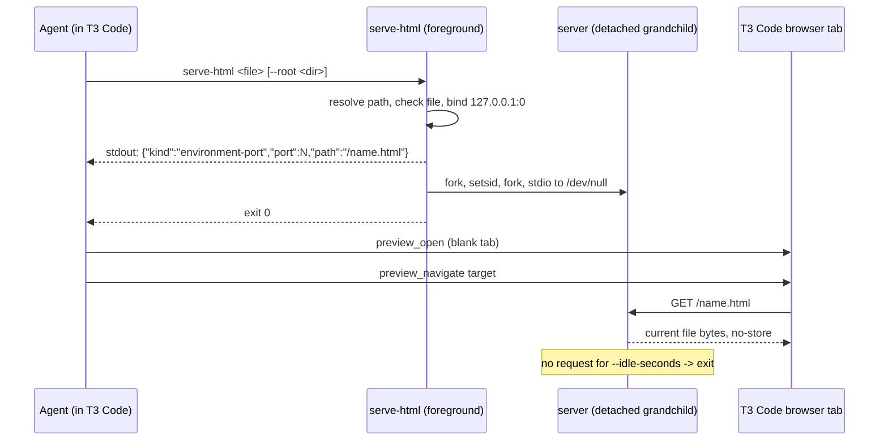

# Open HTML Artifacts in the T3 Code Browser - Plan

## Goal Capsule

- **Objective:** A user working in T3 Code, including a remote session, sees the HTML pages a coding agent opens for them (Compound Engineering ideation, plan, and brainstorm artifacts, coverage reports) in T3 Code's own browser tab, without finding and opening the file by hand.
- **Means:** A shared agent-instructions bullet that routes such pages through a new `serve-html` helper and T3 Code's `environment-port` preview target, installed on every host kind (KTD1, KTD2, KTD3).
- **Product authority:** the user's choices in the `ce-brainstorm` dialogue of 2026-10-19, which wrote no brainstorm artifact; this plan bootstraps its own Product Contract and records those choices as its Key Decisions. Planning resolves HOW only.
- **Stop conditions:** Stop if a page served by the built helper does not load through `preview_navigate` with an `environment-port` target in a live T3 Code session, if the helper's server does not outlive the agent's tool call, or if any host output or check fails to build.
- **Execution profile:** stdlib Python helper, Nix packaging, Nix checks, Markdown. No `nr switch`. The live T3 Code runs in U5 use the built helper from the store; their results are reported apart from check evidence.
- **Open blockers:** None.

---

## Product Contract

### Summary

Agents running under T3 Code show a local HTML page in a T3 Code browser tab. The agent runs `serve-html <file>`, which serves that page on `127.0.0.1` on a free port, prints the preview target, and returns at once. The agent then opens a tab and navigates it to that target. The server stops by itself after 30 idle minutes. Outside T3 Code nothing changes.

### Problem Frame

Compound Engineering skills open HTML artifacts with the platform's open command (`xdg-open` on Linux, `open` on macOS): `ce-ideate` after writing an ideation page, and `ce-plan` and `ce-brainstorm` from their "Open in browser" option. In a remote T3 Code session that command starts a browser on the remote host, which the user cannot see, so the user has to locate the file and open it some other way. T3 Code already has a browser pane, but its tools refuse `file://` URLs: both `preview_open` and `preview_navigate` answered "Invalid preview URL (unsupported-protocol: file:)" in a live probe on 2026-10-19, while a page served on `127.0.0.1` loaded through an `environment-port` target.

### Requirements

**Agent behavior**

- R1. When an agent's session lists T3 Code's preview tools, the agent shows any local HTML file it opens for the user in a T3 Code browser tab through `serve-html` and an `environment-port` target, instead of `xdg-open` or `open`, passing `--root <dir>` when the page loads sibling files from a report directory.
- R2. When the session lists no T3 Code preview tools, or `serve-html` fails, the agent keeps the skill's own way of opening the file and prints the file's absolute path.
- R3. A run with no person present (headless or pipeline) still opens nothing, as the skills already state.
- R4. When the user asks to see a page again, or says its tab no longer loads, the agent runs `serve-html` again instead of reusing an earlier target, and navigates the same tab to the new target. A reload the user makes alone after the idle exit is invisible to the agent and is not a trigger.

**Helper**

- R5. `serve-html <file>` serves that one file on `127.0.0.1` on a free port, prints exactly one line on stdout, the `preview_navigate` target for the file, and returns while the server keeps running.
- R6. By default no other path is served: a request for anything but the printed path gets 404.
- R7. With `--root <dir>`, the server also serves files under that directory, for multi-file reports such as a coverage report that loads sibling CSS and scripts. The file must lie under the directory, and nothing outside it is served.
- R8. The server exits on its own after 30 minutes with no request.
- R9. Each request reads the file from disk, so reloading the tab shows the file's current content.
- R10. A missing or unreadable file, or a failed bind, exits non-zero with a message on stderr and nothing on stdout.
- R11. The command is on the user's `PATH` on NixOS, non-NixOS Linux, and macOS hosts, production and bootstrap outputs alike.

### Key Decisions

- **The page opens in a T3 Code browser tab, not inline in the thread.** Governs R1. (session-settled: user-directed — chosen over inline `html_render`: its reply-width frame, thread background, and 512KB cap distort standalone documents)
- **The server stops after an idle timeout.** Governs R4, R8. (session-settled: user-approved — chosen over a server tied to the agent process, which piles up and has no reliable exit across harnesses, and over a persistent systemd or launchd user service, which needs a fixed port and per-host-kind setup)
- **The rule lives in the shared agent instructions, not in patched plugin files.** Governs R1, R2. It reaches every harness from one template and survives Compound Engineering upgrades.
- **Single-file serving is the default; a directory is served only when the agent names it.** Governs R1, R6, R7. Self-contained artifacts expose nothing beyond themselves, and the coverage-report case named in the brainstorm still works.

### Scope Boundaries

- Patching Compound Engineering's skill files is out of scope; the instructions override their open step.
- An inline `html_render` preview, or showing the page both inline and in a tab, is not built (Key Decisions).
- Starting the helper automatically, or opening pages in runs the skills do not already open them in, is not built (R3).
- A trait gate for the helper is not built: the instructions render the same on every host, so every host carries the command the bullet names.
- Reusing one server across calls is not built. Each call starts its own server, and idle exit bounds how many exist; evidence of many concurrent leftovers would change this.
- T3 Code's Antigravity instance does not get the rule: its runtime loads no global instructions (`docs/provisioning.md`, probe of 2026-10-15), and no delivery path reaches it. Claude Code, OpenCode, Grok, and the Antigravity CLI do get it. A runtime release that loads global instructions would change this.

### Sources / Research

- `home/h82/agents/instructions/instructions.md.tmpl` `# T3 Code` section holds the two existing tool-conditional bullets this one joins. `home/h82/agents/instructions/default.nix` renders it once and writes it to `~/.claude/CLAUDE.md`, `~/.config/opencode/AGENTS.md`, and `~/.gemini/config/AGENTS.md`.
- `tests/agent-instructions.nix`: `checkedSections` covers only `# Review findings` and `# Compound Engineering`. The `# T3 Code` bullets are only in `pinnedSentences`. Sentences split on a full stop followed by a space. `removedTerms` match case-insensitive substrings.
- `packages/agent-tools.nix` `pythonHelper` packages a stdlib Python script with a store-path interpreter. `flake.nix` `pythonScriptCheck` runs a `tests/test_<name>.py` against a copy of the script.
- `tests/lib/configurations.nix` `userEntries` holds NixOS and non-NixOS Linux users only; `tests/antigravity-acp-path-profiles.nix` reads each one's built `home.path`, and `tests/darwin-outputs.nix` reads `$gen/home-path/bin/...` of the macOS fixture on a macOS builder.
- `packages/t3code.nix` wraps T3 Code with `appimageTools.wrapType2`, whose bubblewrap defaults share the network and PID namespaces and set `dieWithParent`. A loopback listener started by an agent is reachable from T3 Code, and it ends no later than T3 Code itself.
- T3 Code's `preview_navigate` tool describes the `environment-port` target as "a dev-server port relative to the current execution environment", which is the agent's side in a remote session.
- Learnings: `.compound-engineering/artifacts/solutions/best-practices/substring-sentence-check-passes-a-negated-instruction.md`, `.compound-engineering/artifacts/solutions/best-practices/mutation-testing-reveals-decorative-nix-check-assertions.md`, `.compound-engineering/artifacts/solutions/best-practices/nix-check-reads-option-value-not-materialized-output.md`, `.compound-engineering/artifacts/solutions/best-practices/pipe-capacity-timing-test-passes-on-the-unfixed-relay.md`, `.compound-engineering/artifacts/solutions/best-practices/nix-check-importing-tofile-copy-fails-read-only-flake-check.md`, `.compound-engineering/artifacts/solutions/integration-issues/darwin-home-manager-activation-lacks-java-home-and-which-for-avdmanager.md`.

---

## Planning Contract

### Key Technical Decisions

- KTD1. **The helper is a stdlib Python script packaged with `pythonHelper` and installed in the shared `home.packages` list of `home/h82/default.nix`.** Python is already in every host's profile, the store-path interpreter avoids macOS's `/usr/bin/python3` stub, and the shared list covers all three host kinds without a `modules/shared/darwin-apps.nix` decision. Covers R11.
- KTD2. **The helper detaches itself after binding and printing: fork, `os.setsid()` in the first child, fork again, and point the grandchild's stdin, stdout, and stderr at `/dev/null`.** macOS has no `setsid` command, but Python's `os.setsid()` works on both kernels. The new session keeps a harness that closes its terminal or kills the call's process group from taking the server down. Binding and printing before the fork means a failure is reported by the foreground call. Covers R5, R10.
- KTD3. **The server is a threading HTTP server bound to `127.0.0.1` port 0, with idle exit measured from the last request.** Threads keep a browser's spare preconnect socket from blocking the real request. Port 0 avoids collisions between servers. Every response carries `Cache-Control: no-store`. The named HTML file is served as `text/html; charset=utf-8`, since the artifacts are often Korean. Other files under `--root` get the type their extension maps to through Python's `mimetypes`, with `charset=utf-8` on text types, so a browser applies a sibling stylesheet and runs a sibling script. Covers R5, R7, R8, R9 (session-settled: user-approved — chosen over a server tied to the agent process, which piles up and has no reliable exit across harnesses, and over a persistent systemd or launchd user service, which needs a fixed port and per-host-kind setup; governs R8).
- KTD4. **The stdout line is the JSON `target` object for `preview_navigate`, and that shape is the committed contract:** `{"kind":"environment-port","port":<n>,"path":"/
"}`. `
` is the percent-encoded file name in single-file mode, and the percent-encoded path relative to the root with `--root`, so relative links in a page inside a subdirectory resolve. The agent passes the object through unchanged, and `environment-port` resolves in the agent's environment. Covers R1, R5.
- KTD5. **The idle timeout is an `--idle-seconds` option defaulting to 1800, and a `--pid-file <path>` option writes the server's process id.** The test sets a short timeout and reads the process id to check the exit and to stop leftovers; a separate assertion pins the shipped default. Neither option changes stdout.
- KTD6. **`# T3 Code` joins `checkedSections` in `tests/agent-instructions.nix`, with every bullet sentence pinned in order.** A pinned sentence outside a checked section can be contradicted by an added sentence, and the check would stay green. The two existing bullets move into the new section list unchanged. Covers R1 to R4.

### High-Level Technical Design

### Assumptions

- Agents that open such pages run at the top level of the user's thread. A preview tab a delegated subagent opens may not be visible in the user's thread; the bullet does not address subagents.
- One new tab per page, and reuse of that tab's id when the same page is reopened, is left to the agent beyond what R4 asks.

### Sequencing

U1 (helper) and U3 (instructions) are independent. U2 depends on U1. U4 depends on U1 to U3. U5 runs last.

---

## Implementation Units

### U1. Write the `serve-html` helper and its test

**Goal:** A command that serves one HTML file (or a named directory) on loopback, prints the preview target, detaches, and exits when idle.

**Requirements:** R5, R6, R7, R8, R9, R10; KTD2, KTD3, KTD4, KTD5.

**Dependencies:** none.

**Files:**

- `scripts/serve-html` (new)
- `tests/test_serve_html.py` (new)

**Approach:**

1. Resolve the file argument to an absolute path before anything else, and with `--root` check that the file lies under the resolved root.
2. Bind `127.0.0.1` port 0 in the foreground, print the KTD4 line, flush, then detach as KTD2 states; the grandchild writes `--pid-file` when given.
3. In the grandchild, serve the single file at its printed path, or with `--root` any regular file under the root by its relative URL path, rejecting `..` escapes and symlinks that resolve outside the root. Everything else is 404.
4. Track the last request time and stop when `--idle-seconds` pass without one.

**Patterns to follow:** `scripts/agent-settings` and `scripts/antigravity-acp-probe` for stdlib Python helpers with a `#!/usr/bin/env python3` shebang; `tests/test_antigravity_acp_probe.py` for a test driven by `pythonScriptCheck`.

**Test scenarios:**

- Serving a self-contained HTML file prints exactly one stdout line that parses as the KTD4 object with `kind` `environment-port`, and the call returns within a few seconds.
- A GET of the printed path on `127.0.0.1` returns the file's bytes with `Cache-Control: no-store` and `Content-Type: text/html; charset=utf-8`.
- After the file is rewritten, a second GET returns the new content.
- A GET of any other path, including a sibling file in the same directory, returns 404.
- With `--root`, a sibling CSS file under the root is served with `Content-Type` `text/css`, while `/../` paths and a symlink pointing outside the root return 404.
- With `--root` and a file in a subdirectory of the root, the printed path is the root-relative path, and a GET of it returns the file.
- A file outside the given `--root` exits non-zero with nothing on stdout.
- A missing file exits non-zero, writes to stderr, and prints nothing on stdout.
- A file name with spaces and non-ASCII characters yields a percent-encoded path that serves the file.
- A relative path argument serves the file it names from the caller's directory.
- With `--idle-seconds 1`, the process named in `--pid-file` is gone after a bounded poll; a request within the window extends its life.
- The server's session id differs from the test process's, so it left the caller's session.
- A connection to `127.0.0.2` on the printed port is refused while `127.0.0.1` answers; inside the build sandbox only `lo` exists and `127.0.0.0/8` routes to it, so a server bound to `0.0.0.0` would accept it.
- The script's source carries the 1800-second default for `--idle-seconds`.
- Every scenario kills the process named in its `--pid-file` in cleanup, so a failed assertion leaves no listener.

**Verification:** the test passes, and each mutation round below turns it red inside the builder: bind `0.0.0.0`, serve the file's directory by default, drop the detach, drop `os.setsid()`, print an extra stdout line, serve every file as HTML, print the base name under `--root`, change the idle default.

### U2. Package the helper and install it on every host

**Goal:** `serve-html` is on `PATH` in every user environment.

**Requirements:** R11; KTD1.

**Dependencies:** U1.

**Files:**

- `packages/agent-tools.nix` (add `serveHtml` via `pythonHelper`)
- `home/h82/default.nix` (add it to the shared `home.packages` list beside `claude-code`)
- `flake.nix` (register `serve-html` with `pythonScriptCheck`, and register the profile check below)
- `tests/serve-html-profiles.nix` (new; asserts `bin/serve-html` in each `userEntries` user's built `home.path`)
- `tests/darwin-outputs.nix` (assert `$gen/home-path/bin/serve-html` resolves to the helper in the macOS fixture)

**Approach:** Mirror the existing `pythonHelper` entries. The profile check reads each user's built `home.path`, not the `home.packages` option value that `userPackagesOf` returns, following `tests/antigravity-acp-path-profiles.nix`. `tests/darwin-config.nix` needs no change: it exempts every package the shared list installs on all kinds, and it must stay green.

**Patterns to follow:** `agentSettings` in `packages/agent-tools.nix`; `tests/antigravity-acp-path-profiles.nix` and its `darwin-outputs` counterpart.

**Test scenarios:**

- Every user entry (NixOS host and bootstrap, Linux fixtures and bootstraps) has `bin/serve-html` in its built profile, resolving to the packaged helper.
- The macOS fixture's built profile has `bin/serve-html` (macOS builder only).
- Removing the package from `home/h82/default.nix` fails both checks inside the builder, not at evaluation.

**Verification:** `nix flake check` passes, `darwin-config` stays green, and CI's `build-darwin` job builds `darwin-outputs`.

### U3. Add the instructions bullet and pin its sentences

**Goal:** Agents under T3 Code get the rule; agents elsewhere see an inert, tool-conditional bullet.

**Requirements:** R1, R2, R3, R4; KTD6.

**Dependencies:** none.

**Files:**

- `home/h82/agents/instructions/instructions.md.tmpl`
- `tests/agent-instructions.nix`

**Approach:**

1. Add a third `# T3 Code` bullet opening with "When the session lists T3 Code's preview tools, such as `preview_open`," with one sentence each for R1's route (`serve-html`, `preview_open`, then `preview_navigate` with the printed line as `target`), the `--root` case, the R4 trigger, the R3 rule that a run with no person present opens nothing, and the R2 fallback.
2. Keep each sentence free of a full stop followed by a space, backslashes, template actions, and every `removedTerms` substring.
3. Add a `t3CodeSentences` list holding the two existing bullets and the new sentences in file order, add a `# T3 Code` entry to `checkedSections`, and build the T3 part of `pinnedSentences` from that list.

**Patterns to follow:** the `compoundEngineeringSentences` list and its `checkedSections` entry.

**Test scenarios:**

- The rendered instructions for every user entry contain each new sentence exactly once, at a sentence start, inside `# T3 Code`, in order.
- Mutation rounds fail the check: delete the bullet, prefix it with "Do not", add a reversing bullet, add a reversing sentence, duplicate it, move it under another heading, and drop each of the R2, R3, and R4 sentences alone.

**Verification:** `agent-instructions` passes on the real template and fails on each mutation, run in a scratch copy per `.compound-engineering/artifacts/solutions/best-practices/copied-git-worktree-writes-the-real-index.md`.

### U4. Document the helper and the rule

**Goal:** The docs say what the helper does, where the rule lives, which harnesses it reaches, and how each is verified.

**Requirements:** R1, R11.

**Dependencies:** U1, U2, U3.

**Files:**

- `docs/provisioning.md` (the shared instructions section: the T3 Code preview rule, `serve-html`, and that T3 Code's Antigravity instance does not receive it)
- `docs/verification.md` (entries for the `serve-html` and `serve-html-profiles` checks and the live T3 Code runs)

**Approach:** One short paragraph each; name the live runs as hardware evidence, separate from checks.

**Test expectation:** none -- documentation only; markdownlint runs in the pre-commit hook.

**Verification:** the pre-commit Markdown lint passes.

### U5. Verify in live T3 Code sessions

**Goal:** Evidence that the built helper and the bullet's route work where they will be used, including the remote case the Objective names.

**Requirements:** R1, R5, R8, R9.

**Dependencies:** U1 to U4.

**Files:** none.

**Approach:**

1. Build the helper, run the store path on a real CE HTML artifact from an agent tool call in T3 Code, and confirm the tool call returns.
2. Open a blank tab with `preview_open` and pass the printed line to `preview_navigate`; confirm the page title.
3. In a later tool call, confirm the server still answers; edit the file and confirm a reload shows the change.
4. Repeat with `--root` on a directory holding an HTML page that loads a sibling stylesheet, and confirm the stylesheet is applied.
5. Stop the server through its `--pid-file` and close the tab.
6. Run steps 1 to 5 again in a T3 Code environment whose agent runs on a different host from the T3 Code client. If no such environment is available, the PR reports the remote case as not verified, with the reason.

**Test expectation:** none -- live evidence, reported apart from checks.

**Verification:** each step's result is recorded in the PR body; a failure at step 2, 3, or 6 is a stop condition.

---

## Verification Contract

- `nix fmt -- --ci`.
- `nix flake check`, which runs `serve-html`, `serve-html-profiles`, `darwin-config`, and `agent-instructions`.
- `nix build --no-link .#vmChecks.all`.
- Every output under `nixosConfigurations`, `homeConfigurations`, `systemConfigs`, and `darwinConfigurations`, production and bootstrap, per `AGENTS.md`; macOS and aarch64 outputs, and `darwin-outputs`, are left to CI.
- Mutation rounds from U1 and U3, each observed to fail inside the builder.
- The U5 live runs, reported as live evidence.

## Definition of Done

- R1 to R11 hold, each traced to a passing check or a U5 live run; R1 to R4 trace to pinned sentences in `agent-instructions`.
- Every check in the Verification Contract passes locally or in CI, and every mutation round fails as listed.
- The remote run in U5 passed, or the PR states why it could not run.
- No server started by tests or the live runs is left listening.
- No abandoned-attempt code remains in the diff.
