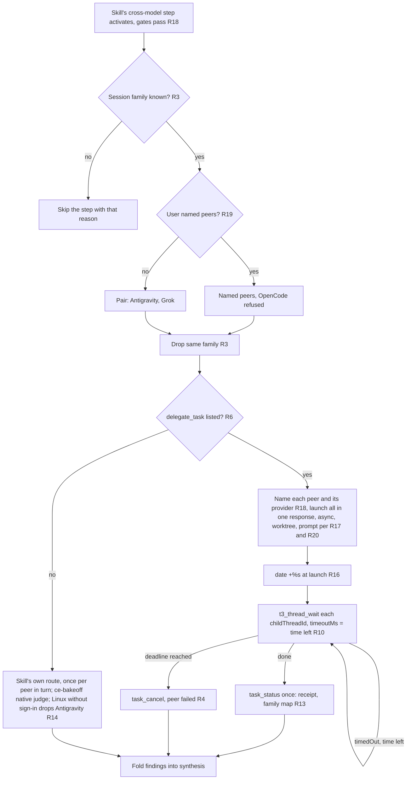

# Dual Cross-Model Review Peers - Plan

## Goal Capsule

- **Objective:** Whenever a Compound Engineering skill decides a cross-model pass is warranted, the user gets independent opinions from two different model families, Gemini through Antigravity and Grok, instead of one OpenCode opinion that never raises a finding's confidence.
- **Means:** Rewrite the cross-model rules in the shared agent instructions template and bring the peer allowlist, the pinned-sentence check, and the docs in line (KTD1, KTD2).
- **Product authority:** The user, in the 2026-10-19 brainstorm session. The Product Contract below wins on behavior; the Planning Contract wins on mechanism.
- **Execution profile:** Instructions prose, one Nix option value, one Nix check, comments, and docs. No runtime code.
- **Stop conditions:** Stop if a pinned sentence cannot be written without a banned term or an internal `". "`, or if removing `opencode` from the allowlist breaks a check that is not about the allowlist.
- **Open blockers:** None.
- **Who finishes:** `lfg` implements, reviews, and opens the pull request; the user merges.

---

## Product Contract

Product Contract preservation: changed: added R16–R20 and sharpened R3, R13, R14, R17, R18, R19 — planning research and document review found gaps in waiting, prompting, isolation, disclosure, fallback, and user-override behavior that the brainstorm left open; the pipeline run took the recommended defaults recorded under Assumptions.

### Summary

Every skill that consults another model (`ce-code-review`, `ce-doc-review`, the `ce-pov` oracle panel, `ce-bakeoff` judging) runs its cross-model step once per peer, Antigravity and Grok, skipping a peer from the session's own model family, and never uses OpenCode as a peer.
Inside T3 Code, the peers launch at once as async child tasks through `delegate_task` instead of the skill's own script route, and the session waits for them, within one shared deadline, before it merges their results.

### Problem Frame

The instructions name OpenCode as the preferred review peer.
Compound Engineering 3.31.0 sends each review to one peer, so the user gets a single second opinion.
The OpenCode route attests its family as `unknown`, so that opinion never raises a finding's confidence.
Antigravity and Grok are both available as T3 Code providers, so two independent families are within reach.

### Requirements

**Peer set**

- R1. When a skill's cross-model step activates, it runs once with Antigravity (`gemini-4-argon-high`) and once with Grok as peers; OpenCode is never a cross-model peer.
- R2. The rule covers every Compound Engineering skill that consults another model: `ce-code-review`, `ce-doc-review`, the `ce-pov` oracle panel, and `ce-bakeoff` judging.
- R3. A peer from the session's own model family is skipped as non-independent, so a Grok session runs only Antigravity and an Antigravity session runs only Grok; when the session's own family is unknown, the automatic step is skipped with that reason, as the skills already do.
- R4. When one peer is unavailable or fails, the step runs with the remaining peer and the report names the missing peer and why; no other provider fills the gap.
- R5. OpenCode is removed from the review peer allowlist (`CROSS_MODEL_PEERS`), so a skill cannot choose it even without the instructions.
- R19. Peers the user names in the conversation for that run replace the pair and then follow every other rule here; a request for OpenCode is refused, the report says OpenCode is excluded, and the step runs the pair.

**T3 Code route**

- R6. When the session lists T3 Code's `delegate_task`, each peer runs as a T3 Code child task on that provider instead of through the skill's command-based route.
- R7. Independent peer tasks launch in the same response with `delegate_task` in the default `mode: "async"`; the session never launches one, waits for it, and then launches the next.
- R8. `mode: "wait"` is used only when exactly one task is launched and the next step needs its result.
- R9. Tasks that edit the same files in a shared checkout never run at the same time: they launch with `isolation: "worktree"` or run one after another.
- R10. When a later step needs the results in the same turn, the session calls `t3_thread_wait` with each task's `childThreadId` after every task is launched, then reads each result with one `task_status` call.
- R11. When `t3_thread_wait` returns `timedOut: true`, the session calls it again for the same thread; it does not loop on `task_status` or start a sleep or timer.
- R12. A task that needs an earlier task's result launches only after that result has been read.
- R13. A T3 Code peer's provider and model, as `task_status` reports them, serve as its identity receipt: findings may raise confidence only when both the session's family and the peer's family are known and differ, and a missing or unmapped report counts as unverified.
- R16. All peer tasks of one step share one deadline, the skill's own peer deadline counted from the moment the batch launched; each wait is bounded by the time left, and a peer still running at the deadline is cancelled and treated as failed under R4.
- R17. Each peer task runs in its own worktree, carries the skill's own reviewer brief, findings schema, and the content under review, marks that content as untrusted data, and tells the child to stay read-only, open no credential or out-of-scope path, and delegate nothing; these limits are instructions to the child, not an enforced sandbox.
- R18. The skill's own gates still decide whether the step runs; before launch the session names each peer it will actually launch and the provider that receives the content, and that notice is the authorization to send it.
- R20. No file under `secrets/` and no value the session knows to be decrypted or a credential goes into a peer task.

**Fallback outside T3 Code**

- R14. Without T3 Code's delegation tools, a skill with its own peer route (`ce-code-review`, `ce-doc-review`, `ce-pov`) runs that route once per peer in turn, naming each peer as the target of its pass; `ce-bakeoff` has no such route, so it uses its native judge and reports the missing peers under R4. The existing rule that keeps the Antigravity route off a Linux host with nobody present to sign in to Google still applies there, leaving Grok alone.

**Consistency**

- R15. The pinned-sentence check, `docs/provisioning.md`, `docs/verification.md`, `README.md`, the OpenCode comments, and the `CONCEPTS.md` entries for cross-model peer and delegation describe the new policy, and nothing in them still names OpenCode as a peer.

### Key Decisions

- **Apply the rule to every skill that consults another model, not only the review skills.** Governs R2. (session-settled: user-directed — chosen over review skills only, or review skills plus the `ce-pov` panel: the user wants one cross-model policy everywhere.)
- **Run the remaining peer when one is missing; never substitute.** Governs R4. (session-settled: user-directed — chosen over substituting another provider or skipping the whole pass: a partial second opinion beats none, and substitution would reintroduce peers the user did not pick.)
- **Treat T3 Code's provider record as the identity receipt.** Governs R13. (session-settled: user-directed — chosen over treating every T3 Code result as unverified evidence: without it two peers would never raise confidence.)
- **Skip a same-family peer instead of running it.** Governs R3. (session-settled: user-approved — chosen over running it as unverified evidence: it adds cost without independence.)
- **The Linux Google sign-in rule covers the skill's route only.** Governs R14. (session-settled: user-approved — chosen over keeping Antigravity off Linux everywhere: T3 Code's app already holds the sign-in, so its Antigravity provider does not wait for one.)
- **Remove OpenCode from the allowlist as well as the instructions.** Governs R5, R19. (session-settled: user-approved — chosen over an instructions-only change: the allowlist enforces the exclusion even when the instructions are not read.)
- **The parallel delegation rules govern every `delegate_task` use, not only peers.** Governs R7–R12. The user supplied them as the concrete meaning of "call async, then wait".

### Scope Boundaries

- OpenCode stays installed and stays a `ce-work` implementation harness and a T3 Code provider; only its peer role ends.
- The `ce-work` delegation model guide is unchanged apart from what R1 and R5 force.
- Changing Compound Engineering itself, for example to send one review to two peers natively, is out of scope; the instructions drive two passes.
- `claude` stays in `CROSS_MODEL_PEERS`, because R19 needs a route for a user who asks for a Claude peer.
- The rules reach only sessions that read the shared instructions: Claude Code, Grok Build, OpenCode, and the terminal Antigravity CLI. T3 Code's Antigravity instance loads no instructions file, so a skill run there keeps Compound Engineering's own peer choice, which can pick `claude`.

#### Considered and not built

- A Nix check that runs a T3 Code child task: no check can start T3 Code, and the learning `opencode-plugin-loading-verifiable-only-by-a-live-run.md` shows agent loading is verifiable only live. The route is a `docs/verification.md` manual item instead; a scriptable T3 Code test harness would change the call.
- Killing `agy_acp_server.par` after a cancelled Antigravity task: the learning `t3code-antigravity-acp-openssl-missing-ca-bundle-hangs-sessions.md` says the process outlives the cancel, but T3 Code owns it and reuses it; killing it from a review could break a live session. Evidence that a leftover process blocks the next task would change the call.
- An enforced read-only sandbox for peer children: `delegate_task` offers no read-only mode, and a narrower `runtimeMode` only adds approval prompts nobody answers. R17's worktree confines edits; a T3 Code read-only child mode would change the call.

#### Deferred to Follow-Up Work

- Refresh the learnings that still describe OpenCode as a review peer (`integration-issues/opencode-plugin-loading-verifiable-only-by-a-live-run.md`, `integration-issues/opencode-config-file-model-variant-silently-dropped.md`, `best-practices/substring-sentence-check-passes-a-negated-instruction.md`) with `ce-compound-refresh`; this change deletes, moves, or renames none of the paths they cite, so the pre-push refresh rule does not require it here.

### Dependencies / Assumptions

- T3 Code's Grok peer runs T3 Code's default Grok model, `grok-4.7` at high effort, as the live catalog listed it on 2026-10-19.
- Each pass sends the reviewed diff or document to both xAI and Google, which roughly doubles external cost and wall-clock time per pass.
- `task_status` returns `providerInstanceId` and `model` for a delegated child: this run's document review read `grok`/`grok-4.7` and `antigravity`/`gemini-4-argon-high` from it on 2026-10-19.

### Assumptions

These were the recommended defaults for gaps the pipeline run could not ask about; the pull request lists them for the user.

- R16's deadline is `CROSS_MODEL_HARD_SECS` plus 10 seconds, 1210 seconds by default, the same budget the skills give their own peer job.
- R18's gates are the existing ones: the skill selected its adversarial or judgment reviewer, the scope is the local tree, `cross_model_review_mode` is not `off`, and the user did not prohibit the pass.
- R13's family map: `antigravity` and any `gemini-*` model are `gemini`, `grok` and any `grok-*` model are `grok`, `claudeAgent` and any `claude-*` model are `claude`; anything else is unknown.
- When both peers fail, the skill's in-process adversarial reviewer covers the lens, as Compound Engineering already does when no peer returns.
- For `ce-bakeoff`, R2 means two delegated judges, one per peer, each given the common brief and neutral-label candidates.
- For the `ce-pov` panel, the pair replaces discovery and its default peer order; each reconcile round is a fresh `delegate_task` with the full brief.

### Sources / Research

- `home/h82/agents/instructions/instructions.md.tmpl`, the Compound Engineering and T3 Code sections.
- `home/h82/agents/cross-model-peers.nix`, which exports `CROSS_MODEL_PEERS` and `CROSS_MODEL_MAX_PEERS=2`.
- `tests/agent-instructions.nix`, which pins each sentence of the Compound Engineering section and the T3 Code sentences.
- `docs/provisioning.md`, sections "Shared agent instructions" and "OpenCode".
- Compound Engineering 3.31.0 `skills/ce-code-review/references/cross-model-review.md`: one peer per review over one fixed route, promotion only on `independence_verified: true`, the `CROSS_MODEL_HARD_SECS` deadline counted from a `date +%s` taken at start, and the skip when the host family is unknown.
- Compound Engineering 3.31.0 reads `CROSS_MODEL_PEERS` only in `ce-code-review`, `ce-doc-review`, and `ce-pov` scripts; `ce-work` reads its own `work_engine_preferences`.

---

## Planning Contract

### Key Technical Decisions

- KTD1. **Peer policy goes in the Compound Engineering section; the user's delegation rules go in the T3 Code section.** The peer rules are Compound Engineering behavior, and the delegation rules apply to every `delegate_task` use (per the Key Decision on R7–R12). Each limit is its own sentence, so deleting or negating one fails the check. Covers R1–R4, R6–R14, R16–R20.
- KTD2. **Promote the T3 Code section into `checkedSections`.** Today its sentences are only pinned to appear once, so a contradicting sentence added beside them passes. With six new rules there, the section needs the allowlist, membership, and order checks the other two checked sections get. Covers R7–R12, R15.
- KTD3. **R16 bounds R11 instead of rewording it, through `timeoutMs`.** R11 was a directive from the user, and the one challenge it gets is this: an Antigravity child can hang with no error (`t3code-antigravity-acp-openssl-missing-ca-bundle-hangs-sessions.md`), so an unbounded re-call blocks the review forever. The session takes `date +%s` right after the batch launches and passes the seconds left as `timeoutMs` on every `t3_thread_wait`, which is a reading of the clock, not a sleep or timer. A `timedOut: true` with time left is re-called as R11 says; one at the deadline ends with `task_cancel`. The T3 Code sentence keeps the user's wording plus "unless that task's deadline has passed"; the deadline and its measurement are stated once, in the Compound Engineering section. Covers R11, R16.
- KTD4. **Remove the `opencode` token in the module and in the test's package-to-token map together.** `tests/lib/cross-model-peers.nix` derives the expected allowlist from installed packages, and OpenCode stays installed, so removing only the module line fails `session-variables`, `darwin-config`, and `darwin-outputs`. Covers R5.
- KTD5. **Name the peers by T3 Code instance id and model, and compare them by family.** Launch keys are `antigravity` with `gemini-4-argon-high` and `grok` with its default model, so the sentence works the same on every host; the receipt comparison maps them to families per the R13 assumption. Covers R1, R6, R13.
- KTD6. **Peer children run with `isolation: "worktree"`.** It is the only containment `delegate_task` offers: an injected instruction that makes a child edit files lands in a throwaway checkout. The cost is a worktree and project setup per peer, and the child sees the committed tree, which is why R17 puts the content under review in the prompt. Covers R17.

### High-Level Technical Design

The decision flow the instructions encode, per cross-model step:

### Sequencing

U1 first; U2 does not depend on U1; U3 describes both, so it lands last.

### Risks

- A change to T3 Code's default Grok model changes the peer without failing a check; the receipt names the served model in every report, so the change is visible where it matters.
- Peer children can still read files the parent can read; R17 asks them not to, and the worktree confines only writes.

---

## Implementation Units

### U1. Rewrite the instructions and their pinned-sentence check

- **Goal:** The rendered instructions carry the new peer policy and the user's delegation rules, and the check fails when any of those sentences is removed, negated, duplicated, or contradicted.
- **Requirements:** R1–R4, R6–R14, R16–R20; KTD1, KTD2, KTD3, KTD5, KTD6.
- **Dependencies:** None.
- **Files:**
  - `home/h82/agents/instructions/instructions.md.tmpl`
  - `tests/agent-instructions.nix`
- **Approach:**
  1. In the Compound Engineering section, replace "For a cross-model review, prefer OpenCode as the peer." with the peer sentences, ahead of the `ce-work` sentences: pair and scope, same-family and unknown-family skips, named peers and the OpenCode refusal, remaining peer, T3 Code route with instance ids, peer task contents and worktree, secrets exclusion, recipient notice, family receipt, shared deadline with its `date +%s` and `timeoutMs` measurement, and the fallback order outside T3 Code. Scope the Linux Google sign-in sentence to sessions outside T3 Code.
  2. In the T3 Code section, add the user's delegation rules after the existing two sentences, keeping the user's wording and adding KTD3's deadline clause to the re-call sentence.
  3. In the check, update `compoundEngineeringSentences`, move the T3 Code sentences into a `t3CodeSentences` list used by both `pinnedSentences` and a new `checkedSections` entry, and update the header comments that list the checked sections.
- **Patterns to follow:** `reviewFindingsSentences` and its `checkedSections` entry; the sentence rules in `best-practices/substring-sentence-check-passes-a-negated-instruction.md`.
- **Execution note:** Check every new sentence for an internal `". "`, a backslash, `{{`, and every entry of `removedTerms` (case-insensitive, including `zen`, `flash`, `codex`, `receives the reviewed content`, and `data terms`), and make sure no pinned sentence is a substring of another.
- **Test scenarios:**
  - The check passes on every fixture host with the new template.
  - Deleting the Antigravity-and-Grok peer sentence from the template fails the check, naming that sentence.
  - Prefixing "Do not " to the same-family skip sentence fails the check.
  - Deleting the peer-task contents sentence (R17) fails the check.
  - Deleting the recipient notice sentence (R18) fails the check.
  - Deleting the `date +%s` and `timeoutMs` deadline sentence fails the check.
  - Adding "For a cross-model review, prefer OpenCode as the peer." back to the Compound Engineering section fails the check.
  - Adding an unpinned sentence to the T3 Code section fails the check (KTD2).
  - Swapping two T3 Code sentences fails the order check.
  - Deleting the deadline clause from the `timedOut` sentence fails the check.
- **Verification:** `agent-instructions` passes, and each mutation above makes it fail; restore the template after each.

### U2. Remove OpenCode from the peer allowlist and its peer comments

- **Goal:** `CROSS_MODEL_PEERS` is `claude,grok` on Linux hosts and `antigravity,claude,grok` on macOS hosts, and no OpenCode code comment describes a review-peer role.
- **Requirements:** R5, R15; KTD4.
- **Dependencies:** None.
- **Files:**
  - `home/h82/agents/opencode.nix`
  - `home/h82/agents/opencode-model.nix`
  - `scripts/opencode`
  - `home/h82/agents/cross-model-peers.nix`
  - `tests/lib/cross-model-peers.nix`
- **Approach:**
  1. Delete the `my.agents.crossModelPeers = [ "opencode" ];` line from `opencode.nix`.
  2. Drop `opencode` from the option description in `cross-model-peers.nix`.
  3. Drop the `opencode` entry from the package-to-token map and its header comment in `tests/lib/cross-model-peers.nix`.
  4. Rewrite the review-peer wording in the comments of `opencode.nix`, `opencode-model.nix`, and `scripts/opencode` to describe OpenCode without a peer role.
- **Patterns to follow:** How `gemini.nix` contributes `antigravity` only on macOS.
- **Test scenarios:**
  - `session-variables` passes and expects `claude,grok` on the x86_64 Linux fixture.
  - `darwin-config` passes and expects `antigravity,claude,grok` for the macOS fixture's launchd agent and session variables.
  - Restoring only the `opencode.nix` line, with the map left without it, fails `session-variables`.
- **Verification:** The three allowlist checks pass on Linux; `darwin-outputs` is left to CI's `build-darwin` job; a search of the U2 files for "review peer" finds nothing.

### U3. Bring the docs and vocabulary in line

- **Goal:** No doc names OpenCode as a peer or says each review goes to one peer, and the docs describe the two-peer policy, the T3 Code route, its limits, and the allowlist values.
- **Requirements:** R15, and the documented limits in Scope Boundaries.
- **Dependencies:** U1, U2.
- **Files:**
  - `docs/provisioning.md`
  - `docs/verification.md`
  - `README.md`
  - `CONCEPTS.md`
- **Approach:**
  1. In `docs/provisioning.md`, rewrite the allowlist paragraph, the Compound Engineering part of "Shared agent instructions", and the `agent-instructions` check description (T3 Code is now a checked section). Remove the review-peer mentions in the OpenCode section. Say that T3 Code's Antigravity instance does not get these rules.
  2. In `docs/verification.md`, replace the OpenCode-peer timing item with a live item for the T3 Code route: the peers launch in one response, `task_status` reports provider and model, a cancelled child counts as a failed peer, and the item fails when `task_status` reports no provider or model. Scope the existing skill-route items to sessions outside T3 Code.
  3. In `README.md`, drop "or as a review peer" from the OpenCode paragraph.
  4. In `CONCEPTS.md`, rewrite "Cross-model peer" for two peers with no replacement, and add the parallel launch-then-wait shape to "Cross-model delegation".
- **Test expectation:** none — docs only; the pre-commit Markdown lint covers formatting.
- **Verification:** A search of these files for "preferred review peer", "prefer OpenCode", "one peer per review", "replacement peer", and "as a review peer" finds nothing; Markdown lint passes.

---

## Verification Contract

| Gate | Command | Proves |
| --- | --- | --- |
| Format | `nix fmt -- --ci` | Nix layout unchanged by hand edits |
| Instructions check | `nix build --no-link .#checks.x86_64-linux.agent-instructions` | U1 sentences pinned and section-checked |
| Allowlist checks | `nix build --no-link .#checks.x86_64-linux.session-variables .#checks.x86_64-linux.darwin-config` | U2 values on Linux and the macOS fixture |
| Mutation rounds | U1 and U2 test scenarios, each in the working tree and reverted | The checks are not decorative |
| Flake | `nix flake check` | Every declared check |
| Host outputs | The AGENTS.md loops over `nixosConfigurations`, `homeConfigurations`, `systemConfigs` | Every buildable output on this builder |
| Markdown | `mise run lint-staged-markdown` (pre-commit) | U3 docs |

macOS outputs and `checks.aarch64-darwin.darwin-outputs` build only in CI's `build-darwin` job. VM tests are unaffected by these files but follow the AGENTS.md shipping rule.

## Definition of Done

- U1–U3 are complete and every gate above passes on this builder.
- Each U1 and U2 mutation scenario failed its check and was reverted.
- No file outside U1–U3's lists changed, apart from this plan.
- No experimental edits or mutation leftovers remain in the diff.
