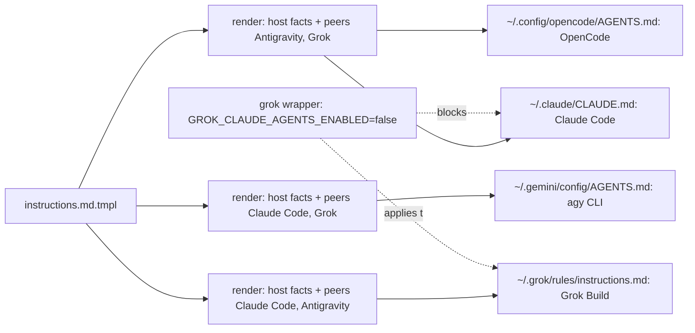

# Per-Harness Cross-Model Peers - Plan

## Goal Capsule

- **Objective:** Every cross-model step gets two independent second opinions, whichever of Claude Code, Antigravity, or Grok Build runs the session, instead of Antigravity and Grok sessions getting only one.
- **Means:** Render the shared instructions template once per harness from per-harness peer data, and give Grok Build its own copy with its Claude Code file scan off (KTD1, KTD4).
- **Product authority:** The user, in the 2026-10-19 brainstorm session. This plan amends the peer set of [Dual Cross-Model Review Peers](2026-10-19-1600-feat-dual-cross-model-review-peers-plan.md); its other rules stand unless a requirement here replaces them. The Product Contract wins on behavior; the Planning Contract wins on mechanism.
- **Execution profile:** Instructions template and its renderer inputs, one wrapper flag, three Nix checks, comments, and docs. No runtime code.
- **Stop conditions:** Stop if a pinned sentence cannot be written without a banned term or an internal `". "`, or if Grok Build stops loading `$GROK_HOME/rules/*.md` symlinks or stops honoring `GROK_CLAUDE_AGENTS_ENABLED=false`.
- **Open blockers:** None.
- **Who finishes:** `lfg` implements, reviews, and opens the pull request; the user merges.

---

## Product Contract

Product Contract preservation: changed: R4 — clarified that findings raise confidence only when the peer's family differs from the session's, which the default pair always meets, so a user-named same-harness peer does not raise it; the planning questions it deferred are resolved in the Planning Contract and removed here, and the Scope Boundaries gain the considered-and-not-built items planning found.

### Summary

Each harness reads its own rendering of the shared instructions, and that rendering names the other two harnesses as its cross-model peers: Claude Code uses Antigravity and Grok, Antigravity uses Claude Code and Grok, and Grok Build uses Claude Code and Antigravity.
A harness's model family is its vendor's, so the rules no longer skip a peer by family or reason about an unknown family.

### Problem Frame

The instructions name Antigravity and Grok as the peer pair for every session and skip a peer from the session's own family.
A Claude Code session therefore gets two opinions, while an Antigravity session gets only Grok and a Grok session gets only Antigravity.
Claude Code is installed on every host and is already in the review peer allowlist, so the third opinion is within reach.
Every harness reads one identical file today, and Grok Build reads it through its Claude Code compatibility, so the file cannot say different things to different harnesses.
Grok Build's documentation shows it always reads `~/.grok/rules/*.md` and can turn off its scan of `~/.claude/` named files, which makes a Grok-only file possible.

### Key Decisions

- **One template, rendered per harness.** Each harness reads a copy that states only its own peers, so no rule depends on the agent recognizing which harness it runs in. (session-settled: user-directed — chosen over one shared file with a per-harness peer table: a Grok session reading a file named `CLAUDE.md` would have to identify itself correctly, and every session would carry the other harnesses' rules.) Governs R1, R6, R7, R8.
- **Harness vendor equals model vendor.** Claude Code runs only Claude models, Antigravity only Gemini models, and Grok Build only Grok models. (session-settled: user-directed — chosen over keeping the family-skip guard for a harness that serves another vendor's model: that case does not and must not occur.) Governs R3, R4.
- **Claude Code peer runs Opus 5.5.** It matches the model and high effort Compound Engineering's own `claude` route uses. (session-settled: user-approved — proposed in the synthesis over Sonnet 5.5; the user confirmed.) Governs R9.

### Requirements

**Peer set**

- R1. Each harness's cross-model step runs once with each of its two peers: Claude Code with Antigravity and Grok, Antigravity with Claude Code and Grok, Grok Build with Claude Code and Antigravity.
- R2. The step still covers `ce-code-review`, `ce-doc-review`, the `ce-pov` oracle panel, and `ce-bakeoff` judging, and each skill's own gates still decide whether it runs.
- R3. A session's model family is its harness's vendor (Claude Code `claude`, Antigravity `gemini`, Grok Build `grok`); the rules to skip a same-family peer and to skip the step when the session's family is unknown are removed.
- R4. A peer's family is the family of the harness it ran on, and a completed peer's findings may raise confidence when that family differs from the session's, as it always does for the pair; inside T3 Code the provider instance `task_status` reports (`claudeAgent`, `antigravity`, `grok`) is the receipt.
- R5. The existing rules for a missing or failed peer, for peers the user names for one run, for the shared deadline, and for the fallback outside T3 Code apply unchanged to each harness's own pair.

**Per-harness delivery**

- R6. Claude Code reads the Claude Code rendering, the Antigravity CLI reads the Antigravity rendering, and Grok Build reads the Grok rendering, each in the location that harness loads globally.
- R7. Grok Build reads only its own rendering: its scan of `~/.claude/` named instruction files is off in every way it starts, including a terminal, T3 Code, and a headless run another harness starts as a peer, while its other Claude compatibility, such as skills, stays on.
- R8. Grok Build still reads a project's top-level `CLAUDE.md` and `AGENTS.md`, so repository instructions such as this one's keep reaching it.

**Claude Code as a peer**

- R9. Inside T3 Code, a Claude Code peer runs as a `delegate_task` child on the `claudeAgent` instance with Opus 5.5, and the pre-launch notice names Anthropic as the provider that receives the content.

### Acceptance Examples

- AE1. **Covers R1, R4.** Given a Grok Build session in T3 Code, when `ce-code-review` decides a cross-model pass is warranted, it launches a Claude Code child and an Antigravity child in one response, and both results may raise a finding's confidence.
- AE2. **Covers R1, R5.** Given an Antigravity CLI session on a Linux host outside T3 Code with no one present to sign in to Google, the step runs Claude Code and Grok; the Linux Antigravity rule does not apply because Antigravity is not a peer here.
- AE3. **Covers R5.** Given a Claude Code session on a Linux host outside T3 Code with no one present to sign in to Google, the step runs Grok only and the report names Antigravity as missing.
- AE4. **Covers R7, R8.** Given a Grok Build session in this repository, its loaded instructions include the Grok rendering and the project `CLAUDE.md`, and do not include `~/.claude/CLAUDE.md`.

### Scope Boundaries

- OpenCode and Codex are out of scope; both are about to be removed. OpenCode keeps receiving the same content as Claude Code, and the OpenCode wording left in the instructions is cleaned up with that removal.
- T3 Code's Antigravity instance reads no instructions file, so its sessions keep Compound Engineering's own peer choice; this plan does not change that.
- Enforcing harness-vendor equals model-vendor through a check on configured models is deferred; R3 records it as a premise.
- The `ce-work` delegation guide and the Antigravity route workaround are unchanged, and both stay in every rendering.

#### Considered and not built

- A Grok Build environment entry in T3 Code's `settings.json`: the settings merge cannot delete an entry later, and T3 Code's Grok instance already starts through the wrapper that carries the switch (KTD4). Revisit if the instance gains a `binaryPath`.
- A managed `~/.grok/config.toml` key: Grok Build writes that file itself, and the environment variable outranks it.
- Leaving the Linux Antigravity sign-in rule out of the Antigravity rendering: the rule only ever applies to a pass sent to Antigravity, which an Antigravity session never sends, so keeping one shared copy costs nothing and keeps the check from re-implementing a branch (KTD3).

### Dependencies / Assumptions

- Grok Build loads `$GROK_HOME/rules/*.md` (default `~/.grok/rules/`) in every project, including Nix store symlinks, and `GROK_CLAUDE_AGENTS_ENABLED=false` marks `~/.claude/CLAUDE.md` disabled while project `CLAUDE.md` and `AGENTS.md` files and the Claude skills still load. Both were confirmed with `grok inspect` on grok-build 1.0.62; `false`, `0`, `no`, and `off` disable the scan, and an empty value counts as unset.
- T3 Code's Grok instance declares no `binaryPath` (`home/h82/t3code.nix`), so it starts the `grok` wrapper on `PATH`; Compound Engineering's `grok-cli` route also resolves `grok` from `PATH`.
- Grok Build writes `~/.grok/config.toml` and `auth.json` itself; the only file this repository adds under `~/.grok` is the rules file.

### Assumptions

- OpenCode serves GLM-5.3 through Synthetic, not a Claude model, so R3's premise does not hold for it literally. OpenCode is out of scope and receives the Claude Code rendering, whose peers (Antigravity and Grok) are still independent of GLM, so nothing changes for it before its removal.
- When the user names a peer for one run that is the session's own harness, R5 still runs it, and its findings do not raise confidence because the families match (KTD5).

### Sources / Research

- `home/h82/agents/instructions/default.nix` and `instructions.md.tmpl`: today's single rendering and its three links.
- `home/h82/agents/grok.nix` and `packages/grok-build.nix`: Grok Build reads the shared file through Claude Code compatibility; the wrapper sets `GROK_DISABLE_AUTOUPDATER`.
- `flake.nix`, check `grok-build`: fails when Home Manager manages any file under `~/.grok`.
- `docs/provisioning.md`, "Shared agent instructions" and "Grok Build": delivery paths, including T3 Code's Antigravity instance reading none.
- `tests/agent-instructions.nix`: pinned sentences, identical-files assertion, and the byte-for-byte template expectation.
- `.compound-engineering/artifacts/solutions/logic-errors/go-text-template-missingkey-error-misses-index-and-printed-nulls.md`: a missing key inside a branch false on one harness passes there, so every rendering must be built.
- `.compound-engineering/artifacts/solutions/best-practices/substring-sentence-check-passes-a-negated-instruction.md` and the mutation-testing learnings named in `AGENTS.md`: per-harness allowlists and mutation rounds.
- Grok Build user guide: `https://github.com/xai-org/grok-build/tree/main/crates/codegen/xai-grok-pager/docs/user-guide`, `12-project-rules.md` and `05-configuration.md`.

---

## Planning Contract

### Key Technical Decisions

- KTD1. **One template; each rendering gets its harness's peer data in the render context.** `default.nix` renders the template once per harness with a `peers` record (`first`, `second`, each with `name`, `instance`, `model`, `provider`) added to the host facts, and links the Claude Code rendering to `~/.claude/CLAUDE.md` and `~/.config/opencode/AGENTS.md`, the Antigravity rendering to `~/.gemini/config/AGENTS.md`, and the Grok rendering to `~/.grok/rules/instructions.md`. The template prints fields rather than branching on a harness name, so a missing field fails the build on every rendering instead of silently dropping a sentence on one. Each `model` field holds the exact phrase the route sentence prints, backticks included, and the template prints it bare. Peers are listed in the fixed order Claude Code, Antigravity, Grok, minus the session's own harness. Covers R1, R6, R9 (governed by the per-harness Key Decision).
- KTD2. **Three peer sentences vary; everything else is shared.** The pair sentence, the T3 Code route sentence (instance and model per peer), and the pre-launch notice (provider per peer) read the `peers` record. The peer data is: Claude Code on `claudeAgent` with model phrase "`claude-opus-5-5`", notice Anthropic; Antigravity on `antigravity` with "`gemini-4-argon-high`", notice Google; Grok on `grok` with "its default model" (no backticks), notice xAI. Covers R1, R9.
- KTD3. **Remove the two family-skip rules and state the vendor rule once, shared.** The sentence "Skip a peer from your own model family…" is replaced by one shared sentence that your model family and each peer's are their harness's vendor (`claude`, `gemini`, `grok`), to be used as the attested host family when a skill asks for it. The receipt sentence keeps its mapping and compares families directly. The Linux Antigravity sign-in rule and the Antigravity model request stay shared. Covers R3, R4 (governed by the vendor Key Decision).
- KTD4. **Turn Grok's Claude Code file scan off in the wrapper.** `packages/grok-build.nix` adds `--set GROK_CLAUDE_AGENTS_ENABLED false` beside `GROK_DISABLE_AUTOUPDATER`. Every launch path in scope goes through that wrapper (terminal, T3 Code's Grok instance, Compound Engineering's `grok-cli` route), `--set` overrides a caller's value, and the environment outranks `config.toml`. Covers R7, R8.
- KTD5. **Confidence still requires different families.** The receipt sentence keeps "findings may raise confidence only when the peer's family differs from yours", which always holds for the pair and keeps a user-named same-harness peer from raising confidence. Covers R4, R5.
- KTD6. **The check states each rendering literally.** `tests/agent-instructions.nix` builds each harness's expected file from the template by replacing the known actions (`{{ .user.gpgKey }}` and the `peers` fields) with literals written in the test, not read from `default.nix`, and fails when the template holds any other action. Each delivery path must equal its harness's expected file byte for byte. The Compound Engineering pinned-sentence list becomes a function of the harness's literals, so the allowlist, membership, and order checks run per rendering. Covers R1, R6.
- KTD7. **Narrow the `.grok` guard instead of dropping it.** The `grok-build` check allows exactly the target `.grok/rules/instructions.md` and still fails on any other file Home Manager manages under `~/.grok`, so `config.toml` and `auth.json` stay Grok's. It also requires the wrapper line `export GROK_CLAUDE_AGENTS_ENABLED='false'`. Covers R7.
- KTD8. **The Claude Code peer runs Opus 5.5 at the route default.** The T3 Code route sentence names `claude-opus-5-5` on `claudeAgent`, matching Compound Engineering's own `claude` route. Covers R9 (governed by the Opus 5.5 Key Decision).

### High-Level Technical Design

One template, three renderings, four delivery paths:

T3 Code's Antigravity instance reads none of these files and is unchanged.

### Sequencing

U1 first, so the `.grok` guard and the wrapper switch exist before the Grok rules file appears; U2 adds the renderings and their check; U3 documents both.

### Risks

- A running `grok leader` or T3 Code Grok session keeps the environment it started with, so it reads `~/.claude/CLAUDE.md` until it restarts; `docs/verification.md` gets a live item for a fresh session.
- With the scan off, a Grok session in another repository loses that repository's `<dir>/.claude/CLAUDE.md` files; top-level `CLAUDE.md` and `AGENTS.md` still load. This repository uses a top-level `CLAUDE.md`.
- Compound Engineering 3.31.0 attests a host family only from a model id the runtime publishes and skips the automatic pass when the family is unknown, which can happen in an `agy` session outside T3 Code. KTD3's vendor sentence is the user's instruction that supplies the family; if a skill still skips the pass, the report says so and the user can name the peers for that run.
- A Grok Build release could change rules loading or the variable's meaning; the stop conditions name both, and the verification item re-runs `grok inspect`.

---

## Implementation Units

### U1. Turn Grok's Claude Code file scan off and narrow the `~/.grok` guard

- **Goal:** Every `grok` launch ignores `~/.claude/CLAUDE.md`, and the checks allow exactly one repository-managed file under `~/.grok`.
- **Requirements:** R7, R8; KTD4, KTD7.
- **Dependencies:** None.
- **Files:**
  - `packages/grok-build.nix`
  - `flake.nix` (check `grok-build`)
  - `tests/darwin-outputs.nix`
  - `home/h82/agents/grok.nix` (comment)
- **Approach:**
  1. Add the `--set GROK_CLAUDE_AGENTS_ENABLED false` wrapper flag and extend the wrapper comment with why.
  2. In `grok-build`, filter `.grok/rules/instructions.md` out of `grokFiles` by exact target and add a whole-line `grep -qxF` for the new export, mirroring the `GROK_DISABLE_AUTOUPDATER` assertion.
  3. Add the same whole-line assertion to `tests/darwin-outputs.nix` beside its `GROK_DISABLE_AUTOUPDATER` grep; `grok-build` already covers every Linux host and fixture.
  4. Rewrite the `grok.nix` comment: Grok reads its own rendering from `~/.grok/rules/`.
- **Patterns to follow:** The `GROK_DISABLE_AUTOUPDATER` flag and its assertions; `best-practices/declared-line-identical-to-distribution-default-makes-verbatim-check-vacuous.md`.
- **Test scenarios:**
  - `grok-build` passes on every fixture and host user with the new wrapper.
  - Removing the wrapper flag fails `grok-build` with the new message.
  - Changing the value to `true` fails `grok-build`.
  - Declaring a `home.file` at `.grok/config.toml` still fails `grok-build`.
  - Declaring the rules file at `.grok/rules/instructions.txt` fails `grok-build`.
- **Verification:** `grok-build` passes; the mutations above fail it; `darwin-outputs` is left to CI's `build-darwin` job.

### U2. Render the instructions per harness and check each rendering

- **Goal:** Each harness reads a rendering that names its own two peers, and the check fails when any rendering is missing, swapped, or drifts from its literal expectation.
- **Requirements:** R1–R6, R9; KTD1, KTD2, KTD3, KTD5, KTD6, KTD8.
- **Dependencies:** U1.
- **Files:**
  - `home/h82/agents/instructions/default.nix`
  - `home/h82/agents/instructions/instructions.md.tmpl`
  - `tests/agent-instructions.nix`
- **Approach:**
  1. In `default.nix`, define the three peer records and one rendering per harness from `hostFacts.of config.my // { peers = …; }`; link the four delivery paths per KTD1; rewrite the delivery comment.
  2. In the template's Compound Engineering section, rewrite the pair, T3 Code route, and notice sentences to print `peers` fields, replace the family-skip sentence with the vendor sentence, and change the receipt clause per KTD5. Leave every other section unchanged.
  3. In the check, replace the delivery list with a harness-to-paths map that adds `.grok/rules/instructions.md`, drop the identical-files loop, build one expected file per harness with the test's own literals, compare every path to its harness's expected file, run the section checks per harness with a harness-specific Compound Engineering list, and replace the one-action rule with a known-actions rule. Keep the fake-key host checks on every path. Rewrite the header comment.
- **Patterns to follow:** `reviewFindingsSentences` and `checkedSections`; the solutions on text/template `missingkey`, substring sentence checks, and mutation testing.
- **Execution note:** Check every new or changed sentence for an internal `". "`, a backslash, `{{` after rendering, and every `removedTerms` entry, and make sure no pinned sentence is a substring of another.
- **Test scenarios:**
  - Covers AE1. The Grok rendering's pair sentence names Claude Code and Antigravity, its route sentence names `claudeAgent` with `claude-opus-5-5` and `antigravity` with `gemini-4-argon-high`, and its notice names Anthropic and Google.
  - The Antigravity rendering names Claude Code and Grok, and the Claude Code rendering names Antigravity and Grok.
  - `~/.config/opencode/AGENTS.md` equals the Claude Code rendering byte for byte.
  - Linking the Claude Code rendering at `.grok/rules/instructions.md` fails the check.
  - Swapping the `first` and `second` peer records for one harness in `default.nix` fails the check.
  - Re-adding "Skip a peer from your own model family, because it is not independent" to the template fails the check.
  - Prefixing "Do not " to the vendor sentence fails the check.
  - Adding a template action the check does not know, such as `{{ .kind }}`, fails the check.
  - Deleting the Grok rules `home.file` entry fails the check.
  - The fake-key fixture host's renderings name its fake key and not the card key.
- **Verification:** `agent-instructions` passes on every host and fixture; each mutation above fails it and is reverted; every host output builds, which renders every harness copy.

### U3. Bring the docs, vocabulary, and comments in line

- **Goal:** No doc says every harness reads one file, that Grok reads `~/.claude/CLAUDE.md`, that nothing lives under `~/.grok`, or that the peer pair is fixed; the docs describe the per-harness pairs and the wrapper switch.
- **Requirements:** R1, R3, R6, R7, R8.
- **Dependencies:** U1, U2.
- **Files:**
  - `docs/provisioning.md`
  - `docs/verification.md`
  - `CONCEPTS.md`
  - `AGENTS.md`
  - `README.md`
- **Approach:**
  1. `docs/provisioning.md`: rewrite "Shared agent instructions" (per-harness renderings, the `peers` data beside the host facts, the per-harness pairs, the removed family rules, the delivery table with the Grok row, the check description), the `CROSS_MODEL_PEERS` paragraph (`claude` is now the default Claude Code peer route for Antigravity and Grok sessions outside T3 Code, not only a fallback), and the Grok Build section (its own rules file, the wrapper switch, the narrowed `~/.grok` rule).
  2. `docs/verification.md`: replace the Grok items with a `grok inspect` item showing the rules file loaded as global and `~/.claude/CLAUDE.md` disabled, in a fresh session after a rebuild, and update the cross-model checklist to the three pairs.
  3. `CONCEPTS.md`: rewrite Cross-model peer for per-harness pairs and the vendor rule, Delivery path for one rendering per harness, and the host-facts entry to name the peer data.
  4. `AGENTS.md` and `README.md`: fix the "one file every delivery path reads" and Grok Build sentences.
- **Test expectation:** none — docs only; the pre-commit Markdown lint covers formatting.
- **Verification:** A search of these files for "same single file", "no per-harness variant", "Nothing Home Manager manages sits under", and "Skip a peer from your own" finds nothing; Markdown lint passes.

---

## Verification Contract

| Gate | Command | Proves |
| --- | --- | --- |
| Format | `nix fmt -- --ci` | Nix layout |
| Instructions check | `nix build --no-link .#checks.x86_64-linux.agent-instructions` | U2 renderings and pinned sentences |
| Grok check | `nix build --no-link .#checks.x86_64-linux.grok-build` | U1 wrapper switch and narrowed guard |
| Mutation rounds | U1 and U2 test scenarios, each applied and reverted | The checks are not decorative |
| Flake | `nix flake check` | Every declared check |
| Host outputs | The `AGENTS.md` loops over `nixosConfigurations`, `homeConfigurations`, `systemConfigs` | Every rendering builds on every host |
| Markdown | `mise run lint-staged-markdown` (pre-commit) | U3 docs |

macOS outputs and `checks.aarch64-darwin.darwin-outputs` build only in CI's `build-darwin` job. The live `grok inspect` item in `docs/verification.md` runs after the user's next rebuild, not as part of this change.

## Definition of Done

- U1–U3 are complete and every gate above passes on this builder.
- Each U1 and U2 mutation scenario failed its check and was reverted.
- No file outside U1–U3's lists changed, apart from this plan and learnings refreshed before push.
- No experimental edits or mutation leftovers remain in the diff.
