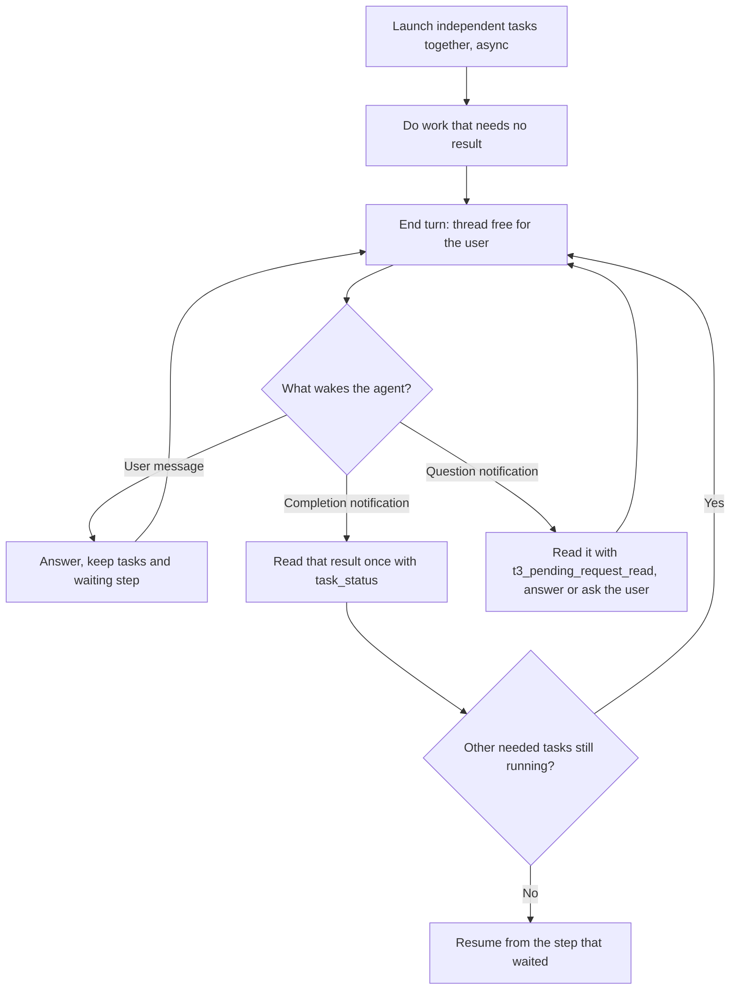

# T3 Code Notification Delegation Wait - Plan

## Goal Capsule

- **Objective:** While subagents that an agent delegated through T3 Code are running, the user can talk to the parent thread: interject, ask something else, or redirect it, instead of watching it sit in a blocking wait until every child finishes.
- **Means:** Replace the in-turn `t3_thread_wait` rules in the `# T3 Code` section of `home/h82/agents/instructions/instructions.md.tmpl` with end-the-turn-and-resume-on-notification rules, drop the cross-model peer deadline from the `# Compound Engineering` section, and update the check, docs, and learning that describe the old wait.
- **Product authority:** The user's 2026-10-19 request and the decisions made in this brainstorm; the Product Contract below wins over the Planning Contract on any conflict. This plan reverses the in-turn wait chosen in `.compound-engineering/artifacts/plans/2026-10-19-1550-fix-t3-code-parallel-delegation-plan.md`.
- **Open blockers:** None.
- **Stop conditions:** Stop and report when a change would need an edit to T3 Code or the Compound Engineering plugin's files, or would weaken a pinned sentence outside the two sections this plan rewrites.
- **Execution profile:** One instructions-and-check change with docs and a learning update, implemented by `ce-work` and shipped through `lfg`.
- **Product Contract preservation:** Product Contract unchanged except that Outstanding Questions were resolved in place from the T3 Code bundle trace, now recorded under Dependencies / Assumptions.

---

## Product Contract

### Summary

An agent in T3 Code launches its independent delegated tasks together in `async` mode and does whatever does not need their results. Then it ends its turn, which frees the thread for the user. T3 Code's completion notifications wake it, and it resumes the step that was waiting once every result that step needs has arrived. Cross-model review peers wait the same way, with no deadline.

### Problem Frame

The current `# T3 Code` rules make the parent call `t3_thread_wait` on each child run and hold its turn until the results come back. The 2026-10-19 parallel delegation plan chose that over ending the turn because skills such as `lfg` forbid ending the turn before `<promise>DONE</promise>`. A review pass with several reviewers, or a `ce-work` run with several units, can hold the thread for many minutes. During that time the user cannot interject, ask an unrelated question, or change direction without interrupting the run. The cross-model peer rule adds a hard deadline of `CROSS_MODEL_HARD_SECS` plus 10 seconds, enforced through `timeoutMs` on `t3_thread_wait`, so it depends on the same blocking wait.

T3 Code already wakes the parent when an `async` child finishes. The `delegate_task` description says the completion is "steered into active turns where supported or queued otherwise, so end the turn instead of polling or spawning watchers". The in-turn rule currently overrides that advice.

### Key Decisions

- **Wait for delegated results by ending the turn and resuming on T3 Code's completion notification, not by blocking in `t3_thread_wait`.** The user's pain is that a blocked turn shuts them out of the conversation. (session-settled: user-directed — chosen over deferring the in-turn wait until results are needed, over a hybrid that ends the turn only for long tasks, and over keeping the 2026-10-19 in-turn wait: only ending the turn frees the thread for the user.) Governs R3, R4, R5, R6.
- **Ending the turn to wait outranks a skill's rule against ending the turn.** Without this, `lfg` and similar skills fall back to blocking. (session-settled: user-approved — proposed in the scoping synthesis with the `lfg` conflict stated, and confirmed.) Governs R7.
- **No `mode: "wait"`, even for a single task.** `mode: "wait"` blocks the turn the same way, so it would bring the problem back for single-task steps, at the cost of one extra turn break for short tasks. (session-settled: user-approved — proposed in the scoping synthesis with that cost stated, and confirmed.) Governs R2.
- **Drop the cross-model peer deadline.** No in-turn tool can enforce a deadline once the turn has ended, and a hung peer sends no notification. (session-settled: user-directed — chosen over checking the deadline on each wake and over keeping an in-turn wait for peers only: the user cancels a peer that runs too long.) Governs R8.
- **Change only the instructions, their check, the docs that describe them, and the learning about the old wait.** T3 Code and the Compound Engineering plugin stay untouched, as in the 2026-10-15 and 2026-10-19 delegation plans.

### Requirements

**Launching**

- R1. The section keeps the existing rule to launch every delegated task that does not need another task's result in the same response, each with `delegate_task` in `async` mode, never one per turn.
- R2. The section tells the agent never to use `mode: "wait"`.

**Waiting**

- R3. After launching, the agent does the work that does not need the delegated results, and when only those results remain, ends its turn.
- R4. When a completion notification arrives, the agent reads that task's result once with `task_status`. While other tasks the waiting step needs are still running, it ends the turn again without cancelling them. Once all have arrived, it resumes from the step that waited.
- R5. The agent never waits for a delegated task with `t3_thread_wait`, never calls `task_status` in a loop, and never starts a sleep, timer, or background command to wake itself.
- R6. When the user sends a message while delegated tasks are running, the agent answers it, keeps those tasks and the waiting step, and ends the turn again unless the user redirects the work.
- R7. Ending the turn to wait for a delegated task's notification is allowed where a skill says not to end the turn, naming `lfg`'s rule not to end the turn before `<promise>DONE</promise>`, and the run continues from the step that waited.

**Cross-model peers**

- R8. The `# Compound Engineering` section no longer sets a deadline for peer tasks or cancels them at one; a peer's result arrives by notification like any other task, and only the user cancels a peer that runs too long.

**Scope, checks, and docs**

- R9. The new rules apply only when the session lists T3 Code's delegation tools; the fallback to the native subagent tool stays unchanged.
- R10. `tests/agent-instructions.nix` pins each new sentence and stops pinning the removed ones, so the check fails when a new rule is dropped, reworded, or negated, or when an in-turn wait sentence comes back.
- R11. `docs/provisioning.md` and `docs/verification.md` describe the notification-based wait and no longer describe the in-turn wait or the peer deadline.
- R12. The learning `.compound-engineering/artifacts/solutions/integration-issues/t3-thread-wait-cannot-carry-in-turn-delegation-waits-alone.md` and its link in `AGENTS.md` are updated or retired so no tracked guidance still tells an agent to wait in-turn.

### Key Flows

- F1. Delegated step inside a skill run
  - **Trigger:** A skill step, such as `ce-code-review`'s reviewers or `ce-work`'s units, delegates several independent tasks.
  - **Steps:** Launch all together (R1); do work that needs no result, then end the turn (R3); on each notification read that result and end the turn again while others are pending (R4); resume when all have arrived.
  - **Covered by:** R1, R3, R4, R7

### Acceptance Examples

- AE1. **Covers R3, R7.** Given an `lfg` run whose `ce-code-review` step has launched its reviewers and finished its local work, when only the delegated results remain, the agent ends its turn without `<promise>DONE</promise>`. When the last notification arrives, it merges the findings and continues `lfg` from that step.
- AE2. **Covers R4.** Given three reviewers were launched and one notification arrives, the agent reads that reviewer's result, leaves the other two running, and ends the turn again.
- AE3. **Covers R6.** Given two units are running and the user asks an unrelated question, the agent answers it and ends the turn. The units' later notifications resume the waiting step.
- AE4. **Covers R2, R3.** Given a step needs one scout's result before it can continue, the agent launches the scout in `async` mode and ends the turn rather than using `mode: "wait"`.
- AE5. **Covers R8.** Given the Grok peer has finished and the Antigravity peer is still running after 20 minutes, the agent does not cancel it. The review step resumes when Antigravity's notification arrives or the user cancels it.

### Scope Boundaries

- No change to T3 Code, its tool descriptions, or the Compound Engineering plugin's skills.
- No replacement deadline or watchdog for hung peers or tasks. The user cancels them.
- The parallel-launch, worktree-isolation, `clientRequestId`, and dependency-ordering rules from the 2026-10-19 plan stay as they are.
- The rules for babysitting pull requests through `watch_pull_request` and for HTML previews are unchanged.
- Considered and not built: a rule for a child paused on an approval. T3 Code does not wake the parent for it but shows "Subagent needs approval" on the parent thread, where the user sees it, and children inherit the parent's runtime mode, so such pauses are rare. Evidence that children routinely stall on approvals unseen would change this.

### Dependencies / Assumptions

- T3 Code starts a new parent turn by itself when an `async` child finishes and the parent is idle. A parent that is mid-turn gets the notification queued ahead of other queued messages; Claude Code parents are never steered, so for them it always opens the next turn. Completions that land close together are batched into one notification naming several task IDs. The notification text carries only the task IDs; the result is read with `task_status`. (Traced in the T3 Code 0.1.1 nightly 20261018 server bundle.)
- A child that asks a question (`user_input`) wakes the parent with a notification naming the pending request. A child paused on an approval does not wake the parent; T3 Code shows "Subagent needs approval" on the parent thread instead. Children inherit the parent's runtime mode unless told otherwise, so approval pauses are rare.

### Sources / Research

- `home/h82/agents/instructions/instructions.md.tmpl` — `# T3 Code` wait rules at lines 59-64 and the peer deadline at line 40.
- `tests/agent-instructions.nix` — `t3CodeSentences` at lines 127-148, the peer deadline pin at line 115, and `onlyPinnedSentences` at line 255.
- `docs/provisioning.md:283` and `docs/verification.md:125` — current descriptions of the wait and the deadline.
- `.compound-engineering/artifacts/plans/2026-10-15-2103-fix-t3-code-async-delegation-plan.md` — the earlier notification-based rules, including the `lfg` override wording (R7 there) and a review fix that keeps a sibling's notification from cancelling a peer.
- `.compound-engineering/artifacts/solutions/integration-issues/t3-thread-wait-cannot-carry-in-turn-delegation-waits-alone.md` — the states (`waiting_for_children`, null `childRunId`, `hasPendingQuestion`) that the in-turn wait had to route around.
- T3 Code server bundle `apps/server/dist/binCli-*.mjs` inside the desktop app's `app.asar` — `delegatedCompletionText`, the `completionWake` policy (`always` for `async`, `settled_only` for `wait`), `DelegatedTaskQuestionReactor`, and the per-provider `supportsActiveSteering` table.

---

## Planning Contract

### Key Technical Decisions

- KTD1. **Rewrite the wait bullets inside the existing `# T3 Code` section, in place of the six in-turn wait sentences and the `mode: "wait"` sentence.** The section already gates on the session listing T3 Code's tools (R9), and `topLevelHeadings` would reject a new heading. The launch, worktree, `clientRequestId`, dependency-ordering, pull request, and preview bullets keep their text and order.
- KTD2. **Replace the peer deadline sentence in `# Compound Engineering` with one sentence that says peers have no deadline.** Deleting it alone would leave nothing pinned to stop a deadline from coming back; a positive sentence gives the check something to require (R8).
- KTD3. **Add the old mechanism's distinctive terms to `removedTerms`.** `CROSS_MODEL_HARD_SECS`, `timeoutMs`, `in-turn wait`, and `childRunId` appear in no new sentence, so the whole-file, case-insensitive guard fails if any of them returns anywhere in the instructions (R10). `t3_thread_wait` cannot join the list because the new prohibition names it.
- KTD4. **Name `t3_thread_wait` in an explicit prohibition.** Its tool description says "call again" after a timeout, which pulls an agent toward a blocking loop; silence would leave that pull unopposed (R5).
- KTD5. **Rewrite the existing learning in place rather than delete it.** Its file name is already linked from `AGENTS.md`, and its facts about `t3_thread_wait` still hold; what changes is that the instructions no longer rely on it. Keeping the path avoids a rename that the push-time learning refresh would then have to chase (R12).
- KTD6. **Write every new sentence without a full stop followed by a space inside it.** `sectionSentences` splits on ". ", so an internal ". " would split a pinned sentence and fail the order check.

### Rule wording

`# T3 Code`, replacing the `mode: "wait"` sentence and the six sentences from "When a later step in the same turn needs the results" through "Outside those cases, this in-turn wait takes precedence", in this order. The first sentence takes the `mode: "wait"` sentence's slot; the rest take the in-turn wait sentences' slot, right after "Launch a task that needs an earlier task's result only after you have read that result."

1. Never use `mode: "wait"`, even for a single task, because it holds your turn until the task finishes. (R2)
2. After launching, do the work that does not need the delegated results, and when only those results remain, end your turn so the user can talk to you while the tasks run. (R3)
3. T3 Code starts your next turn with a notification naming the tasks that reached a terminal state or have a question; read each finished task's result with one `task_status` call. (R4)
4. While another task the waiting step needs is still running, end your turn again without cancelling it, and continue that step once every result it needs has arrived. (R4)
5. When a notification says a delegated task has a question, read it with `t3_pending_request_read`, then answer it with `t3_pending_request_respond` or ask the user, and end your turn again. (R4)
6. When the user writes while delegated tasks are running, answer them, keep the tasks and the waiting step, and end your turn again unless they redirect the work. (R6)
7. Never wait for a delegated task with `t3_thread_wait`, never call `task_status` in a loop, and never start a sleep, timer, or background command to wake yourself. (R5)
8. Ending your turn to wait for a delegated task is allowed even where a skill says not to end the turn, such as `lfg`'s rule not to end the turn before `<promise>DONE</promise>`; when the results arrive, continue the same run from the step that waited. (R7)

`# Compound Engineering`, replacing the sentence that begins "Run `date +%s` right after the peer batch launches":

- Sentence 9: When the session lists T3 Code's delegation tools, a peer has no deadline: wait for its notification like any other delegated task, and leave cancelling a slow peer to the user. (R8, R9)

The trailing (R2) to (R8) tags are traceability labels, not template text. The implementer may tighten wording as long as each R holds, KTD3 and KTD6 hold, and U2 pins the final text.

### Assumptions

- The waiting step survives across turns in the agent's own conversation context; no state file is needed, because the notification and the user's messages arrive in the same thread that launched the tasks.
- A task that fails or is cancelled still reaches a terminal state and produces a notification, so sentence 4's "every result it needs" counts a failed task's error summary as its result; for peers, the existing rule that a failed peer is reported and the other finishes covers it.

---

## Implementation Units

### U1. Rewrite the wait rules in the template

- **Goal:** The rendered instructions carry Rule wording sentences 1 through 9 and none of the replaced sentences.
- **Requirements:** R1, R2, R3, R4, R5, R6, R7, R8, R9; governed by the Key Decisions on notification waits (R3 to R6), the turn-ending override (R7), `mode: "wait"` (R2), and the peer deadline (R8).
- **Dependencies:** None.
- **Files:** `home/h82/agents/instructions/instructions.md.tmpl`.
- **Approach:**
  1. In `# T3 Code`, replace the `mode: "wait"` bullet with sentence 1 (KTD1).
  2. Replace the six in-turn wait bullets with sentences 2 through 8, keeping the pull request and preview bullets after them.
  3. In `# Compound Engineering`, replace the deadline bullet with sentence 9 (KTD2).
  4. Leave every other line unchanged; `{{ .user.gpgKey }}` stays the only template action.
- **Patterns to follow:** The bullet style of the current `# T3 Code` section, which names each tool and mode in backticks.
- **Test scenarios:** Covered by U2.
- **Verification:** Each harness's rendered file holds sentences 1 to 8 once, inside `# T3 Code`, in Rule wording order, and sentence 9 once in `# Compound Engineering` where the deadline sentence was.

### U2. Pin the new sentences and guard the removed mechanism

- **Goal:** The `agent-instructions` check fails when a new sentence is dropped, reworded, negated, reordered, or moved, or when any piece of the in-turn wait or the peer deadline comes back.
- **Requirements:** R10.
- **Dependencies:** U1.
- **Files:** `tests/agent-instructions.nix`.
- **Approach:**
  1. Update `t3CodeSentences` to the section's new order: the two gating sentences, the launch sentence, sentence 1, the worktree, shared-checkout, `clientRequestId`, and dependency sentences, sentences 2 to 8, then the pull request and preview sentences.
  2. In `compoundEngineeringSentences`, replace the deadline sentence with sentence 9.
  3. Add `CROSS_MODEL_HARD_SECS`, `timeoutMs`, `in-turn wait`, and `childRunId` to `removedTerms` (KTD3).
- **Execution note:** Mutation-test each new assertion in a scratch copy, following the mutation-testing learnings `AGENTS.md` lists, including `.compound-engineering/artifacts/solutions/best-practices/copied-git-worktree-writes-the-real-index.md`.
- **Patterns to follow:** The existing `t3CodeSentences` and `compoundEngineeringSentences` lists and `removedTerms`.
- **Test scenarios:**
  - Happy path: the check builds green with U1's text on every fixture host. Covers AE1, AE2, AE3, AE4, AE5.
  - Dropping sentence 8 (the `lfg` override) fails the build, naming it. Covers AE1.
  - Prefixing sentence 7 with "Do not " fails the build.
  - Restoring the old sentence that waits with `t3_thread_wait` using `childRunId` as `runId` to `# T3 Code` fails the build, both as an unpinned sentence and on `childRunId` in `removedTerms`.
  - Restoring the old deadline sentence to `# Compound Engineering` fails the build on `CROSS_MODEL_HARD_SECS`. Covers AE5.
  - Adding the old sentence that allows `mode: "wait"` for exactly one task back to `# T3 Code` fails the build as an unpinned sentence. Covers AE4.
  - Swapping sentences 3 and 4 fails the order check. Covers AE2.
  - Moving sentence 6 under `# Compound Engineering` fails both sections' checks. Covers AE3.
- **Verification:** The check passes on the real template and fails on each mutation above.

### U3. Describe the notification wait in the docs

- **Goal:** The provisioning and verification docs describe what the instructions now say and no longer describe the in-turn wait or the peer deadline.
- **Requirements:** R11.
- **Dependencies:** U1, U2.
- **Files:** `docs/provisioning.md`, `docs/verification.md`, `CONCEPTS.md`.
- **Approach:**
  1. In `docs/provisioning.md`'s shared agent instructions paragraph, replace the shared-deadline sentences with "peers have no deadline", and replace the in-turn wait sentences with the end-the-turn, resume-on-notification behavior, the `lfg` override, and the ban on `mode: "wait"` and `t3_thread_wait`.
  2. In `docs/verification.md`, change the cross-model item's "waits for it with `t3_thread_wait` under the shared deadline" clause to confirm that the session ends its turn after the launch and resumes on the peer's notification, and add a manual item: during a delegated step in T3 Code, send the parent a message, confirm it answers while the child runs, and confirm the child's notification resumes the step.
  3. Confirm the `CONCEPTS.md` entries "Cross-model delegation" and "Delegated task" already edited in the working tree match the shipped rules.
- **Patterns to follow:** The existing wording of those paragraphs and checklist items.
- **Test scenarios:** Test expectation: none -- documentation only; `markdownlint-cli2` through the pre-commit hook covers its form.
- **Verification:** No doc outside `.compound-engineering/artifacts/plans/` still describes an in-turn delegated wait or a peer deadline.

### U4. Rewrite the t3_thread_wait learning and its AGENTS.md link

- **Goal:** The tracked learning records why the instructions moved from the in-turn wait to notification waits and what T3 Code's notification delivery does, so no tracked guidance still tells an agent to wait in-turn.
- **Requirements:** R12.
- **Dependencies:** U1.
- **Files:** `.compound-engineering/artifacts/solutions/integration-issues/t3-thread-wait-cannot-carry-in-turn-delegation-waits-alone.md`, `AGENTS.md`.
- **Approach:**
  1. Keep the file path (KTD5); retitle it around the move to notification waits and keep the `t3_thread_wait` facts as the reason the in-turn wait was fragile.
  2. Replace its Solution section with the new rule set, add the bundle-traced delivery facts from Dependencies / Assumptions, and set `retire_when` to a condition that matches the new rules.
  3. Update the `AGENTS.md` sentence that links it, so its trigger and link text describe the notification wait.
- **Patterns to follow:** Other learnings under `.compound-engineering/artifacts/solutions/integration-issues/` and their frontmatter fields.
- **Test scenarios:** Test expectation: none -- documentation only.
- **Verification:** The learning and the `AGENTS.md` sentence agree with the shipped template.

---

## Verification Contract

| Command | Proves | Units |
| --- | --- | --- |
| `nix fmt -- --ci` | Nix formatting | U2 |
| `nix build --no-link .#checks.x86_64-linux.agent-instructions` | Rules reach every harness, are pinned, and the old mechanism is guarded | U1, U2 |
| Mutation runs in a scratch copy per U2's test scenarios | The new assertions can fail | U2 |
| `nix flake check` | Every declared check still evaluates and builds | U1, U2 |
| `nix build --no-link .#vmChecks.all`, then every `nixosConfigurations`, `homeConfigurations`, `systemConfigs` output per `AGENTS.md` | Host outputs still build with the new instructions | U1 |
| `mise run lint-staged-markdown` (pre-commit hook) | Markdown lint for the plan, docs, and learning | U3, U4 |

macOS and aarch64 outputs build only on CI's runners; leave them to CI. Whether agents follow the new rules shows only in a live T3 Code session, which U3's new verification item describes.

---

## Definition of Done

- U1 through U4 are complete and their verification holds.
- Every command in the Verification Contract that runs on this host passes, and each U2 mutation turned the check red before being reverted.
- No tracked file outside `.compound-engineering/artifacts/plans/` tells an agent to wait for a delegated task in-turn or to enforce a peer deadline.
- No scratch copy, mutation, or abandoned attempt remains in the diff.
