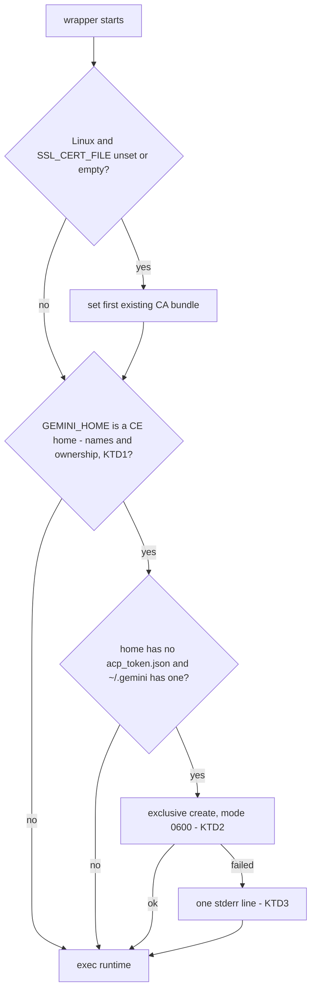

# Antigravity Sign-In Reuse for Compound Engineering - Plan

## Goal Capsule

- **Objective:** On a Linux host signed in to Antigravity once, Compound Engineering's Antigravity route serves cross-model reviews and `ce-work` delegation with nobody present, so agents use it there as they already do on macOS.
- **Means:** The PATH wrapper for `agy_acp_server.par` copies the user's `~/.gemini` sign-in into the private `GEMINI_HOME` that Compound Engineering creates for each run, before it starts the runtime.
- **Product authority:** GitHub issue #252, narrowed by this brainstorm to the sign-in limit. The model-id limit keeps its instruction workaround and is not active scope.
- **Stop conditions:** Stop if recognizing a Compound Engineering home would need a rule that could also match a T3 Code instance home or `~/.gemini`, or if any host output or check fails to build.
- **Execution profile:** Nix packaging, Nix checks, Markdown. No `nr switch`. The live runs in R11 are hardware checks the user performs after deploy; they are reported apart from check evidence.
- **Open blockers:** None.

---

## Product Contract

### Summary

The `agy_acp_server.par` wrapper recognizes a `GEMINI_HOME` that Compound Engineering created for one run, and when that home holds no sign-in token it copies the token from `~/.gemini` before it starts the runtime. With the sign-in reused, Linux hosts list `antigravity` in `CROSS_MODEL_PEERS` by default, and the shared instructions drop the rule that keeps unattended Linux runs off the route.

### Problem Frame

Compound Engineering 3.31.0 starts the Antigravity runtime with a new, empty `GEMINI_HOME` on every run. Its `acpx_antigravity_home` writes only a `settings.json` that selects `oauth-personal`, on the assumption that the runtime copies a sign-in into the new home. On Linux the runtime does not: it reads its token only from that home's `antigravity-acp/acp_token.json`. Every run therefore opens a browser sign-in, and a run with nobody present waits 60 seconds (`CROSS_MODEL_SESSION_START_SECS`) and drops the route as "waiting for a Google sign-in".

The repository works around this today by leaving `antigravity` out of `CROSS_MODEL_PEERS` on Linux (`home/h82/agents/gemini.nix`) and by an instruction that keeps agents off the route unless a person is present to sign in (`home/h82/agents/instructions/instructions.md.tmpl`). As a result, Linux hosts lose Antigravity as a review peer and as the `ce-work` Gemini worker outside T3 Code, even though the user has already signed in to Antigravity on that host.

The #251 plan excluded copying or linking a token into Compound Engineering's private home, because that moves a credential into a scratch directory and works against Compound Engineering's isolation. This plan reverses that exclusion (see Key Decisions).

### Key Decisions

- **Reuse the `~/.gemini` sign-in.** It is the home the `agy` CLI and the runtime's default use, so one sign-in per host serves both, including on hosts without a T3 Code trait. Governs R1. (session-settled: user-approved — chosen over a dedicated persistent Compound Engineering home and over the T3 Code instance home: a dedicated home needs a second sign-in, and the T3 Code home exists only on hosts with a T3 Code trait)
- **Seed only homes Compound Engineering created.** A T3 Code instance that falls back to the PATH runtime must not silently take on the `~/.gemini` account. Governs R2, R3. (session-settled: user-approved — chosen over seeding every non-default home that lacks a token: simpler, but it would sign a T3 Code instance in to the `~/.gemini` account without the user's action)
- **Copy the token; do not link it.** Concurrent reviews would otherwise write the same file, and a runtime that saves by rename would break the link. Each run's copy goes away with Compound Engineering's scratch. Governs R4.
- **Drop the Linux exclusion everywhere.** Every host kind lists `antigravity` in `CROSS_MODEL_PEERS`, and the instruction rule for unattended Linux runs is removed. A host never signed in pays the 60-second wait, after which the review continues with its other peer. Governs R6, R7. (session-settled: user-approved — chosen over including the route only when a token exists, and over keeping the rule: a token-presence switch needs a runtime decision point, and keeping the rule leaves unattended Linux runs without the route)
- **Fix the wrapper, not Compound Engineering.** The wrapper is already ours and on the route's path, so the fix survives Compound Engineering updates. Patching the plugin's `acpx_antigravity_home` at sync time was considered and set aside, because it breaks on each upstream change to that function.

### Requirements

**Sign-in reuse**

- R1. When the wrapper starts the runtime for a Compound Engineering run, the runtime finds the sign-in that `~/.gemini/antigravity-acp/acp_token.json` holds, with no browser sign-in.
- R2. The wrapper adds a token only to a `GEMINI_HOME` that Compound Engineering created for one run, and only when that home holds no token yet.
- R3. Any other start leaves every home untouched: `GEMINI_HOME` unset, set to `~/.gemini`, set to a T3 Code instance home, or set to any other home the wrapper does not recognize as Compound Engineering's.
- R4. The copied token is readable only by the user, and the wrapper never prints or logs token contents. `~/.gemini`'s own token file stays unchanged.
- R5. When `~/.gemini` holds no token, the wrapper starts the runtime exactly as it does today, so the runtime asks for a sign-in as before.

**Peer routing**

- R6. `CROSS_MODEL_PEERS` includes `antigravity` on NixOS, non-NixOS Linux, and macOS hosts.
- R7. The shared agent instructions no longer keep Linux runs off the Antigravity route, and no longer tell agents to add `antigravity` for a single pass. The removal condition keeps only the model-id half: drop the model request once Compound Engineering requests model ids the runtime advertises.

**Compatibility**

- R8. The wrapper's existing behavior holds: argv[0] is the runtime's store path, arguments and stdio pass through, and on Linux `SSL_CERT_FILE` is set when the caller left it unset or empty.
- R9. What T3 Code runs and reports does not change while its managed layout is in place.

**Documentation and verification**

- R10. `docs/provisioning.md` describes the sign-in reuse, the one-time `agy` sign-in per host, and the 60-second wait on a host never signed in. It no longer states that every Linux run asks for a sign-in.
- R11. `docs/verification.md` lists a live run on Linux: a Compound Engineering cross-model review, a `ce-pov` oracle panel pass, and a `ce-work` unit on the Antigravity route, all with nobody signing in during the run. The review runs while the access token in `~/.gemini` has expired, so the copy must refresh, and a second pass starts two reviews at once; `agy` must still work without a new sign-in afterward. It also lists the macOS run, which records whether the macOS runtime keeps its token in a file the wrapper can copy.

### Acceptance Examples

- AE1. **Covers R1, R2.** Given `~/.gemini` holds a valid token and Compound Engineering starts a review with a new private home, when the route opens a session, then no sign-in is requested and the review returns the peer's findings.
- AE2. **Covers R3.** Given T3 Code's managed layout is gone and T3 Code starts an instance through the PATH wrapper with an instance home that has no token, when the runtime starts, then the instance home gains no token and the runtime asks for that instance's own sign-in.
- AE3. **Covers R2.** Given a Compound Engineering home already holds a token, when the wrapper starts, then that token is kept as it is.
- AE4. **Covers R5, R6.** Given a Linux host where `~/.gemini` was never signed in, when an unattended review runs, then the Antigravity route waits 60 seconds and is skipped, and the review completes with its other peer.
- AE5. **Covers R4.** Given two reviews run at once, when each runtime refreshes its access token, then each writes only its own copy, and `~/.gemini`'s token file has the same contents as before.

### Scope Boundaries

- The model-id mismatch stays as the instruction workaround (`gemini-4-argon-high` for a peer, the worker's own id for a unit). Rewriting model ids in the wrapper is not built.
- Reporting both limits to Compound Engineering upstream is not part of this work.
- Writing a refreshed token back to `~/.gemini` is not built. The copy is discarded with the run's scratch.
- A dedicated Compound Engineering sign-in, separate from `~/.gemini`, is not built.
- T3 Code's managed layout, its instance homes, and its sign-in are not changed.

### Dependencies / Assumptions

- Google does not rotate the refresh token in `~/.gemini` when a copy refreshes its access token. If it did, a review could invalidate the user's `agy` sign-in. The Linux live run in R11 checks this with an expired access token, so the copy is forced to refresh, and then runs `agy`.
- Compound Engineering keeps creating the private home as a `gemini-home` directory under its own scratch, with a `settings.json` and no token, as 3.31.0 does in `ce-code-review`, `ce-doc-review`, `ce-pov`, and `ce-work`.
- The macOS runtime may keep its sign-in in the login keychain rather than in `acp_token.json`. In that case R1 does nothing on macOS. macOS already includes `antigravity` in `CROSS_MODEL_PEERS`, so this changes no macOS behavior.

### Outstanding Questions

#### Deferred to Implementation

- Affects R1 (technical): whether the runtime accepts the copied token with only Compound Engineering's own `settings.json` beside it. KTD2 copies only the token, and the R11 live run on Linux confirms it. If the run shows the runtime needs more from `~/.gemini/antigravity-acp/`, that reopens KTD2, because replacing Compound Engineering's `settings.json` is something KTD2 rules out; it is not applied silently.

### Sources / Research

- Compound Engineering 3.31.0 `acpx_antigravity_home` and the sign-in stall: `ce-code-review/scripts/cross-model-adversarial-review.sh` (lines 208-216, 314-317, 1022), `ce-work/scripts/cross-model-work.sh` (lines 125-130), `ce-doc-review/scripts/cross-model-doc-review.sh` (line 221), and `ce-pov/scripts/cross-model-pov.sh` (lines 579-603), in the installed plugin.
- The wrapper: `packages/antigravity-acp-path.nix`. Its checks: `tests/antigravity-acp-path.nix` and `tests/antigravity-acp-path-profiles.nix`.
- The Linux peer exclusion: `home/h82/agents/gemini.nix` (`my.agents.crossModelPeers`) and `home/h82/agents/cross-model-peers.nix`.
- The instruction rules this plan changes: `home/h82/agents/instructions/instructions.md.tmpl` (the Antigravity route lines), asserted in `tests/agent-instructions.nix`.
- The prior exclusion this plan reverses: `.compound-engineering/artifacts/plans/2026-10-19-1202-feat-antigravity-acp-on-path-plan.md` (Scope Boundaries).
- T3 Code instance homes and the PATH fallback: `docs/provisioning.md` (Antigravity CLI and T3 Code sections).
- Before writing any check: `.compound-engineering/artifacts/solutions/best-practices/shebang-script-stub-cannot-observe-argv0.md` and the substring-sentence learning `.compound-engineering/artifacts/solutions/best-practices/substring-sentence-check-passes-a-negated-instruction.md`.

Product Contract preservation: changed: R11 — adds the `ce-pov` pass, the expired-token condition, and the concurrent pass, which document review showed the original run could not exercise; the Dependencies line on refresh-token rotation follows. The two Deferred to Planning questions are answered by KTD1 and KTD2 and resolved in place.

---

## Planning Contract

### Key Technical Decisions

- KTD1. **Recognize a Compound Engineering home by the names Compound Engineering 3.31.0 gives it, plus ownership.** The wrapper seeds only when all of these hold. `GEMINI_HOME` is named `gemini-home`. Its parent is named `xmodel-cr-scratch-*`, `xmodel-doc-scratch-*`, `xmodel-pov-peer-*`, `ce-work-model-check-*`, or `ce-work-adapter-*`. The parent, the home, and its `antigravity-acp` directory are real directories, not symlinks, owned by the current user, and the parent has mode 0700 as `mktemp -d` leaves it. Those five are the `mktemp -d` templates of `ce-code-review`, `ce-doc-review`, `ce-pov`, and `ce-work`. No T3 Code instance home (named by a hex digest under `providers/antigravity`) or `~/.gemini` can match them. The match does not compare the grandparent with `TMPDIR`: `ce-pov` puts its scratch under `CROSS_MODEL_SCRATCH_PARENT` resolved with `pwd -P`, and a `TMPDIR` that ends in `/` gives a doubled slash, so a path comparison misses real homes. A future Compound Engineering that renames the templates makes the wrapper seed nothing, which is R3's behavior: the route asks for a sign-in again, visibly, instead of seeding a wrong home. Governs R2, R3. (session-settled: user-approved — chosen over seeding every non-default home that lacks a token: a T3 Code instance falling back to the PATH runtime must not silently get the `~/.gemini` account)
- KTD2. **Copy only `acp_token.json`, never over an existing file.** The source is `$HOME/.gemini/antigravity-acp/acp_token.json`. The target is `$GEMINI_HOME/antigravity-acp/acp_token.json`, created with mode 0600 by an exclusive create (`O_CREAT|O_EXCL`, which also refuses a planted symlink) so it never replaces or follows anything already there. The wrapper creates no directory. Compound Engineering already wrote its own `settings.json` selecting `oauth-personal`, so the wrapper leaves that file alone. Governs R1, R2, R4. (session-settled: user-approved — chosen over a dedicated persistent CE home and over the T3 Code instance home: one sign-in per host serves `agy` and Compound Engineering, including hosts without a T3 Code trait)
- KTD3. **Seeding is best effort, with one diagnostic line.** Any failure leaves the home as it is, and the wrapper still execs the runtime with its arguments and stdio unchanged. Stdout stays silent on every path, because acpx reads it as the ACP stream. Stderr stays silent when no home is recognized and when `~/.gemini` holds no token. When a home is recognized and a source token exists but the copy fails, the wrapper writes one fixed line to stderr, naming the step and never any token content, so a failed seed can be told apart from a host that was never signed in; every Compound Engineering script sends the runtime's stderr to its private log. Governs R4, R5, R8.
- KTD4. **Seed on every platform.** The seeding code is not gated on Linux like the CA default. On macOS it does nothing when the runtime keeps its token in the keychain, and it helps when it keeps a file. Governs R1.
- KTD5. **The peer allowlist drops its host-kind condition.** `home/h82/agents/gemini.nix` contributes `antigravity` unconditionally, and the test helper that derives expected peers from installed packages stops gating `antigravity-acp-path` on darwin, so every check that reads `CROSS_MODEL_PEERS` follows. Governs R6. (session-settled: user-approved — chosen over including the route only when a token exists and over keeping the Linux exclusion: a token-presence switch needs a runtime decision point, and keeping the exclusion leaves Linux without the route)
- KTD6. **The instruction test asserts the removal, not only the new text.** The removed Linux sentences join `removedTerms` in `tests/agent-instructions.nix` by distinctive phrases (`leaves out Antigravity`, `for that pass only`), so a rendered file that still carries the rule fails. Governs R7.

### High-Level Technical Design

The wrapper's decision before it execs the runtime:

### Assumptions

- Compound Engineering 3.31.0 is the installed version, and its scratch templates are the five KTD1 names. Verified in the installed plugin: `cross-model-adversarial-review.sh:608`, `cross-model-doc-review.sh:663`, `cross-model-pov.sh:583`, `cross-model-work.sh:390` and `:471`; each passes that directory to `acpx_antigravity_home`.
- acpx passes `GEMINI_HOME` through to the runtime it spawns by bare name, so the wrapper sees it. `acpx_base_argv` sets it as an environment entry (`cross-model-adversarial-review.sh:292`).

### Risks

- The runtime may refuse a token copied into another home. Only the R11 live run can show it, after U2 and U3 have enabled the route on Linux. If it fails, revert U2 and U3 until KTD2 is revisited, since every unattended Linux review would otherwise pay the 60-second wait.
- A `~/.gemini` access token that has expired makes every run refresh it through Google, because each copy is discarded with the scratch. That is one token request per run, and no state is shared.
- A Compound Engineering release that renames its scratch templates turns seeding off without an error, the same way a never-signed-in host behaves. A Compound Engineering update should be followed by the R11 Linux run, which catches it.

### Sequencing

U1 first, because U2 and U3 enable the route on Linux and only make sense once the wrapper seeds. U2 and U3 are independent. U4 documents the result last.

---

## Implementation Units

### U1. Seed Compound Engineering homes in the wrapper

**Goal:** The PATH `agy_acp_server.par` wrapper copies the `~/.gemini` token into a Compound Engineering home before it execs the runtime.

**Requirements:** R1, R2, R3, R4, R5, R8; KTD1, KTD2, KTD3, KTD4.

**Dependencies:** None.

**Files:**

- `packages/antigravity-acp-path.nix` (modify: wrapper script and header comment)
- `tests/antigravity-acp-path.nix` (modify: stub and scenarios)

**Approach:**

1. Add the seeding block after the Linux CA block and before `exec`, on every platform (KTD4).
2. Split `GEMINI_HOME` with shell parameter expansion after removing trailing slashes, match the leaf and parent names with `case` patterns, and test each directory with `[ -d ]`, `[ ! -L ]`, and `[ -O ]` (KTD1). Read the parent's mode with `${pkgs.coreutils}/bin/stat` by store path, since the wrapper runs with whatever `PATH` the caller gives.
3. Create the target under `umask 077` with noclobber set, so the shell's redirection opens it with `O_EXCL`, and copy with `${pkgs.coreutils}/bin/cat` by store path (KTD2).
4. On a failed create or copy, remove a partial file only if this run created it, and write KTD3's stderr line.
5. Keep the `exec` line byte-identical, because `tests/darwin-outputs.nix` greps it.

**Execution note:** Extend the stub first so each new scenario fails against the current wrapper, then add the seeding block.

**Patterns to follow:** The existing Linux CA block in the same wrapper. The stub-runtime design in `tests/antigravity-acp-path.nix`, which compares against values the stub reports rather than the wrapper's own Nix expression.

**Test scenarios:** The stub also prints the contents of `$GEMINI_HOME/antigravity-acp/acp_token.json` when present, and its mode. Each scenario runs under `env -i` with `PATH=/no-such-dir`, an explicit `TMPDIR`, and a fake `HOME` holding a fake token. Each CE home is built the way `acpx_antigravity_home` builds it: a 0700 parent, `gemini-home/antigravity-acp/settings.json`.

- Covers AE1. A home under `xmodel-cr-scratch-abc123`: the runtime sees the fake token, with mode 600.
- The same for each of the other four templates (`xmodel-doc-scratch-*`, `xmodel-pov-peer-*`, `ce-work-model-check-*`, `ce-work-adapter-*`).
- A `TMPDIR` ending in `/`, giving `<tmpdir>//xmodel-cr-scratch-abc123/gemini-home`: the runtime sees the fake token.
- A `ce-pov`-style home under a nested scratch parent, not directly in `TMPDIR`: the runtime sees the fake token.
- Covers AE3. The CE home already holds a different token: the runtime sees that token unchanged.
- Covers AE2. `GEMINI_HOME` is a directory shaped like a T3 Code instance home (`$HOME/.t3/userdata/providers/antigravity/<hex>`): no token appears.
- `gemini-home` under a parent with another name: no token appears.
- A matching parent with mode 0755, a `gemini-home` that is a symlink to a real directory, and an `antigravity-acp` that is a symlink: no token appears at either end of the link.
- A dangling symlink planted at the target path: the link is left as it is, nothing is written through it, and the stderr line appears.
- No `antigravity-acp` directory in the home: nothing is created.
- `GEMINI_HOME` unset, and `GEMINI_HOME=$HOME/.gemini`: nothing is created.
- Covers R5. No source token: the runtime starts with no token, and the wrapper writes nothing to stdout or stderr.
- An unreadable source token in a recognized home: the runtime starts, no partial target is left, and exactly the KTD3 line is on stderr, with no token content.
- `HOME` unset: the runtime still starts.
- Covers R4. After every scenario the source token's contents and mode are unchanged, and stdout carries only the stub's output.
- The existing argv[0], pid, argument, stdin, and CA scenarios keep passing (R8).

**Verification:** The `antigravity-acp-path` check passes, and each mutation the Verification Contract lists makes it fail with its own message.

### U2. List Antigravity as a peer on every host kind

**Goal:** `CROSS_MODEL_PEERS` includes `antigravity` on NixOS, non-NixOS Linux, and macOS.

**Requirements:** R6; KTD5.

**Dependencies:** U1.

**Files:**

- `home/h82/agents/gemini.nix` (modify: `my.agents.crossModelPeers` and its comment)
- `tests/lib/cross-model-peers.nix` (modify: drop the darwin gate and the now-unused `kind` parameter, and update the header)
- `tests/session-variables.nix`, `tests/darwin-config.nix`, `tests/darwin-outputs.nix` (modify: call the helper with the package list only, and update comments that describe the Linux exclusion or a wrapper that only execs)
- `tests/antigravity-acp-path-profiles.nix` (modify: assert each Linux profile's wrapper carries the seeding block)

**Approach:** Make the contribution unconditional and let the existing package-derived expectation follow, so the checks that read the session variable and the darwin configuration keep comparing against installed packages. `tests/darwin-outputs.nix` and `tests/antigravity-acp-path-profiles.nix` also assert that the materialized wrapper references `acp_token.json`, so KTD4 is checked on both platforms; the behavior itself is proven by U1's stub check.

**Patterns to follow:** `home/h82/agents/grok.nix`, which contributes its token unconditionally.

**Test scenarios:**

- Covers AE4. A NixOS fixture user's `CROSS_MODEL_PEERS` is `antigravity,claude,grok` (`session-variables`).
- A non-NixOS Linux fixture user gets the same value.
- The macOS fixture keeps `antigravity,claude,grok` (`darwin-config`).
- Mutation: restoring the darwin-only condition in `gemini.nix` fails `session-variables` for the Linux users.
- Mutation: gating the seeding block on Linux fails `darwin-outputs`; gating it on darwin fails `antigravity-acp-path-profiles`.

**Verification:** `session-variables`, `darwin-config`, and `antigravity-acp-path-profiles` pass, and the mutations above fail.

### U3. Remove the Linux rule from the shared instructions

**Goal:** Agents no longer keep Linux runs off the Antigravity route, and the model-id request stays.

**Requirements:** R7; KTD6.

**Dependencies:** U1.

**Files:**

- `home/h82/agents/instructions/instructions.md.tmpl` (modify the Antigravity route lines)
- `tests/agent-instructions.nix` (modify expected sentences and `removedTerms`)

**Approach:**

1. Delete the "Outside T3 Code on a Linux host" sentence.
2. In the `ce-work` outside-T3 sentence, drop the clause that leaves out `antigravity` where the Linux rule applies.
3. Reword the removal sentence to cover only the model request: drop it once Compound Engineering requests model ids the runtime advertises.
4. Update the expected sentences in the test and add KTD6's phrases to `removedTerms`.

**Patterns to follow:** The existing sentence list and `removedTerms` handling in `tests/agent-instructions.nix`. Read `.compound-engineering/artifacts/solutions/best-practices/substring-sentence-check-passes-a-negated-instruction.md` before changing assertions.

**Test scenarios:**

- Every rendered harness file contains the reworded removal sentence and the shortened `ce-work` sentence.
- No rendered file contains `leaves out Antigravity` or `for that pass only`.
- Mutation: restoring the deleted sentence in the template fails the check through `removedTerms`.

**Verification:** `agent-instructions` passes, and the mutation fails.

### U4. Document the sign-in reuse

**Goal:** The docs describe how the route reuses the sign-in and what remains a hardware check.

**Requirements:** R10, R11.

**Dependencies:** U1, U2, U3.

**Files:**

- `docs/provisioning.md` (modify the Antigravity CLI paragraphs on the PATH runtime, the sign-in, and `CROSS_MODEL_PEERS`, and the two Linux-exclusion sentences under Shared agent instructions)
- `docs/verification.md` (modify the Linux and macOS Antigravity route items)

**Approach:** Replace the statement that every Linux run asks for a sign-in with KTD1-KTD3's behavior, the one-time `agy` sign-in, and the 60-second wait on an unsigned host. Change the peer value for Linux to `antigravity,claude,grok`. In `verification.md`, the Linux item drops "add `antigravity` for that run" and carries R11's runs. The macOS item records whether the runtime keeps a token file.

**Test expectation:** none -- documentation only; markdownlint runs in the pre-commit hook.

**Verification:** No remaining doc text states that Linux leaves Antigravity out or that every run asks for a sign-in.

---

## Verification Contract

| Gate | Command | Proves |
| --- | --- | --- |
| Format | `nix fmt -- --ci` | Nix layout |
| Checks | `nix flake check` | `antigravity-acp-path`, `antigravity-acp-path-profiles`, `session-variables`, `darwin-config`, `agent-instructions`, and the rest |
| Hosts | the `nixosConfigurations`, `homeConfigurations`, `systemConfigs`, and `darwinConfigurations` loops in `AGENTS.md` | every output builds; macOS outputs evaluate here and build in CI's `build-darwin` |
| VM tests | `nix build --no-link .#vmChecks.all` | no regression in VM checks |
| Mutations | scratch copies per `.compound-engineering/artifacts/solutions/best-practices/copied-git-worktree-writes-the-real-index.md` | each check fails with its own message for: seeding removed, KTD1 pattern widened to any `gemini-home`, `xmodel-pov-peer-*` dropped, the ownership, symlink, or 0700 test removed, noclobber removed, overwrite of an existing token, a source modified, output on stderr on a silent path, the failed-copy line removed, bare `cat` instead of the store path, the darwin gate restored, seeding gated to one platform, the Linux sentence restored |
| Hardware | R11 items in `docs/verification.md` | live behavior, reported apart from check evidence |

## Definition of Done

- U1 through U4 are implemented, and every gate above passes except the hardware row, which is reported as pending for the user.
- Every mutation in the Mutations row was run and made its check fail.
- No experimental or abandoned code remains in the diff.
