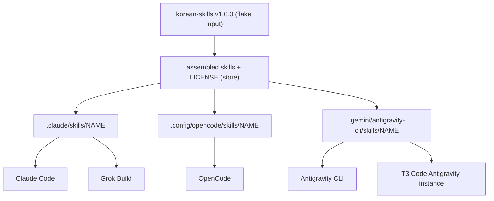

# Korean Writing Skills for Every Harness - Plan

## Goal Capsule

- **Objective:** Korean text an agent leaves behind, in every harness that reads the shared agent instructions, meets the same three checks: natural writing without AI tells, correct grammar and spelling, and a consistent style. T3 Code's Antigravity instance, which reads no instructions file, gets the skills, and the rule reaches it only through a delegating agent's task prompt (KTD5).
- **Means:** install the `humanizer`, `grammar-checker`, and `style-guide` skills from [DaleSeo/korean-skills](https://github.com/DaleSeo/korean-skills) in every harness through one Home Manager module (KTD1), and add a `# Korean text` section to the shared agent instructions (KTD4).
- **Authority:** the Product Contract decides behavior and scope; the Planning Contract's KTDs decide mechanism within it; a unit overrides neither.
- **Execution profile:** Nix module, instructions template, and their checks, then a live load check per harness on the developer's host.
- **Stop conditions:** stop and report when a harness cannot load store-linked skills and the copy fallback (KTD3) also fails, or when the new instruction sentences cannot pass `tests/agent-instructions.nix` without changing their meaning.
- **Who finishes:** `ce-work` implements; the user merges.
- **Open blockers:** none.

---

## Product Contract

### Summary

Every harness gets the three korean-skills skills under their upstream names, pinned to `v1.0.0`. A new rule in the shared instructions has the agent load all three before it writes lasting Korean text or a closing report, apply them while writing, check the text before it publishes it, and audit Korean text with them during code and document review.

### Problem Frame

Korean text that agents write carries recognizable AI tells: translation-ese particles, comma overuse, rigid spacing, hype vocabulary, and tone that drifts between sentences. The user's instructions route reports through `ce-noslop`, but `ce-noslop` applies only its tests to text that is not English and skips its pattern catalog, so nothing today catches Korean-specific tells. The repository installs no Korean-language skill and the instructions template has no rule about Korean text.

### Requirements

**Installation**

- R1. The three skills `humanizer`, `grammar-checker`, and `style-guide` are available, under those names, in Claude Code, Grok Build, OpenCode, the Antigravity CLI, and T3 Code's Antigravity instance, on every host kind (NixOS, non-NixOS Linux, macOS).
- R2. The installed content is pinned to upstream tag `v1.0.0` (revision `fe6432e95f6675f7e411eacb2e1c36f1de54f962`), and a re-pointed tag fails a check rather than changing what is installed.
- R3. Each harness loads the skills from one shared installation mechanism, rather than a plugin in one harness and plain directories in others.
- R4. The upstream MIT license travels with the installed skills.

**Writing rule**

- R5. Before writing covered Korean text, the agent loads all three skills in the session; once loaded, they stay loaded for the rest of the session.
- R6. Covered Korean text is any Korean text that outlasts the conversation, namely commit messages, pull and merge request bodies and comments, issue bodies and comments, documents, and Korean inside code (comments, string literals, user-facing messages, logs, localization resources), plus a closing report, summary, or handoff to the user.
- R7. Short conversational chat replies are not covered text.
- R8. The agent writes covered text by those skills' rules, then checks it with all three before publishing it, and applies every correction it finds.
- R9. While writing, the agent applies the skills silently: it does not paste their analysis tables, grades, or change summaries into the text or the conversation.
- R10. Text the user asks to post as written, and verbatim quotes, are not rewritten.
- R11. Where a report also goes through `ce-noslop`, `ce-noslop` runs first and the three skills run after it, in the order humanizer, grammar-checker, style-guide.

**Audit**

- R12. When `ce-code-review`, `ce-doc-review`, or `ce-simplify-code` meets Korean text in the diff or document under review, it audits that text with all three skills and reports each problem as a finding.
- R13. Those findings fall under the existing rule that every review finding is applied in the same change, whoever wrote the text.

### Key Decisions

- **Covered text is lasting text plus closing reports, not every chat reply.** Loading three skills (about 43 KB of instructions) into every Korean-language session costs context and adds a correction pass to every turn. (session-settled: user-directed — chosen over all chat replies and over lasting text only: closing reports are read and shared, short replies are not.) Governs R6, R7.
- **Korean inside code is covered.** (session-settled: user-directed — chosen over limiting code to comments: the user added code explicitly after the scope question.) Governs R6.
- **Audit runs inside the review skills, not on request alone and not as a one-time sweep.** (session-settled: user-directed — chosen over on-request audits and over a repository-wide sweep of existing text.) Governs R12.
- **Audit findings on human-written Korean are applied like any other finding.** (session-settled: user-directed — chosen over applying only grammar errors to human text and over reporting only: the user kept the existing apply-every-finding rule unchanged.) Governs R13.
- **One installation mechanism with upstream names, not the plugin registry.** The plugin route fits Claude Code alone: the Antigravity row needs a `.agy/` directory or a root `plugin.json`, and the OpenCode row needs a root `index.js`, and korean-skills has neither. Same names everywhere let one instruction sentence name the skills in every harness. (session-settled: user-approved — chosen over extending the plugin registry with a Claude plugin plus separate directories elsewhere: that splits delivery and gives Claude Code different skill names.) Governs R1, R3.
- **Pin the `v1.0.0` tag.** The tag differs from `main` only by a CI commit, so skill content matches the latest upstream. Governs R2.

### Acceptance Examples

- AE1. **Covers R6, R8.** Given a Korean commit message the agent drafted, when it commits, the message has already passed all three skills and every correction is applied.
- AE2. **Covers R6, R7.** Given a one-line Korean answer to a quick question in chat, the agent replies without loading the skills. Given the closing report of a finished task, the agent loads and applies them.
- AE3. **Covers R6.** Given a diff that adds a Korean error message as a string literal, that string is covered text.
- AE4. **Covers R10.** Given the user asks to post a Korean comment exactly as they wrote it, the agent posts it unchanged.
- AE5. **Covers R12, R13.** Given `ce-code-review` on a pull request whose README a person wrote in Korean, the review reports humanizer, grammar, and style findings on it, and all of them are applied in the same change.
- AE6. **Covers R5.** Given a session that already loaded the three skills for an earlier commit message, a later pull request body does not load them again.

### Scope Boundaries

- A one-time sweep that rewrites Korean text already in repositories.
- A Korean rule for the repository's own docs, which stay English per `AGENTS.md`.
- Renaming or namespacing the skills to avoid a future collision with a same-named skill.
- Automatic upgrades past `v1.0.0`; a bump is a deliberate change, like other pinned agent sources.
- Codex and a standalone Gemini CLI, which this repository does not install.
- A copy-based installer with a prune manifest, considered and not built: store links are expected to load, and a root that rejects them fails visibly in the Antigravity live check. Evidence that changes the call: that check reporting the skills missing.

### Dependencies / Assumptions

- T3 Code's Antigravity instance reads no global instructions file (2026-10-15 probe), so R1 gives it the skills but the writing rule (R5-R11) does not reach it; a session there uses them only when asked, or when a delegating agent puts the rule in its task prompt (KTD5).
- Grok Build reads `~/.claude/skills/` through its Claude compatibility default, per `docs/provisioning.md` and the strings of the pinned 1.0.62 binary; nothing in this repository turns that default off.
- The skills' own frontmatter lists `allowed-tools`, including `AskUserQuestion`; the rule assumes an agent applying them silently does not stop to ask questions the skills suggest.

### Outstanding Questions

**Deferred to Implementation**

- Whether the Antigravity CLI and T3 Code's Antigravity instance load a skill whose directory is a Nix store symlink; no store-linked skill has been shown to load there yet, and KTD3 decides what happens if they do not.

### Sources / Research

- `home/h82/agents/agent-plugins.nix` and `scripts/agent-plugin-sync`: the plugin registry and its per-harness source requirements.
- `home/h82/agents/instructions/instructions.md.tmpl` and `home/h82/agents/instructions/default.nix`: the shared instructions and their per-harness renderings.
- `tests/agent-instructions.nix`: the sentence and heading pins on the instructions.
- `docs/provisioning.md`: skill paths for Grok, OpenCode, and T3 Code's Antigravity instance.
- `.compound-engineering/artifacts/solutions/integration-issues/orca-rejects-hardlinked-nix-store-skill-files.md`: hardlinked skill files from `home.file`.
- `ce-noslop` `SKILL.md`: applies only its tests on text that is not English.

Product Contract preservation: restructured, no scope change: the planning-deferred Outstanding Questions are resolved into KTD1-KTD5, and one implementation-time question remains.

---

## Planning Contract

### Key Technical Decisions

- KTD1. **One Home Manager module links each skill into three user skill roots.** `home/h82/agents/korean-skills.nix` takes the pinned `korean-skills` flake input and declares `home.file` entries for each skill under `.claude/skills/<name>` (Claude Code, and Grok through its Claude compatibility), `.config/opencode/skills/<name>` (OpenCode), and `.gemini/antigravity-cli/skills/<name>` (Antigravity CLI, and T3 Code's instance through its directory link). Each root is the one its harness reads: OpenCode 2.0.32 ignores `~/.claude/skills` under the wrapper's `OPENCODE_DISABLE_CLAUDE_CODE=true` but reads `~/.config/opencode/skills` (live probe), and the Antigravity CLI lists a `config/skills` entry twice but an `antigravity-cli/skills` entry once. The module declares no link under `~/.agents/skills`, which dotagents manages. On a host where `~/.claude/skills` is itself a link into `~/.agents/skills`, as on the developer's host, the Claude-root links still land in that dotagents directory, and OpenCode sees them there beside its own entries; the Assumptions cover both effects. The module is unconditional, not in `home/h82/t3code.nix`, because CLI users on every host need the skills. Governs R1, R3 (session-settled: user-approved — chosen over extending the plugin registry with a Claude plugin plus separate directories elsewhere: the plugin rows need a `.agy/` directory, a root `plugin.json`, or a root `index.js`, none of which korean-skills has).
- KTD2. **Pin by tag URL plus a hand-written `expectedRev`, checked against `flake.lock`.** Mirror `home/h82/agents/agent-plugins.nix`: the flake input `github:DaleSeo/korean-skills/v1.0.0` (`flake = false`), a registry with `tag = "v1.0.0"` and `expectedRev = "fe6432e95f6675f7e411eacb2e1c36f1de54f962"` exposed through a read-only internal option, and a check that fails when the locked rev or ref differs. A moved tag then fails a check instead of arriving as a lock diff. Governs R2.
- KTD3. **Store symlinks first, an activation copy only for a root that rejects them.** A small derivation assembles each skill directory with the upstream root `LICENSE` added (R4), and each `home.file` entry links to it. OpenCode loads symlinked skills (live probe) and Claude Code already reads hardlinked store files through its plugin, so links fit the evidence. If the Antigravity probe shows the CLI or T3 instance rejecting the links, that root switches to an activation step that copies the skills with link count 1, designed at that point. Governs R1, R4.
- KTD4. **A new `# Korean text` instructions section, every sentence pinned.** The section sits between `# Markdown` and `# Review findings` in `home/h82/agents/instructions/instructions.md.tmpl`, uses no template actions, so all four renderings carry the same text, and enters `tests/agent-instructions.nix` in its four places: a heading and sentence list, `checkedSections`, `pinnedSentences`, and `topLevelHeadings`. Sentences avoid a full stop followed by a space inside a sentence, any `removedTerms` substring (such as "zen" or "codex"), and an unescaped tilde. R13 needs no new sentence: `# Review findings` already applies every finding those skills report. Governs R5-R12.
- KTD5. **The audit reaches delegated reviewers through their task prompts.** A delegated reviewer or cross-model peer sees none of these instructions, and T3 Code's Antigravity instance reads no instructions file, so one pinned sentence tells the reviewing agent to put the audit rule into each delegated reviewer's or peer's task prompt. The review skills' own text is pinned plugin content this repository does not patch. Governs R12.

### High-Level Technical Design

One pinned source fans out to three skill roots, and each harness reads exactly one of them:

### Assumptions

- Home Manager creates a link under `~/.claude/skills` when that directory is itself a symlink, as it is on this host (into `~/.agents/skills`); this is unverified and the U1 activation build on this host shows it.
- On a host where `~/.claude/skills` points into `~/.agents/skills`, OpenCode also sees the Claude-root entries there, beside its own; both name the same store directory and OpenCode keys skills by name, so a duplicate is harmless. U1's OpenCode live check confirms one listing per name.
- On a host where `~/.claude/skills` points into `~/.agents/skills`, the three Claude-root links sit in dotagents' managed directory, and `dotagents sync` adopts skills it finds there undeclared. The links must stay Nix-owned; the dotagents row of the Verification Contract shows what dotagents reports, and `docs/provisioning.md` says not to adopt them into `~/.agents/agents.toml`.
- A user who already installed one of the three skill names by hand at a target path gets an activation failure ("existing file in the way") and removes it once; `docs/provisioning.md` says so.

### System-Wide Impact

- Every host kind (NixOS, non-NixOS Linux, macOS) gains nine `home.file` links; `tests/darwin-config.nix` evaluates the macOS fixture on Linux, so a link that cannot materialize on darwin shows there.
- The instructions change reaches every harness rendering and therefore every project and session that loads them.

---

## Implementation Units

### U1. Pin korean-skills and link it into every harness

- **Goal:** the three skills, each with `LICENSE`, appear in the three skill roots on every host, from a pinned source a check guards.
- **Requirements:** R1, R2, R3, R4; KTD1, KTD2, KTD3.
- **Dependencies:** none.
- **Files:**
  - `flake.nix` (new `korean-skills` input; register the `korean-skills` check beside `agent-plugins`)
  - `flake.lock`
  - `home/h82/agents/korean-skills.nix` (new)
  - `home/h82/agents/default.nix` (import, alphabetical)
  - `tests/korean-skills.nix` (new)
- **Approach:**
  1. Add the input and lock it.
  2. In the module, keep a registry (`tag`, `expectedRev`, `upstream`, the three skill names) and expose it through a read-only internal option, as `my.agentPlugins` does.
  3. Build one derivation holding `<name>/` for each skill with `SKILL.md`, `references/`, `examples/`, and the upstream root `LICENSE` copied in.
  4. Declare one `home.file` entry per skill per root, each a directory link into that derivation.
- **Patterns to follow:** `home/h82/agents/agent-plugins.nix` (registry, read-only option, `inputs` argument); `tests/agent-plugins.nix` (lock comparison, `or` fallbacks, failures collected); `home/h82/agents/instructions/default.nix` (read-only store links through `home.file`); `tests/lib/configurations.nix` `userEntries` for every user on every host.
- **Execution note:** mutation-test each assertion as `AGENTS.md` requires before trusting the check.
- **Test scenarios:**
  - For every user entry, each of the nine targets is an enabled `home.file` entry, found by resolved `target`, and exists in the materialized `home-files`.
  - Each target holds a `SKILL.md` whose frontmatter `name` equals the directory name, and a `LICENSE` file that starts with "MIT License".
  - The set of skill names under each root is exactly `humanizer`, `grammar-checker`, `style-guide`; dropping one from the registry turns the check red.
  - The registry's `expectedRev` equals `flake.lock`'s `nodes.korean-skills.locked.rev`, and `original.ref` equals `tag`; editing either turns the check red.
  - A lock with no `rev` or no `ref` fails the check.
  - No target lands under `.agents/skills` or `.gemini/config/skills`; moving the Antigravity root to `config/skills` turns the check red.
- **Verification:** the new check passes in `nix flake check`; every `homeConfigurations`, `nixosConfigurations`, and `systemConfigs` output builds; each mutation above turns the check red and reverting it turns it green.

### U2. Add the Korean text section to the shared instructions

- **Goal:** every harness rendering carries a `# Korean text` section whose sentences state R5-R12, and the check pins each sentence.
- **Requirements:** R5, R6, R7, R8, R9, R10, R11, R12, R13; KTD4, KTD5.
- **Dependencies:** U1 (the sentences name the installed skills).
- **Files:**
  - `home/h82/agents/instructions/instructions.md.tmpl`
  - `tests/agent-instructions.nix`
- **Approach:**
  1. Write one sentence per rule: the covered-text definition (R6), the chat-reply exclusion (R7), loading once per session (R5), writing and checking with every correction applied (R8), silent application (R9), the verbatim exception (R10), the `ce-noslop` order (R11), the review audit with findings whoever wrote the text (R12), and the delegated-reviewer task-prompt rule (KTD5).
  2. Add the section between `# Markdown` and `# Review findings`.
  3. Add the heading and sentences to the check's four places in file order.
- **Patterns to follow:** the `# Markdown` and `# Review findings` sections and their pinned lists in `tests/agent-instructions.nix`.
- **Execution note:** run the mutation rounds the learning `substring-sentence-check-passes-a-negated-instruction.md` describes.
- **Test scenarios:**
  - Covers AE1, AE2, AE3, AE4, AE5, AE6. Each new sentence appears exactly once in every harness rendering and starts where a sentence starts.
  - Negating one sentence ("Do not load ...") turns the check red.
  - Adding an extra sentence to the section, such as one that exempts human-written text, turns the check red.
  - Moving the section after `# Review findings` turns the heading-order assertion red.
  - Renaming the heading turns the check red.
  - The rendered files carry no unescaped tilde and no `removedTerms` substring.
- **Verification:** `agent-instructions` passes and each mutation above turns it red.

### U3. Document the skills and the rule

- **Goal:** the provisioning and verification docs and `AGENTS.md` describe the new skills, their roots, the rule, and how to check them by hand.
- **Requirements:** R1, R4, R12; KTD1, KTD3, KTD5.
- **Dependencies:** U1, U2.
- **Files:**
  - `docs/provisioning.md` (the skills-as-user-state sentence near line 240, the Grok paragraph near 260, the T3 Antigravity paragraph near 283, the OpenCode switch bullet near 343, and the Shared agent instructions paragraphs)
  - `docs/verification.md` (manual checklist near lines 136-143)
  - `AGENTS.md` (the `home/h82/agents/` structure bullet)
- **Approach:**
  1. State that the three Korean skills are declared and every other skill stays the user's, including the one-time removal of a hand-installed copy.
  2. Correct the OpenCode bullet: the switch gates `~/.claude/skills` only, and where `~/.claude/skills` links into `~/.agents/skills` OpenCode also sees the Claude-root entries through `~/.agents/skills`.
  3. Say that the three skills are Nix-owned and must not be adopted into `~/.agents/agents.toml` by dotagents.
  4. Describe the `# Korean text` section, its peer task-prompt rule, and that T3 Code's Antigravity instance gets the skills but not the rule.
  5. Add one manual load check per harness, and the dotagents check.
- **Test expectation:** none -- documentation only; the pre-commit Markdown lint covers formatting.
- **Verification:** `markdownlint-cli2` passes and every path and line the docs name exists.

---

## Verification Contract

| Gate | Command or action | Applies to |
| --- | --- | --- |
| Format | `nix fmt -- --ci` | U1, U2 |
| Checks | `nix flake check`, plus `nix build --no-link .#checkShards.<name>` for the shard holding `korean-skills` | U1, U2 |
| Outputs | build every `nixosConfigurations.<host>.config.system.build.toplevel`, `homeConfigurations.<host>.activationPackage`, and `systemConfigs.<host>` as `AGENTS.md` lists; macOS outputs are left to CI's `build-darwin` job | U1 |
| VM tests | `nix build --no-link .#vmChecks.all` | U1, U2 |
| Markdown | `mise run lint-staged-markdown` (pre-commit) | U3 |
| OpenCode live | `opencode serve` in a scratch `HOME` with the wrapper's switches, then `GET /api/skill` lists each name once | U1 |
| Grok live | `grok inspect --json` lists the three skills | U1 |
| Antigravity live | `scripts/antigravity-acp-probe <version>` reports the three skills loaded from a signed-in instance home; failing that, KTD3's copy fallback | U1 |
| Claude live | `/skills` in Claude Code lists the three skills | U1 |
| dotagents | after activation on the developer's host, `dotagents doctor` in user scope, without `--fix`, and `dotagents list`; the three Claude-root links stay Home Manager links into the store and are not declared in `~/.agents/agents.toml` | U1 |

Live checks run on the developer's host and are reported separately from check and VM evidence, per `docs/verification.md`; a live check that needs a sign-in the session lacks is reported as not run.

---

## Definition of Done

- U1-U3 are implemented, and every gate in the Verification Contract that can run here passed; live checks that could not run are named.
- Each new check assertion was mutation-tested red and reverted green.
- The Antigravity load question is answered: links load, or that root uses an activation copy (KTD3).
- No experimental or abandoned code from dead-end attempts remains in the diff.
