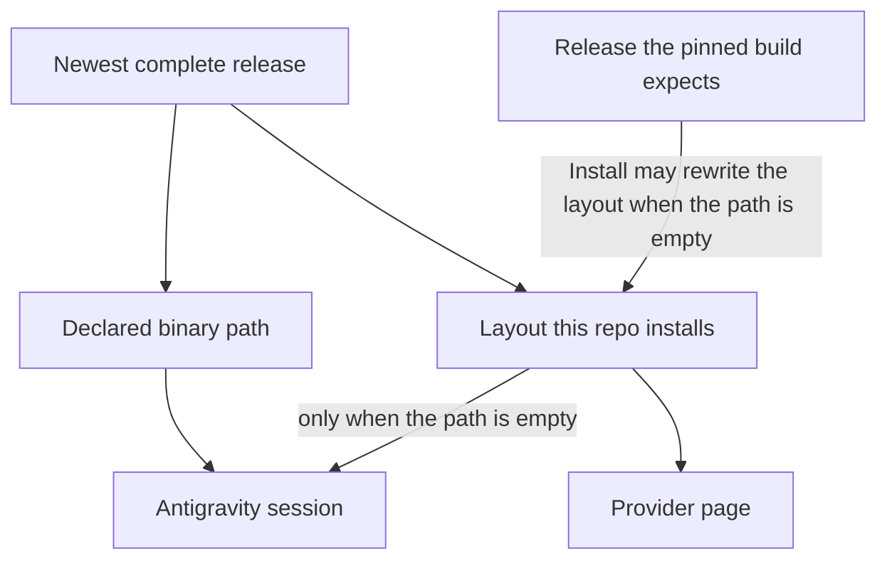
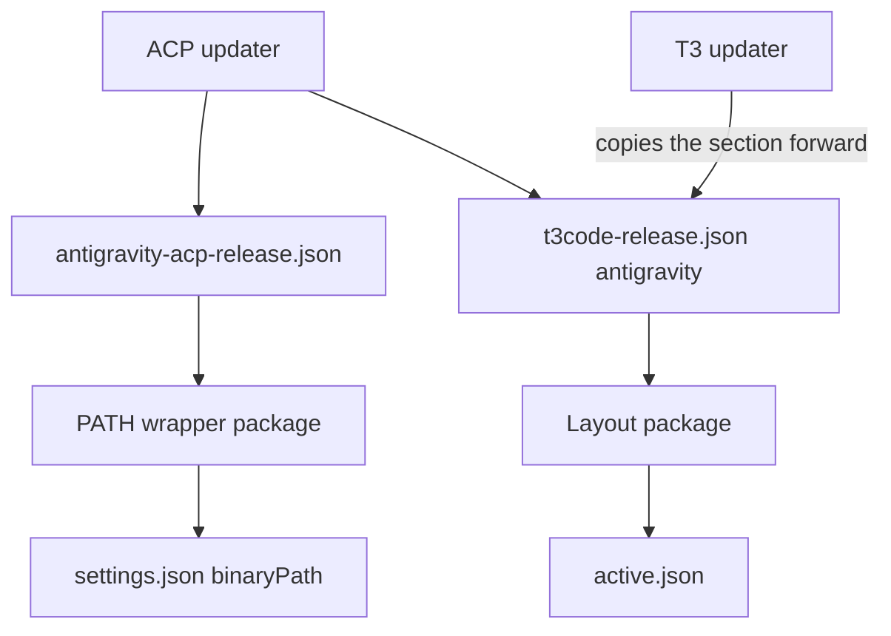
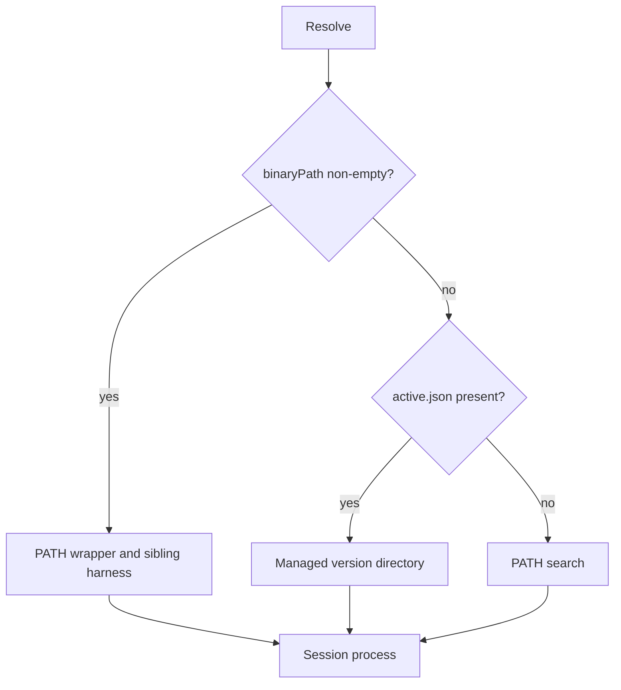
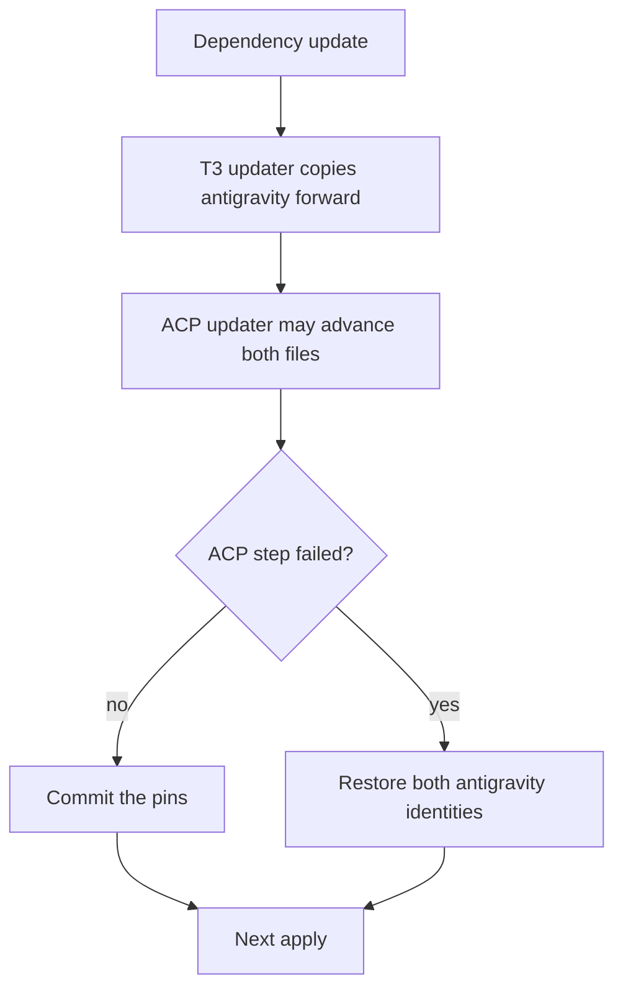

# Antigravity ACP Latest Runtime - Plan

## Goal Capsule

- **Objective:** An Antigravity session in T3 Code runs the newest complete Antigravity ACP release, and an agent does not start a timer whose only job is to wake itself later.
- **Means:** Point the provider's binary path and the runtime T3 Code installs at that release (KTD1, KTD2), and replace the shared self-wake waits (KTD3).
- **Product authority:** Confirmed in this brainstorm.
- **Execution profile:** Standard. The work is packaging, an updater ownership change, and pinned instruction text.
- **Open blockers:** None.
- **Finish:** The implementation pipeline opens the pull request. The user merges. Do not apply the generation on the live machine as validation.

---

## Product Contract

### Summary

T3 Code Antigravity sessions start the newest complete ACP release, the release the PATH runtime already tracks.
The provider binary path and the installed layout both name that release.
The version on the provider page is not the success signal.
Shared agent instructions stop telling the agent to keep a 10-minute background sleep while a delegated task runs.

### Problem Frame

An Antigravity session starts 1.3.0, the release the pinned T3 Code nightly requires.
After a message, progress is slow, and work that is running does not appear in the UI.
The PATH runtime is already on 1.4.1 and moves when Google publishes a newer release that every supported system serves.
Separately, the shared instructions tell an agent who still needs a delegated task to leave a 10-minute `sleep 600` running so a later turn can check it.
That sleep does not do the work.
T3 Code already notifies the thread when the task finishes.

### Key Decisions

- **Same release on the path and the layout.** (session-settled: user-directed — chosen over a path-only change that left the installed layout on the nightly's runtime, and over leaving the path empty and updating only the layout: either selection has to start the newest release.) Governs R2, R3.
- **The session process is the success signal.** (session-settled: user-directed — chosen over also requiring the provider page to keep showing that version: the page may show no version or the version the pinned build expects.) Governs R4.
- **Newest means the complete release the existing updater already selects.** (session-settled: user-approved — the synthesis stated that a one-system release does not move the pin and that a host receives it on the next apply, and the user confirmed.) Governs R5.
- **A self-wake timer is forbidden.** (session-settled: user-approved — the user asked to include the instruction, the synthesis limited it to timers whose only job is to wake the agent, and the user confirmed.) Governs R7, R8.

### Requirements

**Session runtime**

- R1. On a host where T3 Code's Antigravity provider is declared, a session starts the newest complete Antigravity ACP release while the binary path is set or the installed layout is still that release. While the path stays cleared, Install may start the release the pinned build expects until the activation R2 names writes the path back.
- R2. That provider's binary path is set to the release in R1, and if the app clears the path, the next activation that runs writes it back, which on NixOS happens only when the rebuild produces a new Home Manager generation.
- R3. The Antigravity runtime this repository installs for T3 Code is the release in R1.
- R4. When the installed layout is rewritten while the binary path is still set, the session still starts the release in R1, and the provider page may show no version or the version that build expects. Resolve does not reject or replace the layout.
- R5. The newest complete release is the highest release every system this repository supports serves, and a host starts it on the next apply after the existing dependency update records it. A release one system lacks, an update that finds nothing newer, or a failed update leaves the current release in place.
- R6. A host that does not declare T3 Code is unchanged. Signing in to Google stays manual.

**Agent wait**

- R7. The shared agent instructions forbid a sleep, a timer, or a background command whose only purpose is to wake the agent later. A delay a test must reproduce, a retry interval, a wait the user asked for, and a wait that blocks on the task's own run stay allowed.
- R8. With a person present, the agent ends the turn while a needed delegated task is still running and learns that it finished from T3 Code's notification, and the instructions no longer require a 10-minute background wait such as `sleep 600`.

### Actors

- A1. The person using T3 Code on a host that declares the Antigravity provider.
- A2. T3 Code, which selects the Antigravity runtime. Install can rewrite the installed layout to the release the pinned build expects only when the binary path is empty. While the path is set, Install refuses and leaves the layout as it is.
- A3. The agent following the shared instructions.

### Key Flows

- F1. Apply, then send.
  - **Trigger:** A1 applies a generation that carries the release in R1, then sends a message to Antigravity.
  - **Actors:** A1, A2
  - **Steps:** The binary path and the installed layout both name that release. A2 starts a session.
  - **Outcome:** The session process is the release in R1.
  - **Covers:** R1, R2, R3
- F2. The app clears the binary path.
  - **Trigger:** A1 clears the Antigravity binary path in T3 Code.
  - **Actors:** A1
  - **Steps:** On NixOS, a rebuild that does not produce a new Home Manager generation leaves the cleared path in place. The next activation that runs writes the release in R1 back.
  - **Outcome:** The declared path returns on the activation R2 names.
  - **Covers:** R2
- F3. A newer complete release is recorded.
  - **Trigger:** The existing dependency update records a release newer than the one hosts are running.
  - **Actors:** A1, A2
  - **Steps:** A host that has not applied stays on the previous release. After the next apply, F1 holds for the new release.
  - **Outcome:** The session follows R5.
  - **Covers:** R5
- F4. T3 Code replaces the layout.
  - **Trigger:** A later build rewrites the installed layout while the binary path is set, or A1 clears the path and uses Install.
  - **Actors:** A2, A1
  - **Steps:** Install refuses while the path is set and does not rewrite the layout. With the path cleared, Install can replace the layout with the release the pinned build expects. The provider page may show no version or that build's version. A1 sends a message.
  - **Outcome:** While the path stays set, the session process is still the release in R1. After a cleared-path Install, the session is the release the pinned build expects until the activation R2 names writes the path back.
  - **Covers:** R4
- F5. A delegated task is still running.
  - **Trigger:** A3 ends a turn while a delegated task the waiting step needs is still running, and a person is present.
  - **Actors:** A3
  - **Steps:** A3 does not start a sleep or other self-wake timer. The turn ends. A3 names the tasks still running.
  - **Outcome:** A later turn starts when T3 Code notifies that the task finished.
  - **Covers:** R7, R8

### Acceptance Examples

- AE1. Layout replaced.
  - **Covers:** R4
  - **Given:** The pinned T3 Code build expects 1.3.0, the release in R1 is newer, and the binary path is set to that release.
  - **When:** A1 uses Install, then clears the path and uses Install, sends a message, and a later activation writes the path back.
  - **Then:** The first Install refuses and the layout stays. After the path is cleared, Install replaces the layout with 1.3.0 and the session process is that release. After the activation writes the path back, the session process is the release in R1.
- AE2. Cleared path, unchanged generation.
  - **Covers:** R2
  - **Given:** A NixOS host is on the generation that set the binary path, and A1 clears that path.
  - **When:** A rebuild produces no new Home Manager generation.
  - **Then:** The path stays cleared until an activation that runs writes the release in R1 back.
- AE3. One system missing.
  - **Covers:** R5
  - **Given:** Google serves a release newer than R1 on one supported system and not the others.
  - **When:** The dependency update runs.
  - **Then:** The recorded release stays, and sessions keep starting it.
- AE4. Person present, task still running.
  - **Covers:** R7, R8
  - **Given:** A person is present and a delegated task the waiting step needs is still running.
  - **When:** A3 ends the turn.
  - **Then:** A3 has not started a background sleep or other self-wake timer.

### Success Criteria

- On a host with the Antigravity provider, after the apply that carries the release in R1, the session process is that release.
- Slow progress and in-progress work that does not appear in the UI are observed on that host and reported apart from whether the process is the release in R1. Those symptoms do not keep the previous release.

### Scope Boundaries

- Other providers' binary paths, the agy CLI pin, and automating Google sign-in are out. R6 covers hosts that do not declare T3 Code.
- A delay a test must reproduce, a retry interval, a wait the user asked for, and a wait that blocks on the task's own run stay allowed, per R7.
- A replacement self-wake timer is out. R7 and R8 name the wakes that stay.
- The pin check does not download archives. The package fetch already checks the hash, and the installer already records binary size.

#### Deferred to Follow-Up Work

- Changing T3 Code so its embedded release table tracks Google on its own.
- Fetching a release inside the running app, ahead of apply.
- A T3 Code notification when a task writes its result and never reaches a terminal state.

### Dependencies / Assumptions

- The dependency update already selects the highest release every supported system serves, leaves the pin in place when it finds nothing newer or the run fails, and records a newer pin on its existing schedule.
- A non-empty binary path is the only resolve candidate. An empty path reads `active.json` before PATH.
- A runtime found only through PATH or the provider binary path still runs, and the provider page does not show it as installed. At tag `v0.1.1-nightly.20261020.3438`, `fromExternal` reports `version: null` when the executable's real directory is not `versions/<64-hex>`.
- Startup reads `active.json` for the page version and does not replace a complete layout. Resolve does not install. At tag `v0.1.1-nightly.20261020.3438`, Install refuses while the binary path is non-empty and does not rewrite the layout. With the path cleared, Install can download the release embedded in the pinned CLI and rewrite `active.json`. R4 is the session outcome when a rewrite happens and the binary path is still set. A machine check runs the cleared-path Install, then the activation that writes the path back.
- On NixOS, the activation that writes settings runs only when a rebuild produces a new Home Manager generation.
- The rendered instructions today require the 10-minute background wait, forbid every other self-wake sleep, and, when no person is present and no run can be blocked on, wait up to 10 minutes inside the turn. R8 removes the background requirement. R7 covers both waits.

### Sources / Research

- `docs/provisioning.md` describes the installed layout, the PATH runtime, the pin check, and the 10-minute wait.
- `.compound-engineering/artifacts/solutions/integration-issues/t3code-antigravity-runtime-preinstall-managed-layout.md` records the managed layout and that a PATH or binary-path runtime reports no version. Its sentence that a layout outside the CLI's table is rejected or replaced at the next resolve does not match `resolve` or startup at tag `v0.1.1-nightly.20261020.3438`.
- `.compound-engineering/artifacts/solutions/integration-issues/t3code-antigravity-acp-openssl-missing-ca-bundle-hangs-sessions.md` records that a session hangs after `session/prompt` when `SSL_CERT_FILE` is unset. `packages/t3code.nix` sets it for sessions the desktop app starts. `packages/t3code-cli.nix` does not set it.
- `.compound-engineering/artifacts/solutions/best-practices/home-manager-activation-does-not-run-on-every-rebuild.md` records the NixOS activation limit in R2.
- `.compound-engineering/artifacts/solutions/best-practices/nix-check-reads-option-value-not-materialized-output.md` is why U2 reads the built settings and the activation script.
- `.compound-engineering/artifacts/solutions/best-practices/substring-sentence-check-passes-a-negated-instruction.md` is why U3 keeps a mutant that negates the prohibition.
- `packages/antigravity-acp-release.json` records 1.4.1. `packages/t3code-release.json` records Antigravity ACP 1.3.0 for each supported system, on nightly `0.1.1-nightly.20261020.3438`.
- `scripts/antigravity-acp-release` writes only `packages/antigravity-acp-release.json`. `scripts/t3code-release` overwrites the `antigravity` key from `antigravityRelease.ts` at the T3 tag. `.github/workflows/update-dependencies.yml` runs the T3 updater, then the ACP updater.
- `home/h82/t3code.nix` builds the layout package from `packages/t3code-release.json` and declares `driver` and `enabled` for the Antigravity instance. `tests/t3code-traits.nix` fails that module if it names `packages/antigravity-acp-release.json`.
- `home/h82/agents/instructions/instructions.md.tmpl` holds both waits R7 removes. `tests/agent-instructions.nix` pins those sentences. `docs/verification.md` checks them on a machine.

---

## Planning Contract

### Key Technical Decisions

- KTD1. `scripts/antigravity-acp-release` is the only writer that changes the Antigravity archive identity, and it writes that identity into `packages/antigravity-acp-release.json` and into the `antigravity` section of `packages/t3code-release.json`. `scripts/t3code-release` copies the `antigravity` section already in the file and does not read `antigravityRelease.ts` for it. The workflow runs the T3 updater first and the ACP updater second. A failed ACP run restores `packages/antigravity-acp-release.json` and the `antigravity` section of `packages/t3code-release.json` to their pre-step contents, and leaves the rest of that file as the T3 step wrote it. `tests/t3code-antigravity-pin.py` compares the two pin files with each other. It does not download the archives, and it does not compare either file with the table embedded in the CLI. (session-settled: user-directed — chosen over leaving the installed layout on the nightly's runtime: the layout has to be the release the path starts.) Governs R3, R5.
- KTD2. `home/h82/t3code.nix` sets `providerInstances.antigravity.config.binaryPath` to the release in R1 and keeps installing the layout from the `antigravity` section of `packages/t3code-release.json`. The module source does not name `packages/antigravity-acp-release.json`. The path value is Assumption 1. (session-settled: user-directed — chosen over an empty path: the session has to start that release when Install rewrites the layout.) Governs R1, R2, R4.
- KTD3. The shared instructions delete the required 10-minute background sleep and the unattended in-turn wait of up to 10 minutes. A wait that blocks on the task's own run stays. The sentence for a task with no run to block on is Assumption 2. (session-settled: user-approved — chosen over keeping the required background sleep: with a person present the notification is the wake.) Governs R7, R8.

### High-Level Technical Design

One archive identity feeds the PATH wrapper and the managed layout. T3 Code starts the wrapper whenever the binary path is set. Startup reads `active.json` for the page version, and a binary-path runtime reports version null, so the page may show no version or the version the pinned build expects.

The diagrams show ownership and resolve order. They do not fix function names or the settings JSON shape beyond the fields KTD2 names.

### Assumptions

- Assumption 1. The binary path is `$out/bin/agy_acp_server.par` from `packages/antigravity-acp-path.nix`, with `localharness_external` beside it. `packages/t3code-cli.nix` does not set `SSL_CERT_FILE`. The desktop wrapper in `packages/t3code.nix` sets it for sessions the bundled server starts. The PATH wrapper sets it when it is unset. `fromExternal` then reports `version: null`, which R4 allows. This target was not a separate product choice.
- Assumption 2. When no run can be blocked on, the instructions make one check. They take a finished message that holds the whole result. They count the task failed only when the bound has already passed at that check and the session holds no whole result. Otherwise they end the turn with no timer and no further check, and they name the tasks when a person is present. A later turn that does arrive still uses the two-check rule for taking a finished whole result. This fallback was not a separate product choice.

### Sequencing

U1 lands before U2. U2's layout record is the identity U1 writes, and the pin check U1 changes is what lets that identity differ from the CLI table. U3 does not depend on U1 or U2. The change contains all three units.

### System-Wide Impact

The instruction template renders once per harness, into the Claude Code, OpenCode, Antigravity CLI, and Grok Build files `docs/provisioning.md` lists. T3 Code's Antigravity instance reads none of those files. A child prompt still has to carry R7 and R8, because that instance does not load the shared instructions.

### Risks & Dependencies

- A cleared binary path plus Install starts the embedded release until the next activation that runs. On NixOS that activation runs only when the rebuild produces a new Home Manager generation. R2 and AE2 cover the cleared path. Install refuses while the path is set. AE1 covers that refusal and the later activation that writes the path back.
- A delegated task that writes its result and never reaches a terminal state sends no notification. With a person present, that person is the wake. R8. The upstream notification is deferred.

---

## Implementation Units

### U1. One Antigravity archive in both pin files

- **Goal:** The release R5 records is the `antigravity` section of both pin files, and a T3 nightly bump does not reset it.
- **Requirements:** R3, R5. KTD1.
- **Files:** `scripts/antigravity-acp-release`, `scripts/t3code-release`, `tests/test_antigravity_acp_release.py`, `tests/test_t3code_release.py`, `tests/t3code-antigravity-pin.py`, `packages/t3code-release.json`, `packages/antigravity-acp-release.json`, `.github/workflows/update-dependencies.yml`, the `t3code-antigravity-pin` check in `flake.nix`.
- **Approach:** Copy today's per-system archive identity from `packages/antigravity-acp-release.json` into the `antigravity` section of `packages/t3code-release.json`. Follow KTD1 for both writers, the workflow order, the failed-step restore, and the pin check. The check fails closed when a pin file is missing, when a supported system is missing, when the two files disagree, or when the comparison is removed. It does not download archives. The CLI binary is no longer an input of that comparison. Update the comment on the `t3code-antigravity-pin` check so it describes KTD1.
- **Execution note:** Characterize `tests/t3code-antigravity-pin.py` before replacing the comparison. A check that no longer compares anything must still fail the build.
- **Test scenarios:**
  - Given `packages/t3code-release.json` whose `antigravity` section is release N, when `scripts/t3code-release` resolves a newer nightly whose source table is 1.3.0, the written file's `antigravity` section is still N and the T3 version is the newer nightly.
  - Given both pin files at N, when `scripts/antigravity-acp-release` finds a newer release that `x86_64-linux`, `aarch64-linux`, and `aarch64-darwin` all serve, both `antigravity` sections name that release's url, sha256, and byte sizes.
  - Given a candidate that one supported system does not serve, both files stay at N.
  - Given the ACP step fails after it has written, the restore in KTD1 leaves the two `antigravity` sections equal to their pre-step contents and leaves a T3 version bump from the earlier step in place.
  - The pin check exits non-zero when the two files' sha256 values differ and when the comparison is removed. It exits zero when the files match each other and the CLI table is a different version. It does not download an archive.
- **Verification:** `t3code-release`, `antigravity-acp-release`, and `t3code-antigravity-pin` in the Verification Contract.

### U2. Declare the binary path and install that release

- **Goal:** A host that declares the Antigravity provider gets the binary path in Assumption 1 and a managed layout of the same release.
- **Requirements:** R1, R2, R3, R6. KTD2. Assumption 1.
- **Files:** `home/h82/t3code.nix`, `tests/t3code-traits.nix`.
- **Approach:** Import `packages/antigravity-acp-path.nix` and set `config.binaryPath` to Assumption 1. Keep the layout package and the installer's `--runtime` and `--pin` on the `antigravity` section of `packages/t3code-release.json`. Do not put the string `antigravity-acp-release.json` in `home/h82/t3code.nix`. Extend `settingsExpectedBase` with `binaryPath`, computed from the path package output. Leave `assertPinSource` in place.
- **Execution note:** The trait check reads the built settings JSON and the activation script text. An assertion on the Nix option alone does not prove what activation writes.
- **Test scenarios:**
  - The built settings JSON for a host with the provider contains `providerInstances.antigravity.driver` `antigravity`, `enabled` true, and `config.binaryPath` equal to the path package's `bin/agy_acp_server.par`.
  - The activation script passes that layout package's `libexec/antigravity-acp` as `--runtime` and the `antigravity` record from `packages/t3code-release.json` as `--pin`.
  - The source of `home/h82/t3code.nix` does not contain `antigravity-acp-release.json`.
  - A fixture host with `my.t3.cli.enable` and `my.t3.desktop.enable` both false has no `providerInstances.antigravity` and no Antigravity installer activation.
- **Verification:** `t3code-traits`, `antigravity-acp-path-profiles`, and `antigravity-acp-path` in the Verification Contract.

### U3. Remove the self-wake waits from the shared instructions

- **Goal:** An agent following the shared instructions does not start a timer whose only job is to wake itself, and the docs describe that rule.
- **Requirements:** R7, R8. KTD3. Assumption 2.
- **Files:** `home/h82/agents/instructions/instructions.md.tmpl`, `tests/agent-instructions.nix`, `docs/provisioning.md`, `docs/verification.md`, `.compound-engineering/artifacts/solutions/integration-issues/t3code-antigravity-runtime-preinstall-managed-layout.md`.
- **Approach:** Delete the sentence that requires one background `sleep 600`, the sentence that allows only those 10-minute waits, and the sentence that waits the smaller of 10 minutes inside the turn. State R7, R8, and Assumption 2 in the T3 Code section, including that the turn names the tasks still running. The no-run branch is the single check in Assumption 2. A later turn that arrives still uses the two-check rule for taking a finished whole result. Update `t3CodeSentences`, their order, `requireSentences`, `onlyPinnedSentences`, and `selfTestMutants` in the same change. In `docs/provisioning.md`, say the layout's Antigravity record moves with the PATH pin under KTD1, and describe the notification wake instead of the 10-minute waits. In `docs/verification.md`, rewrite the machine checks at the 10-minute background wait, the mid-wait cancellation, and the unattended in-turn wait so they require the behavior in R7, R8, and Assumption 2. In the managed-layout solution, replace the resolve sentence that says a disagreeing layout is rejected or replaced with the startup and resolve behavior in Dependencies.
- **Execution note:** Characterize the current sentence list and `selfTestMutants` before editing. A mutant that only deletes the prohibition, and a mutant that negates it, must each fail the check.
- **Test scenarios:**
  - Each rendered instruction file contains the prohibition on a self-wake sleep, timer, or background command, names the tasks when the turn ends with a person present, and does not contain the `sleep 600` requirement or the in-turn wait of up to 10 minutes. The no-run branch takes a finished whole result, counts the task failed only when the bound has already passed, and does not start a timer for a later check.
  - A fixture that deletes the prohibition fails `agent-instructions`. A fixture that negates it fails the same check.
  - `docs/verification.md` no longer tells the operator to confirm a pending 10-minute background wait or an in-turn wait of up to 10 minutes.
  - `docs/provisioning.md` says a newer managed runtime arrives with the PATH pin, and that `scripts/t3code-release` copies the existing `antigravity` section forward.
- **Verification:** `agent-instructions` in the Verification Contract. Read the three doc files after the edit.

---

## Verification Contract

Build these checks. `nix flake check` on this repo evaluates them and does not build them. Do not run `nixos-rebuild switch` or `nr switch`.

| Check | Command | Proves |
| --- | --- | --- |
| `t3code-release` | `nix build --no-link .#checks.x86_64-linux.t3code-release` | U1. A T3 bump keeps the existing `antigravity` section. |
| `antigravity-acp-release` | `nix build --no-link .#checks.x86_64-linux.antigravity-acp-release` | U1. A complete release advances both files, and a one-system release does not. |
| `t3code-antigravity-pin` | `nix build --no-link .#checks.x86_64-linux.t3code-antigravity-pin` | U1. The two pin files match each other, with no CLI-table comparison and no archive download. |
| `t3code-traits` | `nix build --no-link .#checks.x86_64-linux.t3code-traits` | U2. Materialized settings, activation, the pin-file ban, and a host with the trait off. |
| `antigravity-acp-path-profiles` | `nix build --no-link .#checks.x86_64-linux.antigravity-acp-path-profiles` | U2. The PATH package still reads only `packages/antigravity-acp-release.json`. |
| `antigravity-acp-path` | `nix build --no-link .#checks.x86_64-linux.antigravity-acp-path` | Assumption 1. The wrapper still sets `SSL_CERT_FILE` when it is unset and still execs the archive entry. |
| `agent-instructions` | `nix build --no-link .#checks.x86_64-linux.agent-instructions` | U3. The pinned sentences and the negated-prohibition mutant. |

The repo's full configuration builds stay the ship bar for the pull request. A live session's process identity, the page version, and the instruction behavior on a machine are reported apart from these checks, following `docs/verification.md`. Slow progress and invisible in-progress work are part of that report and do not decide the pin.

---

## Definition of Done

- U1, U2, and U3 each meet their test scenarios, and the Verification Contract commands for those units have been built.
- `home/h82/t3code.nix` does not name `packages/antigravity-acp-release.json`. The two pin files name one Antigravity archive identity.
- The instruction files no longer require `sleep 600` or an in-turn wait of up to 10 minutes. `docs/provisioning.md`, `docs/verification.md`, and the managed-layout solution match KTD1, KTD2, and KTD3.
- Abandoned-attempt code is not in the diff. `nix fmt` has been run on the Nix edits.
- No live `nixos-rebuild switch` or `nr switch` was used as validation. The user merges.
