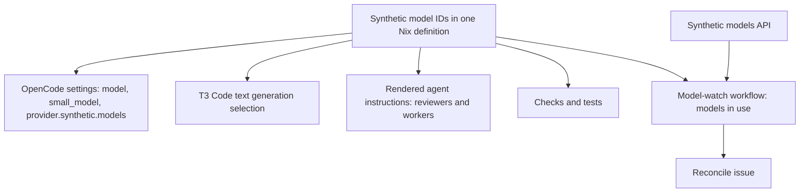
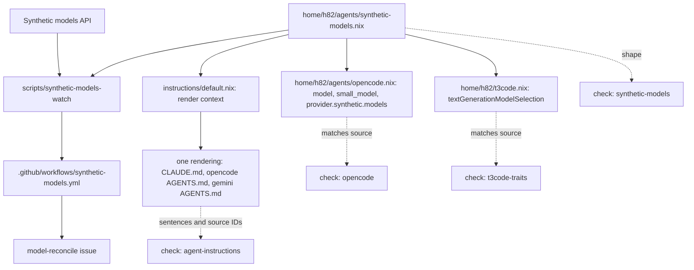
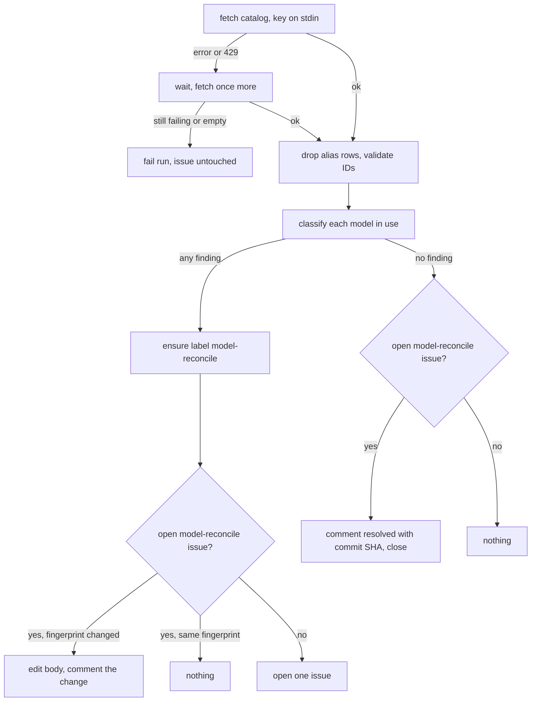

# Claude Code and OpenCode Agent Routing - Plan

## Goal Capsule

- **Objective:** Compound Engineering reviews and implementation units run on Claude Code and OpenCode (Synthetic) alone. Grok is gone from every host, Antigravity stays only as a manual backup, and `claude-opus-5-5` never runs above effort medium.
- **Means:** One Nix data file for every Synthetic model (KTD1) feeds OpenCode, T3 Code, one shared instructions rendering with a reviewer candidate list and same-family exclusion (KTD2), and a daily model-watch script and workflow (KTD5); Grok leaves through deletion plus a reinstall guard (KTD8), and a small OpenCode plugin reports the session's model (KTD6).
- **Product authority:** Product Contract Requirements govern behavior; Key Technical Decisions govern mechanism within them; units override neither. [Issue #284](https://github.com/hyperlapse122/nix-config/issues/284) is the origin; where this plan differs from it, this plan wins.
- **Open blockers:** None.
- **Execution profile:** 10 units run one after another in this order: U1, U2, U3, U4, U5, U6, U7, U8, U9, U10. U6 and U9 share `flake.nix`, `packages/agent-tools.nix`, and `tests/check-shards.nix`, so no two units run in parallel.
- **Stop conditions:** Stop and report when a pinned check cannot be made green without weakening what it guards, when OpenCode 2.1.1 loads neither the plugin directory nor its `plugins` entry, or when a captured OpenCode request's `reasoning_effort` differs from the `variant` T3 Code passed (KTD11).
- **Who finishes and ships:** The autonomous `lfg` run: `ce-work`, `ce-simplify-code`, `ce-code-review`, `ce-commit-push-pr`, then `ce-babysit-pr`; merging stays with the user.

---

## Product Contract

### Summary

Grok Build and Grok Bot leave the repository. Antigravity stays installed but receives no automatic role. Claude Code and OpenCode review each other, excluding any reviewer from the host's own model family. Implementation units go to Synthetic models, Sonnet, and Haiku as the `quick` fallback, with Opus reserved for `deep` at effort medium.

Every Synthetic model ID lives in one Nix definition. A daily workflow reports drift between those IDs and Synthetic's model list as one reconcile issue. A small OpenCode plugin lets a terminal OpenCode session name its own model.

### Problem Frame

The Grok 4.7 reviewer is too slow to keep in the review loop. The Gemini subscription drops from Ultra 20x to Google AI Pro, so Antigravity no longer has the quota to act as a reviewer or worker. Opus usage also needs to shrink.

The instructions today pin the review peers to Antigravity and Grok. They refuse OpenCode as a peer because the Compound Engineering route reports OpenCode's family as `unknown`. They also forbid delegating implementation to OpenCode. Gemini is the primary worker for `writing` and `visual-engineering` and the fallback for three more categories. Opus runs at `max` for `deep` and the `visual-engineering` fallback. Every Synthetic model ID other than GLM-5.3 is either absent or written by hand. Nothing notices when Synthetic retires or replaces a model.

### Key Decisions

- **Remove Grok Bot together with Grok Build.** (session-settled: user-directed — chosen over keeping Grok Bot as an unrelated chat app: the goal is Grok fully out of the repository.) Governs R2, R5.
- **Uninstall only the Grok Bot cask automatically; leave `~/.grok` and Grok Bot user data in place.** (session-settled: user-directed — chosen over documentation-only cleanup and over automatic removal of all leftovers: deleting user data cannot be undone.) Governs R4, R6.
- **Plan all of issue #284 as one unit.** (session-settled: user-directed — chosen over splitting the OpenCode plugin and the model-watch workflow into later plans.)
- **OpenCode sessions follow the same `ce-work` rules as Claude Code sessions.** (session-settled: user-approved — chosen over keeping forced delegation for OpenCode sessions: OpenCode models are now workers.) Governs R25.
- **One Nix source and the watch workflow cover every Synthetic model; Claude model IDs stay inline and unwatched.** (session-settled: user-directed — chosen over a DeepSeek-only source, and over also single-sourcing or watching Claude IDs through the Anthropic API.) Governs R27, R28, R37.
- **"Changed" compares Synthetic's report with what the repository declares, not with a previous run.** (session-settled: user-approved — chosen over a last-run snapshot, both, or dropping the category: the workflow holds only `contents: read` and has no state store.) Governs R42.
- **Keep the Antigravity runtime preinstall; remove only the Antigravity text-generation selection.** (session-settled: user-approved — chosen over deleting `antigravityInstances` whole: the runtime preinstall keeps the manual Antigravity instance working.) Governs R7, R33.
- **One OpenCode instance in T3 Code serves every Synthetic model.** (session-settled: user-directed — chosen over one instance per model: the user confirmed in T3 Code that the instance accepts a per-task `model`.) Governs R24, R33.
- **Heavy-category fallbacks are GLM-5.3, except Kimi K3 for `visual-engineering`.** (session-settled: user-directed — chosen over Kimi K3 everywhere: GLM-5.3 scores higher or equal on long-form writing and agent benchmarks, is cheaper, and runs about twice as fast; Kimi K3 leads the Frontend Arena and reads screenshots.) Governs R24.
- **`deep` falls back to OpenCode GLM-5.3 at max, not Sonnet.** (session-settled: user-directed — chosen over a Sonnet fallback: a Claude outage blocks Sonnet too.) Governs R24.
- **`CROSS_MODEL_MAX_PEERS` stays 2.** (session-settled: user-directed — chosen over 1: an Antigravity or non-GLM OpenCode session needs both reviewers.) Governs R13.
- **Kimi K3 runs at max effort.** (session-settled: user-directed — chosen over high or low: max is Kimi's default, its published results use it, and measured reasoning-token cost differs little.) Governs R11, R30.
- **No automatic model-ID bumps.** (session-settled: user-directed — chosen over a workflow that edits IDs or opens PRs: the workflow only opens a reconcile issue.) Governs R28, R44.

### Requirements

**Grok removal**

- R1. Grok Build leaves the repository: its package and release helper, `home/h82/agents/grok.nix`, the `~/.grok/rules` rendering, the `grok` peer token, every Grok rule in the instructions, its checks and tests, its `update-dependencies.yml` step, its `agents.toml` entry, and its documentation.
- R2. Grok Bot leaves the repository: its package and release helper, the system-manager AppArmor module, the macOS cask mapping, its checks and tests, its `update-dependencies.yml` step, and its documentation.
- R3. T3 Code's `grok` provider instance is declared `enabled = false`, the way the `codex` instance is, so the app does not re-enable it.
- R4. A macOS apply uninstalls the Grok Bot cask when it is installed.
- R5. A check fails when Grok Build or Grok Bot comes back: a Grok package on a host, a home file under `~/.grok`, a Grok Bot cask mapping, or the Grok Bot AppArmor module.
- R6. No apply deletes `~/.grok` or Grok Bot user data; the documentation names the paths left behind and how to remove them.

**Antigravity as a manual backup**

- R7. Antigravity and the Gemini CLI keep their installation, sign-in, settings, `~/.gemini/config/AGENTS.md` rendering, and T3 Code `antigravity` instance with its runtime preinstall, so the user can still start them by hand.
- R8. Antigravity is never assigned automatically as a cross-model reviewer, `ce-work` worker, fallback worker, or T3 Code text generator, and the `antigravity` token leaves `CROSS_MODEL_PEERS`.
- R9. The instructions drop the Gemini worker sentences, the Gemini thinking-level sentences, and the `CROSS_MODEL_EFFORT_OVERRIDE=medium` sentence.

**Cross-model review**

- R10. The instructions pick reviewers from a candidate list and exclude every candidate whose model family matches the host's; the family comes from the model's maker, not the harness.
- R11. The candidates are Claude Code `claude-opus-5-5` at effort medium (family `claude`, default), OpenCode `synthetic/hf:zai-org/GLM-5.3` at max (family `glm`, default), and OpenCode `synthetic/hf:moonshotai/Kimi-K3` at max (family `kimi`, only when the user names it).
- R12. The default reviewers per host session are: Claude Code gets OpenCode GLM-5.3; OpenCode on GLM-5.3 gets Claude Code; Antigravity gets Claude Code and OpenCode GLM-5.3; OpenCode on a non-GLM model gets Claude Code and OpenCode GLM-5.3.
- R13. `CROSS_MODEL_PEERS` is `claude,opencode` and `CROSS_MODEL_MAX_PEERS` stays `2`.
- R14. Model IDs map to families after one leading provider prefix such as `synthetic/` is stripped: `claude-*` to `claude`, `gemini-*` to `gemini`, `hf:<org>/…` by org (`zai-org` to `glm`, `moonshotai` to `kimi`, `deepseek-ai` to `deepseek`, `Qwen` to `qwen`), and `syn:` aliases or unmapped orgs to `unknown`; AE1's receipt `synthetic/hf:zai-org/GLM-5.3` maps to `glm`.
- R15. A reviewer's finding raises confidence only when its family, read from the T3 Code `task_status` provider and model through R14, is known and differs from the host's.
- R16. Outside T3 Code, the Compound Engineering route reports OpenCode as `unknown`, so an OpenCode review there never raises confidence; the instructions say so and the review report states it.
- R17. The instructions drop "never with OpenCode" and the OpenCode refusal, and every harness shares one rendering when the exclusion rule makes per-harness peer data unnecessary.
- R18. An OpenCode session names its host family from its own model ID: through `orchestrator_capabilities` and `t3_thread_configuration` inside T3 Code, and through the R20 plugin tool outside it. When neither answers, the family is `unknown` and that session's reviews raise no confidence.
- R19. Reviewers use pinned `hf:` IDs only; when a pinned ID returns 404, that reviewer is reported as failed and no other model replaces it.

**OpenCode session-info plugin**

- R20. A small OpenCode plugin, installed through Nix, provides a read-only tool that returns at least the current provider, model ID, effort variant, and session ID.
- R21. The instructions tell an OpenCode session without T3 Code tools to name its host family with that tool.
- R22. `docs/verification.md` gets a manual check that the plugin loads in a terminal OpenCode session and returns the current provider and model ID, because only a live run proves plugin loading.

**`ce-work` workers**

- R23. `claude-opus-5-5` runs at effort medium or lower everywhere, as host, reviewer, or worker, and no instruction sentence gives Opus `max`.
- R24. Each category's primary and fallback workers are:

| Category | Primary | Fallback |
| --- | --- | --- |
| `quick` | OpenCode DeepSeek V4.1 Flash latest, low | `claude-haiku-5-5`, medium |
| `unspecified-low` | OpenCode DeepSeek V4.1 Flash latest, high | `claude-sonnet-5-5`, medium |
| `writing` | `claude-sonnet-5-5`, high | OpenCode GLM-5.3, high |
| `visual-engineering` | `claude-sonnet-5-5`, high | OpenCode Kimi K3, max |
| `unspecified-high` | `claude-sonnet-5-5`, high | OpenCode GLM-5.3, high |
| `deep` | `claude-opus-5-5`, medium | OpenCode GLM-5.3, max |

- R25. The instructions drop "never delegate to Grok or OpenCode" and every Grok- or OpenCode-session special rule, so an OpenCode session prefers delegation and implements a unit itself when `work_engine_mode` is `off`, like a Claude Code session.
- R26. Outside T3 Code, the Compound Engineering worker route gets the candidates `opencode` with DeepSeek V4.1 Flash latest, then `claude` with `claude-sonnet-5-5` at high.

**Model IDs and effort**

- R27. Every Synthetic model ID the repository uses (GLM-5.3, Kimi K3, DeepSeek V4.1 Flash latest) is defined once in Nix, and the OpenCode settings, T3 Code settings, instruction rendering, tests, and watch workflow all read that definition.
- R28. The DeepSeek entry pins the newest dated V4.1 Flash build, today `hf:deepseek-ai/DeepSeek-V4.1-Flash-1017`, and moves to a newer build only when the user changes that one value after a reconcile issue reports it; GLM-5.3 and Kimi K3 stay on their pinned IDs until the user moves them.
- R29. `opencode.nix` declares DeepSeek V4.1 Flash latest and Kimi K3 under `provider.synthetic.models`, since OpenCode's built-in catalog may lack them.
- R30. Inside T3 Code each run sets its own effort, so one model can run at different efforts in different roles; outside T3 Code the Compound Engineering route carries one effort per run, so OpenCode runs at its R31 default and Sonnet at high (R26):

| Model | Role | Effort |
| --- | --- | --- |
| `claude-opus-5-5` | host, reviewer, `deep` | medium |
| `claude-sonnet-5-5` | `writing`, `visual-engineering`, `unspecified-high` | high |
| `claude-sonnet-5-5` | `unspecified-low` fallback | medium |
| `claude-haiku-5-5` | `quick` fallback | medium |
| GLM-5.3 | reviewer, `deep` fallback | max |
| GLM-5.3 | `writing`, `unspecified-high` fallback | high |
| Kimi K3 | reviewer when named, `visual-engineering` fallback | max |
| DeepSeek V4.1 Flash latest | `unspecified-low` | high |
| DeepSeek V4.1 Flash latest | `quick`, text generation | low |

- R31. The `opencode.nix` per-model `options.reasoningEffort` values, which the Compound Engineering route outside T3 Code uses as-is, are GLM-5.3 max, Kimi K3 max, and DeepSeek V4.1 Flash latest high.
- R32. No instruction gives DeepSeek, GLM, or Kimi the effort `medium`, which those models do not offer.

**Text generation**

- R33. T3 Code generates commit messages and titles on the `opencode` instance with DeepSeek V4.1 Flash latest at effort low, and the Antigravity text-generation selection in `home/h82/t3code.nix` goes away.
- R34. OpenCode's `small_model` is DeepSeek V4.1 Flash latest; its effort follows Q9.

**Model-watch workflow**

- R35. A GitHub Actions workflow runs daily on a cron schedule and on `workflow_dispatch`.
- R36. The workflow reads the models in use from the R27 Nix definition, each with its roles and defining file, and holds no model list of its own.
- R37. The workflow lists Synthetic's models from `https://api.synthetic.new/openai/v1/models`, sending the `SYNTHETIC_API_KEY` Actions secret when it is set and calling without a key otherwise; the key never reaches a log.
- R38. CI gets no SOPS recipient, because `secrets/tokens.yaml` also holds the GitHub, GitLab, JPI, and Tokscale tokens.
- R39. When the listing fails or returns 429, the workflow waits and retries once; a second failure or an empty list fails the run and leaves the reconcile issue untouched.
- R40. A model in use whose ID is missing from the list is classified **removed**.
- R41. A model in use with a newer build in the same lineage (for example `hf:deepseek-ai/DeepSeek-V4.1-Flash-*`, `hf:zai-org/GLM-*`, `hf:moonshotai/Kimi-*`) is classified **new version**.
- R42. A model in use whose reported `reasoning_parameters.efforts` no longer contains an effort the repository assigns to it is classified **changed**.
- R43. When any difference exists, the workflow opens one reconcile issue, identified by a dedicated label, or updates the open one; the body names the change type, current and candidate models, affected roles and files, and detection time.
- R44. When every difference is resolved, the workflow comments on the open reconcile issue and closes it; it never edits code or opens a pull request, and holds only `contents: read` and `issues: write`.
- R45. The reconcile issue follows a format `/ce-sweep` can process through the `gh-issues` feedback source in `.compound-engineering/config.yaml`.
- R46. The comparison logic lives in a script, with fixed fixtures covering removed, new version, changed, and no change.

**Checks and documentation**

- R47. The checks match the new policy: `tests/agent-instructions.nix`, `tests/lib/cross-model-peers.nix`, `tests/t3code-traits.nix`, `tests/darwin-config.nix`, `tests/gemini.nix`, `tests/update-dependencies-reconcile.sh`, and the related `flake.nix` checks.
- R48. `docs/provisioning.md`, `docs/verification.md`, `README.md`, `CONCEPTS.md`, and `AGENTS.md` describe the new routing; the T3 Code manual checks in `docs/verification.md` use Claude Code and OpenCode, and `docs/provisioning.md` describes the watch workflow and its optional secret.
- R49. The `crossModelPeers` option description in `home/h82/agents/cross-model-peers.nix` names the `claude` and `opencode` tokens.
- R50. The comments in `.compound-engineering/config.yaml` match Compound Engineering 3.31.
- R51. Before push, `ce-compound-refresh` updates each learning under `.compound-engineering/artifacts/solutions/` that cites a Grok or Antigravity path this change deletes, moves, or renames.

### Model ID Source

One definition feeds every surface that names a Synthetic model (R27, R36):

### Acceptance Examples

- AE1. **Covers R10, R12, R15.** **Given** a Claude Code session in T3 Code, **when** `ce-code-review` reaches its cross-model step, **then** OpenCode GLM-5.3 runs at max, Claude Code and Kimi K3 do not, and the `task_status` receipt (`opencode`, `synthetic/hf:zai-org/GLM-5.3`) records `independence_verified: true`.
- AE2. **Covers R10, R12, R18.** **Given** an OpenCode session on GLM-5.3, **when** a review runs, **then** Claude Code reviews and the GLM-5.3 candidate is excluded as the same family.
- AE3. **Covers R12, R13.** **Given** an OpenCode session on DeepSeek V4.1 Flash, **when** a review runs, **then** Claude Code and OpenCode GLM-5.3 both review.
- AE4. **Covers R16.** **Given** a Claude Code session outside T3 Code, **when** the OpenCode route returns a review, **then** its findings raise no confidence and the report says OpenCode's family is `unknown`.
- AE5. **Covers R19.** **Given** Synthetic removed `hf:zai-org/GLM-5.3`, **when** a Claude Code session runs a review, **then** the GLM reviewer is reported as failed and Kimi K3 does not run in its place.
- AE6. **Covers R27, R28, R33, R34.** **Given** Synthetic publishes a newer DeepSeek V4.1 Flash build, **when** the user changes the one Nix value, **then** the workers, T3 Code text generation, `small_model`, instructions, and tests all name the new ID.
- AE7. **Covers R39.** **Given** the models API returns 429 twice, **when** the workflow runs, **then** the run fails and the open reconcile issue, if any, is unchanged.
- AE8. **Covers R40, R43.** **Given** the list lacks `hf:moonshotai/Kimi-K3` and no reconcile issue is open, **when** the workflow runs, **then** one labeled issue opens listing Kimi K3 as removed, with its reviewer and `visual-engineering` fallback roles and its defining file.
- AE9. **Covers R42.** **Given** GLM-5.3's reported efforts drop `max`, **when** the workflow runs, **then** GLM-5.3 is classified changed for the reviewer and `deep` fallback roles, and not for the `high` roles.
- AE10. **Covers R43, R44.** **Given** an open reconcile issue and a run that finds no difference, **when** the workflow finishes, **then** it comments that the drift is resolved and closes the issue; a second clean run opens nothing.
- AE11. **Covers R4, R6.** **Given** a Mac with the Grok Bot cask installed and a `~/.grok` directory, **when** the user applies, **then** the cask is gone and `~/.grok` is still there.

### Success Criteria

- No Grok file, package, or instruction sentence remains, and the reinstall guard passes.
- No rendered instruction names Antigravity or Gemini as a reviewer, worker, or fallback worker, and none gives `claude-opus-5-5` an effort above medium.
- A terminal OpenCode session loads the R20 plugin and its tool returns the current provider and model ID.
- A manual run of the watch workflow opens nothing when there is no drift, and opens or updates exactly one reconcile issue when there is.
- `nix flake check` and CI pass.

### Scope Boundaries

- Codex stays removed; the `codex-absent` check stays.
- The Compound Engineering plugin source does not change; OpenCode stays `unknown` on its route outside T3 Code.
- Antigravity is not removed.
- No apply deletes `~/.grok` or Grok Bot user data.
- Claude model IDs are neither single-sourced nor watched.
- The workflow never bumps a model ID or opens a pull request.

### Outstanding Questions

**Deferred to Implementation**

- Q9. Whether OpenCode 2.1.1 honours a second `provider.synthetic.models` entry that points at the same upstream ID, which is how KTD4 runs `small_model` at effort low. When it does not, `small_model` uses the main DeepSeek entry at high (R31) and the PR says so.
- The exact SDK call through which the R20 tool reads the current session's model and variant (KTD6); only a live run settles it.

### Sources

- [Issue #284](https://github.com/hyperlapse122/nix-config/issues/284): the origin request, its decision record with benchmark and pricing sources, and its effort sources.
- Synthetic models API, called without a key on 2026-10-21: HTTP 200 with no rate-limit headers. Each model reports `id`, `hugging_face_id`, `context_length`, `max_output_length`, `reasoning_parameters.efforts`, `created`, modalities, and pricing. The unsuffixed `hf:deepseek-ai/DeepSeek-V4.1-Flash` is the older September build, not an alias for the newest one. `syn:` aliases resolve to `hugging_face_id` values such as `deepseek-ai/DeepSeek-V4.1-Flash-1017`.
- `home/h82/agents/instructions/default.nix` and `home/h82/agents/instructions/instructions.md.tmpl`: today's per-harness peer records and worker table; OpenCode receives the Claude Code rendering.
- `home/h82/t3code.nix`: `antigravityInstances` drives both the text-generation selection and the Antigravity runtime preinstall.
- `modules/darwin/homebrew.nix`: Homebrew cleanup is `"none"`, so dropping a cask mapping does not uninstall it.
- Prior plans: `.compound-engineering/artifacts/plans/2026-10-19-1600-feat-dual-cross-model-review-peers-plan.md` (why OpenCode left the peer list) and `.compound-engineering/artifacts/plans/2026-10-21-1051-feat-improve-model-routing-plan.md` (the current worker categories).
- Learnings: `.compound-engineering/artifacts/solutions/integration-issues/opencode-plugin-loading-verifiable-only-by-a-live-run.md`, `.compound-engineering/artifacts/solutions/integration-issues/opencode-config-file-model-variant-silently-dropped.md`, and `.compound-engineering/artifacts/solutions/integration-issues/t3code-antigravity-runtime-preinstall-managed-layout.md`.

---

## Planning Contract

Product Contract preservation: changed: Summary, R14, R28, R30 — document-review clarifications with no scope change (Haiku named as the `quick` fallback, the provider prefix stripped before family mapping, the DeepSeek pin moved only by the user, per-role effort scoped to T3 Code). The five questions the Product Contract deferred to planning are answered by KTD3-KTD7.

### Key Technical Decisions

- KTD1. **One pure data file is the Synthetic model source.** `home/h82/agents/synthetic-models.nix` replaces `home/h82/agents/opencode-model.nix` and takes no module arguments, so Home Manager modules, checks, and the workflow (`nix eval --json --file`) read the same attrset without a flake output. Each entry carries the upstream ID, the family, a lineage pattern with a captured version (KTD3), its roles with their efforts, and the effort OpenCode uses by default; top-level keys name the OpenCode default model, `small_model`, and the T3 Code text-generation model. Governs R27, R28, R36.
- KTD2. **One rendering for every harness; the host family comes from the host's own model ID.** Claude Code, OpenCode, and Antigravity read the same file. The template reads the KTD1 data by field access only, never `index`, `range`, or `if`, because `tests/agent-instructions.nix` builds its expected file by replacing a fixed table of actions. Each host applies R14 to the model ID its harness reports: its own model for Claude Code and Antigravity, the system prompt's model section, T3 Code tools, or the R20 tool for OpenCode. Receipts map by `task_status`'s model, not its instance name, because one `opencode` instance serves GLM, Kimi, and DeepSeek. This answers R17: no per-harness value remains.
- KTD3. **A newer build has an equal or higher captured version and a later `created`.** Each lineage pattern is anchored and captures the version (DeepSeek `V<n>[.<n>]-Flash` with an optional `-<MMDD>` suffix, GLM `GLM-<n>[.<n>]`, Kimi `Kimi-K<n>[.<n>]`), so suffixed products such as `-Flash`, `-Air`, `-Code`, `-Preview`, and `-FP8` never match another lineage. A candidate counts as newer only when its captured version is not lower than the model in use and its `created` is later; an equal `created` is not newer. Rows carrying `alias_of` and `syn:` IDs are ignored. Governs R41.
- KTD4. **`small_model` gets its own model entry at effort low, under a nested-owned `provider.synthetic.models`.** OpenCode drops a variant written in its config file and honours a model's `options.reasoningEffort`, and OpenCode 2.x feeds `small_model` only into title generation (`agents.title.model`). `small_model` points at a second entry keyed `hf:deepseek-ai/DeepSeek-V4.1-Flash-1017@low` (the source ID plus `@low`, so R14 still maps it to `deepseek`), whose `id` is the upstream ID and whose `reasoningEffort` is `low`. `scripts/agent-settings` gains an `ownPaths` tier that replaces the object at a nested path whole and refuses any other declaration at or under that path, so `provider.synthetic.models` holds exactly the source's entries while `provider.synthetic.options` and other providers survive. Governs R29, R31, R34; Q9 is the fallback.
- KTD5. **The comparison is a fixture-tested Python helper; the workflow keeps the key away from `gh`.** `scripts/synthetic-models-watch` follows the release-helper pattern (`pythonHelper` in `packages/agent-tools.nix`, network through an overridable command, `pythonScriptCheck` in `flake.nix`) and runs locally through a flake app. It fetches with the header on stdin (`curl -H @-`), never in argv, retries once (R39), validates every catalog ID against `^hf:[A-Za-z0-9._-]+/[A-Za-z0-9._-]+$` and its lineage, writes catalog values only inside code spans, and emits a JSON result, a findings fingerprint, and an issue body file. `.github/workflows/synthetic-models.yml` runs the script in a step that alone receives `SYNTHETIC_API_KEY`, then manages the issue in a later step with `GITHUB_TOKEN` and `--body-file`. Governs R35-R46.
- KTD6. **The plugin is a v2 OpenCode plugin directory the global plugins folder autoloads.** OpenCode 2.1.1 plugins export `{ id, setup(ctx) }`, register tools through `ctx.tool.transform` with JSON Schema arguments, and need no imports, so a plain `index.js` in the store works. `setup` records each session's `{ providerID, id, variant }` from `ctx.session.hook("model.request")`; the tool looks the session up by `sessionID`, falls back to `ctx.session.get`, and returns provider, model ID, variant, configured effort, and the source of each value, with `null` for any it cannot read. Home Manager links the directory to `~/.config/opencode/plugins/session-info/`, so no settings merge or activation ordering is involved; if the live probe shows the folder does not autoload, U8 adds a prefix-scoped `plugins` entry through `home/h82/agents/agent-plugins.nix`. Governs R20.
- KTD7. **The Grok Bot cask uninstall runs brew as the user and warns on failure.** Homebrew refuses to run as root, and `launchctl asuser` leaves the process root. The step calls `${config.homebrew.brewPrefix}/brew` through `sudo --user=<primary user> --set-home` with `NONINTERACTIVE=1`, the way nix-darwin's own Homebrew activation does, after Homebrew in `postActivation`. It checks `brew list --cask grok-bot` first, and each failure prints one line under an `if !` guard, as the Xcode and App Store steps do. Governs R4.
- KTD8. **A `grok-absent` check guards the removal across user, macOS, and system-manager surfaces.** Unlike `codex-absent`, it reads more than `userEntries`: the user packages and home files of every user, the cask mapping in `modules/shared/darwin-apps.nix`, and the evaluated system-manager configuration of each Linux fixture for the AppArmor unit, by attribute evaluation without building a host closure. `tests/t3code-traits.nix` pins the `grok` instance `enabled = false` beside `codex`. Governs R3, R5.
- KTD9. **Checks compare consumers with the model source; they do not pin model IDs as literals.** `tests/opencode.nix`, `tests/t3code-traits.nix`, and `tests/agent-instructions.nix` take model IDs from the source while instance names, efforts, and sentences stay written in the check. A new `synthetic-models` check pins the source's shape: IDs start with `hf:`, each family matches its org per R14, no role effort is `medium` (R32), and each lineage pattern matches and captures its own ID. Governs R27, R47.
- KTD10. **The Antigravity runtime preinstall keeps its own instance list.** `antigravityInstances` in `home/h82/t3code.nix` becomes the literal `[ "antigravity" ]`, no longer derived from the text-generation instance. (session-settled: user-approved — chosen over deleting `antigravityInstances` whole: the skill links keep the manual Antigravity instance working.) Governs R7, R33.
- KTD11. **Per-run effort is proven by a captured request, not by a stored option.** OpenCode drops an unapplied variant silently, so storing `variant` in T3 Code's selection proves nothing. A live probe points a T3 Code OpenCode task at a local listener, as the variant learning describes, and checks that GLM-5.3 at `high` and DeepSeek text generation at `low` send that `reasoning_effort`. Governs R30, R33.
- KTD12. **Inside T3 Code the instructions, not Compound Engineering's gate, decide whether a GLM, Kimi, or DeepSeek host runs the cross-model step.** CE 3.31 accepts only the host families `codex`, `claude`, `grok`, `composer`, `gemini`, and `unknown`, and skips its automatic pass for `unknown`. The instructions therefore say that inside T3 Code the candidate list and R14 family decide; that a host whose family is outside CE's vocabulary passes `unknown` to any CE script; that an `unknown`-family host runs both default reviewers and raises no confidence; and that outside T3 Code such a host reports the pass as skipped by CE. Named candidates replace the defaults and stay capped at two. Governs R10, R12, R18.

### High-Level Technical Design

The model source and its consumers, with the check that guards each edge:

The watch run's decision path (R39-R44):

### Assumptions

These are bets made without a scoping confirmation, because `lfg` runs this plan without check-ins.

- The workflow file is new (`synthetic-models.yml`) rather than a step in `update-dependencies.yml`, which needs `contents: write` that R44 forbids.
- The reconcile issue's label is `model-reconcile`; `/ce-sweep` acks it with its own `feedback:ack` label, and the workflow never removes labels it did not add.
- New drift on an issue `/ce-sweep` already acknowledged is announced by a comment, which moves the issue's `updatedAt` past the sweep cursor.
- Synthetic spells efforts as the repository does: on 2026-10-21 GLM-5.3 and Kimi K3 reported `low`, `high`, `max`, and DeepSeek V4.1 Flash `none`, `low`, `high`, `xhigh`, `max`; U9's fixtures come from that snapshot.
- `tests/gemini.nix` pins no peer token today, so it needs no change unless a removal breaks it.

### Risks

- `/ce-sweep`'s GitHub connector may skip a `github-actions` issue as automation noise; the issue title and first line carry the whole request, which is as far as R45 reaches without changing the plugin.
- The plugin API is v2 and only partly documented; KTD6's fallback and the live probe in `docs/verification.md` cover a folder that does not autoload or a hook that does not fire.
- A declared DeepSeek or Kimi entry with no `limit` fields may get wrong context or output limits if OpenCode's catalog lacks the model; U2's live probe checks this.
- A scheduled workflow in a public repository stops after 60 days without repository activity; the hourly dependency workflow keeps the repository active today.

---

## Implementation Units

| U-ID | Title | Key files | Depends on |
| --- | --- | --- | --- |
| U1 | Synthetic model source | `home/h82/agents/synthetic-models.nix`, `tests/synthetic-models.nix` | none |
| U2 | OpenCode settings from the source | `home/h82/agents/opencode.nix`, `scripts/agent-settings`, `tests/opencode.nix` | U1 |
| U3 | T3 Code instances and text generation | `home/h82/t3code.nix`, `tests/t3code-traits.nix` | U1 |
| U4 | Shared instructions rewrite | `home/h82/agents/instructions/`, `tests/agent-instructions.nix` | U1 |
| U5 | Review peer allowlist | `home/h82/agents/cross-model-peers.nix`, `tests/lib/cross-model-peers.nix` | U2 |
| U6 | Remove Grok Build and Grok Bot | `packages/grok-*`, `flake.nix`, `.github/workflows/update-dependencies.yml` | U4, U5 |
| U7 | Grok Bot cask uninstall on macOS | `modules/darwin/retired-casks.nix`, `tests/darwin-config.nix` | U6 |
| U8 | OpenCode session-info plugin | `packages/opencode-session-info/`, `tests/opencode-session-info.nix` | U2 |
| U9 | Model-watch script and workflow | `scripts/synthetic-models-watch`, `.github/workflows/synthetic-models.yml` | U1, U6 |
| U10 | Documentation and config comments | `docs/`, `README.md`, `CONCEPTS.md`, `AGENTS.md`, `.compound-engineering/config.yaml` | U1-U9 |

### U1. Synthetic model source

**Goal:** Every Synthetic model ID, family, lineage, role, and effort lives in one Nix data file.

**Requirements:** R27, R28, R30, R32; KTD1, KTD3, KTD9.

**Dependencies:** none.

**Files:**

- Create `home/h82/agents/synthetic-models.nix`.
- Delete `home/h82/agents/opencode-model.nix`.
- Create `tests/synthetic-models.nix`; register it in `flake.nix` and `tests/check-shards.nix`.

**Approach:**

1. Entries `glm`, `kimi`, `deepseek` with `id` (without the `synthetic/` prefix), `family`, `lineage` (KTD3), `roles` (each role with its effort per R30), and `opencodeEffort` (R31).
2. Top-level `opencodeDefault = "glm"`, `small = "deepseek"`, `textGeneration = "deepseek"`.
3. DeepSeek `id` is `hf:deepseek-ai/DeepSeek-V4.1-Flash-1017`.

**Patterns to follow:** `home/h82/agents/opencode-model.nix` (a bare imported value); `runCommand` checks in `flake.nix`.

**Test scenarios:**

- Every `id` starts with `hf:` and every family equals the R14 mapping of its org.
- A role effort of `medium` on any entry fails the check (mutation: set DeepSeek `quick` to `medium`).
- Each `lineage` pattern matches its own `id` and captures its version; a DeepSeek pattern that fails to match `hf:deepseek-ai/DeepSeek-V4.1-Flash-1017` fails the check.
- `opencodeDefault`, `small`, and `textGeneration` each name an existing entry.

**Verification:** `nix build .#checks.x86_64-linux.synthetic-models` passes, and fails under each mutation above.

### U2. OpenCode settings from the source

**Goal:** `opencode.json` names the default model, `small_model`, and exactly the Synthetic model entries from U1.

**Requirements:** R29, R31, R34; KTD4, KTD9.

**Dependencies:** U1.

**Files:**

- Modify `scripts/agent-settings` and `tests/test_agent_settings.py` (the `ownPaths` tier).
- Modify `home/h82/agents/opencode.nix`.
- Modify `tests/opencode.nix`.

**Approach:**

1. Add `ownPaths` to `scripts/agent-settings` (KTD4).
2. `model` is `synthetic/` plus the default entry's ID.
3. `ownPaths` declares `provider.synthetic.models`: one entry per U1 model with `options.reasoningEffort` from `opencodeEffort`, plus the KTD4 `@low` entry with `id` and `reasoningEffort` `low`.
4. `small_model` names the `@low` entry; drop the `syn:large:text` removePath and the GLM `setPaths` leaf the owned path replaces.

**Patterns to follow:** the `own` and `setPaths` tiers and their tests in `scripts/agent-settings` and `tests/test_agent_settings.py`; the declaration in `home/h82/agents/opencode.nix`.

**Test scenarios:**

- `ownPaths` replaces the object at `provider.synthetic.models` and keeps `provider.synthetic.options` and `provider.anthropic`.
- `ownPaths` together with a `setPaths` entry at or under the same path is refused.
- A model key left in `opencode.json` from an earlier source is gone after the merge.
- The materialized declaration sets `model` to `synthetic/` plus the source's default ID.
- `small_model` resolves to an entry keyed with the `hf:deepseek-ai/` prefix whose `id` is the source's DeepSeek ID and whose effort is `low`.
- Changing the DeepSeek ID in the source changes both DeepSeek entries and `small_model` with no other edit (Covers AE6).

**Verification:** `checks.x86_64-linux.opencode` and the `agent-settings` script check pass; a live `opencode run` against the `@low` entry settles Q9 and shows whether the declared entries need `limit` fields, per `docs/verification.md`.

### U3. T3 Code instances and text generation

**Goal:** T3 Code generates commit messages and titles on OpenCode DeepSeek at low, keeps Antigravity's runtime preinstall, runs Opus at medium, and keeps Grok off.

**Requirements:** R3, R7, R23, R33; KTD8, KTD10, KTD11.

**Dependencies:** U1.

**Files:**

- Modify `home/h82/t3code.nix`.
- Modify `tests/t3code-traits.nix`.

**Approach:**

1. `textGenerationModelSelection` is `instanceId = "opencode"`, `model = "synthetic/"` plus the source's text-generation ID, `options = [ { id = "variant"; value = "low"; } ]`, the shape T3 Code's `createModelSelection` writes.
2. `defaultModelSelection` adds `options = [ { id = "effort"; value = "medium"; } ]`, so the host's Opus effort is declared rather than inherited (R23).
3. Remove `textGenerationInstance`; set `antigravityInstances = [ "antigravity" ]` (KTD10).
4. Declare `grok = { driver = "grok"; enabled = false; }` with a comment like the `codex` one.

**Patterns to follow:** the `codex` instance declaration and its comment; `modelSelections` owned whole.

**Test scenarios:**

- The declared settings own `textGenerationModelSelection` with instance `opencode`, the source's DeepSeek model, and option `variant` = `low`.
- `defaultModelSelection` is `claudeAgent`, `claude-opus-5-5`, effort `medium`; a value of `high` or `max` fails.
- `providerInstances.grok.enabled` is `false` and `providerInstances.antigravity.enabled` is `true`.
- The Antigravity link activation still passes `--instance antigravity`.

**Verification:** `checks.x86_64-linux.t3code-traits` passes; the KTD11 capture in `docs/verification.md` shows DeepSeek text generation sending `reasoning_effort` `low`.

### U4. Shared instructions rewrite

**Goal:** One rendering states the candidate-list review rules, the host-family rule, the new worker table, and the existing peer safeguards, with no Grok, Gemini worker, or Opus `max` sentence.

**Requirements:** R8-R19, R21, R23-R26, R30, R32; KTD2, KTD9, KTD11, KTD12.

**Dependencies:** U1.

**Files:**

- Modify `home/h82/agents/instructions/default.nix`.
- Modify `home/h82/agents/instructions/instructions.md.tmpl`.
- Modify `tests/agent-instructions.nix`.

**Approach:**

1. Render once; link it to `.claude/CLAUDE.md`, `.config/opencode/AGENTS.md`, and `.gemini/config/AGENTS.md`; drop the Grok path and the `peers` record.
2. Replace the peer sentences: candidate list (R11), same-family exclusion and default reviewers (R10, R12), host family from the host's own model ID and receipts by model (R14, R15, KTD2), the KTD12 gate and `unknown` rules, the outside-T3 `unknown` report (R16), the R18 discovery order including the R20 tool and the system prompt's model section (R21), pinned IDs with no substitution (R19), and the recipient notice naming Anthropic or Synthetic.
3. Keep the peer-isolation sentence (worktree, async, untrusted-data marking, read-only, no credential paths, no further delegation) and the sentence that never puts a `secrets/` file, a decrypted value, or a credential into a peer task, reworded only where they name Antigravity or Grok.
4. Replace the worker sentences with the R24 table, the R25 session rule, and the R26 outside-T3 candidates; Claude workers keep `effort` in `target.options`, OpenCode workers take `variant`, and the table states that per-role efforts apply inside T3 Code (R30).
5. Remove every Gemini thinking-level sentence, the `CROSS_MODEL_EFFORT_OVERRIDE` sentence, and the Grok example in the T3 Code section's session-check sentence.
6. In the check: one expected file for all three paths, model-ID actions filled from the source (KTD9), the new and kept sentences pinned, `peerPattern` updated for the Synthetic candidates, and each retired phrase (`never with OpenCode`, `Grok`, `gemini-4-argon`, `gemini-3.8-flash`, `` `max` for `deep` ``, `CROSS_MODEL_EFFORT_OVERRIDE`) added to `removedTerms`.

**Patterns to follow:** the pinned-sentence lists, `peerPattern`, and `removedTerms` in `tests/agent-instructions.nix`; read the substring-sentence and text/template learnings before editing.

**Execution note:** Change the check's pinned sentences first and watch it fail against the old template, then rewrite the template.

**Test scenarios:**

- All three delivery paths exist and are byte-identical to the one expected file.
- No rendered sentence names Antigravity or Gemini as reviewer, worker, or fallback, and none gives `claude-opus-5-5` `max` or `xhigh`.
- Reinserting "and never with OpenCode" or a Gemini worker sentence fails the check.
- Deleting the secrets sentence or the peer-isolation sentence fails the check.
- A template action outside the known set, or a `range` or `if` action, fails the check.
- The DeepSeek ID in the rendered worker sentence equals the source's ID (Covers AE6).

**Verification:** `checks.x86_64-linux.agent-instructions` passes and fails under each mutation above; the KTD11 capture shows a T3 Code GLM-5.3 task at `variant` `high` sending `reasoning_effort` `high`.

### U5. Review peer allowlist

**Goal:** The `antigravity` token leaves and the `opencode` token joins `CROSS_MODEL_PEERS`, while `grok` stays until U6 removes its package.

**Requirements:** R8, R13, R49.

**Dependencies:** U2, which edits the same `opencode.nix`.

**Files:**

- Modify `home/h82/agents/cross-model-peers.nix`.
- Modify `home/h82/agents/gemini.nix` and `home/h82/agents/opencode.nix` (one token line each).
- Modify `tests/lib/cross-model-peers.nix`.
- Check `tests/session-variables.nix`, `tests/darwin-config.nix`, `tests/darwin-outputs.nix`.

**Approach:**

1. The option description names `claude` and `opencode`.
2. `gemini.nix` drops `crossModelPeers = [ "antigravity" ]`, and `opencode.nix` sets `crossModelPeers = [ "opencode" ]`.
3. The test map drops `antigravity-acp-path`, adds the OpenCode wrapper's pname as `opencode`, and keeps `grok-build` for U6 to remove; its header comment drops the OpenCode exclusion.

**Patterns to follow:** the plan `2026-10-19-1600-feat-dual-cross-model-review-peers-plan.md` KTD4 (module line and test map change together).

**Test scenarios:**

- `session-variables` sees `claude,grok,opencode` and `2` on Linux; `darwin-config` sees the same through the launchd agent.
- Restoring `antigravity` in `gemini.nix` fails `session-variables`.

**Verification:** `session-variables`, `darwin-config` (Linux eval), and CI's `darwin-outputs` pass.

### U6. Remove Grok Build and Grok Bot

**Goal:** No Grok package, file, check, update step, or code reference remains, and a check fails if one returns.

**Requirements:** R1, R2, R5, R13; KTD8.

**Dependencies:** U4 (drops the Grok rendering), U5.

**Files:**

- Delete `packages/grok-build.nix`, `packages/grok-build-release.json`, `scripts/grok-build-release`, `tests/test_grok_build_release.py`, `home/h82/agents/grok.nix`.
- Delete `packages/grok-bot.nix`, `packages/grok-bot-release.json`, `scripts/grok-bot-release`, `tests/test_grok_bot_release.py`, `modules/system-manager/grok-bot-apparmor.nix`.
- Modify `home/h82/agents/default.nix`, `home/h82/default.nix`, `modules/system-manager/default.nix`, `modules/shared/darwin-apps.nix`, `packages/agent-tools.nix`, `flake.nix`, `tests/check-shards.nix`, `tests/lib/cross-model-peers.nix`, `tests/darwin-config.nix`, `tests/darwin-outputs.nix`, `tests/non-nixos-outputs.nix`, `tests/korean-skills.nix`, `home/h82/agents/korean-skills.nix`, `.github/workflows/update-dependencies.yml`, `tests/update-dependencies-reconcile.sh`, `agents.toml`, `.gitignore`.

**Approach:**

1. Remove imports, packages, outputs (`grok-build-release`, `grok-bot-release`, `grok-build`, `grok-bot`), and checks (`grok-build`, `grok-build-release`, `grok-bot`, `grok-bot-release`, `grok-bot-sources`).
2. Drop `grok-build` from the peer test map, so the allowlist checks now expect `claude,opencode` (R13).
3. Remove the update workflow's Grok Build and Grok Bot steps and commits, and their reconcile-test cases.
4. Add `grok-absent` beside `codex-absent` with the KTD8 inputs and register it in a shard, in `hostClosureChecks` if it reads a host generation.

**Patterns to follow:** `codex-absent` in `flake.nix`; `tests/check-shards.nix` and `check-shards-guard`.

**Test scenarios:**

- `grok-absent` passes on every host and fixture.
- Re-adding `grok-bot.nix` to `home/h82/default.nix` fails `grok-absent`.
- Re-adding a `.grok/rules` home file fails `grok-absent`.
- Re-adding the `grok-bot` cask mapping or the AppArmor module import fails `grok-absent`.
- `session-variables` sees `claude,opencode`.
- `check-shards-guard`, `host-name-guard`, and `vm-checks-guard` still pass.

**Verification:** `nix flake check` passes; `rg -i grok packages home modules tests scripts flake.nix .github agents.toml` finds only `grok-absent`, the T3 Code disabled instance and its pin in `tests/t3code-traits.nix`, and the retired phrases in `tests/agent-instructions.nix`.

### U7. Grok Bot cask uninstall on macOS

**Goal:** A macOS apply removes an installed Grok Bot cask and leaves `~/.grok` and app data alone.

**Requirements:** R4, R6; KTD7.

**Dependencies:** U6.

**Files:**

- Create `modules/darwin/retired-casks.nix`; import it from `modules/darwin/profile.nix`.
- Modify `tests/darwin-config.nix` and `tests/darwin-outputs.nix`.

**Approach:** A `postActivation` step after Homebrew lists the retired casks (`grok-bot`) and, per KTD7, uninstalls each installed one with `brew uninstall --cask` without `--zap`.

**Patterns to follow:** the `if !` guards and one-line messages in `modules/darwin/xcode.nix` and `modules/darwin/app-store.nix`; nix-darwin's Homebrew activation for `sudo --user` and `brewPrefix`.

**Test scenarios:**

- The fixture's activation script contains the guarded uninstall for `grok-bot`, without `--zap` (Covers AE11).
- Every brew call goes through `sudo --user` with the absolute brew path; a bare `brew` fails the check, as a bare `mas` does today.
- The step's failure branch prints and continues; a variant that exits non-zero on failure fails the check.
- `tests/darwin-config.nix`'s `rootLines` check and `tests/darwin-outputs.nix`'s ordering check place the step after Homebrew.
- `modules/shared/darwin-apps.nix` maps no `grok-bot`.

**Verification:** `darwin-config` passes on Linux; CI's `build-darwin` builds the macOS fixture.

### U8. OpenCode session-info plugin

**Goal:** A terminal OpenCode session can ask a read-only tool for its provider, model ID, variant, configured effort, and session ID.

**Requirements:** R20, R22; KTD6.

**Dependencies:** U2.

**Files:**

- Create `packages/opencode-session-info/index.js` and `packages/opencode-session-info.nix`.
- Modify `home/h82/agents/opencode.nix` (the `home.file` link).
- Create `tests/opencode-session-info.nix` and a fixture-driven test script; register them in `flake.nix` and `tests/check-shards.nix`.
- Modify `home/h82/agents/agent-plugins.nix` and `tests/opencode.nix` only if the KTD6 fallback is needed.

**Approach:**

1. `index.js` exports `{ id, setup(ctx) }`, records `{ providerID, id, variant }` per session from the `model.request` hook, and registers one argument-free tool through `ctx.tool.transform` (KTD6).
2. The tool returns the recorded values for its `sessionID`, falls back to `ctx.session.get`, adds the configured effort, names each value's source, and returns `null` for any value it cannot read.
3. Link the store directory to `~/.config/opencode/plugins/session-info/`.

**Patterns to follow:** the plugin loading learning for the live probe; `home/h82/agents/korean-skills.nix` for linking a directory into `~/.config/opencode/`.

**Test scenarios:**

- With a stub `ctx` whose hook saw `synthetic`, `hf:zai-org/GLM-5.3`, `max`, the tool returns those values and the session ID.
- With no recorded request and a stub `ctx.session.get`, the tool returns the fallback's values and names the fallback as their source.
- With a throwing stub, the tool returns `null` fields and an error note instead of throwing.
- The plugin directory holds a root `index.js` with no `import` statement.
- The materialized home files link the plugin directory to `.config/opencode/plugins/session-info`.

**Verification:** the check passes; the `docs/verification.md` live probe shows the tool and its output in a terminal session, and records whether the folder autoloads.

### U9. Model-watch script and workflow

**Goal:** A daily run reports Synthetic model drift as one `model-reconcile` issue and closes it when the drift is gone.

**Requirements:** R35-R46; KTD3, KTD5.

**Dependencies:** U1, U6 (shared `flake.nix`, `packages/agent-tools.nix`, `tests/check-shards.nix`).

**Files:**

- Create `scripts/synthetic-models-watch` and `tests/test_synthetic_models_watch.py` with catalog fixtures from the 2026-10-21 snapshot.
- Modify `packages/agent-tools.nix` and `flake.nix` (helper, app, `pythonScriptCheck`), `tests/check-shards.nix`.
- Create `.github/workflows/synthetic-models.yml`.

**Approach:**

1. The script reads `nix eval --json --file home/h82/agents/synthetic-models.nix` output and a catalog fetched per KTD5.
2. It classifies per R40-R42 and KTD3 and writes a JSON result with a findings fingerprint, plus an issue body file whose title and first line state the whole request.
3. The workflow (daily `schedule` plus `workflow_dispatch`, `permissions: contents: read, issues: write`) installs Nix, runs the script in a step with `SYNTHETIC_API_KEY` in that step's `env` only, then in a separate step runs `gh label create model-reconcile --force`, finds the open issue with `gh issue list --label model-reconcile --state open`, and creates it, or edits it and comments when the fingerprint changed, or comments the resolving `GITHUB_SHA` and closes it, always with `--body-file`.
4. Each step checks its own command's exit status, never a piped one.

**Patterns to follow:** `scripts/opencode-release` and its test (overridable network command); `.github/workflows/update-dependencies.yml` for checkout and Nix install pins. Read the `| tee` exit-status learning.

**Execution note:** Write the fixtures and failing tests first.

**Test scenarios:**

- The 2026-10-21 catalog yields no difference.
- A catalog missing `hf:moonshotai/Kimi-K3` yields one removed finding naming its reviewer and `visual-engineering` fallback roles (Covers AE8).
- A catalog with a DeepSeek V4.1 Flash build of later `created` yields a new-version finding naming the candidate.
- `hf:zai-org/GLM-5.3-Flash`, `hf:zai-org/GLM-5.3-Air`, and `hf:moonshotai/Kimi-K2.7-Code` never count as newer GLM or Kimi builds, and `hf:zai-org/GLM-4.7` with a later `created` does not either.
- An equal `created` is not newer, and `syn:` rows and rows with `alias_of` are ignored.
- GLM-5.3 efforts without `max` yield a changed finding for its `max` roles only (Covers AE9).
- A catalog ID containing Markdown, a space, or an `@` mention is rejected and appears only as a count.
- A fetch that fails twice, or returns 429 twice, exits non-zero with no issue output (Covers AE7).
- An empty catalog exits non-zero.
- Without `SYNTHETIC_API_KEY` the fetch sends no header; with it, the stub fetch command's argv contains no key, its stdin carries the header, and the key appears in no output.
- The same findings produce the same fingerprint; a changed finding changes it.

**Verification:** `checks.x86_64-linux.synthetic-models-watch` passes; the script runs locally through its flake app; after merge, a manual `workflow_dispatch` opens no issue when there is no drift (Covers AE10 for the clean path).

### U10. Documentation and config comments

**Goal:** The repository's docs and glossary describe the new routing, the plugin, and the watch workflow.

**Requirements:** R6, R22, R38, R48, R50; KTD11.

**Dependencies:** U1-U9.

**Files:**

- Modify `docs/provisioning.md`, `docs/verification.md`, `docs/macos.md`, `docs/adding-a-host.md`, `README.md`, `CONCEPTS.md`, `AGENTS.md`, `.compound-engineering/config.yaml`.

**Approach:**

1. `docs/provisioning.md`: peer allowlist, shared instructions, OpenCode models and plugin, the watch workflow and its optional `SYNTHETIC_API_KEY` secret, and the Grok leftovers with how to remove them, naming `~/.grok` and its token file `~/.grok/auth.json` and the Grok Bot app data (R6).
2. `docs/verification.md`: T3 Code manual checks on Claude Code and OpenCode (AE1-AE3), the KTD11 effort capture, the plugin live probe (R22), and the Q9 `small_model` probe.
3. `CONCEPTS.md`: rewrite "Cross-model peer" for the candidate list and maker-based family.
4. `AGENTS.md`: project structure without Grok, with the model source, plugin, and workflow.
5. `.compound-engineering/config.yaml`: refresh the comment blocks from the 3.31 `config.example.yaml`, keeping every active key.

**Test expectation:** none -- documentation; the Markdown pre-commit lint covers it.

**Verification:** `mise run lint-staged-markdown` passes on the staged docs, and no doc names Grok except the cleanup note or names an Antigravity automatic role.

---

## Verification Contract

| Gate | Command | Applies to |
| --- | --- | --- |
| Format | `nix fmt -- --ci` | every unit |
| Flake checks | `nix flake check` | every unit |
| One check | `nix build --no-link .#checks.x86_64-linux.<name>` | U1-U9 while iterating |
| Check shards | `nix build --no-link .#checkShards.<name>` | the shard a new check joins |
| Host outputs | the `AGENTS.md` loops over `nixosConfigurations`, `homeConfigurations`, `systemConfigs` | U2-U8 |
| VM checks | `nix build --no-link .#vmChecks.all` | before shipping |
| macOS | CI `build-darwin` | U5-U7 |
| Markdown | `mise run lint-staged-markdown` | U10 and this plan |
| Live probes | the `docs/verification.md` steps for KTD11, R22, and Q9 | U2-U4, U8, recorded in the PR |

Mutation-test each new or changed check per the mutation-testing learnings, in a scratch copy that does not write the real Git index.

## Definition of Done

- Every unit's verification holds, and `nix flake check` and CI pass on the PR's head.
- `rg -i 'grok'` outside `.compound-engineering/artifacts/` finds only `grok-absent`, `modules/darwin/retired-casks.nix` and its tests, the T3 Code disabled instance and its pin, the retired phrases in `tests/agent-instructions.nix`, the Compound Engineering route names in `.compound-engineering/config.yaml` comments, and the docs' cleanup note.
- No rendered instruction gives `claude-opus-5-5` an effort above medium or names Gemini as reviewer or worker.
- Before push, `ce-compound-refresh` refreshes `best-practices/build-aarch64-linux-outputs-on-macos-in-a-podman-nix-container.md` and `integration-issues/t3-thread-wait-cannot-carry-in-turn-delegation-waits-alone.md`, which cite Grok paths or peers (R51).
- No dead-end or experimental code from abandoned attempts remains in the diff.
