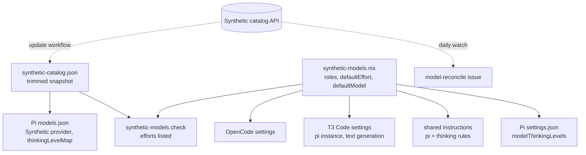
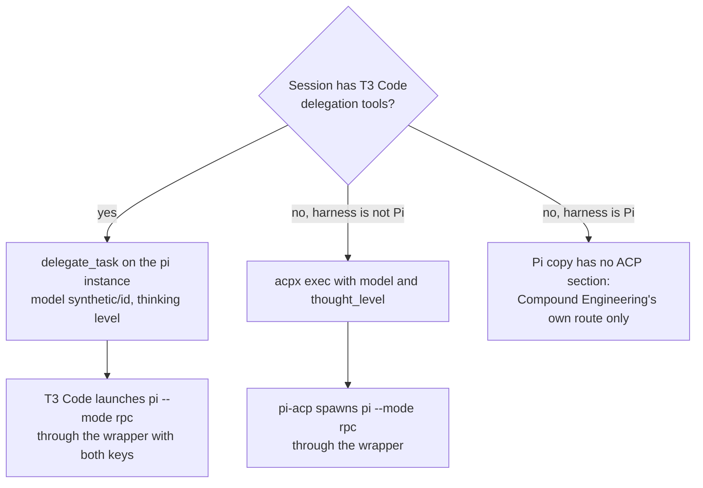

# Pi as the Synthetic model harness, with Exa web search - Plan

## Goal Capsule

- **Objective:** Every Synthetic model role an agent delegates (cross-model review peers, `ce-work` workers and fallbacks, `ce-plan` scouts, T3 Code text generation) runs on Pi, and the research scouts among them can search and fetch the web with cited results.
- **Means:** Package upstream Pi behind a key-carrying wrapper, generate its model config from a committed Synthetic catalog snapshot, add a T3 Code `pi` instance, give Pi an Exa web search and fetch extension, and render the shared agent instructions per harness with every Synthetic role on Pi (KTD1-KTD12).
- **Product authority:** Issues #289 (all of it except the OpenCode removal in its scope items 8 and 9) and #291. OpenCode stays installed and its T3 Code instance stays enabled; removing or disabling it is later work. The Product Contract wins on behavior; the Planning Contract wins on mechanism within it.
- **Execution profile:** Nix packaging and configuration with Python, shell, and JavaScript checks. Repository checks prove shapes and wrapper behavior; extension loading, thinking levels, and the ACP route are proven only by the live probes in the Verification Contract.
- **Stop conditions:** Stop and report when a pinned upstream artifact cannot be fetched or verified, when a live probe shows Synthetic rejects the generated thinking mapping for a model, or when T3 Code's `pi` driver refuses the packaged Pi.
- **Who finishes:** `ce-work` implements the units; the user runs the hardware probes in `docs/verification.md` after rebuilding a host and merges the pull request.
- **Open blockers:** None.

---

## Product Contract

### Summary

Pi becomes the harness for Synthetic models (GLM, Kimi, DeepSeek) on every host kind, standalone and as a T3 Code `pi` instance, and the shared agent instructions route every Synthetic role to it. Every Pi session gets a tool that reports the running model and an Exa-backed web search and fetch tool. Agents in other harnesses get instructions for running Pi over ACP. OpenCode stays installed alongside Pi until a later change removes it.

### Problem Frame

Synthetic models reach every harness through OpenCode today, and OpenCode is heavy for that job. Its shared background server keeps the first client's key and switches. Its config file silently drops a model variant, which is why #288 added a duplicate `@low` DeepSeek entry. A model can learn its own ID only through a session-info plugin the repository maintains.

Issue #285 moved every `ce-plan` research scout to Synthetic models, including the framework-docs, best-practices, and web researchers. Those scouts have no working web search or fetch tool, and `ce-plan` only warns and proceeds when a scout lacks one, so a plan can go ahead without the external research it asked for (#291).

The pinned T3 Code (`0.1.2-nightly.20261021.3473`) already ships a native `pi` driver, so Pi can serve inside T3 Code the way the Antigravity ACP runtime does today, without a wrapper of the repository's own.

### Key Decisions

- **Every Synthetic role inside T3 Code moves to Pi now, while OpenCode stays installed and its T3 Code instance stays enabled.** No rule falls back to OpenCode. Governs R9, R10, R12. (session-settled: user-directed — chosen over keeping OpenCode as a fallback in the rules, or moving only the scouts: one harness per role keeps the instructions short, and disabling the `opencode` instance is deferred with the removal.)
- **The web search and fetch tools load in every Pi session, not only in scout sessions.** Review peers and workers can reach the web too; a peer reading an untrusted diff could be steered into sending its content out through a query or fetch URL, which the user accepted at about the level of OpenCode's built-in webfetch. Governs R17. (session-settled: user-directed — chosen over a separate web-enabled `pi` instance for scouts, or one for scouts and workers: a single instance and a single rule set.)
- **Pi and every third-party Pi extension or adapter come from the latest upstream release, not nixpkgs.** Governs R1, R2. (session-settled: user-directed — chosen over nixpkgs `pi-coding-agent` 1.3.0 on the current lock: the user wants upstream's latest.)
- **Exa backs the web tools.** The user stored `exa_api_key` in `secrets/tokens.yaml` ahead of this work (commit `f37cb07`), which settles #291's service choice. Governs R4, R17.
- **Agents in non-Pi harnesses get instructions for running Pi over ACP, and Pi's own copy of the instructions omits them.** That requires rendering the shared instructions per harness instead of once for all. Governs R14, R15.
- **This change closes #291 and only references #289.** #289's body asks one pull request to close both, but the OpenCode removal it also covers is still open. Governs R21.

### Requirements

**Packaging and secrets**

- R1. Every host kind (NixOS, non-NixOS Linux, macOS) installs Pi from upstream's latest release, pinned in the repository and moved forward by the update workflow.
- R2. Any third-party Pi extension or adapter this work adds, including one ACP needs, follows the same upstream-latest rule as R1.
- R3. Pi gets the Synthetic key from `/run/secrets/cli-auth/synthetic_api_key` on NixOS and `${config.my.secrets.stateDir}/synthetic_api_key` elsewhere, reads it without ever writing it, lets a key the caller already exported win, and does not put a key from the file into the environment that commands run by Pi's tools inherit.
- R4. `exa_api_key` is published beside `synthetic_api_key` on every host kind, following `secrets/README.md`, and reaches Pi only through the wrapper and the published key file, never through a file Pi or T3 Code writes, and never into the environment of commands run by Pi's tools.

**Model configuration**

- R5. Pi's Synthetic provider is generated from a committed snapshot of Synthetic's public catalog and merged into Pi's model config, so models or keys the user added there survive an apply.
- R6. Each model offers exactly the thinking levels its catalog entry lists, `max` included where the catalog has it, so the reviewer and `deep-fallback` roles can run at `max`.
- R7. The model source (`home/h82/agents/synthetic-models.nix`) names its per-model effort and its default and small selections without naming a harness, and OpenCode's settings keep working from the renamed fields.
- R8. A check fails when a role's effort is not one the snapshot lists for that role's model.

**T3 Code**

- R9. T3 Code has an enabled `pi` provider instance, and `textGenerationModelSelection` selects the text-generation model on it with a `thinking` option.
- R10. The `opencode` instance stays enabled, and no rule in the shared instructions points at it.

**Shared agent instructions**

- R11. The shared instructions are rendered for Pi in the file Pi loads globally.
- R12. Inside T3 Code, the cross-model peer, `ce-work` worker, and `ce-plan` scout rules name the `pi` instance with a `thinking` option wherever they name a Synthetic model today.
- R13. The rule that tells a model to learn its own model ID works in both Pi and OpenCode sessions.
- R14. The instructions rendered for Claude Code, OpenCode, and the Antigravity CLI tell the agent how to run Pi as an ACP agent; the copy rendered for Pi does not contain that text.
- R15. In a Claude Code, OpenCode, or Antigravity CLI session outside T3 Code, or any of them without T3 Code's delegation tools, a Synthetic peer or worker runs on Pi over ACP instead of through an OpenCode pass; a Pi session gets no ACP route (R14).

**Pi extensions**

- R16. A model running in Pi can learn its running model ID, and its thinking level when Pi exposes it, either from Pi itself or from a `session_info` tool the repository ships; text generation, which runs Pi with `--no-extensions`, does not depend on it.
- R17. Every Pi session other than text generation offers a web search tool and a page fetch tool backed by Exa's HTTP API, each returning the source URLs of what it found.
- R22. Pi never runs extensions or packages that a checkout it works in supplies under `.pi/`, so a peer or scout reviewing an untrusted diff cannot be made to execute code through them.
- R23. A Synthetic review peer started over ACP runs without Pi's write and shell tools but keeps its web and model-ID tools, because neither `acpx` nor `pi-acp` can enforce read-only access on Pi's own tools.

**Plugins and skills**

- R18. Pi loads the Compound Engineering plugin and the Korean writing skills (`humanizer`, `grammar-checker`, `style-guide`) to the extent Pi supports them.

**Checks and tracking**

- R19. Repository checks cover Pi the way the OpenCode checks cover OpenCode: the generated model config matches the snapshot and the model source, the wrapper reads both key files and never writes them, and the T3 Code traits check asserts the `pi` instance and the text-generation selection. `synthetic-models` and `synthetic-models-watch` keep passing against the renamed fields.
- R20. `docs/verification.md` lists the live checks under Success Criteria.
- R21. The pull request carries `Closes #291` and `Refs #289`.

### Acceptance Examples

- AE1. **Covers R13, R16.** Given a GLM session in Pi and another in OpenCode, when each follows the model-ID rule, then each reports `hf:zai-org/GLM-5.3` and maps it to family `glm`.
- AE2. **Covers R9, R16, R17.** Given T3 Code generating a thread title, when it runs Pi with `--no-extensions --no-tools` on the DeepSeek model at `thinking` `low`, then the title is generated without the `session_info` or Exa extensions.
- AE3. **Covers R14.** Given an apply, when the user opens the instructions rendered for Claude Code and for Pi, then only the Claude Code copy contains the ACP instructions for running Pi.
- AE4. **Covers R5.** Given a model the user added by hand to Pi's model config, when the next apply regenerates the Synthetic provider, then the added model is still there.
- AE5. **Covers R3, R4.** Given a production host whose key files are present, when a Pi session answers on a Synthetic model and calls `web_search`, then both calls authenticate, `env` run through Pi's bash tool shows neither key, and neither key file changed; given a bootstrap host with no key files, Pi still starts and Synthetic serves nothing.

### Success Criteria

These are run live and recorded in `docs/verification.md` (R20):

- A Pi thread in T3 Code answers on each Synthetic model the model source names.
- A `delegate_task` child on the `pi` instance runs GLM at `thinking` `max`.
- T3 Code's text generation runs on DeepSeek at `low` through the `pi` instance.
- T3 Code's MCP tools are visible inside a Pi session.
- A web-dependent `ce-plan` scout on the `pi` instance returns cited external results (#291).
- A non-Pi harness outside T3 Code runs a Synthetic peer on Pi over ACP and gets its result.

### Scope Boundaries

- Removing OpenCode (#289 scope item 8): its package, wrapper, session-info plugin, checks, update-workflow step, and documentation stay.
- Refreshing the OpenCode learnings and dropping their `AGENTS.md` links (#289 scope item 9); they still describe live code.
- Disabling the T3 Code `opencode` instance, and dropping the `@low` alias #288 added; both wait for the removal.
- #290, the workflow that runs Pi headless in GitHub Actions on Synthetic's infinite alias.
- A cap on Exa query count or spend.
- A separate web-enabled Pi instance for scouts, rejected in favor of one instance (see Key Decisions).
- A read-only T3 Code `pi-readonly` instance for review peers, considered and declined by the user: T3 Code peers stay read-only by instruction, as Claude Code and OpenCode peers are today.
- Running Pi as a separate user that cannot read the key files, considered and declined by the user; the encoded-key path stays an accepted risk.
- Removing a model from Pi's `models.json` when the model source retires it, left for the first retirement: the provider is new, so nothing exists to retire yet.

### Dependencies / Assumptions

- T3 Code's `pi` driver launches `pi --mode rpc`, reserves `--mode`, `--session`, and `--print`, requires Pi 0.80.5 or newer, and reaches Pi through an extension that imports `@earendil-works/pi-coding-agent` and `typebox`. The upstream standalone binary serves both as built-in virtual modules, so no `node_modules` has to sit beside it (read from the pinned bundle's `packages/provider-pi/` and Pi's extension loader).
- T3 Code's text generation runs Pi with `--no-extensions --no-tools`, so the text-generation model must be defined in Pi's `models.json`, not by an extension.
- Synthetic's catalog at `https://api.synthetic.new/openai/v1/models` needs no key, and `scripts/synthetic-models-watch` already reads it.
- `exa_api_key` exists in `secrets/tokens.yaml` and no host decrypts it yet (`secrets/README.md`).
- Adding `exa_api_key` to the tokens a non-NixOS production apply requires makes that apply stop when the key is missing, as it does for `synthetic_api_key` today.

### Outstanding Questions

Every question the requirements deferred to planning is answered in the Planning Contract: model ID (KTD7), text-generation thinking and Pi's per-model default (KTD4), the snapshot (KTD3), ACP (KTD9), Compound Engineering's own routes (KTD11), plugins and skills (KTD11), and release tracking (KTD1, KTD9). The questions that only a live run can answer are listed under Open Questions in the Planning Contract.

### Sources / Research

- Issues #289 and #291, and #290 for the downstream workflow that waits on this.
- `home/h82/agents/opencode.nix`, `packages/opencode.nix`, and `scripts/opencode`: the wrapper, key-file, and settings-merge pattern Pi's wiring mirrors.
- `home/h82/t3code.nix`: provider instances and `textGenerationModelSelection`.
- `home/h82/agents/synthetic-models.nix` and its consumers: `tests/synthetic-models.nix`, `scripts/synthetic-models-watch`, `.github/workflows/synthetic-models.yml`.
- `home/h82/agents/instructions/instructions.md.tmpl` and `default.nix`: one rendering today for Claude Code, OpenCode, and Antigravity.
- `modules/nixos/system/secrets.nix`, `scripts/host-secrets`, and `home/h82/security/non-nixos-secrets.nix`: where `synthetic_api_key` is published.
- `home/h82/agents/agent-plugins.nix`, `korean-skills.nix`, and `cross-model-peers.nix`: today's harness targets.
- The OpenCode learnings under `.compound-engineering/artifacts/solutions/integration-issues/` (shared background server, variant dropped from config, plugin loading verifiable only by a live run) for traps Pi may share.

---

## Planning Contract

Product Contract preservation: changed: R3, R4, and AE5 now also keep both keys out of the environment that Pi's tool commands inherit, and R22 (no checkout-supplied `.pi/` code) and R23 (read-only ACP peers) are new — flow analysis found that Pi gives every bash command the wrapper's environment, runs a trusted checkout's `.pi/` extensions, and has no approval step an ACP client could use. The Goal Capsule gained its execution lines, the Outstanding Questions are answered in place by the KTDs below, and one dependency line was corrected to say the standalone Pi binary serves the extension imports itself.

### Key Technical Decisions

- KTD1. **Pi ships as upstream's per-platform release tarball, pinned in `packages/pi-release.json`.** Each GitHub release (`earendil-works/pi`, v1.4.0 today) carries `pi-linux-x64.tar.gz`, `pi-linux-arm64.tar.gz`, and `pi-darwin-arm64.tar.gz`, each a Bun-compiled `pi` binary that needs only glibc on Linux, plus sibling assets (themes, `export-html`, wasm, docs) it resolves from its own directory, and a `SHA256SUMS` file. The package keeps the extracted `pi/` directory whole under `libexec/` and follows `packages/opencode.nix` for everything else: `autoPatchelfHook` and `dontStrip` on Linux (OpenCode is the same kind of Bun binary and survives it), no fixup at all on macOS so the binary's code signature stays valid, `versionCheckHook`, and a release resolver, `scripts/pi-release`, that reads the latest GitHub release, verifies every target asset against `SHA256SUMS`, writes only when strictly newer, and takes its network command from an environment override so its test runs on fixtures. The update workflow runs it beside the OpenCode step. Governs R1. (session-settled: user-directed — chosen over nixpkgs `pi-coding-agent` 1.3.0: the user wants upstream's latest.)
- KTD2. **A `pi` wrapper points Pi at both key files without exporting the keys, and pins Pi's network behavior.** Unlike `scripts/opencode`, which exports the key and so hands it to every command the model runs, the wrapper exports only `PI_SKIP_VERSION_CHECK=1` and `PI_TELEMETRY=0` and `exec`s the pinned binary; the key-file paths are baked into the key helper and the Exa extension at build time, so no environment variable names them either. The Synthetic provider's `apiKey` is a `!` command, a small packaged helper that prints a caller-exported `SYNTHETIC_API_KEY` when one is set and otherwise reads the key file with `scripts/opencode`'s bounded read and validation; Pi runs it per request and does not cache it, which costs one short process per request and keeps the key out of every tool's environment. This stops incidental leaks such as an `env` dump; it does not stop a tool command that reads the published key file itself, which runs as the same user (see Risks & Dependencies). The Exa extension reads its key the same way (KTD8). Both key-file paths are build parameters checked by the plain-absolute-path assertion `packages/opencode.nix` uses. The wrapper is installed as `pi` on PATH, so T3 Code's `pi` driver needs no `binaryPath` and no key reaches a file T3 Code writes. Governs R3, R4.
- KTD3. **The Synthetic provider in `~/.pi/agent/models.json` is rendered from `home/h82/agents/synthetic-catalog.json`, a committed snapshot trimmed to the models the model source names.** Each model maps `id`, `display_name`, `input_modalities`, `context_length`, `max_output_length`, and `pricing` (per token, times one million) to Pi's fields, with `reasoning: true` when the entry lists efforts. The provider uses `baseUrl` `https://api.synthetic.new/openai/v1`, `api` `openai-completions`, and the KTD2 helper as its `!` `apiKey`, so no key is written to disk. `agent-settings` merges the provider's scalars with `setPaths` and each model with `upsertPaths` keyed by `id`, which leaves other providers and hand-added models alone. Retiring a model the source drops is left for the first retirement (Scope Boundaries), because the provider is new and nothing has been written to retire yet. `scripts/synthetic-models-watch` gains a mode that rewrites the snapshot from the live catalog for the source's IDs, and the update workflow runs it and commits the result like a pin; the existing watch keeps reporting drift through its issue. Only named models go in, because only they have roles and an effort the checks can hold to the catalog. Governs R5, R6, R8.
- KTD4. **`thinkingLevelMap` is derived from the catalog's `reasoning_parameters.efforts`, and Pi's per-model startup level carries the default effort.** For each Pi level the map sends the same-named Synthetic effort when the catalog lists it and `null` otherwise, except that `off` maps to `none` when listed and `minimal` is always `null`; `xhigh` and `max` are emitted only when listed. So GLM 5.3 shows `low`, `high`, and `max`, and DeepSeek V4.1 Flash shows `off`, `low`, `high`, `xhigh`, and `max`. `~/.pi/agent/settings.json` gets `modelThinkingLevels."synthetic/<id>"` set to each model's `defaultEffort`, except the text-generation model, whose entry is its `text-generation` role effort (below), `defaultProvider` `synthetic`, `defaultModel` the source's default model, and `defaultProjectTrust` `never` (R22). The text-generation model starts at its `text-generation` role effort (`low` for DeepSeek, whose `defaultEffort` is `high`), because T3 Code's Pi text generation sends `set_model` and never `set_thinking_level`, so the startup level is the only effort it gets. Pi's docs do not say whether `set_model` applies the new model's `modelThinkingLevels` entry or clamps the level the process started with, so U7 captures the outgoing request body of a text-generation run; when it does not show `low`, the `pi` instance also gets the launch argument `--thinking low`, which text generation passes too and which T3 Code sessions override with their own `set_thinking_level`. The cost is that standalone `pi` on DeepSeek also starts at `low`; T3 Code sessions and the ACP route always pass a level explicitly. Governs R6, R9, R22.
- KTD5. **The model source drops OpenCode from its field names.** `opencodeEffort` becomes `defaultEffort`, `opencodeDefault` becomes `defaultModel`, and `small` becomes `smallModel` (still read only by OpenCode's `small_model`). Every consumer moves in the same change: `home/h82/agents/opencode.nix`, `home/h82/t3code.nix`, `tests/synthetic-models.nix`, `tests/agent-instructions.nix`, `scripts/synthetic-models-watch`, and `CONCEPTS.md`. `tests/synthetic-models.nix` also reads the snapshot and fails when a role's effort or a default effort is not one the snapshot lists for that model. Governs R7, R8.
- KTD6. **T3 Code gets an enabled `pi` instance and text generation moves to it.** `providerInstances.pi` is `{ driver = "pi"; enabled = true; }` with no launch arguments. `textGenerationModelSelection` becomes the `pi` instance, model `synthetic/<text-generation id>`, with a `thinking` option at the text-generation effort, recorded for the reader even though text generation ignores it (KTD4 carries the effective level). The `opencode` instance, its `@low` alias, and the alias's hidden-model entry stay untouched. Governs R9, R10.
- KTD7. **A model in Pi learns its ID from a `session_info` tool the repository's Pi extension package registers, with Pi's bash environment as the fallback.** The tool returns the provider, model ID, and thinking level from the extension context (`ctx.model`, `pi.getThinkingLevel()`), so it works in a `pi-readonly` session that has no bash tool (KTD9). Pi also exports `PI_PROVIDER`, `PI_MODEL`, and `PI_REASONING_LEVEL` to every command its `bash` tool runs. The shared rule becomes: in Pi or OpenCode, call `session_info` first; in Pi, print those three variables through the bash tool when it fails; the existing fallbacks stay. Using the same tool name in both harnesses keeps one rule. Text generation runs with no extensions or tools and never needs it. Governs R13, R16.
- KTD8. **The repository's Pi extension is one dependency-free JavaScript file installed in `~/.pi/agent/extensions/nix-config/`.** It registers `session_info` (KTD7) and the Exa tools: `web_search`, which posts to `https://api.exa.ai/search` with `type` `auto`, a bounded `numResults` (default 5, at most 10), and `contents.highlights`, and `web_fetch`, which posts up to a few URLs to `/contents` with a bounded text length. Both return each result's URL, title, and text, marked as untrusted web content, and send the key in the `x-api-key` header. The key comes from a caller-exported `EXA_API_KEY`, which the extension removes from `process.env` at load so tool commands do not inherit it, or else from the Exa key file whose path is substituted into the file at build time, read at call time. Before every request, both tools also read the Synthetic and Exa keys and refuse, with an error and no request, any query, URL, or body that contains either key verbatim, which closes the direct path for a steered model to send a key out through Exa. The tools register even with no key and then return an error naming the missing key, so a scout sees why it has no web access instead of seeing no tool. Search plus highlights in one request is the cheapest path (contents are free up to ten results). Pi loads extensions from that directory on every start, follows symlinks, and serves `typebox` built in, so the file needs no `node_modules`. T3 Code's text generation passes `--no-extensions`, so it never loads. Governs R17. (session-settled: user-directed — chosen over a separate web-enabled `pi` instance for scouts, or one for scouts and workers: one instance and one rule set, exfiltration risk accepted.)
- KTD9. **ACP comes from two upstream npm packages, `pi-acp` and `acpx`, built with `buildNpmPackage` and pinned with a committed lock file each.** Pi speaks only its RPC mode; `pi-acp` (svkozak) wraps `pi --mode rpc` as an ACP agent, takes `model` and `thought_level` as ACP config options, and finds Pi through `PI_ACP_PI_COMMAND`, which the package sets to the wrapper. `acpx` (openclaw) is the ACP client the shared instructions tell an agent to run, as a one-shot `exec` with the model and thinking level set; its built-in `pi` agent entry runs `npx pi-acp`, so the package overrides that entry to the Nix-built adapter. `pi-acp` delegates no file or terminal access to the client, and Pi has no approval step, so `acpx`'s permission flags restrict nothing (R23). The package therefore also defines a `pi-readonly` agent whose `pi-acp` runs a wrapper variant passing `--exclude-tools bash,edit,write`. An allowlist through `--tools` would also drop the tools extensions register, because Pi filters its whole loadout by it (T3 Code's own Pi bridge re-adds its tools for that reason), so the variant removes the three built-ins by name and keeps `session_info`, `web_search`, and `web_fetch`. The instructions send review peers there and `ce-work` workers to `pi`; `ce-plan` scouts never run over ACP, because they are delegated only through T3 Code. Both `pi-acp` wrappers unset `SYNTHETIC_API_KEY` and `EXA_API_KEY` before they start Pi, so a key an OpenCode session exported never reaches Pi's tools through ACP; an agent starting Pi over ACP is never a person testing another account. Neither package ships a lock file, so each pin (`packages/pi-acp-release.json`, `packages/acpx-release.json`) records the tarball URL, its hash, and `npmDepsHash`, and a resolver regenerates `packages/<name>/package-lock.json` from the registry when it moves the pin. This is the repository's first `buildNpmPackage`; Compound Engineering's own Antigravity route still downloads its separate `acpx@0.19.5` through `npx`, unchanged. Governs R2, R14, R15, R23.
- KTD10. **The shared instructions render twice from logic-free templates.** `instructions.md.tmpl` keeps every rule all harnesses share, now naming the `pi` instance and `thinking` wherever it named the `opencode` instance and `variant` for a Synthetic model. A second template, `acp.md.tmpl`, holds a `# Pi over ACP` section: how to run a Synthetic peer or worker with `acpx` outside T3 Code, and the rules for the outside-T3 cross-model and `ce-work` routes that today name an OpenCode pass. The module renders the shared body alone for Pi (`.pi/agent/AGENTS.md`) and the shared body followed by the ACP section for Claude Code, OpenCode, and the Antigravity CLI. Two files keep `tests/agent-instructions.nix`'s ban on `if` and `range` intact, at the cost of one more pinned file; `CONCEPTS.md`'s **Delivery path** entry changes from "every harness reads the same rendering" to "every harness reads the shared rendering, and every harness but Pi also reads the ACP section". Governs R11, R12, R14.
- KTD11. **Outside T3 Code, Compound Engineering's own routes stop reaching Synthetic models through OpenCode.** OpenCode's `crossModelPeers` token goes, so `CROSS_MODEL_PEERS` holds only `claude`, and the outside-T3 `ce-work` rule gives Compound Engineering's own route only `claude`; the ACP section then tells the agent to run each Synthetic peer or worker through `acpx` itself and fold the result in as that skill's peer artifact. Compound Engineering 3.31.0 has no Pi route token, so this is the only way to keep R15 without a fork. For plugins and skills, Pi reads `~/.pi/agent/skills` and `~/.agents/skills` and takes extra skill directories from `settings.json`'s `skills` array: `agent-plugins.nix` gains a `pi` harness that adds the pinned Compound Engineering plugin's `skills` directory there through `agent-settings` (the way its `opencode` harness writes `opencode.json`), and `korean-skills.nix` adds `.pi/agent/skills` as a root. Pi has no subagent or command format to load, so only skills reach it. Governs R15, R18. (session-settled: user-approved — chosen over keeping OpenCode as the outside-T3 route: the user asked for the ACP route and confirmed it.)
- KTD12. **`exa_api_key` is published exactly like `synthetic_api_key`.** NixOS gains `my.cliAuth.enableExaApiKey`, on by default in `modules/nixos/profile.nix`, which adds `cli-auth/exa_api_key` (owner `h82`, mode 0400) to the sops list. Non-NixOS and macOS hosts add `exa_api_key` to `scripts/host-secrets`' token list, so a production apply decrypts it into `my.secrets.stateDir` and stops when it is missing, as it already does for the other five; the key is already in `secrets/tokens.yaml`. Governs R4.

### High-Level Technical Design

How one change to the model source reaches every consumer:

How a Synthetic peer runs in each place:

How each Pi launch differs:

| Launch | Extensions (Exa) | Tools | Thinking level comes from |
| --- | --- | --- | --- |
| T3 Code thread or `delegate_task` | loaded | default set plus T3 Code's MCP bridge | the selection's `thinking` option |
| T3 Code text generation | `--no-extensions` | `--no-tools` | `modelThinkingLevels` startup level (KTD4) |
| `acpx` through `pi-acp` | loaded | default set | the `thought_level` config option |
| `pi` in a terminal | loaded | default set | `modelThinkingLevels`, then `/thinking` |

### Assumptions

- Pi's `modelThinkingLevels` applies when an RPC client switches models with `set_model`, not only at process start. If the live text-generation probe shows otherwise, the fallback is an instance-level `--thinking` launch argument for the `pi` instance, which text generation also passes.
- Synthetic honors the generic OpenAI `reasoning_effort` field Pi sends for an unknown host, for GLM, Kimi, and DeepSeek. This is unverified: OpenCode's `reasoningEffort` setting is a different, client-side name and proves nothing about the wire field. The U3 smoke probe and the U7 request capture prove it, including whether `none` turns DeepSeek's reasoning off.
- Pi's auto-detected OpenAI compatibility flags (developer role, `store`, max-tokens field) suit Synthetic. The live probe on each model is the proof; a rejected request is fixed with an explicit `compat` block on the provider.
- `buildNpmPackage` can build `pi-acp` and `acpx` from their registry tarballs with a generated lock file. If either needs a build step its tarball lacks, the unit falls back to the published `dist/` with only runtime dependencies.

### Open Questions

**Deferred to implementation**

- The exact `acpx` flag or config file that overrides its built-in `pi` agent command, and its one-shot output format, read from the pinned version.
- Whether Pi accepts a plain JSON Schema object as a tool's `parameters` or needs the built-in `typebox`; the extension stays dependency-free either way.
- Whether Pi rejects a skill directory that is a symlink into the Nix store or a hardlinked store file, as Orca did; the live probe in U9 settles it.

### System-Wide Impact

- **Every coding agent's instructions change.** Claude Code, OpenCode, the Antigravity CLI, and every T3 Code thread read the rewritten rules, so a Synthetic peer, worker, or scout launched from any of them lands on Pi from the next rebuild on (U6).
- **Every production apply decrypts one more secret.** A non-NixOS or macOS apply stops when `exa_api_key` is missing from `secrets/tokens.yaml`; the key is already there, and `docs/adding-a-host.md` must name it with the others (U9).
- **Compound Engineering's own cross-model route loses its OpenCode peer.** Outside T3 Code, `CROSS_MODEL_PEERS` holds only `claude`, and Synthetic peers run only when the agent follows the ACP section (KTD11).
- **The update workflow moves four more pins.** Pi, the catalog snapshot, `pi-acp`, and `acpx` each get a step and a commit block, and a failed resolver keeps the old pin as the OpenCode step does.

### Risks & Dependencies

| Risk | Decision |
| --- | --- |
| `pi-acp` (0.0.x) and `acpx` (pre-1.0) change their interfaces between releases | The sandbox ACP session check (U5) fails the update workflow's verify step, which blocks that run's push to `main` and opens the reconciliation pull request, so a breaking adapter release holds every bump in that run until a person fixes or reverts the pin. |
| A Pi release breaks T3 Code's `pi` driver (minimum 0.80.5, RPC hooks) | T3 Code's own version probe reports the instance unavailable; the live probe catches behavior changes. Accepted: the pin moves only through the verified update workflow. |
| `set_model` ignores `modelThinkingLevels`, so text generation runs at the wrong effort | U7's request capture decides, with the `--thinking low` launch argument as the fix (KTD4). |
| Synthetic rejects a request Pi shapes differently from OpenCode | The per-model live probe; an explicit `compat` block fixes it (Assumptions). |
| A review peer reading an untrusted diff reaches the web through Exa | Accepted by the user (Key Decisions); the fetched text is labeled untrusted (KTD8). Keys stay out of tool environments (KTD2), which stops incidental leaks, and the Exa tools refuse a request carrying a key verbatim (KTD8). A same-user tool command can still read a published key file and send it encoded; the user accepted that as part of the every-session web decision rather than run Pi as a separate user or drop web tools from peers. |
| A Pi release changes project trust or stops exporting `PI_MODEL` | The U5 sandbox session check also asserts that a scratch checkout's `.pi/extensions/` file does not load; the `session_info` tool, not the bash variables, is the primary model-ID path (KTD7). |
| The peer timing benchmark was measured on OpenCode only | U9 records a two-sample timing run on the `pi` instance before the change is called done. |

### Sequencing

U1 (model source and snapshot) and U2 (Pi package, wrapper, secrets) come first and are independent. U3 (Pi home configuration) needs both. U4 (Pi extension) needs U2 and U3. U5 (ACP packages) needs U2 and U3. U6 (instructions) needs U1 and U5. U7 (T3 Code) needs U1 and U3. U8 (plugins, skills, peers) needs U3 and U6. U9 (documentation and live probes) comes last.

---

## Implementation Units

### U1. Harness-neutral model source and the catalog snapshot

**Goal:** Rename the model source's OpenCode fields, commit the trimmed Synthetic catalog snapshot, and make the checks hold every effort to it.

**Requirements:** R6, R7, R8; KTD3, KTD5.

**Dependencies:** none.

**Files:**

- `home/h82/agents/synthetic-models.nix`
- `home/h82/agents/synthetic-catalog.json` (new)
- `home/h82/agents/opencode.nix`
- `home/h82/t3code.nix`
- `scripts/synthetic-models-watch`
- `tests/synthetic-models.nix`
- `tests/test_synthetic_models_watch.py`
- `tests/agent-instructions.nix` (field names only)
- `.github/workflows/update-dependencies.yml`
- `flake.nix`

**Approach:**

1. Rename the three fields (KTD5) and update every reader found by `rg 'opencodeEffort|opencodeDefault|\bsmall\b'`.
2. Add the snapshot mode to `scripts/synthetic-models-watch`: fetch the catalog, keep the entries whose `id` the source names and the fields KTD3 maps, and refuse to write when an ID is missing or the catalog is malformed.
3. Generate the first snapshot from `tests/fixtures/synthetic-models/catalog-2026-10-21.json` through that mode, then refresh it live once.
4. Extend `tests/synthetic-models.nix` to read the snapshot and fail on a role effort or default effort the snapshot does not list, and on a source ID the snapshot lacks.
5. Add the snapshot step and its commit block to the update workflow beside the OpenCode pin.

**Patterns to follow:** `scripts/opencode-release` (write only on change, network override for tests), `tests/synthetic-models.nix`'s collected-problems style.

**Test scenarios:**

- Snapshot mode on the fixture catalog writes exactly the four source IDs with their efforts, context, output length, modalities, and pricing.
- Snapshot mode exits non-zero and leaves the file untouched when the catalog lacks a source ID.
- Snapshot mode exits non-zero on a catalog entry whose efforts field is not a list of strings.
- `tests/synthetic-models.nix` fails when a role effort is set to `xhigh` on GLM, whose snapshot entry lists only `low`, `high`, and `max`.
- `tests/synthetic-models.nix` fails when `defaultModel` names a missing entry, and when a source ID is missing from the snapshot.
- The watch's issue body still names where each entry is used under the renamed pointers.

**Verification:** `nix flake check` passes with the renamed fields, and a mutated effort in the source turns `synthetic-models` red.

### U2. Pi package, wrapper, and Exa key publication

**Goal:** Install upstream Pi as a `pi` command on every host kind that carries both keys from their key files.

**Requirements:** R1, R3, R4; KTD1, KTD2, KTD12; AE5.

**Dependencies:** none.

**Files:**

- `packages/pi.nix` (new)
- `packages/pi-release.json` (new)
- `scripts/pi-release` (new)
- `scripts/pi` (new)
- `scripts/pi-synthetic-key` (new, the KTD2 key helper)
- `packages/agent-tools.nix`
- `flake.nix`
- `.github/workflows/update-dependencies.yml`
- `modules/nixos/system/secrets.nix`
- `modules/nixos/profile.nix`
- `scripts/host-secrets`
- `tests/pi.sh` (new)
- `tests/test_pi_release.py` (new)
- `tests/non-nixos-outputs.nix`
- `tests/darwin-outputs.nix`
- `tests/lib/fake-secrets.nix`
- `tests/host-secrets.nix`
- `tests/auth-provisioning.nix`

**Approach:**

1. Write `scripts/pi-release` against the GitHub release API and `SHA256SUMS` for the three target assets, with SRI hashes in the pin.
2. Build `packages/pi.nix` from the pin per KTD1, installing the wrapper as `bin/pi` and the key helper beside it, with `@SYNTHETIC_KEY_FILE@`, `@EXA_KEY_FILE@`, and `@PI@` substituted.
3. Register the app, the `pi-sources` pinned-source check, the `pi-release` script check, and a `pi-wrapper` check that runs `tests/pi.sh` in source and packaged modes and rejects unsafe key-file paths.
4. Add the NixOS option and default, and the non-NixOS token, per KTD12; give every fake `tokens.yaml` a fake `exa_api_key`, extend the per-token loops in `tests/host-secrets.nix` and the NixOS secret-list assertion in `tests/auth-provisioning.nix`, and make the non-NixOS and darwin output checks assert the key helper's baked key-file path under `my.secrets.stateDir`.
5. Add the update-workflow step and commit block.

**Execution note:** Packaging work; prove it with `pi --version` from the built package on Linux and with the stub-based wrapper test, not with unit coverage of Nix expressions.

**Patterns to follow:** `packages/opencode.nix`, `scripts/opencode`, `scripts/opencode-release`, `tests/opencode.sh`, `tests/test_opencode_release.py`, the `opencode-wrapper` check in `flake.nix`.

**Test scenarios:**

- Covers AE5. With both key files present, the stub records no `SYNTHETIC_API_KEY`, `EXA_API_KEY`, or variable naming a key file, and both files' bytes and mtimes are unchanged.
- Covers AE5. With no key files, the stub still runs and stderr is empty.
- The key helper prints the Synthetic key file's contents, prints a caller-exported `SYNTHETIC_API_KEY` instead when one is set, and prints nothing for a missing file.
- The key helper prints nothing for a key file holding whitespace, a control character, or more than 8192 bytes.
- The stub sees `PI_SKIP_VERSION_CHECK=1` and `PI_TELEMETRY=0`, and argv passes through unchanged, including `--mode rpc`.
- Building the package with a key-file path containing a quote or space fails evaluation.
- The release resolver writes a pin from a fixture release whose assets match `SHA256SUMS`, refuses a mismatched or missing asset, refuses a non-plain version, and leaves the pin unchanged when the version is not newer.

**Verification:** the wrapper and resolver checks pass, every host output builds, and a NixOS generation lists `cli-auth/exa_api_key` with owner `h82` and mode 0400.

### U3. Pi home configuration

**Goal:** Give h82 Pi's Synthetic provider, startup thinking levels, and extension directory, merged so user edits survive.

**Requirements:** R5, R6, R9 (startup level), R22; KTD3, KTD4; AE4.

**Dependencies:** U1, U2.

**Files:**

- `home/h82/agents/pi.nix` (new)
- `home/h82/agents/default.nix`
- `tests/pi.nix` (new)
- `flake.nix`

**Approach:**

1. Import `synthetic-models.nix` and the snapshot, and build the `models.json` declaration (provider scalars as `setPaths`, models as `upsertPaths` keyed by `id`) and the `settings.json` declaration (`defaultProvider`, `defaultModel`, `defaultProjectTrust`, `modelThinkingLevels` leaves).
2. Run both merges from `home.activation` after `installPackages`, through `agent-settings`, the way `home/h82/agents/opencode.nix` does.
3. Install the U2 package into `home.packages` on every host kind.
4. Write `tests/pi.nix` against the materialized generation: the declared documents, the package on PATH, and the activation entries.

**Patterns to follow:** `home/h82/agents/opencode.nix` (`mergeInto`, `modelLeaves`), `tests/opencode.nix`.

**Test scenarios:**

- The declared provider has `api` `openai-completions`, an `apiKey` that is the `!` command running the KTD2 key helper, and exactly one model per source entry.
- GLM 5.3's `thinkingLevelMap` maps `low`, `high`, and `max` to themselves and `off`, `minimal`, and `medium` to `null`, with no `xhigh` key.
- DeepSeek's map sends `off` to `none` and includes `xhigh` and `max`.
- A model's `cost.input` equals its snapshot prompt price per token times one million.
- `modelThinkingLevels` sets DeepSeek to `low` (its text-generation effort) and GLM to `max`.
- Covers AE4. Running the merger twice over a `models.json` that holds a hand-added model and a second provider keeps both.
- No declared document contains a literal key value, and the provider's `apiKey` is the `!` command naming the helper's store path.
- `settings.json` declares `defaultProjectTrust` `never`.

**Verification:** `tests/pi.nix` passes for every configuration `tests/lib/configurations.nix` yields, and a mutated effort map in `pi.nix` turns it red. Before U4 starts, an early smoke probe runs the built package with a scratch `PI_CODING_AGENT_DIR` holding the generated `models.json` and `settings.json`: one `--print` completion per source model at each of its listed levels against a local listener records the `reasoning_effort` Pi sends, and one real completion per model through the host's key file shows Synthetic accepts it. A rejected request is fixed here with a `compat` block, not after U8.

### U4. Pi extension: session info and Exa web tools

**Goal:** Ship `session_info`, `web_search`, and `web_fetch` to every Pi session.

**Requirements:** R16, R17; KTD7, KTD8; AE1, AE2.

**Dependencies:** U2, U3.

**Files:**

- `packages/pi-extension/index.js` (new)
- `packages/pi-extension.nix` (new)
- `home/h82/agents/pi.nix`
- `tests/pi-extension.test.mjs` (new)
- `tests/pi-extension.nix` (new)
- `flake.nix`

**Approach:**

1. Write the extension as one ES module that default-exports a function registering the three tools, with `fetch` and reads of the two key files as its only I/O.
2. Package it per host kind as a directory holding only `index.js`, with the Synthetic and Exa key-file paths substituted for placeholders, and link it to `.pi/agent/extensions/nix-config` from `pi.nix`.
3. Test it under `node --test` with a stubbed `fetch` and a fake registration object, and check the materialized home file the way `tests/opencode-session-info.nix` does.

**Patterns to follow:** `packages/opencode-session-info/`, `tests/opencode-session-info.test.mjs`, `tests/opencode-session-info.nix` (including its `ls -A` over globs).

**Test scenarios:**

- `web_search` posts to `/search` with the key in `x-api-key`, `type` `auto`, `numResults` 5 by default, and `contents.highlights`, and returns each result's URL, title, and highlights.
- `web_search` clamps a requested `numResults` of 50 to 10.
- `web_fetch` posts the given URLs to `/contents` with a text length limit and returns each URL with its text.
- With `EXA_API_KEY` unset and no key file, both tools still register and return an error naming the missing key without making a request.
- With a caller-exported `EXA_API_KEY`, loading the extension removes it from `process.env` and the tools still authenticate with it.
- With no exported key, the tools read the key from the baked key-file path at call time.
- A `web_search` query and a `web_fetch` URL that each embed the Exa key or the Synthetic key verbatim return an error and make no request.
- `session_info` returns the provider, model ID, and thinking level a fake context reports, and an error field when the context has no model.
- Fetched page text comes back labeled as untrusted web content.
- A 401, a 429, and a 500 each return an error carrying the HTTP status and no key material.
- A response missing `results` returns an error instead of throwing.
- The packaged directory holds exactly `index.js`, equal to the repository file with only the two placeholders replaced by the host kind's key-file paths, and exactly one home file targets `.pi/agent/extensions/nix-config`.

**Verification:** the node tests and `tests/pi-extension.nix` pass; loading in a real Pi session is the U9 live probe.

### U5. ACP adapter and client packages

**Goal:** Put `acpx` on PATH with its `pi` agent bound to a Nix-built `pi-acp` that runs the wrapper.

**Requirements:** R2, R14, R15, R22, R23; KTD9.

**Dependencies:** U2, U3.

**Files:**

- `packages/pi-acp.nix`, `packages/pi-acp-release.json`, `packages/pi-acp/package-lock.json` (new)
- `packages/acpx.nix`, `packages/acpx-release.json`, `packages/acpx/package-lock.json` (new)
- `scripts/npm-release` (new, shared resolver for both pins)
- `tests/test_npm_release.py` (new)
- `packages/agent-tools.nix`
- `home/h82/agents/pi.nix`
- `flake.nix`
- `.github/workflows/update-dependencies.yml`

**Approach:**

1. Write `scripts/npm-release` to resolve a package's `latest` tag, refuse deprecated or non-plain versions, regenerate its lock file, and record the tarball URL, SRI hash, and `npmDepsHash`.
2. Build each package with `buildNpmPackage` from the pinned tarball and committed lock file.
3. Wrap `pi-acp` twice, each unsetting `SYNTHETIC_API_KEY` and `EXA_API_KEY`: once with `PI_ACP_PI_COMMAND` set to the U2 wrapper's store path, and once set to a read-only variant of the wrapper that adds `--exclude-tools bash,edit,write`.
4. Wrap `acpx` so its `pi` agent entry runs the first and a `pi-readonly` agent entry runs the second, using the override mechanism the pinned version documents.
5. Add both to `home.packages` in `pi.nix`, register checks, and add the workflow steps.

**Execution note:** Confirm the override mechanism in the pinned `acpx` source before writing the wrapper; the live probe in U9 is the proof that the chain runs.

**Patterns to follow:** `scripts/opencode-release` for resolver discipline; `packages/antigravity-acp-path.nix` for a wrapper that pins what an ACP client starts.

**Test scenarios:**

- The resolver writes a pin and lock file from a fixture registry, refuses a deprecated `latest`, and changes nothing when the version is not newer.
- The built `pi-acp` wrapper exports `PI_ACP_PI_COMMAND` equal to the `pi` wrapper's store path.
- `acpx`'s resolved `pi` agent command points into the store at the built `pi-acp`, never at `npx`.
- `acpx`'s `pi-readonly` agent runs the read-only wrapper variant, whose argv carries `--exclude-tools bash,edit,write` and no `--tools` allowlist.
- With `SYNTHETIC_API_KEY` and `EXA_API_KEY` exported to `acpx`, a Pi stub started through either agent records neither variable.
- Both packages run `--version` in the build sandbox.
- In the sandbox without network, `acpx` drives `initialize` and then `session/new` through `pi-acp` in a scratch checkout, so the adapter starts the packaged Pi in RPC mode, and a session ID comes back; a mutant that points `PI_ACP_PI_COMMAND` at a stub that exits at once turns the check red, proving it reaches Pi.
- The same scratch checkout holds a `.pi/extensions/marker.js` that writes a file when loaded (Pi's project extension directory, per its docs), and the file is never written, which holds R22 across Pi releases.

**Verification:** both packages build on every host system and their checks pass; the end-to-end run is the U9 ACP probe.

### U6. Per-harness shared instructions

**Goal:** Render the shared instructions for Pi and route every Synthetic role to the `pi` instance, with the ACP section only in non-Pi copies.

**Requirements:** R11, R12, R13, R14, R15, R23; KTD7, KTD9, KTD10, KTD11; AE1, AE3.

**Dependencies:** U1, U5.

**Files:**

- `home/h82/agents/instructions/default.nix`
- `home/h82/agents/instructions/instructions.md.tmpl`
- `home/h82/agents/instructions/acp.md.tmpl` (new)
- `tests/agent-instructions.nix`
- `CONCEPTS.md`

**Approach:**

1. In `instructions.md.tmpl`, rewrite each Synthetic candidate, worker, and scout rule from the `opencode` instance and `variant` to the `pi` instance and `thinking`, the provider notice to "Synthetic for Pi", and the model-ID rule per KTD7.
2. Move the outside-T3 OpenCode-pass and `ce-work` sentences into `acp.md.tmpl` and rewrite them for `acpx` per KTD11, adding the one-shot command shape, the model and `thought_level` arguments, the timeout, how to read the result, and that review peers use the `pi-readonly` agent and workers the `pi` agent (KTD9).
3. Render both files with the same context; deliver the shared body to `.pi/agent/AGENTS.md` and the concatenation to the three existing paths.
4. Update `tests/agent-instructions.nix`: delivery paths, pinned sentences, the assignment rule for `thinking`, a check that the Pi copy lacks the ACP heading and every other copy has it, and new self-test mutants.
5. Rewrite `CONCEPTS.md`'s **Delivery path** and **Model source** entries.

**Execution note:** Read `.compound-engineering/artifacts/solutions/logic-errors/go-text-template-missingkey-error-misses-index-and-printed-nulls.md` and `.compound-engineering/artifacts/solutions/best-practices/substring-sentence-check-passes-a-negated-instruction.md` before changing pinned sentences; each new pinned sentence needs a mutant that negates it.

**Patterns to follow:** the existing structure of `tests/agent-instructions.nix` (`deliveryPaths`, pinned sentences, `selfTestMutants`).

**Test scenarios:**

- Covers AE3. The Pi copy contains no `# Pi over ACP` heading and no `acpx`; the Claude Code, OpenCode, and Antigravity copies each contain the heading once.
- Covers AE1. The model-ID rule tells Pi and OpenCode to call `session_info` first and Pi to read `PI_MODEL` through bash when it fails, and a mutant that drops either sentence turns the check red.
- Every Synthetic candidate, worker fallback, and scout sentence names the `pi` instance with `thinking` and the source's effort, and none names the `opencode` instance.
- A role effort outside `low`, `high`, and `max` in a rendered `thinking` value fails the assignment rule.
- No copy contains `{{`, `}}`, `<no value>`, or an unrendered placeholder, and a template using `if` still fails.
- The ACP section sends review peers to `pi-readonly` and `ce-work` workers to `pi`, and names no scout.
- Each new mutant (negated ACP sentence, `opencode` instance restored, ACP section leaked into the Pi copy, a peer sent to the `pi` agent) fails the check.

**Verification:** `tests/agent-instructions.nix` passes and every mutant fails; all four copies build for every host and fixture.

### U7. T3 Code `pi` instance and text-generation selection

**Goal:** Enable T3 Code's `pi` instance and run text generation on it.

**Requirements:** R9, R10; KTD6; AE2.

**Dependencies:** U1, U3.

**Files:**

- `home/h82/t3code.nix`
- `tests/t3code-traits.nix`
- `tests/t3code-hidden-model.py`

**Approach:**

1. Add the `pi` provider instance and move `textGenerationModelSelection` per KTD6.
2. Keep the `opencode` instance, its alias entry, and `hiddenAlias` unchanged, and update their comments to say text generation no longer uses the alias.
3. Update the traits check's expected instances and selection, and `tests/t3code-hidden-model.py` for the renamed `smallModel`.

**Patterns to follow:** the `opencode` and `antigravity` entries in `home/h82/t3code.nix`; `tests/t3code-traits.nix`.

**Test scenarios:**

- The declared settings enable `antigravity`, `claudeAgent`, `opencode`, and `pi`, and disable `codex` and `grok`.
- `textGenerationModelSelection` names instance `pi`, model `synthetic/hf:deepseek-ai/DeepSeek-V4.1-Flash-1017`, and option `thinking` `low`.
- The `pi` instance declares no `binaryPath`, and its launch arguments are empty unless the KTD4 capture required `--thinking low`.
- The OpenCode hidden-model entry is still declared.

**Verification:** `tests/t3code-traits.nix` and `tests/t3code-hidden-model.py` pass. A text-generation run captured at a local listener standing in for Synthetic shows `reasoning_effort` `low` in the request body; when it does not, add `--thinking low` to the `pi` instance's launch arguments per KTD4 and capture again.

### U8. Plugins, skills, and Compound Engineering peer routes

**Goal:** Give Pi the Compound Engineering and Korean writing skills, and stop Compound Engineering's own route from reaching Synthetic models through OpenCode.

**Requirements:** R15, R18; KTD11.

**Dependencies:** U3, U6.

**Files:**

- `home/h82/agents/agent-plugins.nix`
- `scripts/agent-plugin-sync`
- `tests/test_agent_plugin_sync.py`
- `home/h82/agents/korean-skills.nix`
- `home/h82/agents/opencode.nix` (`crossModelPeers` line only)
- `home/h82/agents/cross-model-peers.nix` (description)
- `tests/agent-plugins.nix`
- `tests/korean-skills.nix`

**Approach:**

1. Add a `Pi` adapter to `scripts/agent-plugin-sync` and register it in `HARNESSES`: it checks that the linked plugin has a `skills/` directory and writes `<link>/skills` into `~/.pi/agent/settings.json`'s `skills` list through an `agent-settings` `prefixEntries` declaration, and its retire removes that entry. Then add the `pi` harness and a membership row to `agent-plugins.nix`.
2. Add `.pi/agent/skills` to `korean-skills.nix`'s roots.
3. Remove `opencode` from `my.agents.crossModelPeers`.
4. Update both checks.

**Patterns to follow:** the `opencode` harness in `agent-plugins.nix`; the existing roots in `korean-skills.nix`.

**Test scenarios:**

- The Pi adapter's sync adds exactly the pinned plugin's `skills` path and keeps user entries in the array; a second sync is a no-op; a plugin without `skills/` is refused.
- The Pi adapter's retire removes only that entry.
- Each Korean skill materializes under `.pi/agent/skills/<name>` for every user.
- `CROSS_MODEL_PEERS` renders as `claude` in every configuration.

**Verification:** `tests/agent-plugins.nix`, `tests/test_agent_plugin_sync.py`, and `tests/korean-skills.nix` pass; the U9 probe lists the skills inside a Pi session.

### U9. Documentation and live probes

**Goal:** Document Pi everywhere OpenCode's Synthetic role was documented, and record the live probes that prove what checks cannot.

**Requirements:** R19, R20, R21; Success Criteria.

**Dependencies:** U1-U8.

**Files:**

- `docs/provisioning.md`
- `docs/verification.md`
- `README.md`
- `AGENTS.md`
- `CONCEPTS.md`
- `secrets/README.md`
- `docs/adding-a-host.md`

**Approach:**

1. Add a Pi section to `docs/provisioning.md`: package and pin, wrapper and keys, model config, extensions, ACP route, and what still runs through OpenCode.
2. Add a "Pi live probes" section to `docs/verification.md` covering every Success Criteria line, plus a text-generation effort capture, an ACP peer run against a local listener that shows the `reasoning_effort` matching the `thought_level` the ACP section instructed, a `pi-readonly` peer that cannot write yet calls `web_search` and reports its model ID through `session_info`, and a two-sample peer timing run on the `pi` instance per `.compound-engineering/artifacts/solutions/best-practices/benchmark-cross-model-review-peers-in-t3-code-before-changing-them.md`.
3. Update `AGENTS.md`'s project-structure lines for `home/h82/agents/` and `packages/`, `README.md`'s agent list, and `secrets/README.md` (`exa_api_key` now published).

**Test expectation:** none -- documentation; markdownlint runs on commit.

**Verification:** markdownlint passes and every Success Criteria line has a probe in `docs/verification.md`.

---

## Verification Contract

| Gate | Command or action | Proves |
| --- | --- | --- |
| Format | `nix fmt -- --ci` | Nix layout |
| Repository checks | `nix flake check` | U1-U8 checks, including the new `pi-*` and npm-release checks |
| VM checks | `nix build --no-link .#vmChecks.all` | unchanged NixOS behavior |
| Every output | the build loops in `AGENTS.md` over `nixosConfigurations`, `homeConfigurations`, `systemConfigs`, and `darwinConfigurations` | all hosts evaluate and build; aarch64 and macOS outputs are left to CI |
| Markdown | `mise run lint-staged-markdown` (pre-commit) | docs |
| Live probes | `docs/verification.md`, "Pi live probes", after a rebuild on the MS-7D91 desktop | Success Criteria, AE1, AE2, AE5, R13, R16, R17, R18, R22 (a scratch checkout's `.pi/extensions/` file does not load), R23 (a `pi-readonly` peer cannot write but can search) |

Hardware evidence is reported separately from check evidence, per `docs/verification.md`.

## Definition of Done

- Every unit's verification holds and every gate above passes, except the live probes, which are listed as pending in the pull request until the user runs them.
- No reference to the `opencodeEffort`, `opencodeDefault`, or `small` keys of the model source remains.
- No rule in the rendered instructions points a Synthetic role at the `opencode` instance.
- The pull request carries `Closes #291` and `Refs #289` (R21).
- Abandoned experiments and dead code from approaches that did not pan out are removed from the diff.
