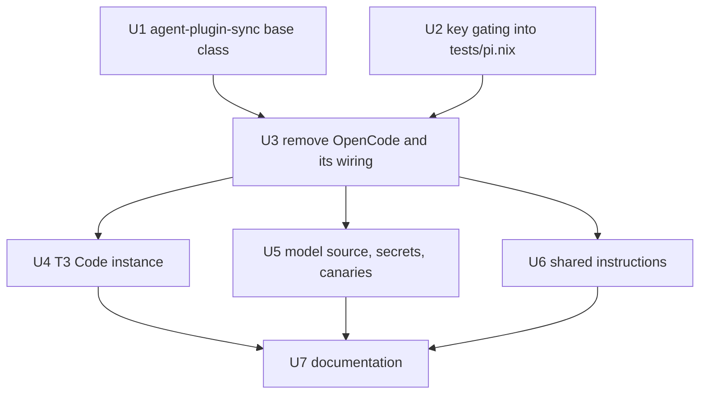

# Remove OpenCode - Plan

## Goal Capsule

- **Objective:** No host or fixture installs, configures, updates, or checks OpenCode, and everything Pi still depends on keeps working unchanged.
- **Product authority:** The user, in the 2026-10-23 brainstorm. This closes the OpenCode removal that the [Pi Synthetic harness plan](2026-10-22-1131-feat-pi-synthetic-harness-plan.md) and issue #289 (scope items 8 and 9) deferred.
- **Means:** Delete OpenCode's own files and their wiring, and edit the shared files Pi uses in place (KTD1-KTD4).
- **Open blockers:** None.
- **Stop conditions:** Stop and report when a Pi check (`pi-settings`, `pi-wrapper`, `pi-extension`, `pi-acp`, `agent-plugin-sync`, `non-nixos-outputs`, `darwin-outputs`) fails for a reason the removal caused and no edit inside the requirements fixes it.
- **Execution profile:** `ce-work` implements, then `lfg` simplifies, reviews, opens the pull request, and watches CI; the user merges.

---

## Product Contract

### Summary

Remove every part of the repository that exists only for OpenCode: its package and wrapper, the session-info plugin, its settings merges, its T3 Code instance, its update-workflow step, its checks and tests, and its mentions in documentation and the shared agent instructions. Parts Pi shares stay and lose only their OpenCode wording. Files already on a machine are left alone.

### Problem Frame

Since the Pi harness work moved Synthetic models to Pi, no rule routes a review, a work unit, or text generation to OpenCode. It is still packaged, merged into `~/.config/opencode` on every apply, pinned and bumped by the dependency workflow every 30 minutes, and covered by its own checks and documentation. That is upkeep for a tool nothing uses, and every OpenCode release can still break the update job or a check.

### Key Decisions

- **Remove from the repository only; leave machine state alone.** Files Home Manager links (`~/.config/opencode/AGENTS.md`, the skill root, the session-info plugin) disappear with the declarations, while merged files, session data, and a running background server stay until the user removes them. (session-settled: user-directed — chosen over also deleting `~/.config/opencode` and `~/.local/share/opencode` and stopping the server on apply: the user wants the repository change only.) Governs R2, R10.
- **No guard against reintroduction.** (session-settled: user-directed — chosen over an `opencode-absent` check like `grok-absent`: the user declined the extra check's upkeep.) Governs R11.
- **Declare T3 Code's `opencode` instance disabled instead of deleting the declaration.** Earlier merges left `enabled = true` in each user's T3 Code settings, and T3 Code keeps undeclared instance fields as the app's, so deleting the declaration would leave a broken OpenCode instance in the picker; `grok` already uses this shape. (session-settled: user-approved — proposed with that reason in the scoping synthesis and confirmed.) Governs R4.
- **Keep what Pi shares.** The Synthetic API key and its SOPS delivery, the model source file, and the shared instructions template stay; only their OpenCode-only parts and wording go. Governs R5, R6, R7.

### Requirements

**OpenCode itself**

- R1. No host or fixture output contains the OpenCode package, its wrapper, or the `opencode-session-info` plugin, and the release helper and pin that only OpenCode used are gone.
- R2. Home Manager no longer declares any file or activation step for OpenCode: no settings or service merge, no service-stop step, no `~/.config/opencode` instructions link, skill root, or plugin link.
- R3. The dependency update workflow no longer updates or commits an OpenCode pin.
- R4. T3 Code's `opencode` provider instance is declared with `enabled = false`, and the hidden-model preference that existed only to hide OpenCode's `@<effort>` text-generation alias is no longer declared.

**Shared parts that stay**

- R5. The Synthetic API key keeps its delivery on every host kind, because Pi reads it; its descriptions name Pi instead of the OpenCode wrapper.
- R6. The Synthetic model source drops the `smallModel` pointer, which only OpenCode's `small_model` read, and keeps every entry and pointer Pi reads; the model-watch script and its checks follow.
- R7. The shared agent instructions no longer name OpenCode as a harness, and every harness keeps its other rules unchanged.
- R8. `agents.toml` no longer lists `opencode` as an agent.

**Checks, docs, and learnings**

- R9. Checks and tests that exist only for OpenCode are removed, and checks that also assert OpenCode facts keep their other assertions; `nix flake check`, the VM checks, and every host output build as before.
- R10. README, `CONCEPTS.md`, `AGENTS.md`, and the guides under `docs/` describe the repository without OpenCode, and `docs/provisioning.md` says that removing it leaves the merged settings files under `~/.config/opencode`, the session data under `~/.local/share/opencode`, and any running `opencode` server for the user to delete or stop by hand, by process rather than through the `opencode` command, which is no longer on `PATH`.
- R11. No new check is added to catch OpenCode returning.
- R12. Learnings under `.compound-engineering/artifacts/solutions/` that describe OpenCode code are refreshed with `ce-compound-refresh` before the push, and `AGENTS.md` links only learnings that remain; past plans stay as history.

### Scope Boundaries

- Deleting OpenCode files from machines, stopping its background server, or adding a cleanup step on apply (per Key Decisions).
- An `opencode-absent` guard check (per Key Decisions).
- OpenCode mentions in `.compound-engineering/config.yaml` and `config.example.yaml`, which are Compound Engineering's template comments listing the routes it supports.
- Removing the Synthetic API key or any model entry Pi uses.
- Rewriting past plans under `.compound-engineering/artifacts/plans/`.

### Sources / Research

- OpenCode-only code: `home/h82/agents/opencode.nix`, `packages/opencode.nix`, `packages/opencode-session-info.nix`, `packages/opencode-session-info/`, `packages/opencode-release.json`, `scripts/opencode`, `scripts/opencode-release`, `tests/opencode.nix`, `tests/opencode.sh`, `tests/opencode-session-info.nix`, `tests/opencode-session-info.test.mjs`, `tests/test_opencode_release.py`.
- Shared with Pi: `home/h82/agents/pi.nix` reads `synthetic_api_key`, `defaultModel`, and `textGeneration`; `smallModel` appears only in `home/h82/agents/opencode.nix` and `scripts/synthetic-models-watch`.
- T3 Code instance and hidden alias: `home/h82/t3code.nix` (the `opencode` instance, `hiddenAlias`, and the `grok` instance with `enabled = false`).
- Instruction mentions: `home/h82/agents/instructions/instructions.md.tmpl` (the `session_info` rule and the `delegate_task` rule).
- Update workflow: `.github/workflows/update-dependencies.yml`, step 10 and its commit step.
- Precedents: [Codex removal](2026-09-21-1748-chore-remove-codex-plan.md), [omp and Orca removal](2026-09-22-1630-chore-remove-omp-and-orca-config-plan.md), and the Grok removal's `grok-absent` check and `modules/darwin/retired-casks.nix`.
- OpenCode learnings: `.compound-engineering/artifacts/solutions/integration-issues/opencode-v2-shared-background-server-keeps-first-client-env.md`, `opencode-config-file-model-variant-silently-dropped.md`, and `opencode-plugin-loading-verifiable-only-by-a-live-run.md`.

---

## Planning Contract

Product Contract preservation: unchanged in scope. R10 now names only what stays (merged settings files, session data, a running server, which is stopped by process), because the Home Manager links go on their own. The three `Deferred to Planning` questions are answered by KTD5, KTD6, and KTD7 and were removed from the Product Contract.

### Key Technical Decisions

- KTD1. **Fold the merged-list behaviour into `Pi` before deleting OpenCode's harness.** `scripts/agent-plugin-sync` defines `class Pi(OpenCode)`, so Pi's `sync`, `retire`, `listed`, and `write_entry` all come from the OpenCode class. Pi becomes a direct `Harness` subclass that owns those methods; a shared base class would have one subclass. The existing `PiCase` tests in `tests/test_agent_plugin_sync.py` are the regression guard. Covers R7 and R9.
- KTD2. **Move the Synthetic and Exa key-gating assertions from `tests/opencode.nix` into `tests/pi.nix`.** `tests/opencode.nix` is the only check that a production configuration decrypts both keys with mode `0400` for h82, that a bootstrap configuration decrypts neither, and that turning off one option removes only its own key. Pi reads both keys, so its check is where they belong. Covers R5 and R9.
- KTD3. **Prove the disabled instance on the merged settings file, not on the option.** T3 Code's built-in default for `opencode` is already off, so asserting the declared `enabled = false` would pass even with no declaration. `tests/t3code-traits.nix` asserts that merging the declared settings into a fixture holding `providerInstances.opencode.enabled = true` yields `false`. Covers R4.
- KTD4. **Stop declaring the hidden-model entry and leave the user's copy alone.** The settings merger keeps keys the declaration no longer names, so the stale `providerModelPreferences.opencode.hiddenModels` entry stays in existing settings files. It only hides a model in an instance that is now disabled, and removing it would be machine cleanup, which the Product Contract excludes. Covers R2 and R4.
- KTD5. **Keep the Tokscale `opencodeDbPaths` fixtures.** They are fixture keys in the Tokscale settings-merge tests (`flake.nix`, `tests/tokscale.nix`, `tests/test_agent_settings.py`), and `home/h82/agents/tokscale.nix` declares no OpenCode setting.
- KTD6. **Keep `retired=(opencode_api_key)` in `scripts/host-secrets`, and its regression assertion in `tests/host-secrets.nix`, which seeds and checks the retired `opencode_api_key`.** It deletes a key file that earlier generations published on hosts that have not published since. It is a retired-secret cleanup the repository already owns, not part of OpenCode.
- KTD7. **Remove `opencode` from `agents.toml`'s `agents` list and keep `/.opencode` in `.gitignore`.** dotagents reads that list for skill links, MCP, hooks, and plugin outputs, so removing the entry stops new project-scope output under `.opencode/`. Other checkouts and worktrees may still hold a generated `.opencode/` directory, and ignoring it costs nothing. The list already omits `codex` and `pi`, and that older drift stays out of scope.
- KTD8. **Keep the OpenCode entries in `tests/agent-instructions.nix`'s removed-phrase list.** Those entries guard instruction sentences that earlier work removed, and they still pass after this change. Dropping them would weaken an existing guard, and R9 keeps other assertions. Re-point the two mutants whose target sentences change (the OpenCode peer refusal and the worker sent to the `opencode` instance) so that every rule family keeps a mutant.
- KTD9. **Rename the `FAKE opencode` canary values to name Pi.** `tests/auth-provisioning.nix` and `tests/lib/fake-secrets.nix` use the string as the Synthetic key's canary. The value is arbitrary, and naming the consumer that remains keeps the VM test's failure messages accurate. Covers R5.

### Assumptions

- Home Manager removes the links it created under `~/.config/opencode` on the first activation of a generation that no longer declares them; the leftover note in R10 relies on this.
- No open auto-update branch carries an OpenCode bump when this merges. A branch that does would conflict on the deleted `packages/opencode-release.json` and is closed by hand.

### Sequencing

U1 and U2 must land before U3, because U3 deletes the OpenCode class and `tests/opencode.nix` that they depend on. U4, U5, and U6 touch disjoint files. U7 describes the final state, so it runs last.

---

## Implementation Units

### U1. Give Pi its own base in agent-plugin-sync

- **Goal:** Pi's plugin-list merge no longer inherits from the OpenCode harness, and the OpenCode harness is gone from `scripts/agent-plugin-sync`.
- **Requirements:** R1, R7, R9; KTD1.
- **Dependencies:** None.
- **Files:** `scripts/agent-plugin-sync`, `tests/test_agent_plugin_sync.py`.
- **Approach:**
  1. Move the merged-list behaviour (`write_entry`, `listed`, `check_source`, `sync`, `retire`) from `OpenCode` into `Pi`, and make `Pi` derive from `Harness` (KTD1).
  2. Delete `OpenCode` and drop `'opencode'` from `HARNESSES`.
  3. Remove the OpenCode paragraphs from the module docstring and the "as it does for OpenCode" wording in `Pi`'s docstring.
  4. Delete `OpenCodeCase`, `OpenCodeSyncTestCase`, and `OpenCodeRetireTestCase`, and any helper only they use (`MERGER_CLI`, `USER_PLUGIN`, after checking).
- **Patterns to follow:** The other `Harness` subclasses in `scripts/agent-plugin-sync`.
- **Test scenarios:**
  - The existing `PiCase` sync, prefix-merge, and retire tests pass unchanged against the new base.
  - `--harness opencode` is rejected as an unknown harness.
  - A sync on a Pi settings file that already holds the user's own entries keeps them beside the declared entry, which the moved shared behaviour must still do.
- **Verification:** The `agent-plugin-sync` flake check passes.

### U2. Move the API key gating into the Pi check

- **Goal:** The Synthetic and Exa key-delivery assertions live in `tests/pi.nix` and pass before `tests/opencode.nix` is deleted.
- **Requirements:** R5, R9; KTD2.
- **Dependencies:** None.
- **Files:** `tests/pi.nix`, `tests/opencode.nix` (source only; U3 deletes it).
- **Approach:** Port `apiKeySecrets`, `keyForcedOff`, and the bootstrap/production split with their failure messages into `tests/pi.nix`, reading the same sops manifests through the same helper. Run them in a separate loop over `configurations.entries ++ keyForcedOff`, behind `configurations.guard`, as `tests/opencode.nix` does, not inside the existing `userEntries` loop, which carries no `config` and includes the non-NixOS fixtures with no sops manifest. Reword the header so it says Pi reads both keys.
- **Execution note:** Mutation-test the ported assertions once, as the repository's mutation-testing learnings require, because a port can silently fold an assertion to a constant.
- **Test scenarios:**
  - A production configuration decrypts `synthetic_api_key` and `exa_api_key` with mode `0400` owned by h82.
  - A bootstrap configuration decrypts neither key.
  - Turning off `my.cliAuth.enableSyntheticApiKey` removes only the Synthetic key, and turning off `my.cliAuth.enableExaApiKey` removes only the Exa key.
  - Mutation: deleting the Synthetic key's delivery from `modules/nixos/system/secrets.nix` turns the check red.
- **Verification:** The `pi-settings` check passes, and fails under each mutation above.

### U3. Remove OpenCode and its wiring

- **Goal:** No package, wrapper, plugin, Home Manager entry, check, or update step for OpenCode remains.
- **Requirements:** R1, R2, R3, R8, R9, R11; KTD5, KTD6, KTD7.
- **Dependencies:** U1, U2.
- **Files:**
  - Delete: `home/h82/agents/opencode.nix`, `packages/opencode.nix`, `packages/opencode-release.json`, `packages/opencode-session-info.nix`, `packages/opencode-session-info/index.js`, `scripts/opencode`, `scripts/opencode-release`, `tests/opencode.nix`, `tests/opencode.sh`, `tests/opencode-session-info.nix`, `tests/opencode-session-info.test.mjs`, `tests/test_opencode_release.py`.
  - Modify: `flake.nix`, `packages/agent-tools.nix`, `home/h82/agents/default.nix`, `home/h82/agents/skills.nix`, `home/h82/agents/agent-plugins.nix`, `.github/workflows/update-dependencies.yml`, `tests/update-dependencies-reconcile.sh`, `tests/agent-plugins.nix`, `tests/korean-skills.nix`, `tests/test-audit-skill.nix`, `tests/darwin-config.nix`, `tests/darwin-outputs.nix`, `tests/non-nixos-outputs.nix`, `tests/test_agent_settings.py`, `agents.toml`.
- **Approach:**
  1. `flake.nix`: drop the `opencode` and `opencode-release` packages, `opencode-sources`, and the `opencode-release`, `opencode`, `opencode-settings`, `opencode-session-info`, and `opencode-wrapper` checks. Reword the `agent-plugin-sync` check's comment to name Pi only. `checkShards` and `check-shards-guard` derive from the check set and `hostClosureChecks` names no OpenCode check, so neither needs an edit.
  2. Home Manager: drop the `./opencode.nix` import, the `.config/opencode/skills` root and its comment, and the `opencode` membership row, exclude, and harness in `agent-plugins.nix`.
  3. Workflow: drop the OpenCode update step and its commit step, reword the Pi step's "as OpenCode's does", and renumber the step comments. Remove the matching OpenCode fixture, step, and commit sections from `tests/update-dependencies-reconcile.sh`.
  4. Tests that list skill roots (`korean-skills`, `test-audit-skill`, `darwin-config`) drop `.config/opencode/skills` in step with `skills.nix`. `tests/agent-plugins.nix` drops its OpenCode block and header text and keeps the Pi ordering assertion. `darwin-outputs` re-points its `opencodeSettings` step assertion to the `piSettings` activation step, asserting that it runs after `writeBoundary` and targets `${config.my.user.home}/.pi/agent/settings.json`, and drops its OpenCode wrapper assertion. `non-nixos-outputs` drops its OpenCode wrapper and settings assertions. Both keep the Pi key-helper assertions. `tests/test_agent_settings.py` retargets its `prefixEntries` fixture and labels from OpenCode to a neutral or Pi path.
  5. `agents.toml`: `agents = ["claude"]`.
- **Patterns to follow:** The Grok removal, commit `2c33134`.
- **Test scenarios:**
  - `git grep -il opencode` outside `.compound-engineering/artifacts/` lists only files that U4-U7 handle, plus the KTD5, KTD6, KTD7, and KTD8 keepers.
  - `nix flake check` evaluates with no reference to a deleted file.
  - The `update-dependencies-reconcile` check passes against the edited workflow.
  - `darwin-outputs` fails if the `piSettings` step moves before `writeBoundary` or targets another home.
  - `darwin-config`, `korean-skills`, and `test-audit-skill` pass with the root list one shorter, and fail if `skills.nix` regains `.config/opencode/skills`.
- **Verification:** `nix flake check` passes, and every host output builds.

### U4. Disable T3 Code's OpenCode instance

- **Goal:** T3 Code's settings declare `opencode` disabled and no longer declare the hidden-model entry.
- **Requirements:** R4; Key Decisions (instance declared disabled); KTD3, KTD4.
- **Dependencies:** U3.
- **Files:** `home/h82/t3code.nix`, `tests/t3code-traits.nix`, `tests/t3code-hidden-model.py` (delete).
- **Approach:**
  1. `providerInstances.opencode` gets `enabled = false` in the `grok` shape, with a comment that says why it is declared rather than deleted.
  2. Remove `hiddenAlias`, `textGeneration`, `textGenerationAlias`, the `syntheticModels` import, and the `prefixEntries` parameter of `declaration` with its `optionalAttrs` line. Keep `migrateInstances`, which still lists `opencode`.
  3. `tests/t3code-traits.nix`: expect `enabled = false`, drop `prefixEntries` from the expected settings, drop `opencodeScript` and `checkHiddenModel`, and renumber `checkSettings`' positional arguments.
- **Test scenarios:**
  - Covers KTD3: merging the declared settings into a fixture with `providerInstances.opencode.enabled = true` yields `false`.
  - The materialized settings carry no `providerModelPreferences.opencode` declaration.
  - Mutation: setting `enabled = true` in `t3code.nix` turns the check red.
- **Verification:** The `t3code-traits` check passes and fails under the mutation.

### U5. Trim the model source and reword shared secrets

- **Goal:** The Synthetic model source, the key's descriptions, and the key canaries name Pi only.
- **Requirements:** R5, R6; KTD9.
- **Dependencies:** U3.
- **Files:** `home/h82/agents/synthetic-models.nix`, `scripts/synthetic-models-watch`, `tests/synthetic-models.nix`, `tests/test_synthetic_models_watch.py`, `modules/nixos/system/secrets.nix`, `home/h82/agents/cross-model-peers.nix`, `tests/lib/cross-model-peers.nix`, `tests/auth-provisioning.nix`, `tests/lib/fake-secrets.nix`, `packages/t3code.nix`.
- **Approach:**
  1. Drop `smallModel` from `synthetic-models.nix`, `ENTRY_POINTERS`, the `selections` list, and the watch test's expected `uses` lists and messages. Reword the source's comments to name Pi only.
  2. Reword the `enableSyntheticApiKey` description and the cross-model peer descriptions to drop OpenCode.
  3. Rename the canaries and the VM test's consumer name to Pi.
  4. Replace OpenCode in `packages/t3code.nix`'s description.
- **Test scenarios:**
  - The watch reports `textGeneration` and `defaultModel` uses for their entries and no `smallModel`.
  - `synthetic-models` fails on an entry pointer that names no entry.
  - The `auth-provisioning` VM test still finds the Synthetic key at `/run/secrets/cli-auth/synthetic_api_key` with mode `400:h82`, and its canary never reaches the journal.
- **Verification:** `synthetic-models`, the watch test, and `vmChecks.auth-provisioning` pass.

### U6. Remove OpenCode from the shared instructions

- **Goal:** The rendered instructions name no OpenCode harness, and the OpenCode copy of them is gone.
- **Requirements:** R2, R7; KTD8.
- **Dependencies:** U3.
- **Files:** `home/h82/agents/instructions/instructions.md.tmpl`, `home/h82/agents/instructions/default.nix`, `tests/agent-instructions.nix`, `tests/claude-effort-absent.nix`.
- **Approach:**
  1. The `session_info` rule says "In Pi, call …", and the `delegate_task` rule's example drops OpenCode. Change each template sentence and its verbatim pin in `tests/agent-instructions.nix` (`sessionInfoSentence`, `delegateRouteSentence`) together.
  2. Remove the `agent-instructions-opencode` file entry and its comment, and drop `.config/opencode/AGENTS.md` from both checks' delivery paths.
  3. Remove the OpenCode `harnessFacts` entry and table and prose mentions, and re-point the two mutants per KTD8.
- **Test scenarios:**
  - The pinned sentences match the rendered instructions for every harness.
  - The re-pointed mutants each turn the check red with the expected message.
  - The removed-phrase list still passes.
- **Verification:** `agent-instructions` and `claude-effort-absent` pass.

### U7. Rewrite the documentation and refresh the learnings

- **Goal:** Every guide describes the repository without OpenCode, and the leftover note exists.
- **Requirements:** R10, R12.
- **Dependencies:** U4, U5, U6.
- **Files:** `README.md`, `CONCEPTS.md`, `AGENTS.md`, `docs/provisioning.md`, `docs/verification.md`, `docs/adding-a-host.md`, `docs/macos.md`.
- **Approach:**
  1. `docs/provisioning.md`: remove the OpenCode and session-info sections and the OpenCode rows and sentences elsewhere. Move the Synthetic key paragraph (file location, option default, rotation) into the Pi section. Replace "What stays on OpenCode" with the R10 leftover note, which names only the merged settings files, the session data, and a running server.
  2. `docs/verification.md`: remove the OpenCode live probes and the OpenCode T3 Code items, and move the generic listener description that the Pi request capture reuses into the Pi section.
  3. README, `CONCEPTS.md`, `docs/adding-a-host.md`, and `docs/macos.md`: drop the OpenCode mentions.
  4. `AGENTS.md`: drop OpenCode from the structure description, and drop the three "Before …" links to the OpenCode-only learnings (`opencode-v2-shared-background-server-keeps-first-client-env.md`, `opencode-plugin-loading-verifiable-only-by-a-live-run.md`, `opencode-config-file-model-variant-silently-dropped.md`). Drop any other "Before …" link whose learning the pre-push refresh deletes or moves, and keep links to refreshed learnings that still apply.
- **Test expectation:** none -- documentation only; the pre-commit `markdownlint-cli2` run and a `git grep -il opencode` scan cover it.
- **Verification:** No guide mentions OpenCode except the R10 leftover note and historical plans.

The pre-push refresh in R12 runs through `ce-compound-refresh` after U7, on the learnings that cite deleted paths or names: the three `integration-issues/opencode-*.md` files, `slow-command-wait-needs-harness-exit-record-not-pgrep-or-monitor.md`, `substring-sentence-check-passes-a-negated-instruction.md`, `benchmark-cross-model-review-peers-in-t3-code-before-changing-them.md`, `help-text-check-passes-while-cli-routes-to-wrong-host.md`, and `verify-linux-only-nix-check-inputs-on-macos-through-derivation-show.md`. The refresh records whether each mention names a deleted path, check, or instance. Each refresh is its own commit.

---

## Verification Contract

| Gate | Command | Proves |
| --- | --- | --- |
| Format | `nix fmt -- --ci` | Nix layout |
| Flake checks | `nix flake check` | U1-U6 checks, shards, and evaluation |
| VM checks | `nix build --no-link .#vmChecks.all` | `auth-provisioning` with the renamed canary |
| Host outputs | The loops in `AGENTS.md` over `nixosConfigurations`, `homeConfigurations`, `systemConfigs`, and `darwinConfigurations` | Every production and bootstrap output builds |
| Darwin | CI's `build-darwin` job | `darwin-outputs` and the macOS fixture, which build only on a Mac |
| Markdown | `mise run lint-staged-markdown` (pre-commit) | Docs and plan lint |

---

## Definition of Done

- Every unit's verification holds, and the Verification Contract's gates pass locally, with Darwin left to CI.
- `git grep -il opencode` outside `.compound-engineering/artifacts/` returns only the keepers KTD5-KTD8 name, the R10 leftover note, `.compound-engineering/config*.yaml`, and the T3 Code instance declaration with its tests.
- The learnings refresh commits exist before the push.
- No dead bindings, unused helpers, or abandoned attempts remain in the diff.
