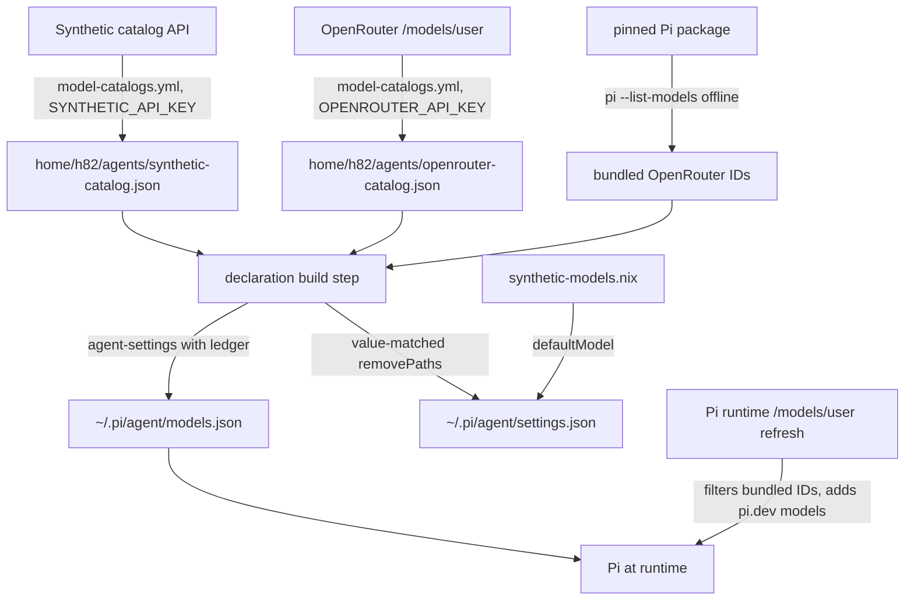

# Pi OpenRouter Provider and Full-Catalog Model Rendering - Plan

## Goal Capsule

- **Objective:** On every host, Pi offers every OpenRouter and every Synthetic model from first start, with each model's metadata current.
- **Means:** render both catalogs from snapshots the repository commits, through the existing Pi settings merger extended with a ledger so dropped models are pruned (KTD1, KTD3); refresh the snapshots from a dedicated workflow (KTD6); and give Pi the OpenRouter key through a helper guarded like the Synthetic one (KTD8).
- **Product authority:** This Product Contract wins on behavior; the Planning Contract's KTDs win on mechanism. Decisions marked `session-settled` were made by the user in the brainstorm and are not reopened.
- **Execution profile:** code change across Home Manager modules, packaging, a Python merger and snapshot scripts, Nix checks, and one GitHub Actions workflow; units land in dependency order.
- **Stop conditions:** stop and report when the user's OpenRouter key cannot be obtained for U1, when Pi rejects the rendered `models.json` in the U5 smoke run, or when a settled decision is shown to be infeasible.
- **Open blockers:** None for planning. U1 needs the user to enter the real OpenRouter key through a private prompt.
- **Who finishes:** `ce-work` implements; the `lfg` run reviews, opens the pull request, and watches CI. The user merges.

---

## Product Contract

### Summary

Pi gets OpenRouter through its built-in `openrouter` provider, with the key from a new host secret. Pi's Synthetic and OpenRouter providers both render the whole catalog from committed snapshots, with no per-model startup effort. A separate scheduled job refreshes both snapshots and pushes changes directly to `main`.

### Problem Frame

Pi reaches only the three Synthetic models that `home/h82/agents/synthetic-models.nix` names. Using an OpenRouter model today means adding a key and model settings by hand on each machine, so what each host's Pi offers cannot be read from the repository. The Synthetic side has the opposite constraint: a model Synthetic adds stays invisible to Pi until someone edits the model source, and each listed model starts at an effort the repository pins. OpenRouter's catalog holds about 470 models and changes often, so a curated, hand-edited list does not scale to it, and the Synthetic list should follow the same rule.

### Key Decisions

- **Render the whole catalog, not a curated list.** (session-settled: user-directed — chosen over a curated OpenRouter model list and over wiring only the key: the user wants every model fixed in the rendered config.) Governs R3, R4.
- **Pin no startup effort for any model, Synthetic included.** (session-settled: user-directed — chosen over starting each model at its highest supported effort or at `high`, and over keeping Synthetic's current per-model efforts: metadata is fixed, effort is left to Pi.) Governs R5.
  - Conflict call-out: this reverses the reason `home/h82/agents/pi.nix` gives for starting the text-generation model at `low` (a client that switches to it with `set_model` sets no level of its own), and Pi's default startup level is `medium`, which these Synthetic models do not offer. Pi clamps an unsupported level, so the decision stays workable; the live check U7 adds to `docs/verification.md` records the clamped level once the change lands.
- **OpenRouter's list comes from `/models/user`, authenticated with a zero-spend key.** (session-settled: user-directed — chosen over the public `/models` endpoint: the user added the Actions secret `OPENROUTER_API_KEY`, a key with a $0 spend limit that cannot call models, to avoid the models API's rate limit.) Governs R9.
- **The snapshot is a prefill; Pi's own OpenRouter refresh stays on.** (session-settled: user-directed — chosen over blocking Pi's runtime refresh, which needs `PI_OFFLINE` and also stops pi.dev catalog updates.) Governs R8.
  - Conflict call-out: in Pi 1.4.0, `models.json` entries and `modelOverrides` are applied after the runtime refresh on every model lookup, so for an ID the snapshot names, the snapshot's price, context, and limits win over what the refresh fetched with the host key until the next snapshot lands. The refresh still adds new pi.dev catalog models and still drops bundled models the host key may not use. Workable; the staleness lasts until the host applies a generation built from a newer snapshot, so the refresh job's cadence is only its lower bound.
- **Snapshot refresh runs in its own job and pushes directly to `main`.** (session-settled: user-approved — chosen over an auto-merged pull request: `update-dependencies.yml` already verifies and pushes directly, and the user proceeded with this choice shown.) Governs R11.
- **Models without tool calling are rendered too.** (session-settled: user-approved — chosen over filtering to models that list tool support, which would narrow "every model"; 69 of 468 OpenRouter models lacked tool support on 2026-10-23.) Governs R3.

### Requirements

**Host key and access**

- R1. A new host secret `openrouter_api_key` lives in `secrets/tokens.yaml` and is published on every host kind exactly as `synthetic_api_key` is.
- R2. Pi gets the OpenRouter key only through a `!` command helper that reads the published key file; an `OPENROUTER_API_KEY` the caller already exported wins, and the key from the file never lands in a file Pi writes or in the environment that commands run by Pi's tools inherit.

**Rendered Pi configuration**

- R3. Pi's built-in `openrouter` provider lists every model in the committed OpenRouter snapshot, each with its display name, prices, context window, maximum output, input modalities, and the thinking levels the catalog says it supports.
- R4. Pi's `synthetic` provider lists every model in the committed Synthetic snapshot with the same fields, whether or not the model source names it.
- R5. No model of either provider gets a startup thinking level from this repository, and the `modelThinkingLevels` entries earlier generations wrote for Synthetic models are removed.
- R6. Pi's default provider and model stay Synthetic GLM, read from the model source.
- R7. A model that a newer snapshot no longer contains disappears from Pi's rendered model list on the next apply, without a hand-maintained retired-model entry.
- R8. Pi's own OpenRouter model refresh at runtime is not disabled; the rendered list is what Pi has before its first refresh and while offline.

**Snapshot refresh**

- R9. The OpenRouter snapshot comes from OpenRouter's `/models/user` endpoint, authenticated with the Actions secret `OPENROUTER_API_KEY`, and is trimmed to the fields R3 renders.
- R10. The Synthetic snapshot comes from Synthetic's catalog, authenticated with the Actions secret `SYNTHETIC_API_KEY`, holds every well-formed model the catalog lists, and is trimmed to the fields R4 renders; a malformed row is skipped with a warning naming it.
- R11. A scheduled job, separate from `update-dependencies.yml`, refreshes both snapshots, confirms Pi's configuration still evaluates with them, and commits and pushes to `main` only when a snapshot changed.
- R12. When one provider's fetch fails or its key is missing, that provider's snapshot stays as committed, the run reports a warning naming it, and the other provider's refresh still lands.
- R13. Each Actions key is visible only to the step that fetches with it and is never printed.

**Model source**

- R14. `home/h82/agents/synthetic-models.nix` stays as the source for OpenCode's settings, Pi's default model, and the model-watch reconcile issue, and no longer limits which Synthetic models Pi lists.

### Acceptance Examples

- AE1. **Covers R7.** Given the committed OpenRouter snapshot lost model `x/y` since the last apply, when the host applies, Pi's `openrouter` model list in `models.json` no longer contains `x/y`.
- AE2. **Covers R12.** Given OpenRouter's `/models/user` returns an error and Synthetic's catalog returns a new model, when the refresh job runs, the OpenRouter snapshot is unchanged, a warning names OpenRouter, and the Synthetic snapshot change is pushed to `main`.
- AE3. **Covers R2.** Given `OPENROUTER_API_KEY` is exported in the shell that starts Pi, when Pi calls an OpenRouter model, the exported key is used and the published key file is not read.
- AE4. **Covers R5.** Given a host whose Pi `settings.json` still holds the `modelThinkingLevels` values earlier generations wrote for the four Synthetic models they named, when the host applies, those entries are gone and Pi starts each model at its own default; a level the user saved with `/thinking` survives.

### Scope Boundaries

- OpenCode does not get an OpenRouter provider, and its Synthetic settings keep reading the model source unchanged.
- The cross-model family mapping for OpenRouter model IDs (such as `openrouter/anthropic/...`) is not added; Pi stays a manual path for peers.
- Pi's runtime catalog refresh is not blocked (see R8).
- Models are not filtered by tool support, modality, or price.
- No per-model startup effort, default, or role is added for any OpenRouter model.
- Pi's default provider does not change to OpenRouter.

### Dependencies / Assumptions

- The user supplies the real OpenRouter key for `openrouter_api_key` during implementation, through a private prompt, and it is set with `sops set --value-stdin` per `AGENTS.md`.
- The Actions secrets `OPENROUTER_API_KEY` (zero-spend) and `SYNTHETIC_API_KEY` exist in the repository.
- `/models/user` reflects the guardrails and provider restrictions of the zero-spend key's account, so the snapshot can differ from what Pi's runtime refresh returns with the host key.
- Pi 1.4.0 lets `models.json` set `apiKey` on a built-in provider and replace a built-in model by matching `id` (`docs/models-configuration.md` in the Pi package).

### Sources / Research

- `home/h82/agents/pi.nix`: current Synthetic rendering, `thinkingLevelMap`, `retiredModels`, and `modelThinkingLevels` startup efforts.
- `home/h82/agents/synthetic-models.nix` and the "Model source" entry in `CONCEPTS.md`: who reads the model source today.
- `scripts/synthetic-models-watch`, `.github/workflows/update-dependencies.yml` (step "Refresh the Synthetic catalog snapshot"), and `.github/workflows/synthetic-models.yml`: current snapshot and watch flow.
- `scripts/pi-synthetic-key` and `packages/pi.nix`: the key-helper pattern R2 follows.
- `.compound-engineering/artifacts/plans/2026-10-22-1131-feat-pi-synthetic-harness-plan.md`: how `synthetic_api_key` and `exa_api_key` are published on each host kind.
- Pi 1.4.0 `docs/providers.md` ("OpenRouter") and `docs/models-configuration.md`: built-in provider override, `!command` keys, and the `/models/user` refresh.
- OpenRouter public `/models` on 2026-10-23: 468 models, 399 listing tool support.

Product Contract preservation: Product Contract unchanged in meaning; the brainstorm's Deferred to Planning questions are resolved in place by KTD1-KTD8, conflict call-outs were added under two Key Decisions, R10 now names the malformed-row skip KTD7 owns, and AE4 now states that only repository-written levels are removed.

---

## Planning Contract

### Key Technical Decisions

- KTD1. **Prune with a ledger the merger keeps, not a retired list.** `scripts/agent-settings` gains one operation that owns a set of entries under a list path or an object path, keyed by ID: it upserts every declared entry, removes every entry it wrote on an earlier apply that the declaration no longer names, and records the IDs it wrote in a ledger file under the user's XDG state directory. Before it replaces the settings file it records the union of the previous and new IDs as pending, and after the write it records the new IDs, so an apply interrupted between the two writes still prunes on the next run. When no ledger exists yet, the operation treats the IDs earlier generations wrote without one (the three source models and `hf:moonshotai/Kimi-K3`) as owned. Entries the user added by hand stay, as `tests/pi_declared.py` requires today. `own` cannot do this because it is top-level only and would delete other providers. Governs R7. The existing `retiredModels` list and its `removeEntries` are dropped, because the whole-catalog snapshot can name a retired ID again (the Synthetic fixture still lists `hf:moonshotai/Kimi-K3`).
- KTD2. **OpenRouter models that Pi already bundles are rendered as `modelOverrides`; the rest as `models` entries.** Pi's `modelFromJson` builds a replacement from the definition only, so a `models` entry for a bundled ID drops that model's built-in `compat` (prompt-cache format and similar). An override merges field by field and keeps `api`, `baseUrl`, and `compat`. Pi 1.4.0 bundles 401 OpenRouter chat models, listed offline by `pi --list-models` with `PI_OFFLINE=1`, a throwaway `HOME`, and a fake `OPENROUTER_API_KEY` (without a key Pi lists none), keeping only the `openrouter` rows. A build step derives that ID list from the pinned Pi package, so the split follows Pi upgrades without a hand-kept list. Neither entry sets `api` or `baseUrl` at provider level: Pi takes them from the bundled model or from the provider's first `openai-completions` model. Governs R3, R8.
- KTD3. **The rendered declaration is built by a derivation, not by Nix evaluation over the snapshot.** One build step reads both snapshots and the bundled-ID list and writes the `agent-settings` declaration, so evaluation needs no import-from-derivation and the checks read the materialized declaration. Governs R3, R4, R7.
- KTD4. **Thinking-level maps come from each catalog's own effort list.** Synthetic uses `reasoning_parameters.efforts`, and OpenRouter uses `reasoning.supported_efforts`. Each Pi level (`off` sends `none`, then `minimal`, `low`, `medium`, `high`, `xhigh`, `max`) maps to the same-named effort when listed. In a `models` entry, `off` through `high` map to null when unlisted and `xhigh` and `max` are omitted when unlisted, as `thinkingLevelMap` in `home/h82/agents/pi.nix` does today, with `minimal` now following the list. In a `modelOverrides` entry all seven levels are present, null when unlisted, because Pi merges an override's map over the bundled one and an omitted `xhigh` or `max` would keep the bundled value. A model whose `reasoning` object is present but lists no efforts gets `reasoning: true` and no map. A model with no reasoning gets `reasoning: false`. Governs R3, R4.
- KTD5. **Startup levels earlier generations wrote are removed only when they still hold the value this repository wrote.** `removePaths` with a value match deletes `synthetic/hf:zai-org/GLM-5.3`=`max`, `synthetic/hf:zai-org/GLM-5.3-Flash`=`high`, `synthetic/hf:deepseek-ai/DeepSeek-V4.1-Flash-1017`=`low` or `high`, and `synthetic/hf:moonshotai/Kimi-K3`=`max`; a removal entry may list several values (U3). The cleanup is a one-time migration: the merger records it as done in the ledger and skips it on later applies, so a level the user saves later, even one equal to a historical value, survives. Governs R5.
- KTD6. **A new workflow, `.github/workflows/model-catalogs.yml`, owns both snapshots.** It runs on its own cron, offset from `update-dependencies.yml`, with its own concurrency group and `workflow_dispatch`. Each fetch is its own step holding only its key. The commit step runs only after the declaration builds and the `pi-settings`, `pi-models-load`, and `synthetic-models` checks pass. Before pushing, it rebases onto `origin/main`; when `main` moved, it re-runs the same verification before `git push`. A rejected push fetches `origin/main`, rebases, re-runs the verification, and pushes once more; a second rejection fails the run and leaves the change to the next scheduled run. Checkout uses `persist-credentials: false`, and `GH_TOKEN_FOR_UPDATES` is set only in the push step's environment. The push requires that token, because a push with `GITHUB_TOKEN` does not start `check.yml`; when it is missing, the run fails with a message naming it and pushes nothing. The push step holds no catalog key. (session-settled: user-approved — chosen over an auto-merged pull request: matches the existing verified direct push.) Governs R11, R12, R13.
- KTD7. **The Synthetic snapshot keeps every catalog row; the OpenRouter snapshot gets its own script.** `scripts/synthetic-models-watch --snapshot` stops filtering to source IDs and keeps `syn:` and alias rows, because each is a model ID Synthetic accepts. A malformed row is skipped with a warning naming it, a row without `reasoning_parameters` is kept with no efforts, and an empty catalog fails the run. The snapshot still fails when any ID `home/h82/agents/synthetic-models.nix` names is missing or malformed, so a refresh that would drop the default model takes the R12 keep-and-warn path. A new `scripts/openrouter-catalog-snapshot` fetches `/models/user`, keeps `id`, `name`, `architecture.input_modalities` and `output_modalities`, `context_length`, `top_provider.context_length` and `max_completion_tokens`, the four price fields Pi reads, and `reasoning`. It skips rows whose output modalities lack `text`, because Pi cannot serve them as chat models. It applies the same skip and empty-catalog rules and leaves the file untouched when content is unchanged. The comparison and reconcile-issue paths of `synthetic-models-watch` stay as they are. Governs R9, R10, R12.
- KTD8. **The OpenRouter key helper mirrors `scripts/pi-synthetic-key`.** It is a new `scripts/pi-openrouter-key`, installed by `packages/pi.nix` with the key path baked in and guarded by the same plain-path assertion. A caller-exported `OPENROUTER_API_KEY` wins. `packages/pi-acp.nix` unsets `OPENROUTER_API_KEY` beside the other two keys, and the Pi extension refuses to send it, as it does the Synthetic and Exa keys. Governs R1, R2.

### High-Level Technical Design

Source-of-truth fan-out from the two catalogs to Pi's files:

### Assumptions

- `/models/user` returns the same row shape as the public `/models` endpoint. Pi's own `personalizeOpenRouterCatalog` reads `top_provider`, `context_length`, and `pricing` from it, which supports this.
- The zero-spend Actions key's account has no guardrail that empties the list. If it does, the empty-catalog rule in KTD7 keeps the committed snapshot and the run warns.
- The OpenRouter snapshot is about 470 rows of trimmed fields, small enough to commit.
- Pi 1.4.0 validates the whole `models.json` against its schema and drops every custom provider when one entry is invalid (a null `maxTokens` was observed to do this), so the renderer never emits a field it cannot fill with a valid value (U5).

### Sequencing

U1 lands with U2 because a host apply fails when a declared secret is missing from `secrets/tokens.yaml`. U3 precedes U5. U4 precedes U5 (U5 renders the snapshots U4 writes) and U6. U7 lands last.

---

## Implementation Units

### U1. Publish the `openrouter_api_key` host secret

- **Goal:** every host kind decrypts and publishes `openrouter_api_key` exactly as it does `synthetic_api_key`.
- **Requirements:** R1.
- **Dependencies:** none. The orchestrator obtains the real key from the user through a private prompt and sets it with `sops set --value-stdin` before this unit's commit; the worker never sees it. The same session also asks, through a separate private prompt, for the zero-spend key U4 seeds with; it is never stored.
- **Files:** `secrets/tokens.yaml`, `modules/nixos/system/secrets.nix`, `modules/nixos/profile.nix`, `scripts/host-secrets`, `tests/lib/fake-secrets.nix`, `tests/host-secrets.nix`, `tests/auth-provisioning.nix`, `secrets/README.md`, `docs/adding-a-host.md`.
- **Approach:**
  1. Add `my.cliAuth.enableOpenRouterApiKey`, default on in the NixOS profile, publishing `cli-auth/openrouter_api_key` with owner `h82` and mode `0400`.
  2. Append `openrouter_api_key` to the `tokens` array in `scripts/host-secrets`.
  3. Give every fake `tokens.yaml` a fake `openrouter_api_key`, and extend the per-token loops and the NixOS secret-list assertion.
- **Patterns to follow:** the `exa_api_key` change in `.compound-engineering/artifacts/plans/2026-10-22-1131-feat-pi-synthetic-harness-plan.md` (KTD12); `.compound-engineering/artifacts/solutions/integration-issues/sops-service-umask-blocks-user-secrets.md`.
- **Test scenarios:**
  - A NixOS fixture generation lists `cli-auth/openrouter_api_key` with owner `h82` and mode `0400`.
  - `scripts/host-secrets` stage and publish move `openrouter_api_key` into the state directory with mode `0400`.
  - A fake `tokens.yaml` that lacks `openrouter_api_key` makes the non-NixOS apply stop with the missing name.
- **Verification:** `host-secrets` and `auth-provisioning` checks pass, and `secrets/tokens.yaml` decrypts with the key present (checked without printing it).

### U2. OpenRouter key helper and its guards

- **Goal:** Pi reaches the OpenRouter key only through `pi-openrouter-key` (KTD8).
- **Requirements:** R2.
- **Dependencies:** U1.
- **Files:** `scripts/pi-openrouter-key`, `packages/pi.nix`, `packages/pi-acp.nix`, `packages/pi-extension.nix`, `packages/pi-extension/index.js`, `home/h82/agents/pi.nix` (key path only), `flake.nix` (`pi-wrapper` cases), `tests/pi.sh`, `tests/pi-acp.sh`, `tests/pi-extension.nix`, `tests/pi-extension.test.mjs`, `tests/non-nixos-outputs.nix`, `tests/darwin-outputs.nix`.
- **Approach:** copy the Synthetic helper's read, trim, and validation rules, and pass `openrouterKeyFile` through every place `syntheticKeyFile` goes.
- **Patterns to follow:** `scripts/pi-synthetic-key`, the `plainPath` guard in `packages/pi.nix`, the unset list in `packages/pi-acp.nix`.
- **Test scenarios:**
  - Covers AE3. With `OPENROUTER_API_KEY` exported, the helper prints the exported key and does not read the key file.
  - With no export and a valid key file, the helper prints the trimmed key.
  - With a missing file, an empty file, or a key holding a non-printable character, the helper prints nothing.
  - `pi-wrapper` rejects a relative, quoted, or spaced `openrouterKeyFile`.
  - `acpx` over the stub Pi sees no `OPENROUTER_API_KEY` in the tool environment.
  - The extension's web tools refuse a request that carries the OpenRouter key.
  - Non-NixOS and macOS outputs bake `${state}/openrouter_api_key` into the helper.
- **Verification:** `pi-wrapper`, `pi-acp`, `pi-extension`, and the non-NixOS output checks pass.

### U3. Ledger-backed owned entries in the settings merger

- **Goal:** `scripts/agent-settings` can own a keyed set of entries under a list or object path and prune the ones it wrote earlier (KTD1).
- **Requirements:** R7.
- **Dependencies:** none.
- **Files:** `scripts/agent-settings`, `home/h82/agents/merge-into.nix` (ledger path argument if the operation needs one), `tests/test_agent_settings.py`.
- **Approach:** the operation takes a path, a key field for lists (object paths key by property name), the declared entries, and a ledger location. The ledger records, per label and path, the IDs written on the last successful apply. Ledger and settings writes follow KTD1's pending-then-final order, each written atomically. A missing ledger seeds ownership from the pre-ledger IDs KTD1 lists, and an unreadable or malformed ledger fails the apply loudly rather than pruning. The ledger also records completed one-time migrations (KTD5). `removePaths` entries accept `values: [scalar]` in place of `value`, removing the key while it holds any listed value.
- **Execution note:** implement test-first; the prune rule is the data-loss surface.
- **Patterns to follow:** `upsert_entries` and `removal_entries` in `scripts/agent-settings`, and their test classes.
- **Test scenarios:**
  - First apply with no ledger upserts all declared entries, prunes a pre-ledger ID the declaration no longer names, keeps a hand-added entry, and writes the ledger.
  - An apply interrupted after the settings write and before the final ledger write, followed by an apply whose declaration drops a newly written ID, removes that ID.
  - A `removePaths` entry with `values: ["low", "high"]` removes the key holding either value and keeps it when it holds `max`.
  - A one-time migration runs on the first apply and not on the second, so a value equal to a migrated one written between them survives.
  - Second apply that drops one declared ID removes exactly that entry and keeps a hand-added entry with another ID.
  - A hand-added entry whose ID later becomes declared is replaced, and removed again when it leaves the declaration.
  - An object path (`modelOverrides`) prunes a key it wrote earlier and keeps a key it never wrote.
  - A malformed ledger fails with a message naming the ledger, and the settings file is unchanged.
  - Re-running with the same declaration leaves both files byte-identical.
  - A failed settings write leaves the pending ledger, and the next successful apply still prunes correctly.
- **Verification:** `agent-settings` check passes, and a mutation that skips the prune step fails a test.

### U4. Whole-catalog snapshot tools

- **Goal:** both snapshots can be regenerated from their APIs with the rules in KTD7.
- **Requirements:** R9, R10, R12.
- **Dependencies:** none.
- **Files:** `scripts/synthetic-models-watch`, `tests/test_synthetic_models_watch.py`, `scripts/openrouter-catalog-snapshot`, `packages/` entry and `flake.nix` app for it, `tests/test_openrouter_catalog_snapshot.py`, `tests/fixtures/openrouter-models/` (a trimmed sample from the public `/models` endpoint), `flake.nix` check registration, `home/h82/agents/synthetic-catalog.json`, `home/h82/agents/openrouter-catalog.json`.
- **Approach:**
  1. Change `catalog_snapshot` to keep every row, skip malformed rows with a warning on stderr, and fail on an empty result.
  2. Write the OpenRouter script with the same CLI shape (`--snapshot FILE`, key from `OPENROUTER_API_KEY` sent as a bearer header on the fetch command's stdin, never on argv).
  3. Seed the Synthetic snapshot locally with the key piped from SOPS, and the OpenRouter snapshot with the zero-spend key from U1's private prompt, never the host `openrouter_api_key`. Neither key is printed.
- **Patterns to follow:** `fetch`, `snapshot_row`, and `write_if_changed` in `scripts/synthetic-models-watch`; `.compound-engineering/artifacts/solutions/logic-errors/printf-pipe-grep-q-under-pipefail-reports-a-miss.md` for any shell test.
- **Test scenarios:**
  - The 14-row Synthetic fixture produces a 14-row snapshot sorted by ID, `syn:` and alias rows included.
  - A Synthetic row with a bad price is skipped and named on stderr, and the other rows are written.
  - An empty `data` array exits non-zero and leaves the file untouched.
  - A Synthetic catalog missing, or holding a malformed row for, the default model's ID exits non-zero and leaves the file untouched.
  - A Synthetic row without `reasoning_parameters` is kept with no efforts.
  - An OpenRouter row whose output modalities lack `text` is skipped.
  - The OpenRouter fixture produces rows with only the kept fields, and a row with null `max_completion_tokens` keeps the null.
  - A second run on unchanged input leaves the file's mtime unchanged.
  - The key appears in no argv of the spawned fetch.
- **Verification:** `synthetic-models-watch` and the new snapshot check pass; the seeded snapshots hold every row each API returned.

### U5. Render both catalogs into Pi

- **Goal:** Pi's `models.json` and `settings.json` declarations follow R3-R8 through KTD2-KTD5.
- **Requirements:** R3, R4, R5, R6, R7, R8.
- **Dependencies:** U2, U3, U4.
- **Files:** `home/h82/agents/pi.nix`, a builder for the declaration (under `packages/` or beside `pi.nix`), `tests/pi_declared.py`, `tests/pi.nix`, `flake.nix` (`pi-settings` inputs).
- **Approach:**
  1. Build the bundled OpenRouter ID list from the pinned Pi package offline per KTD2, and fail the build when it is empty.
  2. Build the declaration: Synthetic rows become owned `models` entries. OpenRouter rows become owned `modelOverrides` keys or owned `models` entries per KTD2. The provider `apiKey` is `!…/bin/pi-openrouter-key`.
  3. Settings: keep `defaultProvider`, `defaultModel`, and `defaultProjectTrust`; drop every `modelThinkingLevels` set; add the value-matched removals of KTD5.
  4. Render a field only when it holds a valid value: omit `contextWindow` and `maxTokens` when null or not positive (taking `top_provider.context_length` before `context_length`, as Pi does), and keep only `text` and `image` in `input`.
  5. Add a `pi-models-load` check that runs the packaged Pi with `PI_OFFLINE=1`, a throwaway `HOME` holding the rendered `models.json`, and a fake key, and fails when `--list-models` reports a schema error or lists neither provider; register it in `flake.nix`.
  6. Remove `retiredModels` and `startupEffort`.
- **Execution note:** run the `pi-models-load` check against the seeded snapshots before anything else in this unit is called done.
- **Patterns to follow:** `modelEntry`, `perMillion`, and `thinkingLevelMap` in the current `home/h82/agents/pi.nix`; `.compound-engineering/artifacts/solutions/best-practices/nix-check-reads-option-value-not-materialized-output.md`.
- **Test scenarios:**
  - Every Synthetic snapshot row appears once in the declared `synthetic` models with price times 1,000,000, its context, max output, and text or image input.
  - An OpenRouter row whose ID Pi bundles appears under `modelOverrides` and not under `models`; a row Pi does not bundle appears under `models`.
  - An OpenRouter price of `-1` or a missing cache price renders as 0, matching Pi's own `perMillion` fallback.
  - A non-bundled model with `supported_efforts: ["high","low","none"]` maps `off`→`none`, `low`, `high`, and null for `minimal` and `medium`, with no `xhigh` or `max` key.
  - A bundled model whose snapshot lacks `xhigh` renders `xhigh: null` and `max: null` under `modelOverrides`.
  - A row with null `max_completion_tokens` renders with no `maxTokens`, and a row with `file` or `audio` input renders `input` with only `text` and `image`.
  - `pi-models-load` fails when the rendered file holds a `maxTokens: null` entry.
  - A reasoning model with no effort list gets `reasoning: true` and no `thinkingLevelMap`.
  - Covers AE1. Seeded `models.json` holding an OpenRouter entry the merger wrote earlier and the snapshot no longer has: after the merge that entry is gone, and a hand-added model and a second provider remain.
  - Covers AE4. Seeded `settings.json` holding the four historical startup levels, with DeepSeek at `high`, plus a user-chosen level on a fifth model: after the merge, the repository-written ones are gone and the user's level remains.
  - The declaration names no key file and no key value.
- **Verification:** `pi-settings` passes on every Linux fixture, and `pi-models-load` passes on the seeded snapshots.

### U6. Snapshot refresh workflow

- **Goal:** snapshots refresh on a schedule and reach `main` only when verified (KTD6).
- **Requirements:** R9, R10, R11, R12, R13.
- **Dependencies:** U4, U5.
- **Files:** `.github/workflows/model-catalogs.yml`, `.github/workflows/update-dependencies.yml` (remove the snapshot step and its commit), `tests/update-dependencies-reconcile.sh`, `tests/model-catalogs-reconcile.sh`, `flake.nix` check registration.
- **Approach:** each fetch step sets `shell: bash` with `pipefail`, records its own outcome, and on failure restores its file and emits `::warning` naming the provider. The commit step commits each changed snapshot separately. The push step follows KTD6's token and retry rules.
- **Patterns to follow:** the push step of `.github/workflows/update-dependencies.yml`; `tests/update-dependencies-push-order.sh`; `.compound-engineering/artifacts/solutions/logic-errors/pipe-to-tee-exit-status-reports-success-in-github-actions-step.md`.
- **Test scenarios:**
  - Each Actions key appears exactly once in the new workflow, in its own fetch step, and neither appears in `update-dependencies.yml`.
  - Covers AE2. In a sandbox remote with a failing OpenRouter fetch stub and a changed Synthetic snapshot, the run pushes only the Synthetic commit and prints the OpenRouter warning.
  - When `main` moved before the push, the verification runs again before `git push`.
  - When verification fails, nothing is pushed.
  - Every `run:` that pipes uses `pipefail`.
  - A rejected push rebases, re-verifies, and pushes once more, with neither catalog key in the push step's environment.
  - `GH_TOKEN_FOR_UPDATES` appears only in the push step, and checkout sets `persist-credentials: false`.
  - With `GH_TOKEN_FOR_UPDATES` unset, the run fails naming it and pushes nothing.
- **Verification:** `update-dependencies-reconcile` and the new reconcile check pass.

### U7. Documentation and vocabulary

- **Goal:** the repository's docs describe the new provider, snapshots, and workflow.
- **Requirements:** R1-R14 (documentation only).
- **Dependencies:** U1-U6.
- **Files:** `AGENTS.md`, `CONCEPTS.md` (Model source entry, plus a catalog snapshot entry), `docs/provisioning.md`, `docs/verification.md`, `secrets/README.md`, `README.md` if it lists agent providers.
- **Approach:** state that `synthetic-models.nix` no longer limits Pi's Synthetic list, and that snapshot metadata overrides Pi's runtime data until the host applies a generation built from a newer snapshot. Add a live check to `docs/verification.md` that confirms Pi's runtime OpenRouter refresh resolves the `!` helper and records the startup level Pi picks for a model with no `medium` effort. Avoid claiming an activation re-runs on every rebuild.
- **Test expectation:** none -- documentation only; markdownlint covers it.
- **Verification:** markdownlint passes and no doc names `retiredModels` or the removed startup efforts.

---

## Verification Contract

| Gate | Command | Applies to |
| --- | --- | --- |
| Format | `nix fmt -- --ci` | all units |
| Flake checks | `nix flake check` | all units |
| Focused checks | `nix build --no-link .#checks.x86_64-linux.<name>` for `agent-settings`, `pi-settings`, `pi-models-load`, `pi-wrapper`, `pi-acp`, `pi-extension`, `synthetic-models-watch`, the new snapshot and reconcile checks, `update-dependencies-reconcile`, `host-secrets`, `auth-provisioning` | U1-U6 |
| VM checks | `nix build --no-link .#vmChecks.all` | U1 |
| Host outputs | every `nixosConfigurations`, `homeConfigurations`, `systemConfigs` output per `AGENTS.md`; `darwinConfigurations` left to CI's `build-darwin` | U1, U2, U5 |
| Pi load | `nix build --no-link .#checks.x86_64-linux.pi-models-load` | U5, U6 |
| Markdown | `mise run lint-staged-markdown` through the pre-commit hook | U7 |

## Definition of Done

- Every R1-R14 is met and AE1-AE4 have passing tests.
- Each new or changed check fails under a mutation of the behavior it guards (prune skipped, pending ledger write skipped, override/model split inverted, value match dropped from KTD5, migration run on every apply, null field rendered, key leaking to argv).
- The seeded snapshots hold the full current catalogs and the declaration builds from them.
- No real key appears in any file, log, or test output.
- No dead code from abandoned approaches remains, including `retiredModels` and `startupEffort`.
