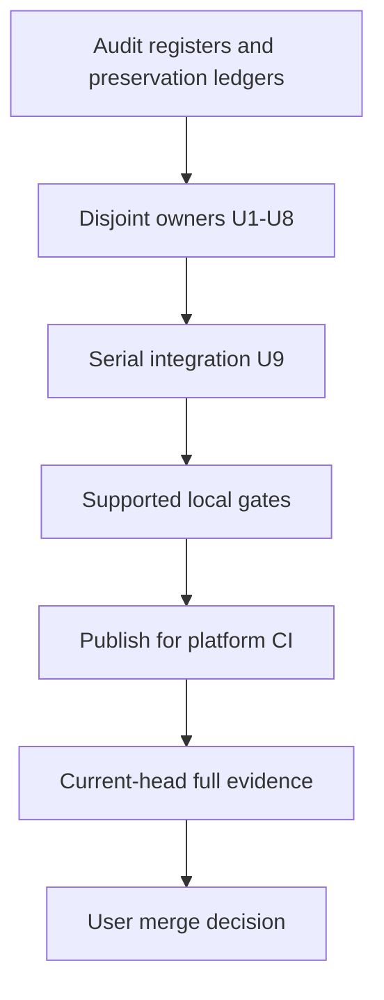

# Test Audit Proof Repairs - Plan

## Goal Capsule

- Objective: Maintainers can trust the repository's regression evidence when deciding whether a configuration change is safe to merge.
- Means: Repair accepted proof gaps and remove only subsumed proof using KTD1 and KTD2.
- Authority: The approved audit scope and repository instructions govern this plan; R1-R6 define preservation and shipping obligations.
- Execution profile: Independent file owners may implement U1-U8 concurrently; U9 integrates shared files serially.
- Stop conditions: A demonstrated conflict with a user decision or a missing implementation prerequisite requires escalation with evidence. Unavailable Linux builders do not prevent implementation or publication for CI.
- Completion owner: The parent LFG workflow implements, verifies, commits, publishes, and watches the PR. The user owns merge.

---

## Product Contract

### Summary

Repair the audit's 24 proof groups, perform its 11 carry-first consolidations, and make its three narrow removals.
Keep each independent package, configuration, protocol, security, platform, migration, and lifecycle contract at its strongest owner.

### Problem Frame

Several checks stay green when delivery or activation is broken because they inspect declarations, reconstruct commands, or observe only part of a promised effect.
Other cases repeat proof already provided by a stronger owner, which adds maintenance cost without protecting another contract.

### Requirements

**Proof quality**

- R1. Implement every accepted repair F1-F24 in the repair register, preserving the independent contracts named there and in the audit preservation ledgers.
- R2. Complete C1-C11 only after their keeper assertions are present, and limit removals to D1-D3.
- R3. Demonstrate each repaired assertion class catches its intended regression without depending on evaluation failure or an unrelated guard.

**Scope and delivery**

- R4. Retain every complete test suite and all named independent contracts; exclude the rejected Claude updater duplication and VSCodium whole-object escape hypotheses.
- R5. Use only fake credentials and scratch state for verification, without host activation or changes to card administration.
- R6. Publish an open PR and leave merge to the user after the repository's current-head evidence requirements are satisfied.

### Key Decisions

- **Apply all accepted findings.** Governs R1-R3. (session-settled: user-approved — chosen over deferring low-severity findings: the user authorized all accepted findings and repository policy requires every valid finding.)
- **Leave merge to the user.** Governs R6. (session-settled: user-directed — chosen over automatic merge: LFG authorizes shipping, while the user explicitly reserves merge.)

### Scope Boundaries

No entire suite is retired, and no runtime optimization target or test-count quota is imposed (R2, R4).
Production changes are limited to D3's unused test-only registry removal unless implementation establishes a real defect requiring a fix under repository policy.
No duplicate validation or production updater fix follows from the two rejected hypotheses (R4).
A new generic test framework or production injection interface is unnecessary: existing test-local runners and fixtures cover the accepted work.

### Acceptance Examples

- AE1. Covers R1, R3. Given an activation block whose helper is replaced by an echo or a dead branch, executing that full block leaves divergent scratch state unrepaired and the owner check fails.
- AE2. Covers R1, R3. Given a configuration entry that still has correct text but is disabled or retargeted, its materialized consumer-path check fails.
- AE3. Covers R2, R4. Given a consolidation candidate with a unique assertion, the keeper first acquires that assertion and still catches the same regression after the smaller case is removed.

### Sources

The audit evidence was reviewed during this implementation. Matching-platform mutation results and full verification are preserved in [PR #342](https://github.com/hyperlapse122/nix-config/pull/342) and [its proof run](https://github.com/hyperlapse122/nix-config/actions/runs/40121639574); review artifacts were removed from the repository at the user's request.
The global F numbers below follow report order; lane-local F numbers are retained in the Source column.
Global C and D numbers are assigned in report order and cross-reference their lane-local candidate names.
The report's baseline is revision `09e9f5aaf56f3bb549c69bc8499de9c208737e4d`.
Control-record filenames inside archived ledgers describe historical evidence; the implementation must produce fresh evidence rather than depend on temporary control files.

---

## Planning Contract

### Key Technical Decisions

- KTD1. Repair existing owners rather than introduce parallel suites. Execute complete redirected activation blocks, read materialized consumer files, and observe actual profile executables where the repair register requires them. This keeps the primary proof at the boundary that can detect the regression (R1, R3).
- KTD2. Transfer unique assertions before removing duplicate cases. Independent transport, lifecycle, platform, root/user recovery, source/package, and profile-delivery boundaries remain separate (R2, R4).
- KTD3. Use `tests/lib/configurations.nix`'s `userEntries` and `userGuard` for Linux Home Manager contracts. Keep system assertions on the system matrix and Darwin runtime proof in `tests/darwin-outputs.nix`, because the Linux user enumerator excludes Darwin.
- KTD4. Keep mutation work isolated from the shared checkout. A scratch copy excludes `.git`, has its own initialized index, and is addressed from the trusted checkout; every mutation records whether it applied, evaluated, ran the intended assertion, and was caught. Follow `.compound-engineering/artifacts/solutions/best-practices/copied-git-worktree-writes-the-real-index.md`.
- KTD5. Give U9 exclusive ownership of `flake.nix` and `docs/provisioning.md`. Other owners return integration requirements rather than edit these shared files, preventing concurrent integration conflicts.
- KTD6. Preserve destination, declaration, and DAG assertions where they cover independent wiring while adding behavioral execution. Existing `stepBlock` and redirected execution in `tests/darwin-outputs.nix` are the model, with helper failures observed through the original block rather than a reconstructed helper call.

### Assumptions

The implementation begins from the supplied clean `chore/audit-tests` baseline.
The audit's owner and caller analysis remains applicable; each unit rechecks its current source before editing.
No external technology choice remains open, so a bake-off would not change the method.
Exact test-local helper factoring is implementation-owned and must not add a production-only seam for tests.
Platform availability may change during execution; unsupported results remain pending evidence under the Verification Contract.

### Sequencing and ownership

U1-U8 own disjoint files and can proceed independently under KTD5.
Within each unit, establish keeper assertions and repaired proof before deleting subsumed cases.
Every unit's integration notes identify whether each changed check newly consumes a host or Home Manager generation.
U9 consumes those notes, updates closure-based routing and runs the combined verification classification.
Mutation runs use isolated snapshots (KTD4), and no test reads a checkout being concurrently edited.

### System-Wide Impact

Changes affect evidence used by CI and maintainers rather than intended host behavior.
Home contracts span NixOS and standalone Linux users, including production/bootstrap variants; Darwin has a separate native boundary.
The D3 configuration simplification removes only an internal provenance option, while shipped skill content and attribution remain unchanged.

### High-Level Technical Design

### Risks and dependencies

An extraction harness can accidentally recreate the command instead of executing activation; KTD6 and AE1 prevent that.
A synthetic replay or identical derivation can establish a gap but cannot count as a supported-platform build.
A broad source rewrite can remove a pinentry grammar variant despite preserving the same encoded result; C11 explicitly preserves those inputs.
The full verification obligation includes Linux/KVM and matching architecture builders, which are not available in the supplied local baseline.

### Repair register

| ID | Source | Owner unit | Required repair and retained contract |
| --- | --- | --- | --- |
| F1 | agents F1 | U2 | Execute actual Claude, Codex, Gemini/Antigravity, Tokscale and agentPlugins activation blocks with divergent state and recording/failing helpers. Keep declaration, destination and DAG proof. |
| F2 | agents F2 | U2 | Read delivered `.gemini/settings.json`, checking enabled resolved destination and materialization; preserve mutable Antigravity merge proof separately. |
| F3 | agents F3 | U2 | Cover Gemini, Codex settings and plugins with Linux `userEntries/userGuard`; retain system-specific assertions and native Darwin coverage. |
| F4 | releases F1 | U1 | Emit a distinctive failed-fetch response-body sentinel and require its absence from stdout and stderr; keep malformed-success-response coverage. |
| F5 | releases F2 | U1 | Require two distinct numeric schedule minutes with documented 30-minute separation; retain off-hour/full-day assertions. |
| F6 | systems F1, systems-deepen | U7 | Parse the job-level YAML condition and enforce the entire expected condition, rejecting false prefixes, true suffixes and misleading step conditions. |
| F7 | systems F2, systems-deepen | U3 | Exercise a syntactically valid identity against another valid expected recipient; retain corrupt input, unchanged old bytes and staging cleanup. |
| F8 | systems F3, systems-deepen | U3 | Validate nonempty recipient syntax and exact membership in the applicable token rule; preserve bootstrap pairing and ciphertext/rule equality. |
| F9 | systems-security F1 | U3 | Capture and require nonzero statuses in nr and age helper diagnostic cases before asserting messages. |
| F10 | systems-security F2 | U3 | Add valid mismatched SSH public metadata with a wallet password that decrypts the existing private key; preserve missing-entry/wrong-password and provision-time boundaries. |
| F11 | systems-security F3 | U3, U9 | Replace assertion-free render claims with actual installed Linux pinentry substitution, executable and compile/run proof. Retain raw relay and separate Darwin filter tests; remove nonexistent variant claims. |
| F12 | systems-platform F1 | U4 | Missing NDK `source.properties` must fail before version checking; keep compiler, API and other metadata contracts. |
| F13 | systems-platform F2 | U4 | Inspect materialized `10-unqualified-search.conf` at its consumer path and parse TOML; commented text must not satisfy discovery policy. |
| F14 | systems-platform F3 | U4 | Execute actual containersAuth on Linux and Darwin scratch targets; inspect JSON, directory/file modes, existing bytes and dry-run behavior. Keep real credential-consumer VM proof. |
| F15 | systems-platform F4 | U4 | Execute native Darwin Codex activation and inspect TOML, retired-key removal, preserved undeclared state and refusal propagation. Keep darwin-config wiring predicates. |
| F16 | inline F1 | U9 | Read delivered GPG, Zsh and Ghostty files at actual consumer paths. Preserve root `.zshenv` startup chain, font order and uniqueness, both zero TTLs and rejection of nonzero TTLs. |
| F17 | inline F2 | U9 | Run each installed user's `home.path/bin/python3` and `bin/uv` under controlled environment instead of builder tools; use Linux user matrix and preserve package diagnostics. |
| F18 | systems-desktop F1 | U5 | Execute real printer reconciliation for fresh, correct and changed URI states. Reject needless recreation/query for a correct offline queue while preserving description updates. |
| F19 | systems-desktop F2 | U5 | Execute actual taskbar activation over divergent fixtures for both supported applet types and trait variants, inspecting writes and order. |
| F20 | systems-desktop F3 | U5 | Execute full redirected VSCodium activation, seed nested undeclared siblings, and require refusal propagation; keep target/order checks. |
| F21 | systems-desktop F4 | U5 | Observe every method/path request and require no requests in Tailscale existing-state scenario B; keep fresh-instance authentication/deletion lifecycle. |
| F22 | systems-deepen F4 | U6 | Inspect enabled, correctly targeted installed udev rule directory and receiver-specific line rather than a check-owned copy of extraRules. |
| F23 | systems-deepen F5 | U6 | Assert delivered sysctl consumer path and all four numeric policies; retargeting outside sysctl.d must fail. |
| F24 | systems-deepen F6 | U7 | Exercise actual workflow list expressions with distinct fixture outputs and recorded target splitting. Consistent lambda alpha-renaming must pass; all-host/all-check/native-runner/globbing contracts remain. |

### Consolidation and removal register

| ID | Source and candidate | Keeper and carry-first obligation | Unit |
| --- | --- | --- | --- |
| C1 | releases C1, plugin train case at :55 | All-train case at :63 keeps newer CLI train, prefix, status and exact tag; keep numeric-order/malformed-tag cases. | U1 |
| C2 | releases C2, Claude Code case at :90 | :97 keeps up-to-date status and forbids manifest fetch; keep downgrade/unreadable-pin cases. | U1 |
| C3 | releases C3, T3 SRI at :291 | Complete independently expected dry-run pin at :409; retain persisted-write boundary at :284. | U1 |
| C4 | releases C4, WiFiman hash at :151 | Full fixed expected pin and selected URL at :113; retain persisted file at :158. | U1 |
| C5 | agents C1, prefix collision at :85 | :76 already checks preserved `themePreference`; keep its explicit assertion. | U2 |
| C6 | agents C2, direct main success at :309 | Real process entry point at :324 retains status and merged model. | U2 |
| C7 | agents C3, direct main refusal at :291 | Carry explicit absence of `Traceback` into :330 first; preserve distinct TOML/ledger refusal inputs. | U2 |
| C8 | agents C4, plugin rerun at :362 | Carry exact symlink target into converged-registration :370 first; keep :381 reassertion separately. | U2 |
| C9 | agents C5, Codex helper startup | Package postInstallCheck in `packages/codex.nix` owns same helper smoke; keep installed-profile/sibling helper proof in `flake.nix`. | U2, U9 |
| C10 | systems C1, Docker get at :66 | Carry exact `{ServerURL, Username, Secret}` key set into every distinct routing row at :120 before deletion; retain error/list/mutation/leakage and real consumer VM. | U3 |
| C11 | systems-security C1, pinentry encoding | Table retains simple no-holder, holder-bearing and alignment SETDESC variants. Carry raw-PIN-negative assertion to every answered row. No runtime reduction claim. | U3 |
| D1 | releases D1, obsolete T3 TypeScript fixture plumbing | Remove only unused `agy_entry/agy_source`, fetch response and source plumbing; retain Antigravity-pin preservation, release-list-only fetch and still-used platform fixtures. | U1 |
| D2 | systems D1, direct Git dependency self-test | Remove only `tests/lint-staged-markdown.sh` direct replacement self-test at :391-396; retain actual linked-worktree hook commit cases. | U7 |
| D3 | systems-desktop D1, internal provenance registry | Remove `my.testAuditSkill`, repeated registry assertions and its documentation clause. Retain shipped attribution, license, enabled resolved targets, byte equality, frontmatter and non-symlink proof. | U8, U9 |

---

## Implementation Units

### U1. Release proof and narrow replay consolidation

- **Goal:** Complete F4-F5, C1-C4 and D1.
- **Requirements:** R1-R4.
- **Dependencies:** None.
- **Files:** `tests/test_agent_plugin_release.py`, `tests/update-dependencies-reconcile.sh`, `tests/test_claude_code_release.py`, `tests/test_t3code_release.py`, `tests/test_wifiman_desktop_release.py`.
- **Approach:** Extend existing failed-fetch and schedule fixtures, then consolidate the listed same-owner replay cases under KTD2.
- **Patterns:** Existing complete expected-pin assertions and process fixtures in these files, with the accepted release findings recorded in the repair register.
- **Execution note:** Prove the repaired assertions catch payload printing and duplicated schedule minutes before consolidating.
- **Test scenarios:**
  1. A failed fetch emits a sentinel body internally, returns failure, and neither captured stream contains the sentinel.
  2. A schedule with duplicate minutes fails; two distinct numeric minutes 30 minutes apart pass, with off-hour/full-day constraints intact.
  3. Each C1-C4 keeper still rejects incorrect train, pin/hash or forbidden fetch behavior after its smaller case is removed.
  4. D1 retains existing Antigravity-section bytes and permits only the release-list fetch.
- **Verification:** Owner source suites and update reconciliation runner pass; intended failure controls turn red; no still-consumed fixture is removed.

### U2. Linux agent activation and keeper proof

- **Goal:** Complete F1-F3 and C5-C9 at their existing owners.
- **Requirements:** R1-R4.
- **Dependencies:** None; send C9 wiring evidence to U9.
- **Files:** `tests/claude.nix`, `tests/codex-settings.nix`, `tests/gemini.nix`, `tests/tokscale.nix`, `tests/agent-plugins.nix`, `tests/test_agent_settings.py`, `tests/test_agent_plugin_sync.py`, `tests/codex.nix`.
- **Approach:** Apply KTD1, KTD3 and KTD6. Use scratch homes and test-local command substitution only for external effects, preserving the full original control flow. Read the actual Gemini home-files path. Carry C7/C8 assertions before removing cases.
- **Patterns:** `tests/darwin-outputs.nix` step execution, `tests/lib/configurations.nix` user matrix, existing refusal and symlink fixtures.
- **Execution note:** Establish AE1/AE2 proof before dropping any extracted-command assertions that no longer own an independent contract.
- **Test scenarios:**
  1. Each affected activation runs with divergent state and invokes its helper with the declared destination and data.
  2. Echo/dead-branch mutants fail effect assertions; failing helpers retain the owner's intended failure/refusal policy.
  3. Disabling or retargeting Gemini delivery fails, while renaming a file attribute without changing its destination passes.
  4. Standalone Linux production and bootstrap users participate, and the matrix guard rejects missing populations.
  5. Process refusals omit Traceback for both malformed TOML and ledger failures; plugin convergence preserves exact symlink target and separate reassertion behavior.
  6. Removing the outer Codex helper replay retains package install checking and profile/sibling delivery proof.
- **Verification:** Relevant Linux owner checks and merger/plugin sibling source suites pass; mutation evidence distinguishes execution from extraction and delivery from option text.

### U3. Security boundary proof and pinentry preservation

- **Goal:** Complete F7-F11, C10 and C11 without weakening transport or recovery contracts.
- **Requirements:** R1-R5.
- **Dependencies:** None; send installed Linux pinentry wiring needs to U9.
- **Files:** `tests/test_install_user_age_identity.py`, `tests/bootstrap-recipients.nix`, `tests/nr.sh`, `tests/age-identity-helpers.sh`, `tests/test_desktop_ssh.py`, `tests/pinentry-card.sh`, `tests/test_docker_credential_sops.py`.
- **Approach:** Use valid distinct fake recipients/identities and actual status capture. Extend the SSH load fixture to decrypt successfully before mismatched public metadata is rejected. Factor pinentry prompt setup into a table under C11; leave raw relay testing intact and make the installed-render input contract explicit for U9.
- **Patterns:** Existing fake crypto and wallet fixtures, `packages/gpg-tools.nix` installed outputs, separate `tests/pinentry-card-darwin.sh` boundary.
- **Test scenarios:**
  1. Valid wrong recipient refuses publication, preserves old bytes and leaves no staging residue; corrupt input still fails separately.
  2. Empty or malformed bootstrap recipients, comment-only matches and wrong-rule matches fail; actual token-rule membership passes.
  3. Correct diagnostics with status zero fail nr/age negative cases.
  4. A decryptable existing private key with valid mismatched public metadata is rejected during loading, distinct from provision-time mismatch.
  5. Installed Linux pinentry has resolved substitutions and both executable entry points, compiles and selects its actual packaged delegates.
  6. Every C11 grammar row remains, answered rows omit raw PIN data, and Docker routing rows retain exact schema plus distinct values.
- **Verification:** Owner/sibling suites and raw pinentry proof can run independently on Linux. Final installed pinentry verification waits for U9 wiring; its evidence is recorded separately from native Darwin filter proof. No timeout counts as a pass.

### U4. Platform delivery and native Darwin effects

- **Goal:** Complete F12-F15.
- **Requirements:** R1, R3-R5.
- **Dependencies:** None.
- **Files:** `tests/android-sdk.nix`, `tests/podman-containers.nix`, `tests/darwin-config.nix`, `tests/darwin-outputs.nix`.
- **Approach:** Use KTD1 and KTD6 for containersAuth and Darwin Codex. Keep cross-evaluation wiring assertions in darwin-config and perform native effects in darwin-outputs. Use a TOML parser for the delivered registry drop-in.
- **Patterns:** Existing Darwin Pi scratch merger runner and Android existence assertions; `home/h82/dev/containers.nix` and `home/h82/agents/codex.nix` are production owners to read.
- **Test scenarios:**
  1. Absent NDK source.properties fails even if compiler and other metadata remain; the pinned version passes.
  2. Disabled, retargeted or comment-only search registry config fails the materialized consumer check.
  3. Actual containersAuth creates correct parsed JSON with 0700 directory and 0600 file modes; existing custom bytes survive and dry-run makes no changes on Linux and Darwin.
  4. Native Codex activation applies declared TOML, removes retired keys, preserves undeclared state and propagates refusal without altering protected malformed input.
  5. Echo-only activation fails both effect owners while the separate registry credential-consumer VM remains intact.
- **Verification:** Linux platform checks and native `checks.aarch64-darwin.darwin-outputs` pass on matching builders; cross-evaluation is not native execution evidence.

### U5. Desktop and provisioning lifecycle observers

- **Goal:** Complete F18-F21.
- **Requirements:** R1, R3-R5.
- **Dependencies:** None.
- **Files:** `tests/printing.nix`, `tests/plasma-taskbar.nix`, `tests/vscodium.nix`, `tests/tailscale-provisioning.nix`, `tests/tailscale-mock-api.py`.
- **Approach:** Execute actual generated scripts/steps with scratch state and recording tools. Add request observation to the existing VM fixture rather than duplicating the consumer elsewhere. Apply KTD6 to VSCodium and taskbar.
- **Patterns:** Printer owner `modules/nixos/services/printing.nix`, taskbar owner `home/h82/desktop/kde/plasma.nix`, VSCodium owner `home/h82/dev/vscodium.nix`, current Tailscale VM scenarios.
- **Test scenarios:**
  1. Fresh and changed-URI printer queues reconcile, while an already-correct offline queue rejects unnecessary creation and still receives description updates.
  2. Both supported applet types with divergent launcher/grouping data receive expected KConfig writes and ordering across relevant trait variants.
  3. VSCodium full activation writes nested declared settings, preserves undeclared siblings and propagates refusal; echo/dead-branch variants fail.
  4. Existing Tailscale state produces zero requests of any method/path; fresh state retains authentication and deletion lifecycle proof.
- **Verification:** Linux desktop checks and Tailscale VM pass; focused controls fail at the intended lifecycle assertion. The rejected whole-object hypothesis adds no test or production change.

### U6. Materialized system consumer paths

- **Goal:** Complete F22-F23.
- **Requirements:** R1, R3-R5.
- **Dependencies:** None.
- **Files:** `tests/logitech-wakeup.nix`, `tests/kernel-sysctl.nix`.
- **Approach:** Observe actual installed udev and sysctl destinations using existing materialization helpers, keeping receiver specificity and numeric policy assertions.
- **Patterns:** `tests/lib/etc-file.nix`, existing enabled-target delivery checks; learnings listed under Required learning references in the Verification Contract.
- **Test scenarios:**
  1. Disabling udev delivery or moving its rule outside the consumed directory fails despite unchanged extraRules text.
  2. A receiver-specific line passes and a broadened or missing receiver policy fails.
  3. Retargeting sysctl outside sysctl.d fails; independently changing any of its four numeric policies fails.
- **Verification:** Both owner checks pass and disable/retarget controls fail inside their builders rather than only at evaluation.

### U7. Workflow semantics and dependency-only removal

- **Goal:** Complete F6, F24 and D2.
- **Requirements:** R1-R4.
- **Dependencies:** None.
- **Files:** `tests/check-workflow-docs-skip.sh`, `tests/lint-staged-markdown.sh`.
- **Approach:** Parse whole job-level conditions and exercise the workflow's actual list expression with fixture output names rather than spelling-dependent source fragments. Remove only D2's direct Git replacement self-test.
- **Patterns:** Current workflow fixtures and `.github/workflows/check.yml` as the read-only owner; linked-worktree hook commit cases remain primary hook proof.
- **Test scenarios:**
  1. Exact intended job condition passes; permanently false prefix, always-true suffix and correct step-only condition fail.
  2. A consistent lambda alpha rename passes while omitted host/check outputs or wrong native runner routing fail.
  3. Distinct fixture outputs reach separately recorded build targets without accidental glob expansion.
  4. Existing linked-worktree commits still reject bad staged Markdown and accept clean content, including the branch without hooks scenario.
- **Verification:** Workflow docs gating and staged-Markdown source runners pass; semantic wrong-condition controls fail and harmless alpha-renaming stays green.

### U8. Remove the unused skill provenance seam

- **Goal:** Complete the code portion of D3.
- **Requirements:** R2, R4.
- **Dependencies:** None; send the documentation clause removal to U9.
- **Files:** `home/h82/agents/test-audit.nix`, `tests/test-audit-skill.nix`.
- **Approach:** Remove only the internal option and tests asserting its repeated literal registry; preserve actual skill contribution and all D3 keepers. Update the check's header description to match its remaining assertions.
- **Patterns:** Direct `my.agentSkills` contributions in neighboring modules and existing materialized skill assertions.
- **Test scenarios:**
  1. Every enabled resolved skill target still has byte-identical attributed source, license, valid frontmatter and non-symlink SKILL.md.
  2. Removing shipped attribution or breaking a delivered target still fails after registry removal.
- **Verification:** `test-audit-skill` and sibling skill-root checks pass; repository search finds no live reference to the removed option after U9's documentation integration.

### U9. Serial shared integration and evidence reconciliation

- **Goal:** Complete F16-F17 and shared integration for F11, C9 and D3.
- **Requirements:** R1-R6.
- **Dependencies:** U1-U8 integration notes; U3 must specify installed pinentry input, U8 the removed option clause.
- **Files:** `flake.nix`, `docs/provisioning.md`; temporary proof-only edits to `.github/workflows/check.yml` and temporary `tests/audit-proof-mutations.py` if no supported Linux/KVM builder becomes available.
- **Approach:** Apply KTD3 and KTD5. Wire installed pinentry proof without replacing raw tests, keep profile helper proof after C9, and remove only D3's registry clause from provisioning. Materialize inline delivery checks and run installed user runtimes. Add dependencies only where required by the changed check. Add every check that newly consumes a host or Home Manager generation to `hostClosureChecks`, even when its declaration is unchanged. Other shard membership edits follow declaration changes. Confirm C9 package and integrated profile keepers before accepting its removal.
- **Patterns:** Shared user enumerator, current package/profile assertions and materialized Darwin counterparts.
- **Test scenarios:**
  1. Disabled/retargeted GPG, Zsh and Ghostty deliveries fail with current content policies retained.
  2. Empty fake user Python/uv packages cannot pass via builder tools; installed real profile executables pass under controlled environment.
  3. Linux installed pinentry proof fails unresolved placeholders or missing installed entry points while raw and Darwin tests keep their separate boundaries.
  4. Codex profile/sibling helper evidence and D3 shipped skill evidence remain after narrow removals.
- **Verification:** Combined complete branch diff satisfies the Verification Contract. Record production versus test/support LOC and actual proof/cost changes without claiming unmeasured speedups.

---

## Verification Contract

Follow `docs/verification.md#publishing-and-merge-readiness` for the full branch diff and current-head evidence.
Before trusting repaired guards, read the applicable learnings listed below and the additional guard-specific entries required by repository instructions.
No execution occurred while writing this plan.

### Proof obligations

Before executing an activation block, its unit confirms every write target and external service call is redirected to scratch state or a recording test-local substitute. Assert that destination replacement actually changed the block. If complete isolation cannot be established, report that specific prerequisite and continue other independent units; do not run against the host or fall back to reconstructed partial calls (R5, KTD6).

Each repair register row has an owner assertion, a passing unmutated control and a deliberately broken control that fails for its intended reason (R3).
Group equivalent mutations by assertion class, while preserving independent platform/transport boundaries.
Record revision, command, platform, mutation application, expected diagnostic, actual result and restored control.
Any changed check that newly reads a host generation must enter `hostClosureChecks` in `flake.nix` so its build runs in the hosts shard.
Missing files must fail in the builder through guarded lookups rather than unguarded derivation interpolation.
For consolidation, compare the keeper's actual assertions with C1-C11 before deletion and rerun keeper/sibling proof afterward.
Load `test-audit` before test edits, and follow its candidate-evidence workflow.

### Linux mutation evidence venue

The parent evidence integrator owns supported-platform mutation runs independently of normal clean-head CI.
If no Linux/KVM builder becomes available, U9 temporarily extends `.github/workflows/check.yml` on the PR with a finite matrix of the repaired assertion classes and a temporary `tests/audit-proof-mutations.py` runner.
Use the existing Linux runner and KVM setup for applicable VM classes, pinned action versions and read-only repository permissions.
The runner operates only on isolated scratch copies under KTD4, verifies mutation application, requires the intended builder diagnostic, and restores a passing control for every row.
Expected failure is accepted only when the guarded assertion runs and fails for its documented reason; evaluation errors, unrelated failures and timeouts remain missing evidence.
These jobs verify R3 and do not replace clean-head check shards, VM jobs or host outputs.
After capturing evidence, remove the temporary workflow additions and runner, preserve run/artifact links and revision identities, then require the ordinary final-head CI matrix again.
This finite proof venue is implementation work for the parent; pending mutation jobs do not block implementation or initial PR publication, but they prevent completion of R3 and merge readiness.

The PR description links a durable per-class evidence index containing the mutation, owner check, platform, command, expected/actual diagnostic, control restoration and CI run/artifact reference.
Preserve enough failure output in the index to remain useful after CI artifacts expire.
If implementation exposes a production defect, update the PR title and body around the resulting behavior and list the applied finding rather than describing the PR as tests-only.

### Commands and applicability

| Gate | Command or concrete evidence | Applicability |
| --- | --- | --- |
| Source owners | Existing Python files in U1-U3 through their declared dependency environment; existing shell runners in U1/U3/U7 with fixture arguments from their flake declarations | Supported native platform only; desktop SSH requires Linux SO_PEERCRED |
| Changed Linux checks | `nix build --no-link .#checks.x86_64-linux.<owner>` for each changed owner, plus relevant sibling checks | Matching Linux builder; source replay is additional evidence |
| Evaluation | `nix flake check --no-build --all-systems` | Local Darwin supported; rerun on implementation head |
| Native macOS | `nix build --no-link .#checks.aarch64-darwin.darwin-outputs` and every production/bootstrap Darwin system output | Apple Silicon local or build-darwin CI |
| All checks | `nix flake check` and declared check shards on their supported systems | CI check-shards plus build-linux/build-darwin; enumerate rather than assume coverage |
| VM tests | `nix build --no-link .#vmChecks.all` on x86_64 Linux with KVM | All nine baseline VM tests, including Tailscale and retained security/consumer boundaries |
| Host outputs | Enumerate `nixosConfigurations`, `homeConfigurations`, `systemConfigs`, `darwinConfigurations`; build every production/bootstrap output using documented output suffixes | Native/matching architecture builders, including fixture checks |
| Publish hygiene | `git diff --check`, changed Markdown lint, `nix fmt -- --ci` where available | Darwin formatter unavailable; Linux fmt CI required |
| Complete diff | Classify from merge-base with `scripts/ci-docs-only-paths` and semantic review | Tests/configuration require full evidence even if documentation paths also change |

### Baseline and platform obligations

At `09e9f5aaf56f3bb549c69bc8499de9c208737e4d`, the audit reports all-system evaluation and native Darwin outputs passed.
It also reports 25 of 26 Python source suites and named source/helper runners passed; desktop SSH lacked native Darwin support.
Raw pinentry timed out twice on Darwin, leaving Linux raw and package proof pending.
Linux checks, Linux host builds and all VM tests were unavailable because no Linux/KVM builder was available and Podman was stopped.
These are inherited baseline statements, not passes for the implementation head.

Implementation and PR publication may proceed after supported local gates, with each unavailable Linux, architecture and VM result explicitly pending for CI.
Merge readiness requires successful current-head PR workflow evidence, all declared checks, VM tests and every production/bootstrap output under the repository policy (R6).
A docs-only skip cannot satisfy an affected consumer check such as one reading `docs/provisioning.md`.
Hardware results remain separately reported and are not inferred from builds; no switch/apply is verification under R5.

### Required learning references

- `.compound-engineering/artifacts/solutions/best-practices/mutation-testing-reveals-decorative-nix-check-assertions.md`
- `.compound-engineering/artifacts/solutions/best-practices/unguarded-derivation-interpolation-defeats-nix-check-mutation-testing.md`
- `.compound-engineering/artifacts/solutions/best-practices/nix-check-reads-option-value-not-materialized-output.md`
- `.compound-engineering/artifacts/solutions/best-practices/converged-fixture-state-defeats-nix-check-mutation-testing.md`
- `.compound-engineering/artifacts/solutions/best-practices/activation-step-grep-check-passes-an-echo-only-step.md`
- `.compound-engineering/artifacts/solutions/best-practices/nix-check-importing-tofile-copy-fails-read-only-flake-check.md`
- `.compound-engineering/artifacts/solutions/best-practices/home-manager-activation-does-not-run-on-every-rebuild.md`
- `.compound-engineering/artifacts/solutions/integration-issues/sops-service-umask-blocks-user-secrets.md`
- `.compound-engineering/artifacts/solutions/integration-issues/tmpfs-gnupghome-card-provisioning-traps.md`

---

## Definition of Done

- Every F1-F24 row has implemented owner proof and recorded caught-mutation evidence on a supported platform.
- Every C1-C11 carry-first obligation and D1-D3 narrow removal is checked against the durable preservation ledgers (R2, R4).
- All owner/sibling checks pass, and unavailable platform evidence is tracked until the Verification Contract's readiness gates pass.
- All valid implementation review findings are applied under repository policy; any permitted exception is evidenced with the required tag in the PR.
- No whole suite, independent contract or pinentry SETDESC variant is lost, and abandoned experimental code and mutation state are removed.
- The parent reports actual production and test/support changes, retained contracts and verification limits, opens and watches the PR, then leaves merge to the user (R6).
