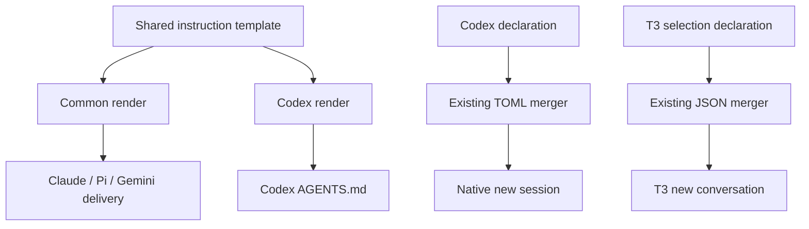
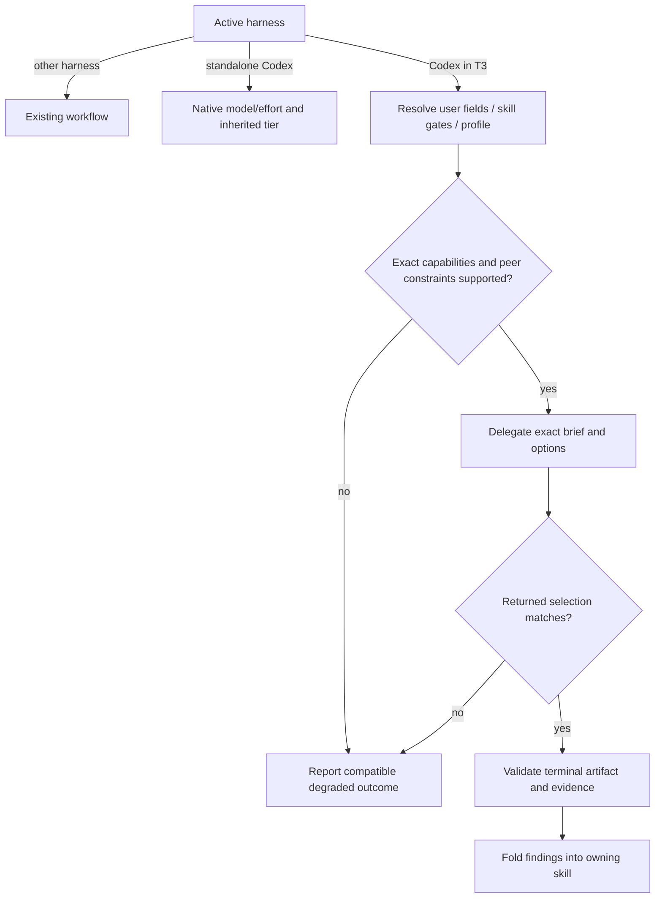
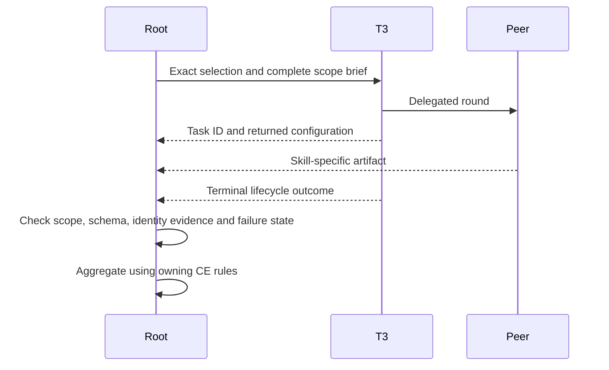
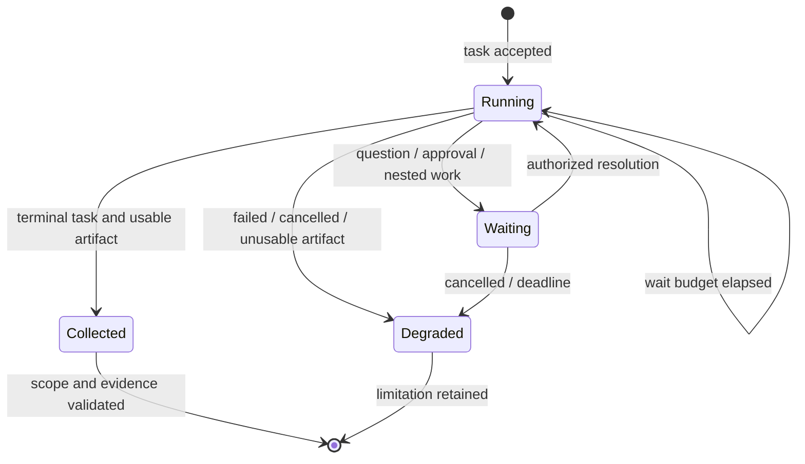

# Codex Role-Based Orchestration and Model Defaults - Plan

## Goal Capsule

- **Objective:** Sustain repeated multi-repository sweep, implementation, review, and learning workflows within ChatGPT Pro $500 usage while reducing avoidable waiting and rework.
- **Means:** Add Codex-only orchestration instructions and align T3 Code and Codex startup defaults with explicit role-level model, reasoning effort, and service-tier choices.
- **Product authority:** This Product Contract records the confirmed scope and role policy; implementation planning may choose delivery mechanisms without changing these decisions.
- **Execution:** U1-U4 define implementation and verification; the calling workflow owns execution and its review gates.
- **Open blockers:** None. Client compatibility and CE transport integration are implementation investigations, not permission to silently weaken the policy.

---

## Product Contract

### Summary

Introduce an explicit model, effort, and service-tier policy for Codex-led Compound Engineering and general delegation.
Use Astra for orchestration, Sol for substantive execution and verification, and Luna for bounded extraction, while retaining CE-required independent Claude and Gemini reviews.
Apply the policy through T3 delegation when running in T3 Code and through supported native capabilities in standalone Codex.

### Problem Frame

The user repeatedly runs `ce-sweep → lfg`, alongside `ce-compound` and `ce-compound-refresh`, across several repositories.
Claude Max 20x plus Max 5x did not provide enough weekly usage for this workload.
The priority is sustained usable capacity, with faster completion where its usage cost is justified.

An agent can spend too much by inheriting an expensive parent configuration or requesting `max` for work that fits Sol `medium`.
Using the smallest model for every task can also waste capacity when weak results cause repeated investigation or repairs.
The policy therefore needs to distinguish retrieval, interpretation, implementation, and risk review rather than assigning models solely by role title.

### Key Decisions

- **Capacity before blanket acceleration** (session-settled: user-directed — chosen over speed-first use of the included allowance: the prior two Claude subscriptions exhausted their weekly capacity). Governs R3, R8, R9, R17.
- **Astra orchestration with explicit child profiles** (session-settled: user-approved — chosen over inheriting one model and effort everywhere: reserve deeper reasoning for work that needs it). Governs R2, R4, R5, R6, R7.
- **Retain CE independent review through T3 delegation** (session-settled: user-directed — chosen over GPT-only reviews or broad external-model routing: keep CE's model-family diversity without moving ordinary work off the ChatGPT subscription). Governs R10, R11, R12.
- **Prevent discretionary effort inflation** (session-settled: user-approved — chosen over agents freely escalating routine work to maximum reasoning: exact effort values and evidence-based escalation make usage predictable). Governs R5, R6, R7, R13.
- **Respect native Codex's tier limit** (session-settled: user-approved — chosen over claiming child-level tier control everywhere: T3 and native Codex have different supported controls). Governs R14, R15.

### Requirements

**Scope and defaults**

- R1. Apply the new orchestration policy only when the active harness is Codex, including Codex-led T3 sessions; other harnesses retain their existing general orchestration behavior.
- R2. Set both T3 Code's default conversation selection and Codex's default new-session selection to `gpt-6-astra`, reasoning effort `low`, and Standard service.
- R3. Prefer ChatGPT-authenticated Codex for ordinary work, without automatically switching to separately billed API access or purchasing credits when allowance is exhausted.

**Role selection and effort**

- R4. Cover every CE identity and general delegated task using the role profiles and coverage map below, preserving each skill's own selection triggers, prompts, permissions, and artifact contracts.
- R5. Resolve a concrete model and effort for each dispatched task from its work profile, rather than implicitly inheriting the orchestrator's settings.
- R6. Raise a task above its profile only for a named unresolved issue or substantive verification failure that requires deeper reasoning, and record the evidence and requested change before dispatch.
- R7. Do not automatically select `max` or `ultra` for GPT profiles; those efforts require an explicit user request, and role titles, large context, or generic claims that work is important do not authorize an increase.

The following profiles are normative defaults under R4-R7, not claims that every task at one effort has been benchmarked in this repository.

| Profile | Work | Model | Effort | Default service |
| --- | --- | --- | --- | --- |
| P1 | Exact lookup, fixed-field extraction, status collection | `gpt-6-luna` | `low` | Standard |
| P2 | Grounding scouts, bounded classification and evidence summaries | `gpt-6-luna` | `medium` | Standard |
| P3 | General implementation, ordinary planning, synthesis, claim verification, learning authoring | `gpt-6.1-sol` | `medium` | Standard |
| P4 | Complex logic tracing, substantive code review, security, concurrency, or data-integrity analysis | `gpt-6.1-sol` | `high` | Standard |
| P5 | Root orchestration, delegation, progress management | `gpt-6-astra` | `low` | Standard |
| P6 | Complex planning, architecture alternatives, high-risk decisions, conflicting-evidence adjudication | `gpt-6-astra` | `medium` | Standard |
| P7 | CE-required independent Claude or Gemini review or diverse candidate | CE's selected external model | CE's explicit prescribed effort | Provider default; no automatic acceleration |

**Service tier and consumption**

- R8. Use Standard by default and restrict automatic Fast use to a supported task that is currently blocking dependent work, with an explicit reason for spending extra usage; when available allowance is unknown, retain Standard unless the user requests acceleration.
- R9. Never automatically select Ultrafast; enable it only on an explicit user request and a model/account combination that advertises support.

**T3 delegation and independent review**

- R10. Inside T3 Code, dispatch Codex-led subagents and CE-required Claude/Gemini work through T3's delegated-task tools, not ordinary top-level conversations or direct provider CLI workers.
- R11. Retain CE's independent-review selection, recipient constraints, prescribed model and effort, and distinct-family requirements rather than forcing all reviewers onto GPT.
- R12. A T3 replacement for a CE CLI review route must preserve the review scope, applicable instructions, findings schema, identity evidence, terminal result collection, failure classification, and downstream aggregation.
- R13. Resolve supported values from T3's live model catalog and explicitly set `target.model` plus effort and supported service tier in `target.options`; check the returned selection against the request.

T3 currently advertises `default`, `priority`, and `ultrafast` for Astra and Sol, and `default` and `priority` for Luna.
Standard maps to T3 `default`; Fast maps to T3 `priority`.
These values must be rechecked at dispatch, not extrapolated to Claude or Gemini.
P7 retains the selected CE model and effort even when a cheaper GPT profile would otherwise fit.
The GPT-only effort restriction in R7 does not silently rewrite a CE-prescribed external effort.

**Standalone Codex and unsupported settings**

- R14. Outside T3, use native Codex model and effort controls where supported, while treating subagent service tier as inherited from the root session unless the installed client demonstrably supports independent control.
- R15. When a requested model, effort, tier, or route cannot be honored, report the limitation and apply the owning skill's compatible fallback without claiming that the requested configuration ran.
- R16. Preserve explicit user selections and existing project precedence; changing startup defaults must not rewrite active conversations or raise child settings through inheritance.

**Repeated workflows and coverage**

- R17. Reduce repeated-work overhead through bounded briefs, shared evidence artifacts, and parallel independent work within existing limits, without omitting required review or verification stages.
- R18. Resolve unlisted or newly introduced roles by their actual responsibilities, using P3 as the general fallback and P4 or P6 for evidenced risk rather than inventing a new model or maximum effort.
- R19. Synchronize the affected generated instructions, declared settings, documentation, and relevant verification so the installed behavior matches the policy across supported hosts.

### CE Role Coverage

This map applies R4 and defines defaults for the installed CE 3.32.0 taxonomy.
It does not authorize extra subagents, change workflow ownership, or convert work a skill keeps in the root context into delegated work.
For root-owned work, the root remains Astra and uses P5 or P6; the P3 authoring assignments apply only when that work is delegated by the skill.

| Workflow or identity | Default profile | Responsibility boundary |
| --- | --- | --- |
| General status, fetch, exact file or symbol lookup | P1 | Reading a known field is distinct from interpreting behavior |
| `ce-sweep` source-persona fetch | P1 | Retrieval and quoting; unclear connector semantics use P3 |
| `ce-sweep` media analyzer | P3 | Interpret frames/transcripts into supported findings |
| `ce-sweep` decision round and reconciliation; `lfg` coordination | P5 / P6 | P6 when resolving conflicting evidence or a difficult scope decision |
| `ce-brainstorm` grounding scout; `ce-pov` project/precedent scouts | P2 | Bounded source gathering, not a verdict |
| `ce-brainstorm` claim verifier | P3 | Check claims against source evidence |
| `ce-plan` repo, git-history, learnings, framework-docs, web and best-practices researchers | P2 / P3 | P2 for gathering; P3 when interpreting applicability or reconciling sources |
| `ce-plan` spec-flow analyzer | P4 | Trace missing states and behavioral edge cases |
| `ce-plan` architecture strategist and complex plan author | P6 | General delegated plan authoring remains P3 |
| `ce-plan` data-integrity guardian | P4 | Risk analysis rather than mechanical extraction |
| `ce-work` implementation worker and design-sync worker; PR comment resolver | P3 | Complex diagnosis uses P4; architectural decisions use P6 |
| `ce-debug` investigation and root-cause analysis; `ce-optimize` attribution | P4 | Exact evidence gathering can use P1/P2 without transferring diagnosis |
| `ce-explain` work-recap and behavior-trace scouts | P2 | A trace requiring complex causal reasoning uses P4 |
| `ce-ideate` evidence researchers and issue-intelligence analyst | P2 / P3 | Retrieval uses P2; interpretation uses P3 |
| `ce-ideate` generation and ceiling frames; `ce-bakeoff` candidates | P3 / P6 / P7 | Honor the skill's generation/ceiling distinction and required model diversity |
| `ce-pov` verdict/synthesis and independent peer | P6 / P7 | Evidence scouts do not decide the verdict |
| `ce-code-review` correctness, standards, testing, maintainability, agent-native, security, performance, API-contract, data-migration, reliability, adversarial fallback, previous-comments, frontend-races, Swift/iOS and deployment-verification personas | P4 | These are substantive reviewers even when a change is small |
| `ce-code-review` learnings researcher | P2 / P3 | Retrieval uses P2; applying a learning to the diff uses P3 |
| `ce-code-review` merge leaf, validator and report leaf | P3 / P4 / P3 | Finding validation uses P4; merging/rendering must preserve all findings |
| `ce-doc-review` whole-doc, coherence, scope, feasibility, product, design, security and local adversarial lenses | P4 | An independent peer uses P7 |
| `ce-simplify-code` reuse, quality, efficiency, comment and test-value reviewers | P4 | Review depth does not depend on how short the requested output is |
| `ce-compound` Related Docs Finder | P2 | Overlap interpretation beyond bounded matching uses P3 |
| `ce-compound` session historian, document synthesis and grounding validation | P3 | Root-owned classification and drafting retain root ownership |
| `ce-compound` security sentinel, performance oracle, data-integrity guardian and pattern-recognition specialist | P4 | Research-only framework/best-practices gathering uses P2 |
| `ce-compound-refresh` investigation and replacement authors | P3 | Complex behavior verification uses P4; root retains deletions and metadata decisions |
| Browser/device/prototype execution, ordinary writing, handoff and other general workers | P3 | Required modalities/tools must be available; status-only collection uses P1 |
| Commit, publication and babysitting coordination | P5 | Deterministic commands do not need another model call; diagnosis uses P4 |

### Escalation and Failure Behavior

Under R6, an escalation record identifies the unresolved question, relevant evidence, previous configuration, and next supported configuration.
P1/P2 work that turns into interpretation moves to P3; a difficult implementation or validation problem moves from P3 to P4; an unresolved architectural tradeoff moves to P6.
These are responsibility changes, not an instruction to walk an escalation ladder on every retry.
An effort increase beyond a profile must satisfy R6 and R7 even when the model exposes higher settings such as `xhigh`.

A formatting error, transient network failure, busy slot, or missing credential is not evidence that more reasoning is needed.
Capacity errors follow the platform's queue/backpressure behavior, and a failed launch must not create duplicate active work.
Requested and returned T3 selections are configuration evidence; they must not be described as stronger serving-model attestation than the provider actually supplies.
No suitable T3 route means the CE pass is reported as unavailable/degraded under R15, rather than silently shelling out or dropping a required review.

### Acceptance Examples

- AE1. **Covers R2, R5, R13.** Given a new Codex-led T3 conversation, the root starts as Astra `low` Standard; a routine implementation unit explicitly requests Sol `medium` Standard even if the root later uses a higher effort.
- AE2. **Covers R4, R6, R7.** Given a sweep fetch followed by media interpretation, the fetch uses P1 and the analysis uses P3; calling the work important does not justify Sol `max`.
- AE3. **Covers R6, R7.** Given a Sol `medium` worker that finds a reproducible concurrency failure it cannot explain, the orchestrator may request Sol `high` with that evidence; a transient API error alone does not qualify.
- AE4. **Covers R8, R9.** Given many repositories running in parallel with unknown remaining allowance, tasks stay on Standard; a supported Fast task requires the R8 conditions, and Ultrafast requires the user's explicit request.
- AE5. **Covers R10, R11, R12, R13.** Given CE selecting an independent Claude reviewer in T3, the orchestrator creates a T3 delegated task with CE's model and effort, collects the terminal artifact, and preserves the review's independence and failure metadata.
- AE6. **Covers R14, R15.** Given standalone Codex whose root is Standard, assigning a different model/effort to a child does not claim a distinct child tier; unsupported tier control is disclosed.
- AE7. **Covers R1, R16.** Given a Claude-led session consuming the shared instruction source, the Codex-only policy does not change its general routing; an existing T3 conversation is not rewritten by the new startup default.
- AE8. **Covers R4, R17, R18.** Given compound refresh over overlapping learnings, skill ownership and sequencing remain intact; a new unlisted semantic investigator uses P3 rather than inheriting Astra or choosing `max`.
- AE9. **Covers R13, R15.** Given a T3 result reporting a different effort from the request, the parent reports the mismatch and does not count it as a successful application of the requested role policy.

### Success Criteria

- Representative `ce-sweep → lfg` and learning-maintenance runs show explicit role selections and no unexplained effort escalation.
- Verification distinguishes generated configuration from observed runtime settings, including the root/child inheritance and T3 transport cases in the acceptance examples.
- Before/after observations record completed work, elapsed time, retries/rework, and available usage evidence for comparable tasks; no fixed weekly capacity or speedup is promised without measurements.
- A complete role-coverage check against the installed CE version finds no identity dependent on implicit high-cost inheritance; dynamic roles resolve through R18.

### Scope Boundaries

- The source instruction template, its necessary delivery changes, Codex and T3 default settings, relevant checks, and matching documentation are in scope under R19.
- T3's separate title/text-generation model and other harnesses' general defaults remain unchanged.
- CE skill cache edits, a new orchestration service, cross-repository global scheduling, automatic quota scraping, and a permanent benchmark dashboard are outside scope.
- No subscriptions are purchased or canceled, no credits are purchased, and no machine activation is performed by this brainstorm.
- This policy does not guarantee that an account with existing paid credits cannot consume them; the provider's billing behavior is separate from instructions that avoid API fallback and purchases.
- Broad runtime policy applies to future work; this artifact does not retroactively rerun the brainstorm's completed scout or verifier.

### Dependencies and Planning Investigations

- Codex-only delivery uses the shared-template discriminator in KTD1; no renderer or host-trait change is needed.
- Pinned Codex 0.164.0 supports explicit Standard and the native model/effort default pair in KTD2; native tier limits remain governed by R14.
- KTD4-KTD6 define instruction-only CE transport, artifact and lifecycle adaptation; unsupported peer requirements are named under Compatibility Limits.
- Pinned T3 source resolves project/current-selection precedence as documented below; installed consumer observations remain implementation evidence under U2.
- The bounded observation set and usage-visibility limits are recorded under Assumptions and U4.

### Sources and Research

Research checked on 2026-10-25; external catalogs and account entitlements can change.
The benchmark figures below inform the selected profiles but do not measure this user's CE workflow or establish the best effort for each role.

| Source | Observation | Relevance and limit |
| --- | --- | --- |
| [Artificial Analysis: Astra max](https://artificialanalysis.ai/models/gpt-6-astra) | Intelligence Index 53; 58.1 output tokens/s; $3.26 per index task | Supports reserving Astra for judgment; these are API benchmark measurements at max |
| [Artificial Analysis: Sol max](https://artificialanalysis.ai/models/gpt-6-1-sol) | Intelligence Index 52; 57.3 output tokens/s; $0.72 per index task | Close aggregate score at lower measured API task cost; not proof of equivalence on planning or review |
| [Artificial Analysis: Luna max](https://artificialanalysis.ai/models/gpt-6-luna) | Intelligence Index 38; 137 output tokens/s; $0.07 per index task | Supports investigating Luna for bounded work; higher speed does not prove shorter end-to-end tasks |
| [OpenAI subagents](https://learn.chatgpt.com/docs/agent-configuration/subagents) | Explicit model/effort selection; specialized agents; root service-tier inheritance | Supports native capability boundary and avoiding implicit inheritance |
| [OpenAI speed](https://learn.chatgpt.com/docs/agent-configuration/speed) | Fast consumes included usage at 2.5x; Ultrafast at 8x; Pro $500 supports Ultrafast | These are usage multipliers, not guaranteed wall-clock speedups |
| [OpenAI pricing](https://learn.chatgpt.com/docs/pricing) | Subscription usage differs from API-key billing; model credit rates differ | API benchmark dollars must not be converted into subscription task counts |
| [OpenAI configuration reference](https://learn.chatgpt.com/docs/config-file/config-reference) | Native `service_tier = "fast"` maps to request `priority` | Native configuration names differ from T3 option names |

T3's live `orchestrator_capabilities` response in this session advertised per-child `reasoningEffort` and `serviceTier` for Codex models.
An actual grounding scout launch returned Luna `medium` with `serviceTier=default`; the claim verifier launch returned Sol `medium` with the same tier.
These demonstrate option-bearing dispatch, not a benchmark or proof of accelerated service performance.

Repository evidence verified by an independent claim checker:

- `home/h82/agents/instructions/instructions.md.tmpl` and `home/h82/agents/instructions/default.nix`: current policy has no model-routing section and one rendered artifact supplies four harness delivery paths.
- `home/h82/agents/codex.nix`: runtime-owned configuration is merged; no model or reasoning default is currently declared.
- `home/h82/t3code.nix`: default conversation selection is Codex Sol `low`; text generation separately uses Claude Haiku; model-selection objects are replaced as a whole.
- `scripts/agent-settings`: runtime declarations preserve unrelated state.
- `CONCEPTS.md`: instruction delivery, provider-instance homes, and the declared settings set define the current boundaries.
- `.compound-engineering/artifacts/solutions/integration-issues/t3code-settings-json-value-outranks-repository-t3-json.md`: machine-wide settings can outrank project files; that finding concerns specific keys and is not proof of model-selection precedence.
- `.compound-engineering/artifacts/plans/2026-10-24-1551-refactor-harness-default-instructions-plan.md` and `.compound-engineering/artifacts/plans/2026-10-24-1800-chore-match-t3-codex-defaults-plan.md`: nearby prior work, not an asserted absence of all overlapping plans.

Installed CE 3.32.0 evidence includes `ce-brainstorm/references/model-tiers.md`, `ce-sweep/references/model-tiers.md`, `ce-explain/references/orchestration.md`, the planning/review persona catalogs, `ce-compound/references/research.md`, and `ce-compound-refresh/references/investigate.md`.
Its `ce-code-review/references/cross-model-review.md` currently specifies a detached CLI worker with explicit review artifacts and identity metadata.
The need to preserve those semantics when replacing the transport is an integration inference, not a claim that CE already supports T3 delegation.

---

## Planning Contract

Product Contract unchanged.

### Key Technical Decisions

- KTD1. **Render a Codex variant from the shared template.** Extend the rendering context in `home/h82/agents/instructions/default.nix` with a delivery discriminator, leaving `lib/host-facts.nix` unchanged. Render the common policy once for Claude, Pi, and Gemini and a Codex variant from the same template. Only the new section is conditional. This meets R1/R19 without duplicating personal policy or changing the renderer. A separate instruction service or copied full template adds ownership without solving another requirement.
- KTD2. **Declare startup defaults through the existing mergers.** (session-settled: user-approved — chosen over one inherited configuration for all work: retain the Astra root and explicit child profiles.) Use Codex user TOML and T3's whole top-level `defaultModelSelection` object, retaining the separate text-generation selection and existing Codex home. Codex 0.164.0 uses `model`, `model_reasoning_effort` and explicit `service_tier = "default"`. Set `agents.default_subagent_model` to `gpt-6.1-sol` and `agents.default_subagent_reasoning_effort` to `medium` as the generic native fallback. Role-specific native configuration must remain consistent because role application can subsequently change model/effort. T3's local `modelSelections` variable maps to top-level persisted keys, not a JSON namespace. Do not inject wrapper flags or managed `[models.new_thread]` requirements, which would change precedence under R16. Keep unrelated runtime settings and project trust intact. The selected role defaults remain governed by R2-R9.
- KTD3. **Resolve routing at each dispatch.** (session-settled: user-approved — chosen over implicit parent inheritance: concrete child profiles keep capacity predictable.) Under R5/R13/R16, resolve task-scoped current user field overrides, applicable skill constraints, then the responsibility profile; fill unspecified fields from that profile rather than the parent. Preserve the skill's conversation, checkout, project, and default peer precedence and recipient gates under R11. Discover the exact provider/model descriptors, searching omitted models before declaring them absent. Use T3 `default` for Standard and `priority` for authorized Fast; do not extrapolate Codex options to external providers. Compare returned provider, model, and options before counting the requested configuration as applied. A root-only selection does not override child profiles. Mixed work uses the profile of its substantive responsibility; split work only where the owning skill already allows delegation. Missing descriptors, discovery failure, provider rejection, and receipt mismatch remain distinct observed limitations under R15.
- KTD4. **Adapt CE transport in instructions, without building a runner.** (session-settled: user-directed — chosen over GPT-only peer substitution: retain CE external identity while using T3 transport.) Inside Codex-led T3, the Codex section explicitly replaces CLI launch/status/result/reap with delegated-task lifecycle tools under R10/R12. Keep the installed skill's trigger, exact persona, scope, recipient consent, model/effort, deadline, schema, failure policy, and aggregation contract. Code review, document review, POV, bake-off and other peer workflows retain their own schemas rather than sharing an invented generic format. This exception applies only inside Codex-led T3; standalone Codex retains the owning skill's compatible transport. No installed CE cache edits are needed. This is the smallest mechanism that retains R11; implementing a transport daemon or schema framework would exceed this prompt/configuration change.
- KTD5. **Carry complete briefs and truthful evidence.** T3 children receive the relevant active instructions, persona, repository/read root, reviewed base/revision or document identity, prior-round findings/responses, expected artifact contract, and private output destination. Separate untrusted review material from trusted constraints. Review uncommitted content in the shared checkout; a worktree child starts from committed state. Capture the reviewed scope identity and recheck it before fold-in; drift requires a fresh bounded round or incomplete coverage. Parent-owned scratch receipts link the task/round/scope to the findings artifact and preserve CE identity/failure fields. Requested/returned selection is configuration evidence only: unknown actual model/effort stays `unverified`, and independence receives no promotion without the owning skill's required evidence. Missing arrays, malformed output or a fluent summary never become an empty successful review.
- KTD6. **Retain lifecycle and safety ownership.** Keep each task ID, a stable request ID for retries of one dispatch, and a fresh delegated task for every new review round. A wait timeout leaves live work running; pending questions, approvals and nested children are incomplete states. Use notifications and bounded status reads when results are needed, not duplicate launch loops. Respect the workflow's existing concurrency and recovery limits. Bind each invoked skill's pre-launch, started failure, no-review, retry/replacement and local-lens fallback outcomes to the observed T3 result before launch. An explicit recipient stays fixed where that skill requires it; disclose any permitted replacement before sending. Preserve surviving findings and identify uncovered lenses after partial failure. Cancel owned live work when abandoning a pass and preserve its failure classification and scratch cleanup. An instruction to avoid writes is not enforced read-only access; if the selected peer route cannot preserve a required tool restriction, disclose the degraded pass under R15. Parent tools do not grant authority to answer a child's reserved approval.

### High-Level Technical Design

Delivery and configuration have separate owners:

Dispatch branches implement KTD3-KTD6:

The peer protocol keeps findings and receipts separate:

### Assumptions

- The instruction adapter can be expressed in one Codex-only section without a new executable helper. Implementation should shorten references and reuse CE's contracts before introducing another file or abstraction.
- A representative observation set is one bounded implementation task, one substantive code review, and one learning-maintenance task. Reuse existing equivalent records when available; these examples do not establish weekly capacity or a model ranking.

### Compatibility Limits and Implementation Evidence

R15 governs unsupported combinations; none of these gaps authorizes a changed model policy.

- The live catalog establishes option-bearing Codex dispatch and Standard=`default`, not native child tier isolation or actual serving speed. Native child preparation reapplies the root tier after role configuration; unsupported accelerated child tiers can be cleared by the pinned client. Disclose that limitation rather than claiming independent Standard or resetting the root. If independent Standard is required and unsupported, report the limitation.
- Antigravity's inspected Gemini entries expose no effort descriptor, and the repository's peer allowlist does not currently include literal `antigravity`. An enabled provider alone neither authorizes recipient egress nor proves CE's prescribed Gemini effort. Retain an eligible CE Claude route when its selection contract allows it; otherwise report the required Gemini pass unavailable. Do not add an allowlist recipient incidentally.
- T3 task metadata does not establish provider-origin serving-family attestation. Preserve attributed peer findings while independence remains unverified; never manufacture CLI receipt fields or a corroboration bonus.
- Enforced read-only peer tools must be established for the selected T3 route. A shared-checkout instruction is weaker than the fixed CE CLI tool boundary; a missing control is an explicit degraded route, not proof of equivalent isolation.
- Client startup, resumed-session behavior, provider option application, and tier inheritance need consumer observations during implementation. Static declarations and current online docs alone do not prove the pinned clients applied them.

### Pinned Compatibility Evidence

[Codex 0.164.0 configuration source](https://github.com/openai/codex/blob/rust-v0.164.0/codex-rs/core/src/config/mod.rs) establishes the explicit Standard sentinel and both `[agents]` defaults used in KTD2. [Child preparation](https://github.com/openai/codex/blob/rust-v0.164.0/codex-rs/core/src/agent/child_config.rs) establishes requested/default field resolution followed by role application and root-tier reapplication. [Request filtering](https://github.com/openai/codex/blob/rust-v0.164.0/codex-rs/protocol/src/openai_models.rs) omits the Standard sentinel from outgoing tier requests, so a literal wire `default` is not the sole acceptable evidence.

T3 release `v0.1.3-nightly.20261024.3617` resolves to `27e0c684c585f955252d65f06206dd11a143bff5`. Its [project resolver](https://github.com/pingdotgg/t3code/blob/v0.1.3-nightly.20261024.3617/packages/shared/src/projectSettings.ts) lets eligible project override records replace environment defaults whole. A disabled-provider project override is skipped, and a present null differs from omission. This is not evidence that `t3.json` exposes model settings.

The [composer derivation](https://github.com/pingdotgg/t3code/blob/v0.1.3-nightly.20261024.3617/apps/web/src/composerDraftStore.ts) prioritizes active draft selection, stored thread selection, then project/environment selection, subject to provider eligibility and locks. The [new-thread helper](https://github.com/pingdotgg/t3code/blob/v0.1.3-nightly.20261024.3617/apps/web/src/lib/chatThreadActions.ts) prioritizes the resolved default over a selection carried from a different conversation; the [caller](https://github.com/pingdotgg/t3code/blob/v0.1.3-nightly.20261024.3617/apps/web/src/hooks/useHandleNewThread.ts) protects a valid explicitly selected current draft. R16 therefore does not establish cross-conversation carry over the new default. If that stronger behavior is required, it needs a user decision and upstream compatibility work, not a silent default-policy change.

These are tagged-source findings, corroborated by the installed T3 bundle, not runtime observations. They resolve the representation and precedence questions without proving account support, serving identity or effective installed behavior.

### Startup Selection Boundaries

| Selection source | Planned ownership and evidence |
| --- | --- |
| Declared application baseline | Existing mergers reassert owned defaults on apply; edits to these owned fields are not promised to survive reapplication |
| Explicit invocation/project fields | Preserve the consuming client's supported precedence under R16; observe model-only and full overrides separately |
| Existing conversation/resume | Retain persisted selection; observe it separately from new-conversation defaults |
| Explicit root task selection | Applies to the named task/fields and duration; it does not select child profiles by inheritance |
| Explicit child/peer selection | Applies only to its named work, subject to the owning skill's recipient/safety constraints and supported capabilities |

### Research Applied and System-Wide Impact

The source-to-consumer trace is `instructions/default.nix` → template renderer → materialized home files, and declared Codex/T3 settings → `scripts/agent-settings` → runtime-owned configuration → client selection. This single-pass source trace establishes ownership, not runtime application.

The byte-render contract and non-Codex absence guard change together under U1. The activation check must execute the materialized step against divergent scratch settings under U2: [activation-effect learning](../solutions/best-practices/activation-step-grep-check-passes-an-echo-only-step.md) and [materialized-output learning](../solutions/best-practices/nix-check-reads-option-value-not-materialized-output.md). Negative controls retain negation and contradictory-policy coverage from [instruction-sentence learning](../solutions/best-practices/substring-sentence-check-passes-a-negated-instruction.md).

T3 owns model-selection objects whole because leaf merges retain stale options. The [settings precedence learning](../solutions/integration-issues/t3code-settings-json-value-outranks-repository-t3-json.md) concerns workspace settings and cannot establish model-selection precedence. [Activation reassertion](../solutions/best-practices/home-manager-activation-does-not-run-on-every-rebuild.md) is conditional on a changed Home Manager generation on NixOS; documentation must preserve that distinction.

The instruction change affects all production/bootstrap and fixture deliveries, but changes general routing only for Codex. Peer content still crosses the selected provider boundary under CE's recipient rules. There is no new stored task database, telemetry service, quota scraper, scheduler or benchmark dashboard. Representative timing/usage observations belong in verification records using the [peer comparison method](../solutions/best-practices/benchmark-cross-model-review-peers-in-t3-code-before-changing-them.md); historical usage multipliers are not fresh account evidence.

---

## Implementation Units

### U1. Deliver the Codex-only policy with independent guards

**Goal:** Install the role policy at the Codex delivery path while retaining the common personal policy elsewhere.

**Requirements:** R1, R4-R9, R14-R19; AE2-AE4, AE6-AE8.

**Dependencies:** None.

**Files:** `home/h82/agents/instructions/default.nix`, `home/h82/agents/instructions/instructions.md.tmpl`, `tests/agent-instructions.nix`, `tests/agent-instructions.py`, `tests/claude-effort-absent.nix`.

**Approach:** Apply KTD1 and the profile/override resolution in KTD3. Update independent rendering expectations and delivery manifests alongside the template. Keep the non-Codex orchestration ban and the common signing/recipient/personal-policy assertions. Narrow only the authorized Codex CE effort exception in the Claude sentence guard; retain unrelated Claude settings/environment protections.

**Patterns to follow:** Existing materialized `home-files` inspection and independent expected bytes; the template renderer needs no feature change.

**Test scenarios:**

- Covers AE2/AE3. Delivered Codex instructions resolve extraction, interpretation, review and evidenced escalation to the applicable profiles without automatic maximum effort.
- Covers AE7. All non-Codex delivery bytes retain the previous common personal policy and contain no added routing section.
- Removing the Codex section, leaking it to another delivery, changing a profile or negating an effort/tier limit fails the appropriate guard for its own reason.
- The Codex CE effort exception passes while a blanket Claude effort assignment still fails.

**Verification:** Independently rendered expected variants match enabled materialized production/bootstrap and fixture paths; targeted negative controls distinguish leakage, omission and contradictory policy.

### U2. Align startup defaults at existing configuration owners

**Goal:** New sessions use the requested default selection while explicit selections remain effective.

**Requirements:** R2, R3, R13-R16, R19; AE1, AE6, AE7.

**Dependencies:** None.

**Files:** `home/h82/agents/codex.nix`, `home/h82/t3code.nix`, `tests/codex-settings.nix`, `tests/t3code-traits.nix`.

**Approach:** Apply KTD2 through existing `setPaths` and whole-object ownership. Use the pinned `[agents]` model/effort pair from KTD2 as the fallback for general native work, while explicit role dispatch still implements P1-P4/P6. Do not place native child tier on an unsupported surface. Preserve the separate title/text-generation model and provider-instance home.

**Execution note:** Prefer scratch activation/config-consumer evidence to tests that only compare the declaration to itself.

**Test scenarios:**

- Covers AE1. Seed an old model with incompatible stale options, execute the generated settings merge against scratch files, and obtain Astra low Standard plus intact unrelated user state.
- Covers AE7. T3 text-generation selection, provider home, plugins, project trust and unrelated TOML keys survive the merge.
- Covers AE6/AE7. New sessions consume the default, explicit project/user fields win at their supported layer, and resumed conversations keep their selection; record client version and observed fields.
- Replacing the generated activation command with an echo fails the file-effect assertion.

**Verification:** Declaration values and actual scratch writes agree with independent expected values. Consumer observations separately establish effective startup and override behavior without machine activation.

### U3. Preserve CE review contracts over T3 delegation

**Goal:** Codex-led T3 workflows collect usable CE peer findings without weakening reviewer identity or scope.

**Requirements:** R4-R7, R10-R13, R15-R18; AE5, AE8, AE9.

**Dependencies:** U1.

**Files:** `home/h82/agents/instructions/instructions.md.tmpl`, `tests/agent-instructions.py`, `docs/provisioning.md`, `docs/verification.md`.

**Approach:** Apply KTD4-KTD6 as instruction guidance and a compact documented contract mapping. Code review retains findings/residual risks/testing gaps; document review retains findings/residual risks/deferred questions; POV retains its final-answer and round contract. Read each invoked skill's current schema rather than copying all schema fields into permanent policy. Use existing scratch artifacts and task tools, with no custom runtime validator or transport program.

**Test scenarios:**

- Covers AE5. An eligible CE Claude peer receives the required persona, scope and exact prescribed effort, and its schema-complete artifact reaches the owning aggregation step.
- Covers AE9. Returned selection mismatch, missing required array, truncated artifact, missing artifact or changed reviewed scope produces an incomplete/degraded result without discarding valid attributed findings.
- A completed task with unverified serving identity gains no independence bonus; a non-final POV position does not end the panel.
- A wait timeout, pending approval, nested child or transient retry does not create duplicate work or claim completion. A second round receives the original brief plus prior findings and responses in a new task.
- Gemini without recipient authorization or supported effort, and a peer without required enforced read-only access, are reported under R15 without CLI/GPT substitution.

**Verification:** Static guards protect the instruction boundary; bounded transcript scenarios establish lifecycle, artifact and truthful limitation behavior. Report any unsupported required peer capability separately from successful ordinary dispatch.

### U4. Synchronize documentation and collect representative evidence

**Goal:** Document what the installed configuration guarantees and measure representative behavior without promising capacity gains.

**Requirements:** R1-R19 and Success Criteria; AE1-AE9.

**Dependencies:** U1, U2, U3.

**Files:** `CONCEPTS.md`, `docs/provisioning.md`, `docs/verification.md`.

**Approach:** Update the identical-delivery and no-orchestration descriptions, Codex CE effort exception, declared settings and conditional activation wording. Replace the stale verification checklist that refers to removed worker pins. Record compatibility limits next to the consumer observations they constrain. Use the observation set in Assumptions with the same scope and outputs before/after where comparable evidence exists.

**Test scenarios:**

- A transcript shows explicit Luna low/medium and Sol medium/high requests under an Astra low Standard root, including a later parent-setting change that does not alter the child profiles.
- Unknown allowance retains Standard; a Fast dispatch records the supported critical-path reason and known allowance; Ultrafast and GPT max/ultra require explicit user selection.
- Explicit user field overrides and checkout peer `off` with/without the skill's allowed live opt-in retain R11/R16 precedence.

**Verification:** Docs distinguish declaration, scratch activation, client observations, serving identity and account usage evidence. Before/after notes contain task scope, completed work, time, retries/rework and only available usage evidence; unavailable baselines are named rather than fabricated.

---

## Verification Contract

This is runtime instruction/configuration work, even when edited paths resemble documentation. Before inspecting or changing tests, load `test-audit` and the repository's applicable check/mutation learnings. Reuse the existing check owners; register any genuinely new check and its shard only if existing owners cannot prove the changed boundary.

| Evidence | Scope | Required outcome |
| --- | --- | --- |
| Independent instruction/delivery checks | U1/U3 | `agent-instructions` and `claude-effort-absent` pass on supported outputs with the variant-specific negative controls |
| Scratch activation and declared settings | U2 | `codex-settings`, `t3code-traits`, existing `agent-settings` and `text-template` contracts pass; real scratch writes preserve unrelated state |
| Client observations | U2/U3 | Pinned versions, effective selections, explicit overrides, resumed state, native inherited tier, peer artifact/lifecycle outcomes and unsupported capabilities are recorded separately |
| Branch hygiene | All | `git diff --check`, changed-Markdown lint and `nix fmt -- --ci` pass before publication |
| Full platform evidence | All | Follow `docs/verification.md`: current-head flake evaluation, all declared checks, Linux VM checks and every production/bootstrap host output on supported builders; unavailable local outputs remain pending for CI |
| Workload observations | U4 | Comparable task scope and outputs accompany timing, retries and usage visibility; no benchmark ranking or weekly-capacity guarantee is inferred |

No machine activation, API-key workload, purchased credits or hardware operation is validation for this plan. Keep real credentials out of evaluation/build inputs. Hardware verification remains separate under the repository's existing policy.

---

## Definition of Done

- U1-U4 satisfy their verification outcomes and retain every Product Contract requirement and acceptance example.
- New defaults and Codex-only delivery are proven at their actual consumers; a passing declaration alone is insufficient.
- CE peer results retain their schema, scope, permission and evidence contracts, with unsupported combinations explicitly degraded under R15.
- Verification records separate local checks, supported-builder/current-head CI evidence, runtime observations and remaining platform limits.
- No abandoned implementation, installed cache edit, new orchestration service, paid fallback or unrelated model/default change remains.
