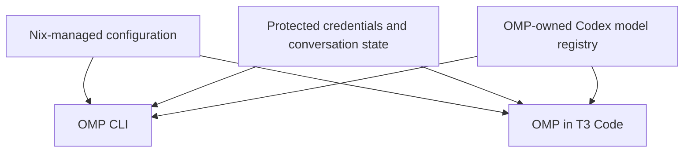
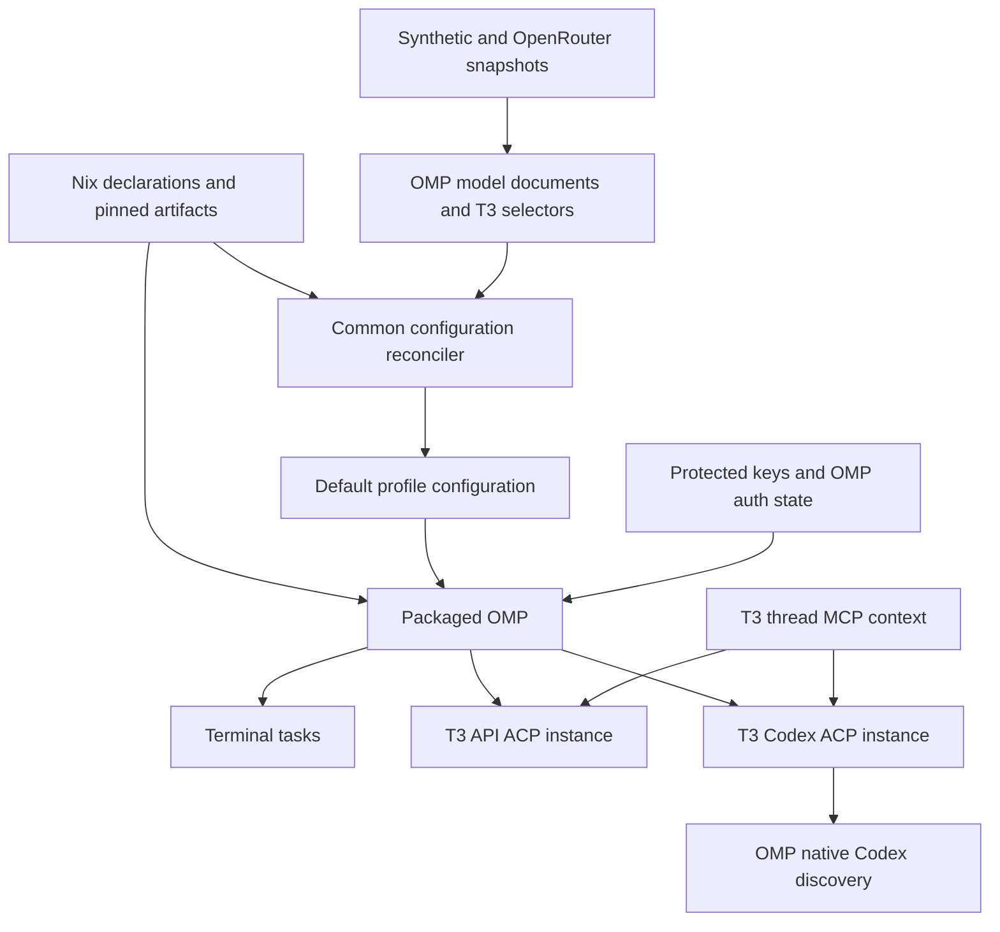
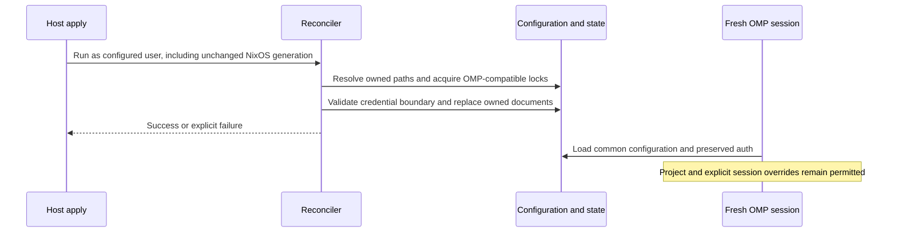

# Managed OMP Agent Environment - Plan

## Goal Capsule

- **Objective:** Make occasional coding work immediately usable from the terminal or T3 Code with the same prepared working environment the user expects from Codex and Claude Code.
- **Means:** Replace the repository-managed Pi environment with OMP and retain OpenCode's retired state.
- **Product authority:** The Product Contract below records the scope confirmed by the user, including the subsequent preference for non-interactive verification.
- **Execution:** Implement and verify this plan, review the resulting change, and publish a pull request; merging remains the user's action.
- **Stop conditions:** Report an unsupported required runtime capability or unavailable authenticated evidence rather than reducing scope or claiming a pass.

---

## Product Contract

### Summary

Provide OMP as a fully configured secondary coding agent for CLI and T3 Code use.
Manage its environment through Nix, retain Synthetic and OpenRouter access, and add Codex subscription access using OMP-owned model information.
Replace Pi's provisioning while preserving user credentials and conversation history.

### Problem Frame

The user previously used this kind of CLI workflow before adopting T3 Code and valued being able to start urgent work quickly.
Occasional use still needs the shared instructions, skills, and tools available in the user's primary agents; a bare executable would leave setup work at the moment the tool is needed.

### Key Decisions

- **Nix owns the common user environment.** Governs R3, R4, R9. (session-settled: user-directed — chosen over enforcing Nix-only settings inside every project and profile: manage common settings, tools, and skills while permitting project configuration, as with Codex and Claude Code.)
- **Retain both API providers.** Governs R5. (session-settled: user-directed — chosen over Synthetic-only or manual provider setup: preserve both existing provider choices.)
- **Start with the Synthetic model.** Governs R6. (session-settled: user-directed — chosen over Codex or OpenRouter as the startup provider: use GLM 5.3 at max initially and change the declaration later.)
- **OMP owns Codex model information.** Governs R7. The user explicitly requested subscription access without predeclared Codex models.
- **Prepared-agent parity is the target.** Governs R8, R9, R10. (session-settled: user-directed — chosen over a minimal CLI installation: occasional use should offer the same level of preparation as Codex and Claude Code.)
- **Explicit cross-model review from GLM.** Governs R10. (session-settled: user-directed — chosen over extending CE's automatic family recognition: retain the GLM default, support explicitly requested reviews, and report unverified independence honestly.)
- **Exercise the headless runtime.** Governs R13. The user selected non-interactive OMP runs as the verification surface.

### Requirements

**Availability and configuration**

- R1. OMP must be available as a directly usable CLI on the repository's supported Linux and Apple silicon macOS host kinds.
- R2. OMP must be usable from T3 Code on hosts that enable T3, with working model selection, prompts, tool execution, and results.
- R3. Nix must manage the complete common OMP user configuration, including provider setup, startup defaults, instructions, skills, plugins, and tool integration; project settings and explicitly selected separate profiles remain permitted overrides.
- R4. Applying the managed configuration must restore declared settings while preserving credentials, conversation history, and runtime caches as state rather than configuration.

**Providers and model selection**

- R5. Synthetic and OpenRouter must retain the full model-selection coverage currently provided by their catalog snapshots and use the existing protected credential delivery.
- R6. A fresh OMP session without an explicit model override must start with Synthetic `hf:zai-org/GLM-5.3` at reasoning level `max`.
- R7. Codex subscription access must use OMP's authentication and model registry without repository-declared Codex model lists or metadata overrides.

**Working environment**

- R8. OMP must load the shared personal instructions, repository instructions, contributed skills, and Compound Engineering capabilities needed for the same everyday workflows available in the managed Codex and Claude Code environments.
- R9. OMP must follow the existing policy of disabled automatic memory and Nix-managed software updates.
- R10. Required tool integrations and CE workflows must work in both CLI and T3 contexts, with evidence for delegation and cross-model review rather than assuming that installed skills establish compatibility.

  Cross-model review from the GLM default is explicitly requested; automatic independent review parity is not required. Preserve CE's identity checks and label independence unverified when serving evidence does not establish it.

**Replacement and verification**

- R11. Remove Pi-only packages, configuration, extensions, adapters, and maintenance work while retaining shared components needed by OMP or another consumer.
- R12. Keep OpenCode retired and disable retired T3 provider entries without deleting the user's old credentials or conversation history.
- R13. Verify OMP behavior primarily through its non-interactive runtime, with separate protocol or T3 evidence for behavior that a standalone CLI run cannot establish.
- R14. Verification must establish effective model and reasoning selection, loaded instructions and skills, and observable tool behavior rather than accepting an agent's unsupported self-report.

### Key Flows

- F1. **Quick terminal task.** The user opens a project and launches OMP without selecting a model; the managed default and working environment apply, and the agent completes the requested task. **Covers R1, R6, R8, R10.**
- F2. **Alternative provider.** The user chooses a Synthetic or OpenRouter model, or authenticates the Codex subscription and selects an OMP-listed model; the selection is usable for that session. **Covers R5, R7.**
- F3. **T3 task.** The user selects OMP in T3 and submits a task; the session receives the intended instructions, skills, and tools and returns usable results. **Covers R2, R8, R10.**
- F4. **Configuration change.** The user changes a managed default in Nix and applies the environment; the new declaration takes effect while existing authentication and conversations survive. **Covers R3, R4.**

The configuration authority and runtime-state boundary are:

### Acceptance Examples

- AE1. **Fresh default:** Given a provisioned environment and working Synthetic access, a non-interactive run with no model override uses the effective selection in R6 and performs a small task. **Covers R6, R13, R14.**
- AE2. **Restore configuration:** Given a local edit to a managed setting, applying the declaration restores it while leaving authentication and existing conversations intact. **Covers R3, R4.**
- AE3. **Codex registry change:** Given a successful Codex login, models exposed by OMP are selectable without adding model definitions to this repository. **Covers R7.**
- AE4. **Working skills:** Given a disposable project with a known instruction and an installed skill, a headless task demonstrates their observable effect and executes a representative tool action. A successful process exit or a claim that a skill was loaded is insufficient. **Covers R8, R13, R14.**
- AE5. **T3 boundary:** Given a successful CLI check, T3 support is still unproven until an OMP session completes a task with the intended tool and configuration context through T3. **Covers R2, R10, R13.**
- AE6. **Replacement:** After applying the replacement, new work uses OMP and retired provider entries remain disabled; old conversation and credential data remains available on disk. **Covers R11, R12.**

### Scope Boundaries

- OMP remains a secondary agent; changing the user's primary Codex or Claude Code workflow is outside this change.
- Parity under R8 and R10 concerns configured working capabilities, not identical model quality, terminal appearance, proprietary features, or blindly copying Codex-specific model orchestration rules.
- Migrating old Pi or OpenCode conversations into OMP is outside scope; their preservation is governed by R4 and R12.
- R3 concerns persistent configuration, not enumerating every upstream default or preventing explicit per-session choices; the Codex registry exception is governed by R7.
- Repository-managed packaging, integration, documentation, and maintenance belong to this change; building a new agent harness or silently accepting CLI-only delivery does not.

### Dependencies and Assumptions

The repository currently provisions Pi for `x86_64-linux`, `aarch64-linux`, and `aarch64-darwin`.
OMP 18.12.6 publishes artifacts for all three platforms; their Nix runtime compatibility requires build evidence.
T3 desktop is supported on NixOS and macOS; non-NixOS Linux uses the configured CLI surface.

OMP documents native ACP, shared context files, skills, plugins, and headless modes.
These are upstream capabilities, not evidence that the pinned T3 application or this repository's CE integration already supports OMP.
The current T3 Pi driver uses Pi-specific RPC behavior, so replacing its executable cannot be assumed sufficient.

The current model source declares GLM 5.3 `max`, but Pi's startup settings do not enforce that effort.
R6 is a required OMP outcome, not a claim that Pi already behaves that way.

### Outstanding Questions

No product decision remains open. Runtime compatibility, authenticated provider behavior, and platform build evidence are implementation verification obligations under the contracts below.

### Sources and Research

- `home/h82/agents/pi.nix`, `home/h82/agents/pi-declarations.py`, and `home/h82/agents/synthetic-models.nix`: current providers, catalog rendering, defaults, and effort distinction.
- `home/h82/agents/skills.nix`, `home/h82/agents/instructions/default.nix`, and `home/h82/agents/agent-plugins.nix`: shared environment delivery and harness-specific differences.
- `home/h82/agents/codex.nix` and `home/h82/agents/claude.nix`: current managed settings, memory, and update policies.
- `home/h82/t3code.nix` and `docs/provisioning.md`: enabled Pi instance, retired OpenCode instance, and Pi-specific T3 integration.
- `.github/workflows/model-catalogs.yml` and `.github/workflows/update-dependencies.yml`: catalog and package maintenance affected by replacement.
- `.compound-engineering/artifacts/plans/2026-10-23-1443-chore-remove-opencode-plan.md`: prior OpenCode removal and preserved user-state boundary.
- [OMP providers](https://omp.sh/docs/providers), [context files](https://omp.sh/docs/context-files), [skills](https://omp.sh/docs/skills), and [plugins](https://omp.sh/docs/plugins): upstream integration surfaces, consulted on 2026-10-25.
- [OMP ACP](https://omp.sh/docs/acp) and [run modes](https://omp.sh/docs/modes): protocol integration and non-interactive execution; the latter documents `omp -p` and JSON output as headless entry points.

---

## Planning Contract

### Key Technical Decisions

- KTD1. **Pin the native release.** Package OMP 18.12.6, build `20261021-210324-45c35e4`, source revision `45c35e40c46166dc726ccc52f5d27f40f2449f99`, for the three R1 systems. Use immutable build-service artifact paths and verified hashes, preserving Bun's appended payload and Darwin signatures. Follow `packages/pi.nix` for Linux runtime patching and `packages/codex.nix` for wrapper/package checks; inspect the actual artifact layout during implementation.
- KTD2. **Reconcile complete common configuration documents.** Under R3 and R4, render the default profile's main settings and provider definitions from Nix and atomically restore complete documents on apply. Missing declared keys revert to pinned defaults. Keep documents writable for OMP's settings UI between applies. Reuse one bounded reconciler from Home Manager activation and a NixOS system activation hook, so unchanged generations restore drift too. Coordinate with OMP's real file locks, not an unrelated ledger lock. (session-settled: user-directed — chosen over project/profile enforcement: only the common user environment is managed; project settings and explicit profiles remain allowed.)
- KTD3. **Keep state outside configuration replacement.** Preserve the existing default profile and its resolved state directories, without opportunistic XDG migration. Never replace the agent directory or its databases. Deliver API credentials through protected command helpers; keep Codex OAuth in OMP's auth store. Before replacing an existing mixed file, preserve credential bindings for the same declared identity, or fail before mutation when that cannot be done safely. Configuration failures must fail apply without exposing contents. This implements R4, R5, and R7.
- KTD4. **Translate both snapshots into OMP's model schema.** Retain the complete Synthetic/OpenRouter snapshots and their refresh workflow for R5. Render explicit missing models and compatible overrides, including OMP `thinking` metadata derived from catalog effort lists. Declare the R6 selector and Synthetic GLM-5.3 low/high/max efforts explicitly; do not rely on OMP's Flash default or generic Synthetic ladder. Leave `openai-codex` model definitions entirely absent under R7.
- KTD5. **Use two supported local ACP instances.** Register `OMP` for Synthetic/OpenRouter and `OMP Codex` for native subscription discovery through T3's `acpRegistry` driver, using the same packaged executable and auth/state directory. The API instance receives all snapshot selectors through uncapped `customModels`; the Codex instance uses an OMP process overlay and startup scope for `openai-codex/*`, with no custom model rows. This prevents T3's 256-model discovery cap from hiding Codex behind API catalogs. Keep the ordinary CLI default governed by R6. Model-specific thinking is verified after activation because T3 publishes the active descriptor set across inactive picker rows.
- KTD6. **Deliver native context and complete CE assets.** Replace Pi instruction/skill roots with OMP's default-profile roots and retain the complete pinned CE tree, including referenced scripts and persona assets. Manage the contributed skill root as a whole, preserving retired generated skills as inactive state. Use native OMP task/search/fetch/session capabilities where they satisfy existing consumers, and T3-injected MCP for app-owned orchestration. Keep `acpx` if CE consumes it, removing only Pi-specific bindings. R10's explicit-review decision governs identity reporting; no invented OMP peer token or false family attestation is allowed.
- KTD7. **Disable named automatic mechanisms.** Declare `memory.backend: off`, `autolearn.enabled: false`, `startup.checkUpdate: false`, and `marketplace.autoUpdate: off`. Disable discovery of old `omp-managed` generated skills in the common configuration. Package and plugin updates stay on the existing Nix maintenance paths; catalog refresh remains registry data. Preserve ordinary session history under R9.
- KTD8. **Retire provisioning after replacement evidence.** Remove Pi-only consumers together, retain disabled Pi/OpenCode T3 entries, and preserve old user state under R11 and R12. Update catalog checks, package updaters, instruction/skill checks, and documentation in the same change. Existing generations remain a provisioning rollback path; no rollback deletes newer OMP state.

### High-Level Technical Design

### Configuration and State Boundaries

| Surface | Ownership | Handling |
| --- | --- | --- |
| Default-profile `config.yml` | Complete Nix document | Restore declared mapping; account for existing `config.yaml` and legacy names |
| Synthetic/OpenRouter `models.yml` | Nix | Translate full snapshots, protected key commands, no Codex rows |
| Common instructions and contributed skills | Nix | Native OMP paths, complete skill assets, remove retired managed links |
| Common plugin/tool registrations | Nix | Exact declared registrations, preserving only valid credential bindings |
| Auth databases, OAuth tokens, sessions, caches | OMP state | Never recursively replace or relocate |
| Project settings/instructions and explicit profiles | User/project | Preserve normal upstream discovery and explicit selection |
| T3-injected MCP credentials | Session state | Receive through ACP; never persist into Nix documents |

OMP's main settings writer resolves symlinks and locks the physical path. On Linux its lock uses an abstract Unix socket keyed by two seeded xxHash64 digests; macOS uses a sidecar `flock`. The reconciler must use that contract or a packaged upstream helper. A shell `flock` alone is not Linux coordination. Main settings can contain credential-marked values, and MCP files can hold OAuth bindings; whole-file replacement must not silently discard either.

### Assumptions and Compatibility Bounds

- Two T3 entries are an implementation presentation choice within R2, avoiding a new provider driver or proxy.
- T3's Codex-only roster must fit its current 256-model and 128-character discovery bounds. Verify the real OMP roster; exceeding either is an upstream compatibility blocker, not permission to declare Codex models locally.
- T3's inactive model rows can show the active model's effort choices. Verify selection against returned ACP state and refresh before choosing effort; an ignored requested effort is a failure of that selection, never a pass.
- R6 applies in the common default environment. Project settings, explicit profiles, and explicit session choices permitted by R3 can override it.
- Runtime-dependent questions belong to verification: native artifact dependencies, lock interoperability, skill file metadata acceptance, effective provider requests, and terminal child collection. Stop with evidence if a required behavior cannot be implemented through the supported surfaces.

### Grounding

Use exact source revisions for implementation-sensitive claims:

- [OMP settings](https://github.com/can1357/oh-my-pi/blob/45c35e40c46166dc726ccc52f5d27f40f2449f99/docs/settings.md), [model schema](https://github.com/can1357/oh-my-pi/blob/45c35e40c46166dc726ccc52f5d27f40f2449f99/docs/models.md), and [ACP implementation](https://github.com/can1357/oh-my-pi/blob/45c35e40c46166dc726ccc52f5d27f40f2449f99/packages/coding-agent/src/modes/acp/acp-agent.ts).
- [T3 local ACP settings](https://github.com/pingdotgg/t3code/blob/e9d61252f6fd8369b80fe8f7e07209cbbb7221d9/packages/provider-acp-registry/src/settings.ts), [discovery probe](https://github.com/pingdotgg/t3code/blob/e9d61252f6fd8369b80fe8f7e07209cbbb7221d9/packages/provider-acp-registry/src/server/probe.ts), and [custom model combination](https://github.com/pingdotgg/t3code/blob/e9d61252f6fd8369b80fe8f7e07209cbbb7221d9/packages/provider-core/src/server/snapshotProbe.ts).
- [Pinned CE identity policy](https://github.com/EveryInc/compound-engineering-plugin/blob/1522cc36e14b5c2c44afcdb5793370bd4ac8d418/skills/ce-code-review/references/cross-model-review.md).
- `.compound-engineering/artifacts/solutions/best-practices/home-manager-activation-does-not-run-on-every-rebuild.md` governs the KTD2 activation distinction.
- `.compound-engineering/artifacts/solutions/best-practices/nix-check-reads-option-value-not-materialized-output.md` requires separate declaration, output, and runtime evidence.
- `.compound-engineering/artifacts/solutions/integration-issues/orca-rejects-hardlinked-nix-store-skill-files.md` motivates checking actual OMP skill discovery rather than assuming store links work.

---

## Implementation Units

### U1. Package the pinned OMP runtime

**Goal:** Provide the same reproducible CLI on all R1 platforms.
**Requirements:** R1, R9; KTD1.
**Dependencies:** None.
**Files:** `packages/omp.nix`, `packages/omp-release.json`, `scripts/omp`, `scripts/omp-release`, `tests/omp-package.nix`, package exports in `flake.nix`.
**Approach:** Follow the existing native release pin/update pattern; retain immutable artifact identity, hash verification, runtime libraries, and payload integrity. Keep credentials out of builds.
**Test scenarios:** Each platform's package reports the pinned version; Linux starts with the store loader; a failed release lookup or digest mismatch leaves pins unchanged.
**Verification:** Native package smoke checks pass on supported builders, with unavailable platforms explicitly pending.

### U2. Own common configuration without losing state

**Goal:** Apply restores the common environment while preserving live user state.
**Requirements:** R3, R4, R9; F4, AE2; KTD2, KTD3, KTD7.
**Dependencies:** U1.
**Files:** `home/h82/agents/omp.nix`, `scripts/omp-config-reconcile`, `packages/agent-tools.nix`, the NixOS profile and a focused activation module, `tests/omp-settings.nix`, `tests/omp_settings_applied.py`, `tests/vm-checks.nix`.
**Approach:** Inventory owned configuration paths, render complete documents, and use the same reconciler across host kinds. Implement the pinned lock contract, dry-run behavior, atomic replacement, and non-secret failure reporting. Preserve mixed-file credential state according to KTD3; refuse an unsafe migration before writing. Keep project/profile overrides permitted.
**Test scenarios:** Changed and newly added global keys revert; malformed configuration is handled without losing state; lock contention fails visibly; fake auth/history/cache sentinels survive; changed and unchanged NixOS generations restore drift; project overrides and explicit session choices still work.
**Verification:** Materialized documents and actual activation behavior establish AE2, including the unchanged-generation case on a disposable VM. No developer-host switch is used as validation.

### U3. Preserve providers and effective defaults

**Goal:** Keep both full API catalogs and native Codex subscription discovery usable.
**Requirements:** R5, R6, R7, R14; F1, F2, AE1, AE3; KTD3, KTD4.
**Dependencies:** U1, U2.
**Files:** `home/h82/agents/omp-declarations.nix`, `home/h82/agents/omp-declarations.py`, `scripts/omp-provider-key`, `tests/omp-models-load.nix`, `tests/omp_models_load.py`, `tests/omp-headless.py`.
**Approach:** Translate existing snapshots using OMP's actual schema, retaining required modalities/limits/reasoning metadata and compatible transports. Reuse protected key delivery. Make model/effort selection observable through runtime state and captured fake-provider request payloads.
**Test scenarios:** Every snapshot selector loads offline; absent provider keys fail without leaking data; a fresh default request carries the exact GLM model and `max`; explicit alternatives remain usable; generated declarations contain no Codex rows; authenticated Codex catalog changes require no repository edits.
**Verification:** Real pinned OMP loads the generated catalogs and completes deterministic headless tool exchanges against fake endpoints. Record authenticated Synthetic/OpenRouter/Codex evidence separately from automated tests.

### U4. Deliver instructions, skills, and working CE tools

**Goal:** Make the common environment usable for the everyday workflows in R8 and R10.
**Requirements:** R8, R9, R10, R13, R14; AE4; KTD6, KTD7.
**Dependencies:** U1, U2, U3.
**Files:** `home/h82/agents/skills.nix`, `home/h82/agents/instructions/default.nix`, `home/h82/agents/agent-plugins.nix`, `scripts/agent-plugin-sync`, `packages/acpx.nix`, `tests/agent-plugins.nix`, `tests/test_agent_plugin_sync.py`, `tests/agent-instructions.py`, `tests/omp-headless.py`.
**Approach:** Deliver native OMP roots and complete CE assets, preserving shared plugin membership. Map session inspection, search/fetch, native CLI delegation, and T3 MCP delegation to supported tools. Retain explicit cross-model review identity and permission controls under R10.
**Test scenarios:** A disposable repository instruction and contributed skill cause observable tool effects; search/fetch helpers consume fake credentials safely; a native child reaches a terminal artifact; a required explicit peer result preserves all schema fields and honestly reports identity uncertainty; cancelled or failed children cannot be counted as completed.
**Verification:** Real headless events and artifact contents prove behavior; skill lists and model prose alone do not.

### U5. Connect OMP through T3 local ACP

**Goal:** Make both T3 entries usable with complete intended model coverage.
**Requirements:** R2, R5, R7, R10, R13, R14; F3, AE5; KTD5.
**Dependencies:** U1, U2, U3, U4.
**Files:** `home/h82/t3code.nix`, `tests/t3code-traits.nix`, `tests/omp-acp.py`, `tests/omp-acp.nix`.
**Approach:** Register local ACP commands and process-only provider scopes. Compare complete API selector sets and native Codex advertisement separately. Use the actual `thinking` ACP option and verify returned effective state after model changes.
**Test scenarios:** Tail snapshot models remain selectable; Codex scope discovers its current roster without local definitions; GLM startup uses `max`; prompt/tool/result events complete; cancellation and resume work; T3 MCP tools are available and a delegated child returns a terminal result.
**Verification:** Automated real-OMP ACP exchanges establish protocol behavior; an actual T3 task establishes app integration and orchestration separately. Record unsupported inactive-picker behavior as the KTD5 limit, not as successful option application.

### U6. Retire Pi and complete maintenance integration

**Goal:** Replace active Pi provisioning without stranding maintenance or deleting user data.
**Requirements:** R11, R12; AE6; KTD8.
**Dependencies:** U1, U2, U3, U4, U5.
**Files:** `home/h82/agents/default.nix`, Pi-only files under `packages/`, `scripts/`, and `tests/`, `flake.nix`, `tests/check-shards.nix`, `.github/workflows/model-catalogs.yml`, `.github/workflows/update-dependencies.yml`, `AGENTS.md`, `docs/provisioning.md`, `docs/verification.md`, affected solutions.
**Approach:** Remove only exclusively Pi-owned consumers, replace catalog workflow check names atomically, retain shared `acpx` and snapshot tooling, and disable retired T3 entries. Refresh learnings citing removed paths before publication, following repository rules.
**Test scenarios:** No active package/registration/update/check references a removed Pi component; shared CE membership survives; old Pi/OpenCode state sentinels remain; the sandboxed catalog updater exercises the replacement checks.
**Verification:** Repository guards, affected consumers, and full branch verification pass; documentation distinguishes automated, authenticated, platform, and hardware evidence.

---

## Verification Contract

Load `test-audit` and the applicable repository check learnings before changing tests. Prefer runtime/materialized-output assertions, and prove new guards can fail through meaningful mutations. Use fake credentials and disposable homes in builds; never evaluate or build with real plaintext credentials.

| Boundary | Evidence | Units |
| --- | --- | --- |
| Formatting | `git diff --check`, changed Markdown lint, `nix fmt -- --ci` | All |
| Evaluation and outputs | `nix flake check --no-build`, declared checks and complete production/bootstrap outputs per `docs/verification.md` | All |
| Native OMP | Version and headless startup on each supported architecture | U1 |
| Configuration restore | Materialized files, lock behavior, preserved fake state, unchanged-generation VM apply | U2 |
| Providers | Complete selector comparison, offline loader, actual fake-endpoint request payload, separate authenticated smoke | U3 |
| Context and CE | Observable instruction/skill/tool effects, terminal child artifacts, explicit-review identity records | U4 |
| T3 | Real ACP exchanges plus actual app task, injected MCP, effective model/effort, cancellation/resume | U5 |
| Retirement and maintenance | Replacement check registrations, sandboxed catalog refresh, preserved old state | U6 |

Register ordinary checks in `flake.nix` and exactly one check shard; register VM checks only in `tests/vm-checks.nix`. Host-generation consumers belong in `hostClosureChecks`. Run `nix flake check` and relevant shards locally where supported; obtain remaining architecture/macOS evidence from current-head CI. Missing builders or authentication are pending evidence, not passes. No developer-host `nr switch` or `nixos-rebuild switch` is authorized as a test.

Authenticated tests must use the existing protected runtime credential path without logging tokens. If Codex login requires user consent, request that specific interaction through the supported private/authentication surface. Do not replace subscription access with billed API access. Test a small observable action; record exact version, entry point, model/effort evidence, and result without private prompt content.

---

## Definition of Done

- U1-U6 satisfy their verification outcomes and preserve the Product Contract's user decisions.
- CLI and T3 behavior have separate evidence, including effective defaults and terminal tool/delegation results.
- Common configuration restoration preserves credentials/history and permits the project/profile exceptions in R3.
- No Pi-only provisioning or broken maintenance references remain; shared dependencies and old state survive.
- Review findings are handled under `AGENTS.md`, and applicable learnings are refreshed before push.
- The pull request reports local results, pending external evidence, and any permitted unapplied findings. Current-head CI and required platform/host/VM evidence are complete before declaring it ready to merge.
