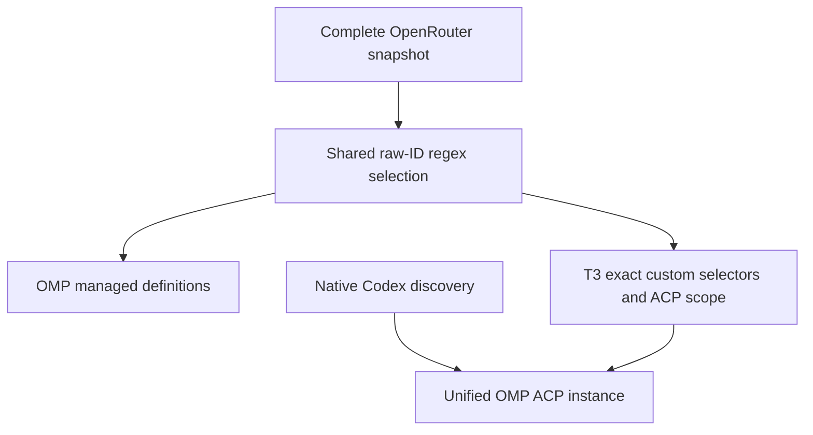

# Unified OMP Model Selection - Plan

## Goal Capsule

- **Objective:** Use one OMP entry for Codex, Synthetic, and selected OpenRouter models, with a consistent startup default.
- **Means:** Consolidate the T3 OMP instances and filter managed OpenRouter definitions through declared regular expressions.
- **Product authority:** The confirmed conversation establishes this contract; subsequent instructions defer actual T3 display verification and permit dropping old conversation records.
- **Open blockers:** None. The user authorized implementation, publication, and merging after readiness.

## Product Contract

### Summary

Unify T3's OMP entries and restrict OpenRouter to the declared model selection.
Use Codex GPT Astra with low reasoning effort as the OMP default.

### Problem Frame

T3 currently separates API and Codex OMP sessions to avoid a discovery limit while registering the entire OpenRouter snapshot.
The user wants one OMP entry and only the selected OpenRouter-owned model family.

### Key Decisions

- **One OMP entry.** Governs R1, R2. (session-settled: user-approved — chosen over separate API and Codex entries: the user wants one entry after considering the discovery-limit rationale.)
- **Filter OpenRouter by catalog model ID.** Governs R3, R4. (session-settled: user-directed — chosen over the complete OpenRouter catalog: retain the OpenRouter-owned model family while excluding its bodybuilder endpoint.)
- **Use the Codex startup default.** Governs R5. (session-settled: user-directed — chosen over the T3 OMP Synthetic default: match the requested GPT Astra low selection.)

### Requirements

**Instance and startup behavior**

- R1. T3 offers one OMP entry for new work across native Codex subscription models, the existing Synthetic selection, and the OpenRouter selection governed by R3 and R4.
- R2. Consolidation preserves existing authentication; old conversation records need no preservation or migration.
- R5. OMP defaults to `openai-codex/gpt-6-astra` with reasoning effort `low`, including its T3 entry and ordinary CLI.

**OpenRouter selection**

- R3. Managed OpenRouter model definitions and T3 model configuration include only catalog model IDs matched by declared allow regular expressions; the initial allow expression is `^openrouter/.*$`.
- R4. Exclude the exact catalog model ID `openrouter/bodybuilder` from R3's selection, even though it matches the allow expression.
- R6. Apply R3 and R4 consistently when catalog data is refreshed, without restoring the full catalog as managed definitions.

### Acceptance Examples

- AE1. **Covers R3, R4.** The current snapshot yields `openrouter/auto`, `openrouter/auto-beta`, `openrouter/free`, `openrouter/fusion`, and `openrouter/pareto-code`; `openrouter/bodybuilder` is absent from generated definitions and T3 model configuration.
- AE2. **Covers R3, R6.** A newly cataloged model outside the `openrouter/` model-ID namespace remains excluded even though its provider is OpenRouter.
- AE3. **Covers R3, R4, R6.** A newly cataloged ID matching the allow expression is included unless excluded by R4; the current five-model result is not a fixed allowlist.
- AE4. **Covers R1, R2, R5.** Applying the consolidated configuration preserves authentication and configures new OMP work with the required default, without migrating old conversation references.

### Scope Boundaries

- Preserve the existing Synthetic model scope and native Codex subscription discovery; this work does not introduce a local Codex model catalog.
- Other T3 providers and T3's overall default provider selection are outside this change.
- Raw catalog snapshot retention and filtering placement are implementation choices, provided R3, R4, and R6 hold.
- Actual T3 picker display verification is deferred to a follow-up issue at the user's request. It is not an acceptance gate for this change, and generated configuration evidence must not be reported as observed UI behavior.

### Deferred Follow-up Issue

**Title:** Verify unified OMP model display in T3.

After the implementation is available, inspect the actual T3 picker for the unified OMP entry, native Codex models, existing Synthetic models, and the selected OpenRouter models.
Check that `bodybuilder` is absent and record any discovery truncation or model-option display discrepancies.
Track this separately from implementation verification in [issue #351](https://github.com/hyperlapse122/nix-config/issues/351).

### Sources / Research

- `home/h82/t3code.nix`: the current two-instance setup, API custom selectors, and separate Codex discovery scope.
- `home/h82/agents/omp.nix`: the ordinary CLI already declares the requested Codex model and low effort.
- `home/h82/agents/openrouter-catalog.json`: the inspected snapshot contains 467 entries, including six IDs in the `openrouter/` namespace before the R4 exclusion.
- `home/h82/agents/omp-declarations.py`: the managed API model-definition generator.
- `.compound-engineering/artifacts/plans/2026-10-25-1735-feat-omp-managed-agent-plan.md`, KTD5: the recorded discovery-cap rationale for splitting the instances.

---

## Planning Contract

### Key Technical Decisions

- KTD1. Select raw catalog rows once in a shared Nix catalog module using declared regular expressions and an exact exclusion, then feed those selected rows to both the existing Python renderer and T3 selector generation. This implements R3, R4, and R6 without two regex engines or changes to complete upstream snapshots.
- KTD2. Keep instance ID `omp` and retire `omp-codex` through the existing targeted settings retirement mechanism. Do not migrate thread references or delete shared OMP auth/state directories; R2 does not require record cleanup.
- KTD3. Narrow the unified ACP launch scope to native Codex, existing Synthetic models, and exact selected OpenRouter selectors. A raw ID such as `openrouter/free` becomes `openrouter/openrouter/free` after the provider prefix; filtering the prefix instead of the raw ID would violate R3.
- KTD4. Set the unified ACP overlay to the default in R5 and pass explicit `--model openai-codex/gpt-6-astra --thinking low` startup arguments, keeping the already-correct ordinary CLI default. Verify against the pinned runtime that missing Codex authentication cannot select the first available paid API model from the combined scope. Preserve metadata overrides for selected bundled models and native Codex metadata ownership.

### High-Level Technical Design

### Assumptions and Execution-time Evidence

- Reuse the existing settings merger and reconciler rather than adding migration machinery. Existing retirement and document replacement patterns support this choice.
- The ordinary CLI may still discover built-in models not represented in managed definitions; removing OMP's upstream catalog is outside R3.
- Verify combined ACP discovery and default selection using isolated fake-credential protocol fixtures. Inspect the pinned T3 discovery bounds if needed; no actual picker observation is required in this change.
- No new framework or external API behavior is needed. Local generation, retirement, and ACP patterns supply the implementation guidance; external research is not needed.

---

## Implementation Units

### U1. Select managed OpenRouter models

**Goal:** Implement R3, R4, and R6 at the shared catalog boundary.

**Dependencies:** None.

**Files:** `home/h82/agents/omp-model-catalogs.nix` (new), `home/h82/agents/omp-declarations.nix`, `home/h82/agents/omp-declarations.py` if documentation needs updating, `tests/omp_models_load.py`, and `tests/omp-models-load.nix` if its fixture wiring changes.

**Approach:** Apply KTD1 before the renderer receives rows. Keep raw snapshots complete and retain existing metadata conversion and credential helpers.

**Test scenarios:**

- Covers AE1: generated managed definitions contain the five expected selected IDs and no other OpenRouter IDs.
- Covers AE2, AE3: controlled matching, nonmatching, and excluded rows distinguish regex selection from a hardcoded five-ID list.
- Selected model metadata still loads in the pinned OMP runtime; native Codex definitions remain absent from managed API documents.

**Verification:** Extend the existing generated-document/runtime checks, with negative controls that detect a widened selection and a removed exclusion.

### U2. Consolidate the T3 OMP instance

**Goal:** Implement R1, R2, and R5 with the selected catalog from U1.

**Dependencies:** U1.

**Files:** `home/h82/t3code.nix`, `tests/t3code-traits.nix`, `tests/omp-acp.py`, and `tests/omp-acp.nix` if fixture wiring changes.

**Approach:** Apply KTD2 through KTD4 using the existing activation merger. Retain the protocol exercise of Synthetic tools and resume by selecting that model explicitly instead of treating it as the startup default.

**Test scenarios:**

- Covers AE4: seeded two-instance settings converge to one enabled OMP entry while auth and unrelated settings survive.
- Covers AE1: unified launch scope and custom selectors contain only the selected OpenRouter subset plus the existing Synthetic set, with Codex discovered natively.
- A new ACP session starts with R5; absent Codex authentication must not silently route a request to a paid API model.
- Explicit Synthetic selection still supports native tools, MCP results, cancellation, and session resume in the existing isolated fixture.

**Verification:** Run the materialized settings and real pinned ACP checks; do not use source greps as substitutes for activation behavior.

### U3. Update documentation and track deferred display verification

**Goal:** Describe the unified configuration and publish the follow-up issue specified by Scope Boundaries.

**Dependencies:** U1, U2.

**Files:** `docs/provisioning.md`, `docs/verification.md`, `CONCEPTS.md` if catalog terminology needs refinement, and this plan's follow-up issue link.

**Approach:** Replace current two-instance and complete-managed-OpenRouter claims. Keep complete snapshot maintenance distinct from filtered managed definitions. Refresh affected solution documents separately before push under repository policy.

**Test expectation:** No new tests for prose; run affected documentation consumer checks and Markdown lint.

**Verification:** The PR names the follow-up issue and distinguishes generated/protocol evidence from unobserved T3 display behavior.

---

## Verification Contract

- Run `nix build --no-link .#checks.x86_64-linux.omp-models-load .#checks.x86_64-linux.omp-acp .#checks.x86_64-linux.t3code-traits .#checks.x86_64-linux.omp-settings` for affected behavior.
- Run `git diff --check`, changed Markdown lint, and `nix fmt -- --ci` before publishing.
- Use scratch copies without a copied worktree `.git` pointer for negative controls; read the repository's check-authoring learnings and `test-audit` before modifying tests.
- Require current-head CI and the complete platform evidence specified by `docs/verification.md#publishing-and-merge-readiness` before merging. Report unavailable local platforms as pending CI evidence.
- Actual T3 picker display and authenticated provider requests are not established by fake-credential ACP fixtures. Track the former in the requested follow-up issue and report hardware evidence separately.

## Definition of Done

- U1 and U2 satisfy their generated configuration and protocol checks, with no abandoned experiment code left in the diff.
- U3 documents the new behavior and links the display-verification follow-up issue.
- Simplification and code review findings are assessed and substantiated fixes applied; any unapplied findings are recorded with reasons.
- The PR has the required successful current-head evidence, no unresolved review or branch-currency blocker, and is merged under the user's explicit authorization.
