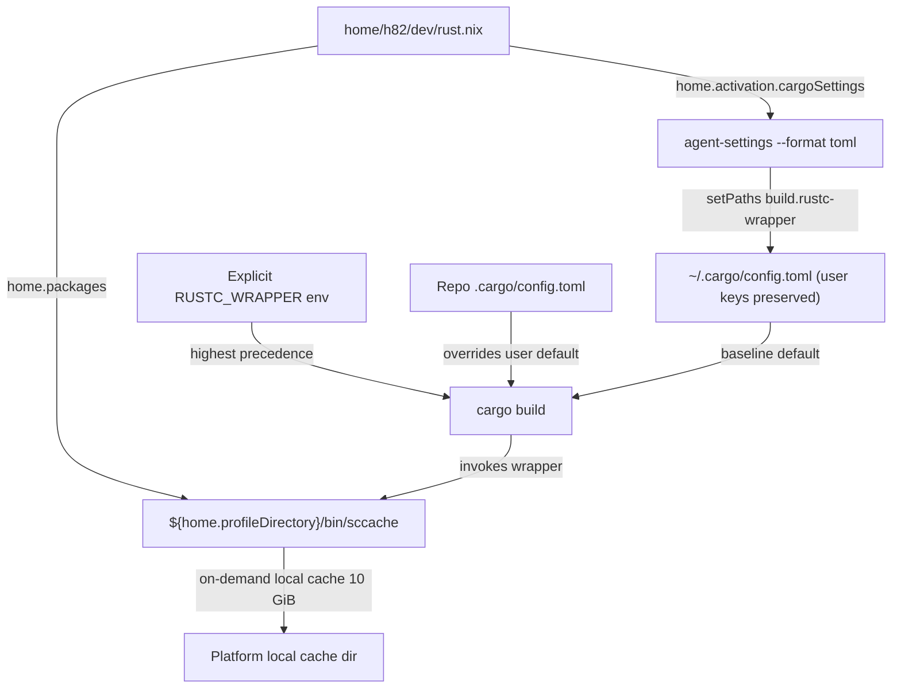

# Rust sccache Compilation Cache - Plan

## Goal Capsule

- **Objective:** Across every personal host, Cargo builds reuse compiled Rust crate artifacts across worktrees and repositories on the same machine without manual wrapper setup or losing fast incremental local edits.
- **Means:** Install `sccache` on every host profile and merge a profile-backed `build.rustc-wrapper` default into `~/.cargo/config.toml` during Home Manager activation (KTD1, KTD2).
- **Authority:** Settled user decisions in this plan, `AGENTS.md`, then existing patterns in `home/h82/agents/codex.nix` and `tests/codex-settings.nix`.
- **Stop conditions:** Stop if Home Manager activation cannot update `~/.cargo/config.toml` without clobbering user settings, if any settled decision is invalidated, or if any host evaluation or check fails.
- **Execution profile:** Standard depth across three units covering declarative Rust configuration, cross-platform Nix checks with mutation testing, and provisioning and verification documentation.
- **Finishes and ships:** `ce-work` implements and verifies locally; the LFG pipeline simplifies, reviews, opens the PR, and watches CI while leaving merge to the user.

---

## Product Contract

### Summary

Install `sccache` across all host configurations and register it as the default Cargo `rustc` wrapper in the user's Cargo configuration. Use `sccache`'s default local disk cache while keeping Cargo's default incremental compilation and preserving user-authored Cargo settings.

### Problem Frame

Each Git worktree, T3 Code worktree, and repository checkout starts with an isolated `target/` directory. Clean checkouts, new worktrees, `cargo install` runs, and release builds recompile identical third-party Rust dependencies from scratch on the same host. Exporting a wrapper variable manually per shell misses GUI editors and desktop coding agents, while replacing `~/.cargo/config.toml` with a read-only file would clobber registries, aliases, or other local Cargo settings.

### Key Decisions

- **Automatic Cargo wrapper with default incremental compilation.** Enable `sccache` by default for Cargo while keeping default incremental behavior and leaving C/C++ compilers unwrapped so dependency and release crates hit the cache without slowing local edits. (session-settled: user-approved — chosen over binary-only opt-in, forcing `CARGO_INCREMENTAL=0`, or global C/C++ compiler wrapping: caches dependency and release crates across worktrees automatically while preserving fast local incremental builds and C/C++ build compatibility.) Governs R1, R2, R4.
- **Partial ownership of user Cargo configuration.** Declare only the default wrapper key in the user's Cargo configuration rather than exporting a session-wide environment variable so GUI apps and shells share one default without overriding per-repository wrappers. (session-settled: user-approved — chosen over session-wide `RUSTC_WRAPPER` environment variables or whole-file replacement: reaches shells and GUI tools on every OS while respecting repository-level Cargo configs and user-authored Cargo settings.) Governs R2, R3, R5.
- **On-demand local disk cache with upstream defaults.** Rely on `sccache`'s built-in local storage and idle-exiting server because the primary Linux x86_64 and macOS ARM64 hosts do not share native Rust target artifacts. (session-settled: user-approved — chosen over remote S3-compatible backends or persistent background services: avoids secret, network, and service maintenance with no loss of native cache hits.) Governs R6.

### Requirements

**Installation and default Cargo behavior**

- R1. Every host configuration across NixOS, non-NixOS Linux, and macOS (production and bootstrap variants alike) places `sccache` on the user's `PATH`.
- R2. Applying the user environment configures Cargo's user-level default `rustc` wrapper in `~/.cargo/config.toml` to invoke `sccache` so shells, user services, and GUI applications use it automatically.

**Compatibility and overrides**

- R3. Reapplying the user environment updates only the declared wrapper key in `~/.cargo/config.toml` while preserving comments and all other user-authored tables and keys.
- R4. Cargo's default incremental compilation behavior and global C/C++ compiler settings remain unmodified.
- R5. Per-repository `.cargo/config.toml` wrapper settings and explicit `RUSTC_WRAPPER` environment overrides continue to take precedence over the user-level default.

**Cache runtime and verification**

- R6. `sccache` operates on demand with its upstream local disk cache path and 10 GiB limit, without a persistent background service or remote cache backend.
- R7. Automated repository checks verify `sccache` presence on `PATH` and the materialized `~/.cargo/config.toml` merge behavior across host configurations, proven with mutation rounds.

### Acceptance Examples

- AE1. Cross-worktree dependency cache hit
  - **Covers:** R1, R2, R4
  - **Given:** Two clean Rust checkouts on the same host after applying the user environment, with no `RUSTC_WRAPPER` set in the shell.
  - **When:** `cargo build` compiles shared library dependencies in the first checkout and then runs in the second checkout.
  - **Then:** Cargo invokes `sccache` automatically for cacheable `rlib` crates so the second checkout reuses cached artifacts, while workspace crates in `dev` profile keep Cargo's default incremental compilation.
- AE2. Preservation of user Cargo settings
  - **Covers:** R3
  - **Given:** `~/.cargo/config.toml` already contains user-authored comments, tables, and keys outside the wrapper setting.
  - **When:** Home Manager activation applies the user environment.
  - **Then:** The default `rustc` wrapper entry matches the declared `sccache` setting and all unowned comments, tables, and keys remain intact.
- AE3. Repository and environment override precedence
  - **Covers:** R2, R5
  - **Given:** A repository whose `.cargo/config.toml` specifies a different `build.rustc-wrapper`, or a command invoked with `RUSTC_WRAPPER=""`.
  - **When:** `cargo build` runs in that repository or command environment.
  - **Then:** Cargo honors the repository wrapper or explicit environment override instead of forcing the user-level `sccache` default.

### Scope Boundaries

- No remote or distributed cache backends (such as S3, R2, GCS, or Redis) and no SOPS secret provisioning for `sccache`.
- No global `CARGO_INCREMENTAL=0` override.
- No global C/C++ compiler wrapping (`CC`, `CXX`) or CMake compiler launcher (`CMAKE_C_COMPILER_LAUNCHER`, `CMAKE_CXX_COMPILER_LAUNCHER`) defaults.
- No custom `SCCACHE_DIR` or `SCCACHE_CACHE_SIZE` overrides and no persistent `systemd` or `launchd` service units for `sccache`.
- Considered and not built: automatic migration of legacy extensionless `~/.cargo/config` files, because Cargo has preferred `config.toml` since Rust 1.39 and prints an explicit stderr warning whenever an extensionless `config` file shadows `config.toml`; revisit only if a managed tool writes `~/.cargo/config`.
- Considered and not built: stopping `sccache` during Home Manager activation via `sccache --stop-server`, because that command exits non-zero when no server is running and would abort active builds, whereas `sccache`'s 600-second idle timeout and wire-protocol handshake handle upgrades cleanly; revisit only if an upstream `sccache` release breaks wire compatibility without restarting.
- Considered and not built: spawning a live `sccache` daemon and compiling translation units inside `tests/cargo-settings.nix`, because upstream `pkgs.sccache` already tests compiler caching at package build time and starting a loopback daemon inside a check builder adds unnecessary toolchain dependencies and port contention beyond R7; live Cargo caching is verified post-apply in `docs/verification.md`.
- Key Flows are omitted because `sccache` runs transparently inside single `cargo` invocations rather than introducing a multi-step user workflow; Requirements and Acceptance Examples specify activation and override precedence completely.

### Sources

- Current Rust user configuration: `home/h82/dev/rust.nix` and `home/h82/dev/default.nix`.
- Partial TOML ownership pattern in Home Manager activation: `scripts/agent-settings` (`--format toml`) and `home/h82/agents/codex.nix`.
- Cross-platform package and activation checks: `tests/codex-settings.nix`, `tests/lib/agent-activation.nix`, `tests/darwin-config.nix`, `tests/darwin-outputs.nix`, `tests/non-nixos-outputs.nix`, `tests/check-shards.nix`, and `modules/shared/darwin-apps.nix`.
- Institutional learnings: `.compound-engineering/artifacts/solutions/best-practices/activation-step-grep-check-passes-an-echo-only-step.md`, `.compound-engineering/artifacts/solutions/best-practices/unguarded-derivation-interpolation-defeats-nix-check-mutation-testing.md`, `.compound-engineering/artifacts/solutions/best-practices/converged-fixture-state-defeats-nix-check-mutation-testing.md`, and `.compound-engineering/artifacts/solutions/best-practices/home-manager-activation-does-not-run-on-every-rebuild.md`.
- Upstream Cargo and `sccache` documentation: <https://doc.rust-lang.org/cargo/reference/config.html#buildrustc-wrapper>, <https://github.com/mozilla/sccache/blob/main/docs/Rust.md>, and <https://github.com/mozilla/sccache/blob/main/docs/Local.md>.

---

## Planning Contract

- **Product Contract preservation:** Product Contract unchanged aside from recording three considered-and-not-built implementation mechanisms under Scope Boundaries.

### Key Technical Decisions

- KTD1. **Merge `build.rustc-wrapper` into `~/.cargo/config.toml` through `scripts/agent-settings --format toml` in `home.activation.cargoSettings` ordered after `installPackages`.** Reuses the repository's `tomlkit` compare-and-swap merger from `home/h82/agents/codex.nix`, creating `~/.cargo/config.toml` with mode `0600` when absent, preserving comments and unowned tables when present, respecting `DRY_RUN`, and propagating non-zero exit codes without stranding `installPackages` or `linkGeneration`. (session-settled: user-approved — chosen over session-wide `RUSTC_WRAPPER` environment variables or whole-file replacement: reaches shells and GUI tools on every OS while respecting repository-level Cargo configs and user-authored Cargo settings.) Governs R2, R3.
- KTD2. **Declare `build.rustc-wrapper` as `"${config.home.profileDirectory}/bin/sccache"` rather than a bare command name or a raw `/nix/store` hash.** Evaluates to `/etc/profiles/per-user/<user>/bin/sccache` on NixOS and macOS and `/home/<user>/.nix-profile/bin/sccache` on standalone non-NixOS Linux, giving GUI editors, desktop agents, and non-login user services an absolute executable path without `PATH` lookup while surviving generation rollbacks and `nix-collect-garbage` without rewriting `~/.cargo/config.toml` on every `sccache` bump. Governs R1, R2, R5.
- KTD3. **Verify materialized binaries, activation runtime effects, and cross-platform coverage across host closures.** Combine `tests/lib/agent-activation.nix` sandbox execution with `home.path` executable verification in `tests/cargo-settings.nix` (listed in `hostClosureChecks` in `flake.nix` because reading `home.path` pulls host user closures), paired with Darwin option checks in `tests/darwin-config.nix`, Darwin materialized output checks in `tests/darwin-outputs.nix`, and non-NixOS fixture checks in `tests/non-nixos-outputs.nix`. Governs R1, R2, R3, R4, R5, R6, R7.

### High-Level Technical Design

### Assumptions

- On NixOS hosts, `home.activation.cargoSettings` reasserts `~/.cargo/config.toml` only when a rebuild produces a new Home Manager generation, matching the repository's documented `Activation reassertion` behavior in `CONCEPTS.md`; non-NixOS Linux and macOS applies run activation on every `nr switch`.
- Because `home/h82/dev/rust.nix` is imported unconditionally on NixOS, non-NixOS Linux, and macOS via `home/h82/dev/default.nix`, `pkgs.sccache` appears on both NixOS and non-NixOS Linux user profiles and requires no entry in `modules/shared/darwin-apps.nix`.

### Sequencing

1. U1 updates `home/h82/dev/rust.nix` to install `pkgs.sccache` and register `home.activation.cargoSettings`.
2. U2 adds `tests/cargo-settings.nix`, extends `tests/darwin-config.nix`, `tests/darwin-outputs.nix`, and `tests/non-nixos-outputs.nix`, registers the check in `flake.nix`, and proves every assertion class with mutation rounds in an isolated scratch copy.
3. U3 documents the Rust and Cargo configuration ownership in `docs/provisioning.md` and the check and hardware verification steps in `docs/verification.md`.

---

## Implementation Units

### U1. Configure `sccache` and partial `~/.cargo/config.toml` ownership

- **Goal:** Install `sccache` on every host configuration and configure Cargo's user-level default `rustc` wrapper during Home Manager activation without touching unowned Cargo settings or environment variables.
- **Requirements:** R1, R2, R3, R4, R5, R6 (KTD1, KTD2).
- **Dependencies:** none.
- **Files:** `home/h82/dev/rust.nix`.
- **Approach:**
  1. Add `pkgs.sccache` alongside `pkgs.rustup` in `home.packages` inside `home/h82/dev/rust.nix`.
  2. Import `agentSettings` from `packages/agent-tools.nix` and render a JSON declaration setting path `["build", "rustc-wrapper"]` to `"${config.home.profileDirectory}/bin/sccache"`.
  3. Define `home.activation.cargoSettings` with `lib.hm.dag.entryAfter [ "installPackages" ]`, guarded by `if [[ ! -v DRY_RUN ]]; then`, invoking `agent-settings --format toml --label Cargo --settings ${config.home.homeDirectory}/.cargo/config.toml` without exit-status suppression.
  4. Leave `home.sessionVariables`, `systemd.user.sessionVariables`, `home.file`, and `modules/shared/darwin-apps.nix` untouched for `CARGO_INCREMENTAL`, `RUSTC_WRAPPER`, `CC`/`CXX`, and `SCCACHE_*`.
- **Patterns to follow:** `home/h82/agents/codex.nix` (`codexSettings` TOML activation merge and `DRY_RUN` guard).
- **Test scenarios:**
  - Every `configurations.userEntries` host (NixOS and non-NixOS Linux, production and bootstrap) carries an executable `bin/sccache` in `home.path`, and macOS fixtures include `sccache` in `home.packages` (verified in U2).
  - Running `cargoSettings` against an absent `~/.cargo/config.toml` creates the file with `build.rustc-wrapper` set to `"${config.home.profileDirectory}/bin/sccache"` (verified in U2).
  - Running `cargoSettings` against a seeded `~/.cargo/config.toml` containing comments, `[build] jobs = 4`, and unowned tables such as `[net]` and `[alias]` updates `build.rustc-wrapper` while preserving every comment and unowned key (verified in U2).
  - Running `cargoSettings` with `DRY_RUN=1` performs zero helper calls and modifies no files (verified in U2).
- **Verification:** `home/h82/dev/rust.nix` formats cleanly with `nix fmt -- --ci`, evaluates across NixOS, Linux, and Darwin configurations, and passes U2's checks.

### U2. Add cross-platform repository checks and mutation rounds

- **Goal:** Guard `sccache` installation, `cargoSettings` activation behavior, absence of conflicting session or symlink declarations, and cross-platform parity with mutation-tested Nix checks.
- **Requirements:** R1, R2, R3, R4, R5, R6, R7; AE1, AE2, AE3 (KTD1, KTD2, KTD3).
- **Dependencies:** U1.
- **Files:** `tests/cargo-settings.nix`, `tests/darwin-config.nix`, `tests/darwin-outputs.nix`, `tests/non-nixos-outputs.nix`, `flake.nix`.
- **Approach:**
  1. Create `tests/cargo-settings.nix` iterating `configurations.userEntries` with `configurations.userGuard`, `or` fallbacks, and `lib.optionalString` guards so mutations fail inside the builder rather than during evaluation.
  2. Assert per entry that `home.path` contains an executable `bin/sccache`, `home.activation.cargoSettings` exists and orders after `installPackages`, invokes `/bin/agent-settings` with `--format toml`, targets `${userConfig.home.homeDirectory}/.cargo/config.toml`, matches the expected per-host `declared` JSON (`${userConfig.home.profileDirectory}/bin/sccache`), never swallows exit status, leaves `.cargo/config.toml` untargeted by `home.file`, and defines no `RUSTC_WRAPPER`, `CARGO_BUILD_RUSTC_WRAPPER`, `CARGO_INCREMENTAL`, `SCCACHE_DIR`, `SCCACHE_CACHE_SIZE`, `CC`, `CXX`, or `CMAKE_*_COMPILER_LAUNCHER` session variables.
  3. Execute each entry's `cargoSettings` block through `tests/lib/agent-activation.nix` against a divergent seeded TOML document containing comments, a stale `build.rustc-wrapper`, a sibling `build.jobs` key, and unowned tables.
  4. Extend `tests/darwin-config.nix` and `tests/non-nixos-outputs.nix` to assert `sccache` package presence and `cargoSettings` activation wiring on macOS and non-NixOS Linux fixtures, and extend `tests/darwin-outputs.nix` to assert `bin/sccache` in the materialized macOS profile and runtime `cargoSettings` TOML merge execution in a scratch home.
  5. Register `cargo-settings` in `flake.nix` under `checks.x86_64-linux` and add `"cargo-settings"` to `hostClosureChecks` so CI builds it in the `hosts` shard without pulling host closures into a light shard.
- **Execution note:** Run mutation rounds in a disposable temporary directory without `.git` (or with its own isolated git state) per `.compound-engineering/artifacts/solutions/best-practices/copied-git-worktree-writes-the-real-index.md`, confirming each assertion class fails inside the builder for its own reason before restoring the clean tree.
- **Patterns to follow:** `tests/codex-settings.nix`, `tests/lib/agent-activation.nix`, `tests/git-lfs.nix`, `tests/darwin-config.nix`, and `tests/darwin-outputs.nix`.
- **Test scenarios:**
  - Happy path: `cargo-settings`, `darwin-config`, `non-nixos-outputs`, `check-shards-guard`, and `host-name-guard` pass on `x86_64-linux`.
  - Edge case (divergent TOML seed): seeded comments, `[build] jobs = 4`, `[alias]`, and `[net]` survive while `build.rustc-wrapper` updates from `"old-wrapper"` to `"${userConfig.home.profileDirectory}/bin/sccache"`, and a second run is byte-idempotent.
  - Edge case (dry run and refusal propagation): `DRY_RUN=1` leaves the seeded file untouched, and a forced merger exit code `73` fails the activation snippet.
  - Edge case (executable smoke): `$homePath/bin/sccache --version` exits 0 without starting a daemon.
  - Mutation rounds: removing `pkgs.sccache`, removing `home.activation.cargoSettings`, ordering `cargoSettings` before `installPackages`, replacing the merger call with `echo`, appending `|| true`, changing `build.rustc-wrapper` away from `${config.home.profileDirectory}/bin/sccache`, or adding a `home.file.".cargo/config.toml"` entry each fail inside the check builder with the intended diagnostic.
- **Verification:** `nix build --no-link .#checks.x86_64-linux.cargo-settings .#checks.x86_64-linux.darwin-config .#checks.x86_64-linux.non-nixos-outputs .#checks.x86_64-linux.check-shards-guard .#checks.x86_64-linux.host-name-guard` succeeds, and every mutation round fails in the builder for its own assertion class.

### U3. Update provisioning and verification documentation

- **Goal:** Document `sccache` and `~/.cargo/config.toml` partial ownership alongside the repository's verification coverage and post-apply hardware checks.
- **Requirements:** R2, R3, R5, R6, R7.
- **Dependencies:** U1, U2.
- **Files:** `docs/provisioning.md`, `docs/verification.md`.
- **Approach:**
  1. Add a `## Rust and Cargo` section in `docs/provisioning.md` describing `rustup` and `sccache` installation from `home/h82/dev/rust.nix`, partial ownership of `build.rustc-wrapper` in `~/.cargo/config.toml` via `agent-settings --format toml`, generational reassertion on NixOS versus unconditional apply reassertion on non-NixOS Linux and macOS, repository `.cargo/config.toml` and `RUSTC_WRAPPER` override precedence, external registry/Git `rlib` cache hits across worktrees versus same-checkout `--release` workspace `rlib` hits, and upstream local disk cache defaults (`~/.cache/sccache` on Linux, `~/Library/Caches/Mozilla.sccache` on macOS, 10 GiB limit, on-demand idle-exiting server).
  2. Update `docs/verification.md` to record `cargo-settings` check coverage plus an unchecked post-apply verification item building two scratch Cargo checkouts sharing an external crates.io or Git `rlib` dependency without manual environment variables and confirming `sccache --show-stats` records a Rust cache hit on the second checkout.
- **Patterns to follow:** `## VSCodium` in `docs/provisioning.md` and `## Repository checks` / `### Every host` in `docs/verification.md`.
- **Test scenarios:**
  - Test expectation: none -- prose documentation updates; verified by Markdown linting and consumer checks (`claude-effort-absent` and `agent-instructions`) that read `docs/`.
- **Verification:** `mise exec -- markdownlint-cli2 docs/provisioning.md docs/verification.md .compound-engineering/artifacts/plans/2026-10-26-1220-feat-rust-sccache-plan.md` and `nix build --no-link .#checks.x86_64-linux.claude-effort-absent .#checks.x86_64-linux.agent-instructions` pass.

---

## Verification Contract

| Gate | Command | Scope / Builder | Covers |
| --- | --- | --- | --- |
| Formatting | `nix fmt -- --ci` and `git diff --check` | Local `x86_64-linux` | U1, U2, U3 |
| Markdown lint | `mise exec -- markdownlint-cli2` on changed Markdown files | Local `x86_64-linux` | U3 |
| Flake evaluation | `nix flake check --no-build` | Local `x86_64-linux` | U1, U2 |
| Targeted & consumer checks | `nix build --no-link .#checks.x86_64-linux.cargo-settings .#checks.x86_64-linux.darwin-config .#checks.x86_64-linux.non-nixos-outputs .#checks.x86_64-linux.check-shards-guard .#checks.x86_64-linux.host-name-guard .#checks.x86_64-linux.session-variables .#checks.x86_64-linux.claude-effort-absent .#checks.x86_64-linux.agent-instructions` | Local `x86_64-linux` | R1-R7, U1-U3 |
| Declared Linux checks | `nix flake check` | Local `x86_64-linux` or CI `check-shards` | U1, U2, U3 |
| NixOS host outputs & VM checks | `nix build --no-link .#vmChecks.all` and every `.#nixosConfigurations.<host>.config.system.build.toplevel` | Local `x86_64-linux` (with `/dev/kvm`) or CI | U1, U2 |
| ARM64 Linux & macOS outputs | `checks.aarch64-linux.*`, `darwinConfigurations.<host>.system`, and `checks.aarch64-darwin.darwin-outputs` | CI `ubuntu-24.04-arm` and `macos-15` (`build-darwin`) | R1, R2, R7 |

---

## Definition of Done

- U1, U2, and U3 satisfy R1 through R7 and AE1 through AE3 with all session-settled decisions preserved.
- `tests/cargo-settings.nix` passes and each assertion class has been proven red in the builder via an isolated scratch mutation round, with zero mutation or experiment artifacts left in the working tree.
- Local formatting, whitespace, Markdown lint, flake evaluation, and supported Linux checks pass; platform-specific ARM64 Linux and macOS checks are verified via CI before declaring merge readiness, and post-apply hardware verification is reported separately per `docs/verification.md`.
