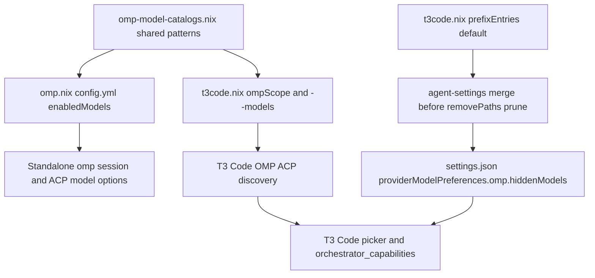

# Curate OMP Antigravity Models and Hide T3 Default Placeholder - Plan

## Goal Capsule

- **Objective:** Present only usable conversational models when selecting an OMP model in T3 Code and the standalone terminal `omp` CLI.
- **Means:** Share one curated OMP model allowlist admitting explicit conversational Antigravity families across standalone OMP and T3 Code, and merge `"default"` into T3 Code's OMP hidden-model preferences (KTD1, KTD2, KTD3).
- **Product authority:** Established by interactive `ce-brainstorm` scope confirmation on 2026-10-26; supersedes the earlier boundary that left standalone `omp` CLI session discovery unfiltered.
- **Product Contract preservation:** Clarified R2, R4, AE1, and AE3 to name interactive and ACP session model selection rather than the raw diagnostic `omp models` registry dump, and generalized AE1's conversational model count from a live-cached nine to every `gemini-*`, `claude-*`, and `gpt-*` chat model in the active catalog; no product scope change.
- **Stop conditions:** Stop if any session-settled decision is invalidated by runtime evidence or if a repository check fails without a valid fix.
- **Open blockers:** None.

---

## Product Contract

### Summary

Unify T3 Code's OMP provider instance and the standalone terminal `omp` CLI onto one curated model scope that allows conversational Antigravity model families (`gemini-*`, `claude-*`, and `gpt-*`).
Hide T3 Code's synthesized `Default` placeholder in its OMP model preferences while preserving any other models the user hides at runtime.

### Problem Frame

T3 Code's OMP model selector currently mixes usable chat models with two kinds of unusable or redundant entries.
First, T3 Code synthesizes a built-in `Default` entry (`default`) for ACP Registry instances before model discovery finishes or when discovery returns no list, which adds a redundant choice beside configured OMP models.
Second, the wildcard `google-antigravity/**` pattern exposes Antigravity's autocomplete-only `tab_*` models (`tab_flash_lite_preview` and `tab_jump_flash_lite_preview`), which cannot run agent turns, while the standalone terminal `omp` CLI carries no model filter at all and exposes those `tab_*` entries plus roughly 580 uncurated bundled OpenRouter vendor models.

### Key Decisions

- **Apply model curation across both T3 Code and the standalone CLI** (session-settled: user-directed — chosen over restricting only T3 Code's OMP instance: removes unusable models from terminal `omp` usage as well). Governs R1, R3.
- **Share one curated model scope across T3 Code and the standalone CLI** (session-settled: user-approved — chosen over excluding only `tab_*` in the standalone CLI while keeping uncurated bundled OpenRouter vendor models: keeps model availability identical across both OMP surfaces). Governs R3, R4.
- **Allow explicit conversational Antigravity model families** (session-settled: user-directed — chosen over excluding only the `tab_*` prefix or hiding models only in T3 Code's UI: blocks `tab_*` and any future non-conversational Antigravity models regardless of naming). Governs R1, R2.
- **Include `gemini-*`, `claude-*`, and `gpt-*` in the Antigravity allowlist.** Retains all current conversational Antigravity models, including `gpt-oss-120b`, while accepting that a future conversational family under a new prefix requires an explicit allowlist update. Governs R1.

### Requirements

**Antigravity and shared OMP model scope**

- R1. The declared OMP model scope allows `google-antigravity` models only when their model ID matches `gemini-*`, `claude-*`, or `gpt-*`, replacing the wildcard `google-antigravity/**` pattern.
- R2. Autocomplete and other non-conversational `google-antigravity` models outside R1, including `tab_flash_lite_preview` and `tab_jump_flash_lite_preview`, are absent from OMP session model selection in the standalone CLI, T3 Code's OMP model selector, and T3 Code orchestration capability queries.
- R3. Both T3 Code's OMP provider instance and the standalone terminal `omp` CLI enforce the same curated model scope across Synthetic models, R1's Antigravity families, native OpenAI Codex discovery, and the declared OpenRouter selection.
- R4. Uncurated bundled OpenRouter vendor models outside the declared `openrouter/*` selection are excluded from standalone terminal `omp` CLI session model selection as well as T3 Code.

**T3 Code `Default` placeholder hiding**

- R5. T3 Code's OMP model preferences hide the synthesized `default` model entry so `Default` does not appear in T3 Code's OMP model selector or orchestration capability listings.
- R6. Rebuilding or re-applying configuration preserves any other model entries the user has hidden under T3 Code's OMP model preferences, and remains idempotent across repeated applies.

**Preserved startup and documentation behavior**

- R7. OMP's default model and thinking level (`openai-codex/gpt-6-astra` at `low`) and T3 Code's global default model selection remain unchanged.
- R8. Repository provisioning documentation reflects that the standalone terminal `omp` CLI now shares the curated model scope rather than exposing unfiltered bundled models in session selection.

### Acceptance Examples

- AE1. Conversational Antigravity models stay selectable while `tab_*` models are excluded
  - **Covers:** R1, R2, R3
  - **Given:** The pinned OMP catalog containing `gemini-*`, `claude-*`, `gpt-oss-120b`, `tab_flash_lite_preview`, and `tab_jump_flash_lite_preview` under `google-antigravity`.
  - **When:** Available session models are resolved in the standalone `omp` CLI or queried through T3 Code's OMP instance.
  - **Then:** Every `gemini-*`, `claude-*`, and `gpt-*` chat model in the active catalog (18 in pinned `omp` 18.12.6's offline bundled catalog, including `gpt-oss-120b`) is present, and both `tab_*` models are absent.
- AE2. Future Antigravity model additions follow family allowlisting
  - **Covers:** R1, R2
  - **Given:** Upstream OMP adds a non-conversational Antigravity model outside `gemini-*`, `claude-*`, and `gpt-*`, or adds a new `gemini-*` model.
  - **When:** The configuration is built without editing the allowlist.
  - **Then:** The non-conversational model remains excluded and the new `gemini-*` model is included; a conversational model under an unlisted family prefix stays excluded until its prefix is added.
- AE3. Standalone `omp` CLI enforces the shared curated scope
  - **Covers:** R3, R4, R7
  - **Given:** Activated Home Manager OMP settings on a host.
  - **When:** Session-selectable models are resolved in the standalone `omp` CLI.
  - **Then:** Only the shared curated scope from R3 appears, uncurated bundled OpenRouter vendor models are absent, and the default model remains `openai-codex/gpt-6-astra` at `low`.
- AE4. T3 Code hides `Default` without clobbering user-hidden OMP models
  - **Covers:** R5, R6
  - **Given:** A T3 Code `settings.json` where the user previously hid another OMP model in the UI.
  - **When:** Home Manager activation runs once or repeatedly, including before live ACP discovery completes.
  - **Then:** `default` is present once in OMP's hidden models alongside the user's hidden model, `Default` is hidden from the OMP picker, and configured custom OMP models remain selectable.

### Scope Boundaries

- Upstream OMP and T3 Code packages and binaries are not patched or modified.
- Synthetic model selections, native OpenAI Codex discovery, and the declared OpenRouter selection (`^openrouter/.*$` excluding `openrouter/bodybuilder`) remain unchanged.
- Other T3 Code provider instances (`codex`, `claudeAgent`, and disabled providers) and their model preferences are untouched.
- Authentication storage and credential discovery for OMP and T3 Code remain unchanged.

### Sources / Research

- `home/h82/t3code.nix`: current `ompPatterns` (`google-antigravity/**`), `ompScope`, `customModels`, `declaration` helper, and `retiredPaths` entry for `providerModelPreferences.opencode`.
- `home/h82/agents/omp.nix` and `home/h82/agents/omp-model-catalogs.nix`: current common `~/.omp/agent/config.yml` declaration without `enabledModels`, and pure-Nix catalog selector module.
- `scripts/agent-settings`: `prefixEntries` list-merge semantics executing before `removePaths` pruning while preserving user-managed entries in `settings.json`.
- `docs/provisioning.md`: current OMP section describing standalone CLI discovery of bundled models outside managed definitions.
- `tests/omp-acp.py`, `tests/omp_settings_applied.py`, `tests/omp_models_load.py`, `tests/omp-activation.nix`, `tests/t3code-traits.nix`, and `tests/t3code-opencode-disabled.py`: existing materialized assertions on `ompPatterns`, reconciler drift restoration, catalog evaluation and metadata loading, NixOS activation VM equality, and `providerModelPreferences` merges.
- `.compound-engineering/artifacts/solutions/best-practices/activation-step-grep-check-passes-an-echo-only-step.md` and `.compound-engineering/artifacts/solutions/best-practices/home-manager-activation-does-not-run-on-every-rebuild.md`: institutional learnings governing materialized activation checks and reassertion documentation.

---

## Planning Contract

### Key Technical Decisions

- KTD1. **Export the shared `patterns` list from `home/h82/agents/omp-model-catalogs.nix`** (session-settled: user-directed — chosen over keeping T3-only patterns or excluding only `tab_*`: defines one pure-Nix source of truth with explicit `google-antigravity/gemini-*`, `google-antigravity/claude-*`, and `google-antigravity/gpt-*` globs). Keeps `home/h82/t3code.nix` decoupled from `config.my.omp.*` options so standalone `moduleWith` evaluation in `tests/t3code-traits.nix` continues to evaluate cleanly. Governs R1, R2, R3.
- KTD2. **Declare `enabledModels` in `~/.omp/agent/config.yml` while retaining T3 Code's explicit ACP launch overlay** (session-settled: user-approved — chosen over leaving standalone CLI unfiltered: enforces the curated allowlist in standalone CLI sessions and ACP discovery alike). Keeping `ompScope` and `--models` in `home/h82/t3code.nix` insulates T3 Code sessions from runtime edits to the writable `~/.omp/agent/config.yml` between rebuilds. Governs R3, R4, R7.
- KTD3. **Wire `prefixEntries` through `home/h82/t3code.nix` to merge `"default"` into `providerModelPreferences.omp.hiddenModels`.** Extends `t3code.nix`'s `declaration` helper to forward `prefixEntries` to `scripts/agent-settings` with prefix `"default"` and value `"default"`, preserving user-hidden OMP models and coexisting with `providerModelPreferences.opencode` retirement. Governs R5, R6.
- KTD4. **Verify runtime model curation through ACP `session/new` options, reconciler checks, and NixOS VM activation rather than `omp models --json`.** Upstream OMP's `omp models` subcommand queries `modelRegistry.getAvailable()` directly without consulting `enabledModels`, whereas interactive `/model`, cycling, default resolution, and ACP `session/new` enforce `enabledModels`. Seeding isolated fake credentials in `tests/omp-acp.py` exercises both T3's ACP launch and standalone `omp --mode acp` against the pinned binary while keeping `tests/omp_models_load.py`'s API metadata and unmanaged-Codex runtime checks intact and asserting `patterns` in its controlled catalog evaluation. Governs R1, R2, R3, R4.

### High-Level Technical Design

### Assumptions

- Upstream OMP's diagnostic `omp models` subcommand dumps the raw provider registry without consulting `enabledModels`; standalone CLI curation governs interactive `/model` selection, `Ctrl+P` model cycling, startup and fallback resolution, and ACP `getAvailableModels()`, consistent with Scope Boundaries' rule against patching upstream binaries.
- All genuine OMP model selectors carry a `<provider>/<id>` prefix (`synthetic/`, `google-antigravity/`, `openrouter/`, `openai-codex/`), so `prefixEntries` with prefix `"default"` matches only T3 Code's synthesized `"default"` placeholder and cannot collide with real OMP model IDs.

---

## Implementation Units

### U1. Share curated OMP model patterns and standalone CLI scope

- **Goal:** Define the curated OMP model allowlist once with explicit conversational Antigravity families and apply it to both standalone OMP settings and T3 Code's OMP launch scope.
- **Requirements:** R1, R2, R3, R4, R7 (KTD1, KTD2, KTD4)
- **Dependencies:** None.
- **Files:** `home/h82/agents/omp-model-catalogs.nix`, `home/h82/agents/omp.nix`, `home/h82/t3code.nix`, `tests/omp_models_load.py`, `tests/omp_settings_applied.py`, `tests/omp-acp.py`, `tests/omp-activation.nix`
- **Approach:**
  1. Export `patterns` from `home/h82/agents/omp-model-catalogs.nix` combining `synthetic/**`, `google-antigravity/gemini-*`, `google-antigravity/claude-*`, `google-antigravity/gpt-*`, derived `openrouter/<id>` selectors, and `openai-codex/*` per KTD1.
  2. Import `omp-model-catalogs.nix` in `home/h82/agents/omp.nix` and declare `enabledModels` in `config.yml` alongside the unchanged `openai-codex/gpt-6-astra` `low` default per KTD2.
  3. Point `ompPatterns` in `home/h82/t3code.nix` at the shared `patterns` export so `ompScope` and `--models` stay identical to `config.yml`.
  4. Assert the exported `patterns` list in `tests/omp_models_load.py`'s controlled catalog evaluation step, populate `expected["enabledModels"]` in `tests/omp-activation.nix` from `(import ../home/h82/agents/omp-model-catalogs.nix).patterns`, and extend `tests/omp_settings_applied.py` and `tests/omp-acp.py` per KTD4 to verify reconciler drift restoration and real runtime filtering across both T3's ACP command and standalone `omp` without `--config` or `--models`.
- **Patterns to follow:** Pure Nix catalog selection in `home/h82/agents/omp-model-catalogs.nix`; `nix-instantiate --eval` harness in `tests/omp_models_load.py`; `omp config get` assertions in `tests/omp_settings_applied.py`; isolated ACP `session/new` inspection in `tests/omp-acp.py`; expected `config.yml` dictionary check in `tests/omp-activation.nix`.
- **Test scenarios:**
  - Covers AE1: With isolated fake Synthetic, OpenRouter, and Google Antigravity credentials in scratch storage, both T3's ACP launch and standalone `omp --mode acp` without `--config` or `--models` advertise every bundled `google-antigravity` chat model matching `gemini-*`, `claude-*`, and `gpt-*` (derived dynamically from offline `omp models --json`, 18 models in `omp` 18.12.6 including `gpt-oss-120b`) plus the declared Synthetic and OpenRouter selectors, while `tab_flash_lite_preview` and `tab_jump_flash_lite_preview` appear in the raw bundled catalog and are absent from ACP `session/new`.
  - Covers AE2: Evaluating `omp-model-catalogs.nix` against controlled catalog rows in `tests/omp_models_load.py` includes matching OpenRouter selectors and preserves the three explicit Antigravity family globs without admitting `google-antigravity/**` or `tab_*`.
  - Covers AE3: Standalone `omp --mode acp` reading only the reconciled `~/.omp/agent/config.yml` with isolated fake Codex, Synthetic, and OpenRouter credentials excludes uncurated bundled OpenRouter vendor models and starts on `openai-codex/gpt-6-astra` at `low`, while T3 Code's explicit `--model` ACP launch retains its absent-Codex-authentication no-API-fallback check.
  - Drifting `enabledModels` in `~/.omp/agent/config.yml` and re-running the materialized `ompSettings` activation (and `vmChecks.omp-activation` switch) restores the declared `enabledModels` list.
- **Verification:** Materialized `omp-settings`, `omp-models-load`, `omp-acp`, and `vmChecks.omp-activation` checks pass, and mutation rounds widening `patterns` or removing `enabledModels` from `omp.nix` fail the corresponding runtime assertions.

### U2. Hide T3 Code's synthesized `Default` entry for OMP

- **Goal:** Merge `"default"` into `providerModelPreferences.omp.hiddenModels` during T3 Code settings activation without overwriting user-hidden models or breaking retired preference cleanup.
- **Requirements:** R5, R6, R7 (KTD3)
- **Dependencies:** U1.
- **Files:** `home/h82/t3code.nix`, `tests/t3code-traits.nix`, `tests/t3code-opencode-disabled.py`, `tests/omp-acp.py`
- **Approach:**
  1. Add optional `prefixEntries` support to the `declaration` helper in `home/h82/t3code.nix` and declare a `prefixEntries` rule for `["providerModelPreferences" "omp" "hiddenModels"]` with prefix `"default"` and value `"default"` in `merges.t3codeSettings` per KTD3.
  2. Update `settingsExpectedBase` and `selectionSeed` coverage in `tests/t3code-traits.nix`, plus `tests/t3code-opencode-disabled.py` and `tests/omp-acp.py`, to verify non-destructive merging, idempotence across repeated runs, and coexistence with `providerModelPreferences.opencode` removal.
- **Patterns to follow:** `declaration` and `merges.t3codeSettings` in `home/h82/t3code.nix`; real-merger execution in `tests/lib/agent-activation.py` and `tests/t3code-opencode-disabled.py`.
- **Test scenarios:**
  - Covers AE4: Running `t3codeSettings` activation once and twice against a `settings.json` seeded with a user-hidden OMP model produces `providerModelPreferences.omp.hiddenModels` containing that user entry plus a single `"default"`, with identical JSON on the second run.
  - Running the real merger against a `settings.json` containing retired `providerModelPreferences.opencode` and `providerModelPreferences.codex` removes `opencode`, leaves `codex` untouched, and populates `providerModelPreferences.omp.hiddenModels` with `["default"]`.
  - Standalone evaluation of `home/h82/t3code.nix` across `linux`, `nixos`, and `darwin` kinds in `tests/t3code-traits.nix` (`moduleWith`) succeeds without requiring `home/h82/agents/omp.nix` options, and keeps global `defaultModelSelection` unchanged.
- **Verification:** Materialized `t3code-traits` and `omp-acp` checks pass, and mutation rounds removing `prefixEntries` or clobbering `hiddenModels` fail the real-merger assertions.

### U3. Update provisioning documentation

- **Goal:** Align `docs/provisioning.md` with the shared OMP model allowlist and T3 Code `Default` hiding behavior.
- **Requirements:** R8
- **Dependencies:** U1, U2.
- **Files:** `docs/provisioning.md`
- **Approach:**
  1. Update the `### OMP` and `### T3 Code` sections in `docs/provisioning.md` to state that `omp-model-catalogs.nix` supplies the shared curated model allowlist, including explicit `gemini-*`, `claude-*`, and `gpt-*` Antigravity families, to both `~/.omp/agent/config.yml` and T3 Code's OMP instance while leaving raw `omp models` registry inspection and complete catalog snapshots intact.
  2. Document that T3 Code's settings merge adds `"default"` to `providerModelPreferences.omp.hiddenModels` via `prefixEntries` while preserving user-hidden models, maintaining accurate activation-reassertion wording across NixOS, non-NixOS Linux, and macOS.
- **Patterns to follow:** Prose style, Markdown tilde escaping rules, and activation-reassertion precision in `docs/provisioning.md`.
- **Test scenarios:**
  - Test expectation: none -- documentation-only unit; verified by Markdown linting and formatting checks.
- **Verification:** `docs/provisioning.md` accurately describes both surfaces without stale claims that ordinary CLI session selection exposes unfiltered bundled models, and passes Markdown lint with zero issues.

---

## Verification Contract

| Check / Command | Scope / Applicability | Units | Done Signal |
| --- | --- | --- | --- |
| `nix fmt -- --ci` | All Nix modules and tests | U1, U2 | Exits 0 with no formatting diff |
| `mise x -- markdownlint-cli2` | Plan artifact and `docs/provisioning.md` | U3 | Exits 0 with 0 lint issues |
| `git diff --check` | Full branch diff | U1, U2, U3 | Exits 0 with no whitespace or conflict markers |
| `nix flake check --no-build` | Flake evaluation across outputs | U1, U2 | Exits 0 |
| `nix build --no-link .#checks.x86_64-linux.omp-settings .#checks.x86_64-linux.omp-models-load .#checks.x86_64-linux.omp-acp .#checks.x86_64-linux.t3code-traits .#checks.x86_64-linux.darwin-config .#vmChecks.omp-activation` | Targeted Linux repository and VM checks | U1, U2 | All derivations build and pass |
| `nix build --no-link .#checkShards.<shard>` and `.#vmChecks.all` and host closures | Full Linux pre-readiness verification per `docs/verification.md` (Darwin outputs verified in CI `build-darwin`) | U1, U2, U3 | All supported local checks/builds and current-head CI pass |

---

## Definition of Done

- Requirements `R1`-`R7` and Acceptance Examples `AE1`-`AE4` are implemented and verified by materialized repository checks, with mutation rounds confirming each new or updated assertion fails for its own reason before restoration.
- All abandoned, experimental, or temporary files from implementation and mutation testing are removed from the checkout.
- `docs/provisioning.md` matches the shipped behavior, and `git diff --check`, Markdown lint, `nix fmt -- --ci`, local check/VM/host builds, and pull-request CI checks succeed.
