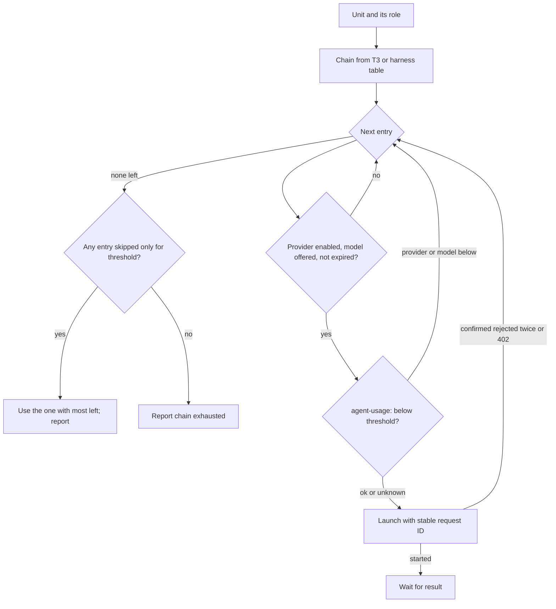
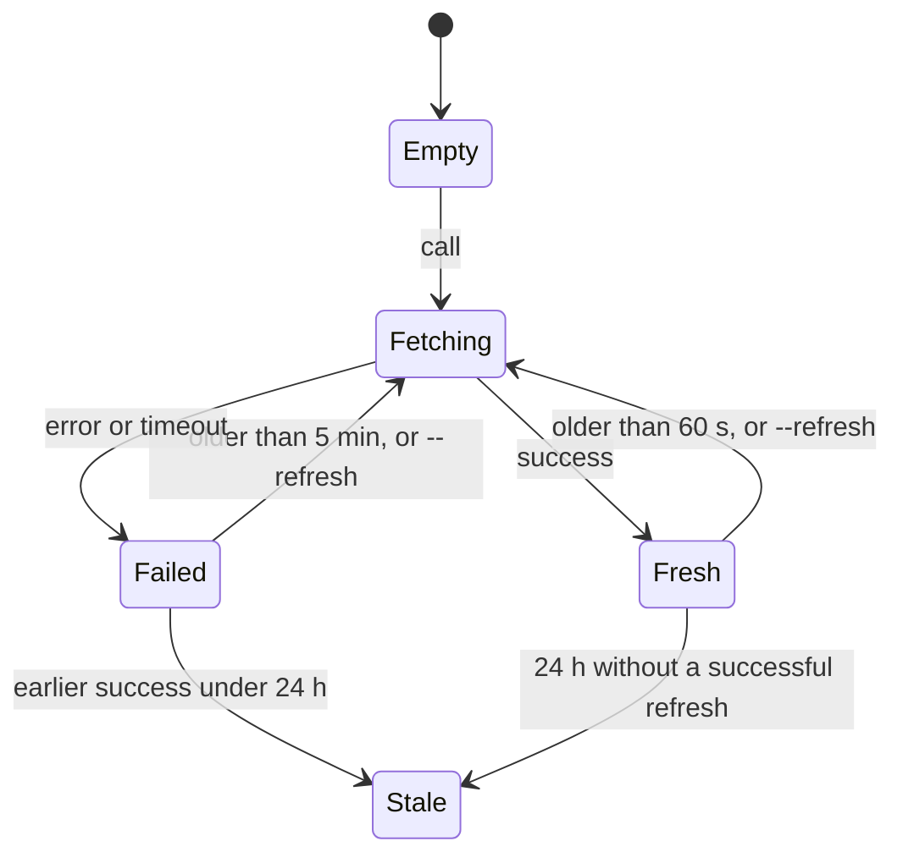

# T3 Code Role Routing - Plan

## Goal Capsule

- **Objective:** Whichever harness the user opens in T3 Code, each delegated piece of work goes to the model family that does it best, and work moves past a provider that is near its usage limit instead of stalling on it.
- **Means:** One shared role vocabulary in the agent instructions, a cross-provider T3 routing table, per-harness tables for use outside T3, and a usage utility that reads every provider's limits.
- **Product authority:** The user set the structure, the oh-my-openagent baseline, the root models, the service tiers, the 25% remaining threshold, and the deferrals to issues #376, #377 and #378 in the brainstorm on 2026-10-27.
- **Open blockers:** None.
- **Execution profile:** Deep; nine implementation units across instructions, a new usage utility, packaging, T3 settings and repository documentation.
- **Stop conditions:** Stop and report if the Claude Agent SDK usage call cannot run outside a T3-managed session (U3), or if Grok Build cannot be packaged for every supported platform (U5).
- **Finishing:** `lfg` implements, reviews and opens the pull request; merging stays with the user.

---

## Product Contract

Product Contract preservation: changed R3, R7, R10, R21, R28 — clarified root-chain timing, retry and expiry boundaries, the all-skipped fallback, and parallel write scopes from the spec-flow analysis; added AE8 and AE9; no scope change. The planning-owned Outstanding Questions are answered in the Planning Contract.

### Summary

The shared agent instructions gain a role vocabulary that Claude Code, Codex and OMP all use.
Inside T3 Code, one cross-provider routing table assigns each role an ordered model chain that follows oh-my-openagent's defaults; outside T3, each harness uses its own table.
A new usage utility reads every provider's limits with caching, and routing skips a provider whose remaining allowance in any window falls below 25%.

### Problem Frame

Today only Codex and OMP carry role tables, each limited to its own provider, and Claude Code has none.
In T3 Code the root harness therefore keeps every delegated task inside its own family, even where another family is clearly better: GPT follows review rules closely, Claude handles conversation and delegation well, and Gemini handles prose and UI.
Routing also ignores usage limits, so a provider near its weekly cap keeps receiving work until a call fails.

Usage data from 2026-10-06 to 2026-10-27 shows where routing matters most: review was 52% of 3,809 T3 delegated tasks and 45% of their run time, and implementation was 12% of tasks but 32% of run time.

### Key Decisions

- **Three instruction layers: shared roles and CE mapping, per-harness tables, and one T3 table.** (session-settled: user-approved — chosen over a separate T3-only table and principles-only guidance: one place for role definitions keeps four tables from drifting apart.) Governs R1, R2, R4.
- **Inside T3 the T3 table replaces the harness tables; outside T3 the harness tables apply.** (session-settled: user-approved — chosen over a partial T3 override and harness-first routing: the same work goes to the same model whichever root is open.) Governs R2.
- **oh-my-openagent's default chains are the baseline, minus models this environment lacks.** (session-settled: user-directed — chosen over even usage distribution and a Gemini Flash-led scout: the user wants each family on the work it does best.) Governs R5, R8.
- **Roots follow oh-my-openagent, and each harness renders only its own root row.** (session-settled: user-directed — chosen over a single shared root row and a Sol-only Codex root: Claude Code gets Opus 5.5 `medium`, Codex the Astra chain, OMP keeps Argon `high`.) Governs R3, R12.
- **Sol replaces Astra as primary outside the root.** (session-settled: user-approved — chosen over keeping Astra primary: Astra is the only model whose Codex usage the user notices.) Governs R5.
- **CE review personas go to GPT-6.1 Sol `medium`.** (session-settled: user-approved — chosen over oh-my-openagent's Claude Opus reviewer: GPT keeps to review rules, and a Claude root gets a different family reviewing.) Governs R5.
- **Codex service tiers match oh-my-openagent.** (session-settled: user-directed — chosen over Standard everywhere: the ChatGPT Pro plan covers Fast for Luna and Sol.) Governs R9.
- **Cross-model work and reviews in T3 run through `delegate_task` in the shared checkout, with parallel writers allowed.** (session-settled: user-directed — chosen over skill-specific CLI or worktree transports and serialized writers: this matches how the user already works without problems.) Governs R14, R15.
- **The Claude effort ban goes entirely.** (session-settled: user-directed — chosen over keeping it inside Claude Code: the Claude Code `Agent` tool and T3 both take an explicit effort.) Governs R16, R17.
- **No session-default Claude effort is declared, and the old `effortLevel` retirement step goes.** (session-settled: user-approved — chosen over keeping the retirement step: a leftover value counts as one the user saved.) Governs R17.
- **Skip a provider when any provider-wide window has less than 25% left.** (session-settled: user-directed — chosen over a 90% used threshold, per-window thresholds and skipping only at the limit.) Governs R21.
- **Each provider's limits come from that provider's own interface, cached like OMP's usage cache.** (session-settled: user-directed — chosen over parsing T3 logs, calling T3's internal RPC, and reading Codex through `omp usage`.) Governs R18, R19, R20.
- **Grok Build returns now; whether it stays is issue #378.** (session-settled: user-directed — chosen over waiting for a topped-up balance: a failing Grok entry is skipped.) Governs R11, R13, R26.
- **Synthetic models are used until 2026-11-18; cleanup is issue #377.** (session-settled: user-directed — chosen over not using Synthetic.) Governs R10.
- **Earlier plans and learnings do not bind new work in this repository.** (session-settled: user-directed — chosen over confirming every earlier decision: the user changes this repository experimentally and often.) Governs R23, R24.
- **The oh-my-openagent comparison is a maintained document, synced by hand.** (session-settled: user-directed — chosen over a scheduled change detector or an automatic PR.) Governs R25.

### Requirements

**Instruction structure**

- R1. The shared agent instructions define one role vocabulary and one mapping from Compound Engineering workflows and personas to roles, delivered unchanged to Claude Code, Codex and OMP.
- R2. Each harness receives its own role-to-model table for use outside T3, and every harness receives the T3 table, which replaces the harness table for delegation inside T3.
- R3. The T3 table's root row renders per harness: Claude Code sees only the Claude Code root chain, Codex only the Codex chain, and OMP only the OMP row. A root chain is the order for choosing a model when a thread or session starts; it never moves a running session to another model.
- R4. The roles are `root`, `scout`, `quick`, `writing`, `visual`, `implement`, `implement-high`, `deep`, `hard-decision`, `review`, `review-gate`, `architect` and `peer`, with the meanings in the role table below.

| Role | Work | oh-my-openagent counterpart |
| --- | --- | --- |
| `root` | Conversation with the user, delegation, progress | main agent |
| `scout` | Code search, grounding, evidence gathering | `explore`, `librarian` |
| `quick` | Mechanical edits, status lookups, commit messages | `quick` |
| `writing` | Documentation and prose | `writing` |
| `visual` | Frontend and UI | `visual-engineering` |
| `implement` | Ordinary implementation | `unspecified-low` |
| `implement-high` | Feature work across several files | `unspecified-high` |
| `deep` | Hard logic or debugging that evidence can settle | `deep-low` |
| `hard-decision` | A central decision evidence cannot settle | `deep-high`, `ultrabrain` |
| `review` | CE review personas (code, doc, simplify) | `omo-native-code-reviewer` |
| `review-gate` | Plan review, final gate, adversarial review | `plan-reviewer`, `omo-native-gate-reviewer` |
| `architect` | Architecture and plan consultation | `architect`, `plan-consultant` |
| `peer` | CE-required independent cross-model review | none |

**Routing tables**

- R5. The T3 table assigns each role this chain, tried left to right ("S" marks a Synthetic entry under R10):

| Role | Chain |
| --- | --- |
| `root` (Claude Code) | Claude Opus 5.5 `medium` → Kimi K3 `high` (S) → GLM-5.3 `high` (S) |
| `root` (Codex) | GPT-6 Astra `medium` → GPT-6.1 Sol Fast `medium` → GPT-6.1 Sol `medium` |
| `root` (OMP) | Gemini 4 Argon `high` |
| `scout` | GPT-6 Luna Fast `low` → Claude Haiku 5.5 `medium` → DeepSeek V4.1 Flash `high` (S) |
| `quick` | GPT-6 Luna Fast `low` → Claude Haiku 5.5 `medium` → DeepSeek V4.1 Flash `off` (S) → GLM-5.3-Flash `low` (S) |
| `writing` | Gemini 4 Argon `low` → Claude Opus 5.5 `low` |
| `visual` | Gemini 4 Argon `low` → Claude Fable 5.1 `max` → Claude Opus 5.5 `max` → Kimi K3 `high` (S) |
| `implement` | Claude Sonnet 5.5 `medium` → Grok `grok-4.7` `xhigh` → GLM-5.3 `high` (S) → GPT-6.1 Sol `medium` → Gemini 3.8 Flash `high` |
| `implement-high` | Claude Opus 5.5 `medium` → GLM-5.3 `high` (S) → Kimi K3 `high` (S) → GPT-6.1 Sol `medium` → Gemini 4 Argon `high` |
| `deep` | GPT-6.1 Sol `medium` → GPT-6.1 Sol Fast `medium` → Claude Opus 5.5 `xhigh` |
| `hard-decision` | GPT-6.1 Sol `xhigh` → GPT-6 Astra `high` → Claude Fable 5.1 `max` |
| `review` | GPT-6.1 Sol `medium` → GPT-6.1 Sol `high` → Claude Opus 5.5 `high` |
| `review-gate` | GPT-6.1 Sol `xhigh` → GPT-6 Astra `high` → Claude Opus 5.5 `max` |
| `architect` | Claude Fable 5.1 `max` → Claude Opus 5.5 `max` → Kimi K3 `high` (S) → GPT-6.1 Sol `xhigh` |
| `peer` | The external model and effort the owning CE skill selects |

- R6. The per-harness tables assign each role a model from that harness's own provider only:

| Role | Claude Code | Codex | OMP |
| --- | --- | --- | --- |
| `root` | Opus 5.5 `medium` | Astra `medium` → Sol Fast `medium` → Sol `medium` | Argon `high` |
| `scout` | Haiku 5.5 `medium` | Luna Fast `low` | Gemini 3.5 Flash Lite `low` |
| `quick` | Haiku 5.5 `medium` | Luna Fast `low` | Gemini 3.5 Flash Lite `minimal` |
| `writing` | Opus 5.5 `low` | Sol `low` | Argon `low` |
| `visual` | Fable 5.1 `max` → Opus 5.5 `max` | Sol `low` | Argon `low` |
| `implement` | Sonnet 5.5 `medium` | Sol `low` | Gemini 3.8 Flash `low` |
| `implement-high` | Opus 5.5 `medium` | Sol `medium` | Gemini 3.8 Flash `medium` |
| `deep` | Opus 5.5 `xhigh` | Sol `medium` | Gemini 3.8 Flash `medium` |
| `hard-decision` | Fable 5.1 `max` | Sol `medium` | Argon `high` |
| `review` | Opus 5.5 `high` | Sol `medium` | Gemini 3.8 Flash `medium` |
| `review-gate` | Opus 5.5 `max` | Sol `medium` | Argon `high` |
| `architect` | Fable 5.1 `max` | Sol `medium` | Argon `high` |
| `peer` | CE selection | CE selection | CE selection |

- R7. Delegation moves to the next chain entry when the provider is disabled, the model is not offered, R21 applies, usage is exhausted (including Grok's `402`, which skips at once), an R10 expiry has passed, or the launch is confirmed rejected twice; the root never starts a replacement while an earlier attempt may still be live, and reports each skipped entry with its reason.
- R8. GPT `max` and `ultra` are used only on the user's explicit request, and an OMP entry whose oh-my-openagent counterpart uses `max` runs at `high`, the highest effort T3 passes to OMP.
- R9. Codex entries marked "Fast" run at `serviceTier` `priority` and every other Codex entry at `default`; Ultrafast is never selected, and the current rule against automatic Fast for a root no longer applies.
- R10. Synthetic entries carry the expiry date 2026-11-18: from 2026-11-19 (local date) agents start no new Synthetic work, while tasks already running may finish; inside T3 these entries override the OMP rule against automatically switching to Synthetic, and outside T3 OMP still does not switch to Synthetic automatically.
- R11. The model roster lists the remaining Synthetic models (Qwen 3.8 27B, Nemotron 3 Super 120B, GPT-OSS-120B, GLM-4.7-Flash and the `syn:*` aliases) for explicit requests only, under the same expiry.

**T3 Code settings**

- R12. A new T3 Code thread defaults to Claude Opus 5.5 at effort `medium`.
- R13. The T3 Code `grok` provider instance is enabled, backed by a reinstated Grok Build package.

**Delegation in T3**

- R14. Inside T3, cross-model work and reviews go through T3 `delegate_task` in place of each skill's own CLI or worktree transport, run in the shared checkout without a worktree, and carry read-only access as a prompt instruction disclosed as such; this replaces, inside T3 only, the Codex rule that reports a pass unavailable without enforced read-only access.
- R15. Children that write files may run in parallel in the shared checkout.
- R28. The shared instructions tell every root to dispatch independent delegated tasks in parallel, starting all of them before waiting on any, and to serialize only tasks that depend on another task's result; parallel writers get disjoint file scopes, and the root integrates any shared file itself.

**Claude effort**

- R16. No instruction, setting, environment variable or check forbids a Claude effort, and the `claude-effort-absent` check is removed.
- R17. The repository declares no Claude Code session-default effort, removes the activation step that retires an earlier `effortLevel` value, and narrows the "Claude Code version bumps" guidance in `AGENTS.md` to defaults that no routing table sets.

**Usage limits**

- R18. A usage utility in this repository reports each provider's usage windows (used share, reset or regeneration time) and can be called the same way from Claude Code, Codex and OMP, inside and outside T3, without printing any credential.
- R19. The utility reads each provider from its own interface: Codex from the Codex app-server `account/rateLimits/read`, Claude from the Claude Agent SDK `get_usage`, Gemini from the `google-antigravity` entries of `omp usage --json`, Grok from `GET https://cli-chat-proxy.grok.com/v1/billing?format=credits` with the Grok CLI's stored token, and Synthetic from `GET https://api.synthetic.new/v2/quotas`; a provider it cannot read is reported as unknown.
- R20. The utility caches results per provider and account in one store shared across processes and harnesses, does not refetch while a result is fresh, lets concurrent callers share one in-flight fetch, caches failures for a while, and offers a forced refresh.
- R21. Before delegating, the root reads the chain's provider limits and skips every entry of a provider whose provider-wide window has less than 25% left, and only that model's entries when a model-specific window has less than 25% left; when every runnable entry was skipped only for this threshold, it uses the one whose lowest applicable window has the most left and says so, and it never revives an entry skipped for any other R7 reason.
- R22. Synthetic's weekly allowance is a rolling quota: R21 judges it by `percentRemaining`, and reports give the next regeneration time and amount in place of a reset time.

**Repository operation**

- R23. `AGENTS.md` states that this repository changes experimentally and often, so decisions recorded only in earlier plans, brainstorms or learnings do not bind new work and the current request prevails.
- R24. The `Review findings` rule in `AGENTS.md` that asks before reversing a user decision applies, in this repository, only to decisions made in the current task, including that task's brainstorm Scope Boundaries and `session-settled` entries; the shared instruction template keeps its wording for other repositories.
- R25. A maintained document in this repository compares the T3 table with oh-my-openagent's defaults and records the oh-my-openagent commit and date it compared against, and `AGENTS.md` requires any change to a routing table or the roster to update it in the same change.
- R26. The `grok-absent` check keeps its Grok Bot guards and drops its Grok Build guards.
- R27. Learnings that this change makes wrong are refreshed in the same change, including `codex-priority-tier-costs-2-5x-subscription-usage-for-review-peer` and the learnings that cite `claude-effort-absent` or `grok-absent`.

### Acceptance Examples

- AE1. **Covers R7, R21.** **Given** Claude's provider-wide Weekly window has 20% left, **when** the root delegates an `implement` unit, **then** it skips Claude Sonnet 5.5, tries Grok `grok-4.7`, and reports that Claude was skipped for low weekly allowance.
- AE2. **Covers R21.** **Given** Claude's Weekly · Fable window has 10% left and its other windows have more than 25%, **when** the root delegates `architect` work, **then** it skips Claude Fable 5.1 and uses Claude Opus 5.5 `max`.
- AE3. **Covers R21.** **Given** every entry of the `deep` chain belongs to a provider below 25%, **when** the root delegates `deep` work, **then** it uses the entry with the most remaining allowance and reports that every entry was below the threshold.
- AE4. **Covers R7, R10.** **Given** the date is 2026-11-19, **when** the root delegates `quick` work and Luna and Haiku are both unavailable, **then** it skips both Synthetic entries as expired and reports that the chain is exhausted.
- AE5. **Covers R7, R13.** **Given** Grok Build answers `402 Payment Required`, **when** the root delegates an `implement` unit after Claude Sonnet 5.5 fails, **then** it skips the Grok entry and tries GLM-5.3.
- AE6. **Covers R3, R12.** **Given** the user opens a new T3 thread without choosing a model, **then** it starts on Claude Opus 5.5 `medium`, and the instructions that thread reads show only the Claude Code root chain.
- AE7. **Covers R19.** **Given** the usage utility runs, **when** it reports Codex, **then** the values come from the Codex app-server, not from the `openai-codex` entry of `omp usage --json`.
- AE8. **Covers R7, R21.** **Given** OMP is unavailable and every other entry of the `quick` chain is below 25%, **when** the root delegates `quick` work, **then** it picks among the below-threshold entries only and never retries an OMP entry.
- AE9. **Covers R7.** **Given** a `delegate_task` launch times out without a task ID, **when** the root retries, **then** it reuses the same request ID instead of starting a second child on the next entry.

### Success Criteria

- A T3 thread opened on any of the three harnesses routes the same delegated role to the same chain, while the root chain stays harness-specific per R3.
- The usage utility reports Codex, Claude, Gemini, Grok and Synthetic windows from one command, and repeated calls within the fresh period make no new provider request.
- The oh-my-openagent comparison document and the instruction tables agree at every commit that touches either.

### Scope Boundaries

- Putting Gemini 3.8 Flash at the front of `scout` and `quick` is deferred to [#376](https://github.com/hyperlapse122/nix-config/issues/376); until then OMP keeps its current scout and quick models.
- Removing Synthetic entries after 2026-11-18 is deferred to [#377](https://github.com/hyperlapse122/nix-config/issues/377).
- Removing Grok Build again is deferred to [#378](https://github.com/hyperlapse122/nix-config/issues/378).
- Grok Bot is not reinstated.
- Codex usage volume is not a routing concern beyond keeping Astra out of non-root primaries.
- No automatic or scheduled sync with oh-my-openagent.
- The shared instruction template's `Review findings` wording for other repositories is unchanged.
- GPT-6.1 Terra stays unused because oh-my-openagent's defaults do not use it.

### Dependencies / Assumptions

- T3 Code's `delegate_task` accepts the models and options in R5 on the `claudeAgent`, `codex`, `omp` and `grok` instances; `orchestrator_capabilities` confirmed this for every instance except `grok`, which is disabled today.
- Grok Build 1.0.70 offers `grok-4.7`, `grok-4.7-build-fast`, `grok-4.6` and `grok-4.5`, and its balance was exhausted on 2026-10-27.
- Synthetic's quota endpoint is documented as under development; its `planWeeklyLimit` and `search` fields were observed in a live response, not in the documentation.

### Sources / Research

- oh-my-openagent model matching: <https://github.com/code-yeongyu/oh-my-openagent/blob/HEAD/docs/guide/agent-model-matching.md>, read 2026-10-27.
- T3 Code usage-limit sources at `pingdotgg/t3code` `becf853d`: `apps/server/src/provider/codexUsageLimits.ts`, `apps/server/src/provider/claudeUsageLimits.ts`, `apps/server/src/provider/antigravityUsageLimits.ts`, `packages/provider-grok/src/server/usageLimits.ts`.
- OMP usage cache: `packages/ai/src/auth/usage-cache.ts` inside the `omp` 18.12.6 binary; `omp usage invalidate` clears it.
- Synthetic quotas: <https://dev.synthetic.new/docs/synthetic/quotas>.
- GPT-6.1 Sol and Astra comparison: <https://www.eesel.ai/blog/gpt-6-1-sol>.
- Current role tables: the `Codex role orchestration` and `OMP role orchestration` sections of `home/h82/agents/instructions/instructions.md.tmpl`.
- Grok Build removal: commit `2c33134a`.
- Earlier removal of T3 routing guidance: `.compound-engineering/artifacts/plans/2026-10-24-1551-refactor-harness-default-instructions-plan.md`, which no longer binds per R23.

---

## Planning Contract

### Key Technical Decisions

- KTD1. **The renderer gains a `claude` delivery flag, and per-harness rows are template conditionals, not data lookups.** `home/h82/agents/instructions/default.nix` passes `codex` and `omp` today; Claude Code gets `claude` so its harness table and root row render only for it. Literal conditionals avoid the index-lookup gap in `missingkey=error` described in `.compound-engineering/artifacts/solutions/logic-errors/go-text-template-missingkey-error-misses-index-and-printed-nulls.md`. Implements R2, R3.
- KTD2. **One shared CE coverage table maps workflows to roles and replaces the two P1-P7 coverage tables.** Profiles map as P1 → `quick`, P2 → `scout`, P3 → `implement` (ordinary planning, synthesis and claim verification included), P4 → `review` for review personas and `deep` for diagnosis, security and data-integrity work, P5 → `root`, P6 → `architect` for planning and architecture and `hard-decision` for conflicting evidence, P7 → `peer`. Implements R1, R4.
- KTD3. **Codex and OMP keep the protections in their dispatch, transport and lifecycle sections and drop the rules that block the new routing.** Kept: stable request IDs, cancellation, recipient allowlists and consent, artifact validation. Rewritten against the role contract: the OMP rule that OMP-led children use only `instanceId` `omp`, the Codex rules that GPT `xhigh` needs an explicit request and that automatic Fast covers only Luna, the Codex and OMP rules that allow an explicit Claude effort only for CE peer tasks, and every P1-P7 reference. Inside T3 the read-only paragraph is replaced per R14; outside T3 it stays. Implements R2, R7, R8, R9, R14, R16.
- KTD4. **The usage utility is one Python command, `agent-usage`, with a small Node helper for Claude.** It follows the `pythonHelper` pattern in `packages/agent-tools.nix`; the Claude reader starts a Claude Agent SDK query that never sends a prompt and calls the SDK usage method, which sends the `get_usage` control request R19 names, with the SDK pinned through `packages/npm-release-package.nix` like `acpx`. Conflict call-out on the Key Decision governing R19: the SDK method is named `usage_EXPERIMENTAL_MAY_CHANGE_DO_NOT_RELY_ON_THIS_API_YET`, so an SDK update can break it; a failure reports Claude as unknown rather than blocking routing. Implements R18, R19.
- KTD5. **The cache is one JSON file per provider and account under `$XDG_CACHE_HOME/agent-usage/`, guarded by an advisory file lock.** A caller holding the lock fetches; others wait up to 30 seconds and then read whatever is published; the kernel drops the lock when a process dies, so a crashed fetcher never blocks others. Results are written by atomic rename. Fresh for 60 seconds, failures cached for 5 minutes, last success kept for 24 hours and marked stale; a stale window whose reset time has passed is shown for history only, reports its current allowance as unknown, and never sets a threshold flag (Synthetic's rolling quota keeps its own regeneration semantics); `--refresh` bypasses freshness and failure caching but still takes the lock. Implements R20.
- KTD6. **The utility owns the R21 threshold arithmetic.** Each window reports `remainingPercent`, and each provider reports whether it is below threshold provider-wide and which models are below threshold; the instructions tell the root to act on those flags. One implementation keeps all three harnesses consistent. Implements R21, R22.
- KTD7. **Account identity is a hash of a non-secret identifier.** Codex `accountId`, the Claude credential's account or organization ID, the OMP usage scope, the Grok entry's `email`, and a fixed `default` for Synthetic; no token reaches a cache key, file or report. Implements R18, R20.
- KTD8. **Grok Build returns by restoring the files removed in `2c33134a` and bumping to the current release with its own release script.** The `grok-absent` check in `flake.nix` keeps its Grok Bot probes and drops the Grok Build package and `~/.grok` probes. Implements R13, R26.
- KTD9. **T3's new-thread default becomes `claudeAgent` / `claude-opus-5-5` with `effort` `medium`, and the Codex CLI default becomes `gpt-6-astra` `medium`.** The Codex CLI root is what R6's Codex root row describes outside T3. Claude Code's own default stays undeclared because Opus 5.5 already defaults to `medium` (R17). Implements R6, R12, R17.
- KTD10. **The oh-my-openagent comparison lives at `docs/agent-routing.md`.** It sits beside the other user guides and is a CI docs-only path, so a comparison-only edit does not rebuild hosts. Implements R25.

### High-Level Technical Design

Delegation decision a root follows for one unit (R5, R7, R10, R21):

Usage cache states for one provider and account (R20):

### Assumptions

- `lfg` runs this plan without a person to confirm the plan-time scoping, so the spec-flow defaults recorded in the Product Contract preservation note stand as assumptions.
- `codex app-server --listen stdio://` answers `account/rateLimits/read` after `initialize` and `initialized` with the user's existing `~/.codex` login; whether the call counts against usage is unverified.
- The Claude Agent SDK usage call works from a standalone Node process with the user's existing Claude Code login.

---

## Implementation Units

### U1. Shared role vocabulary, CE coverage and T3 routing table

- **Goal:** Add the shared routing layer every harness reads.
- **Requirements:** R1, R3, R4, R5, R7, R8, R9, R10, R11, R14, R15, R21, R22, R28; KTD1, KTD2, KTD3.
- **Dependencies:** none.
- **Files:** `home/h82/agents/instructions/instructions.md.tmpl`, `home/h82/agents/instructions/default.nix`, `tests/agent-instructions.py`, `tests/agent-instructions.nix`.
- **Approach:**
  1. Add the `claude` flag to the render context and a Claude delivery route in the Python contract.
  2. Add a shared section with the role table, the CE coverage table on roles, chain semantics (R7, R21 via `agent-usage`, R10 expiry), parallel dispatch (R28), and the T3 delegation rule (R14, R15).
  3. Add the T3 table with one root row per harness behind the delivery conditionals.
  4. Remove the Codex and OMP CE coverage tables that the shared table replaces.
- **Patterns to follow:** existing `CODEX_CONTRACT` and `OMP_*` exact-section contracts and their mutants in `tests/agent-instructions.py`.
- **Test scenarios:**
  - Each delivery contains the role table and T3 table exactly once and no other delivery's root row. Covers AE6.
  - A mutant that swaps the Codex root row into the Claude delivery fails.
  - A mutant that negates the parallel-dispatch sentence fails.
  - A mutant that changes a chain entry's model or effort fails.
  - A mutant that drops the "never revive" clause of the fallback rule fails.
  - Rendered output contains no unresolved template token or `<no value>`.
- **Verification:** `agent-instructions` passes, and each mutant fails at its named assertion.

### U2. Per-harness role tables

- **Goal:** Give Claude Code a table and move Codex and OMP to the role vocabulary.
- **Requirements:** R2, R6, R8, R9, R10; KTD1, KTD3.
- **Dependencies:** U1.
- **Files:** `home/h82/agents/instructions/instructions.md.tmpl`, `tests/agent-instructions.py`, `home/h82/agents/omp-writer.md`, `home/h82/agents/omp-designer.md`, `home/h82/agents/omp.nix`, `tests/omp-settings.nix`.
- **Approach:**
  1. Add a Claude Code section that maps roles to `Agent` tool `model` and `effort`.
  2. Replace the Codex and OMP P1-P7 tables with role rows per R6, and rewrite the retained dispatch and responsibility-resolution paragraphs per KTD3.
  3. Add native OMP `writer` and `designer` agents on `google-antigravity/gemini-4-argon` at `low`, following `home/h82/agents/omp-architect.md` and its `home.file` entry in `home/h82/agents/omp.nix`, and point the outside-T3 OMP dispatch text at them for `writing` and `visual`; scout and quick stay put per the #376 deferral.
- **Patterns to follow:** `PROFILES` and `OMP_PROFILES` row checks.
- **Test scenarios:**
  - Claude, Codex and OMP deliveries each carry exactly their own harness table.
  - A mutant that adds an effort column value outside the model's accepted set (for example `max` on an OMP Gemini row) fails.
  - The Codex and OMP deliveries keep the request-ID, cancellation, consent and artifact-validation sentences.
  - Neither delivery still restricts OMP-led children to `instanceId` `omp`, GPT `xhigh` to explicit requests, automatic Fast to Luna, or Claude effort to peer tasks.
  - The materialized `~/.omp/agent/agents/writer.md` and `designer.md` select Argon at `low`.
- **Verification:** `agent-instructions` and `omp-settings` pass.

### U3. `agent-usage` provider readers

- **Goal:** Report every provider's usage windows from its own interface.
- **Requirements:** R18, R19, R22; KTD4, KTD7. Covers AE7.
- **Dependencies:** none.
- **Files:** `scripts/agent-usage`, `scripts/agent-usage-claude.mjs`, `packages/agent-tools.nix`, `packages/claude-agent-sdk.nix`, `packages/claude-agent-sdk-release.json`, `home/h82/agents/usage.nix`, `home/h82/agents/default.nix`, `tests/test_agent_usage.py`, `flake.nix`, `tests/check-shards.nix`.
- **Approach:**
  1. Codex: spawn `codex app-server --listen stdio://`, handshake, call `account/rateLimits/read`, map `primary` and `secondary` windows.
  2. Claude: run the Node helper; map `five_hour`, `seven_day` and `model_scoped` entries.
  3. Gemini: run `omp usage --json --provider google-antigravity`; ignore `openai-codex`.
  4. Grok: read the `auth.x.ai::…` entry's `key` from `$GROK_HOME/auth.json` or `~/.grok/auth.json`, call the billing endpoint; on `401` run `grok models` once and retry; skip when `XAI_API_KEY` or custom endpoint settings are present.
  5. Synthetic: get the key from `omp-synthetic-key` and call the quotas endpoint; report rolling regeneration per R22.
  6. Any failure yields `unknown` for that provider without failing the others.
- **Execution note:** Prove each reader against a stubbed command or local HTTP server before touching real credentials.
- **Patterns to follow:** `scripts/omp-provider-key` for key handling; `tests/test_omp_release.py` for PATH-stubbed script tests.
- **Test scenarios:**
  - A stubbed app-server returning a weekly window yields a Codex window with the right used and remaining percent. Covers AE7.
  - Codex values ignore an `openai-codex` entry in a stubbed `omp usage` output.
  - A Claude helper result with a Fable `model_scoped` entry yields a model-scoped window.
  - Grok `401` then success after a stubbed `grok models` yields a window; a second `401` yields unknown.
  - Grok `402` yields unknown with an exhausted marker.
  - Synthetic `planWeeklyLimit` yields a window with regeneration time and amount and no reset time.
  - One provider failing leaves the other providers' results intact.
  - No output, cache file or error message contains a stub token.
- **Verification:** `agent-usage` check passes; the PATH assignment sits on the tested command, per `.compound-engineering/artifacts/solutions/logic-errors/env-assignment-prefix-on-cd-never-reaches-the-next-command.md`.

### U4. `agent-usage` cache and threshold output

- **Goal:** Make repeated calls cheap and give roots a ready skip decision.
- **Requirements:** R20, R21; KTD5, KTD6, KTD7. Covers AE1, AE2, AE3, AE8.
- **Dependencies:** U3.
- **Files:** `scripts/agent-usage`, `tests/test_agent_usage.py`.
- **Approach:**
  1. Wrap each reader with the KTD5 cache and lock.
  2. Emit JSON with per-window `remainingPercent`, per-provider below-threshold flag, below-threshold models, status (`ok`, `stale`, `unknown`), and fetch time.
  3. Offer a human-readable default view and `--json`.
- **Test scenarios:**
  - Two calls within 60 seconds hit the stub once.
  - Two concurrent calls hit the stub once and both get the result.
  - A failure followed by a call within 5 minutes does not hit the stub; `--refresh` does.
  - A failed refresh after an earlier success reports the earlier windows as `stale`.
  - A stale snapshot with 10% left whose reset time passes during a failed refresh no longer marks the provider below threshold.
  - A lock holder killed mid-fetch does not block the next caller.
  - Weekly 20% left marks the provider below threshold. Covers AE1.
  - Fable window 10% left with other windows above 25% marks only the Fable model. Covers AE2.
  - Exactly 25% left is not below threshold.
- **Verification:** `agent-usage` check passes with each boundary mutant (threshold `<` to `<=`, provider flag ignoring a window) failing.

### U5. Reinstate Grok Build and enable its T3 instance

- **Goal:** Make Grok Build available to T3 again without Grok Bot.
- **Requirements:** R13, R26; KTD8. Covers AE5.
- **Dependencies:** none.
- **Files:** `packages/grok-build.nix`, `packages/grok-build-release.json`, `scripts/grok-build-release`, `tests/test_grok_build_release.py`, `home/h82/agents/grok.nix`, `home/h82/agents/default.nix`, `packages/agent-tools.nix`, `home/h82/t3code.nix`, `flake.nix`, `.github/workflows/update-dependencies.yml`, `tests/update-dependencies-reconcile.sh`, `tests/non-nixos-outputs.nix`, `tests/darwin-outputs.nix`, `tests/check-shards.nix`.
- **Approach:**
  1. Restore the Grok Build files from `2c33134a^`, leaving every Grok Bot file out.
  2. Bump the pin to 1.0.70 with `grok-build-release`.
  3. Set the T3 `grok` instance `enabled = true`.
  4. Narrow `grok-absent` to Grok Bot probes.
- **Patterns to follow:** the restored files themselves; `packages/omp.nix` for wrapper environment.
- **Test scenarios:**
  - `grok-build-release` tests pass against fixtures.
  - The package's install check runs `grok --version`.
  - `grok-absent` still fails when a Grok Bot package or cask returns and passes with Grok Build installed.
  - The materialized T3 settings show `grok` enabled.
- **Verification:** package builds on x86_64-linux; aarch64 and Darwin builds deferred to CI.

### U6. T3 and Codex default roots

- **Goal:** Start new sessions on the R6 and R12 roots.
- **Requirements:** R6, R12; KTD9. Covers AE6.
- **Dependencies:** U7 (the effort guard must be gone first).
- **Files:** `home/h82/t3code.nix`, `tests/t3code-traits.nix`, `home/h82/agents/codex.nix`, `tests/codex-settings.nix`.
- **Approach:**
  1. Set `defaultModelSelection` to `claudeAgent`, `claude-opus-5-5`, option `effort` `medium`.
  2. Set the Codex CLI `model` to `gpt-6-astra` and `model_reasoning_effort` to `medium`.
- **Test scenarios:**
  - The materialized T3 settings carry the Claude default with `effort` `medium`. Covers AE6.
  - A stale Codex default in seed settings is replaced while unrelated keys survive.
- **Verification:** `t3code-traits` and `codex-settings` pass.

### U7. Remove the Claude effort ban

- **Goal:** Stop forbidding Claude effort anywhere.
- **Requirements:** R16, R17.
- **Dependencies:** none.
- **Files:** `tests/claude-effort-absent.nix` (delete), `flake.nix`, `tests/check-shards.nix`, `home/h82/agents/claude.nix`, `tests/test_agent_settings.py`.
- **Approach:**
  1. Delete the check and its flake and shard entries.
  2. Remove the `effortLevel` and `modelSettings."claude-opus-5-5".effortLevel` retirement entries from the settings merge.
- **Test scenarios:**
  - A seed `settings.json` with `effortLevel` keeps it after the merge.
  - `check-shards-guard` passes with the check gone.
- **Verification:** flake evaluates; `agent-settings` passes.

### U8. Repository documentation and comparison document

- **Goal:** Record the repository rules and the oh-my-openagent comparison.
- **Requirements:** R17, R23, R24, R25; KTD10.
- **Dependencies:** U1, U2.
- **Files:** `AGENTS.md`, `docs/agent-routing.md`, `CONCEPTS.md`.
- **Approach:**
  1. Add the experimental-repository statement (R23) and scope the `Review findings` reversal rule (R24).
  2. Narrow "Claude Code version bumps" (R17) and drop the `claude-effort-absent` mention.
  3. Update the `home/h82/` structure line to describe roles instead of `P1`-`P6`.
  4. Write `docs/agent-routing.md` with the T3 table, the oh-my-openagent table, the compared commit and date, and the deviations; add the AGENTS.md rule that table or roster changes update it.
- **Test scenarios:** `agent-instructions` still passes, since it reads `AGENTS.md` and `CONCEPTS.md`.
- **Verification:** Markdown lint passes.

### U9. Refresh learnings

- **Goal:** Keep captured learnings true after this change.
- **Requirements:** R27.
- **Dependencies:** U5, U6, U7.
- **Files:** `.compound-engineering/artifacts/solutions/best-practices/codex-priority-tier-costs-2-5x-subscription-usage-for-review-peer.md`, `.compound-engineering/artifacts/solutions/best-practices/benchmark-cross-model-review-peers-in-t3-code-before-changing-them.md`, `.compound-engineering/artifacts/solutions/best-practices/nix-check-reads-option-value-not-materialized-output.md`.
- **Approach:** Run `ce-compound-refresh` on each; note the Pro plan, the oh-my-openagent service tiers, and the removed effort retirement.
- **Test expectation:** none -- documentation only.
- **Verification:** Each refreshed learning names the current behavior and its date.

---

## Verification Contract

- `nix fmt -- --ci`, `git diff --check`, and Markdown lint on changed files.
- `nix flake check --no-build`, then build `agent-instructions`, `agent-usage`, `grok-build-release`, `grok-absent`, `t3code-traits`, `omp-settings`, `check-shards-guard`, `agent-settings`, and `codex-settings` on x86_64-linux.
- Build every production and bootstrap host output listed in `AGENTS.md`; aarch64 and Darwin outputs come from CI.
- Live smoke check, reported separately from repository checks: run `agent-usage --json` once on this host and confirm each provider reports windows or `unknown` without printing a credential.

## Definition of Done

- Every unit's verification holds, and every R and AE is covered by a unit or test scenario.
- The three rendered instruction files show only their own root row and harness table.
- `agent-usage` reports all five providers with caching and threshold flags.
- No experimental or abandoned code remains in the diff.
