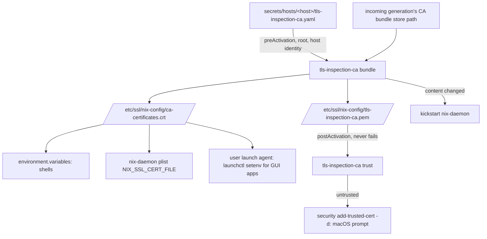

# macOS TLS Inspection CA Trust - Plan

## Goal Capsule

- **Objective:** On the work MacBook, every Nix-provided tool keeps working when Endpoint Protector's network DLP re-signs its TLS traffic, whether the tool runs from a shell, from a GUI app, or inside nix-daemon.
- **Means:** a SOPS-encrypted copy of the inspection CA, a combined CA bundle built at apply time, system-wide CA environment variables, and a repair step for macOS keychain trust (KTD1-KTD5).
- **Product authority:** the user, in the 2026-10-27 brainstorm. Other Macs, Linux hosts, and the NixOS desktop are not active scope. This file's Product Contract outranks the Planning Contract; the Planning Contract outranks unit text.
- **Execution profile:** one branch, units in U-ID order, autonomous through PR; the live apply and the keychain prompt are the user's.
- **Stop conditions:** stop if root cannot decrypt the secret with the host identity, if nix-darwin offers no way to point nix-daemon at the bundle, or if any change would write the certificate's plaintext or subject into the repository.
- **Open blockers:** none.

---

## Product Contract

### Summary

Commit the inspection CA as a SOPS-encrypted secret, combine it with the Nix CA bundle on every production apply, and point the standard CA environment variables at that bundle for shells, GUI apps, and nix-daemon.
When macOS itself stops trusting the CA, the apply restores that trust instead of leaving it to the device management agent.

### Problem Frame

Endpoint Protector's network DLP on the work MacBook intercepts TLS for selected processes and re-signs each server certificate with its own CA.
Today `bun` is intercepted, while `curl`, `node`, Python, and Nix's own fetchers are not; the employer's policy decides the list and can widen it without notice.
The CA is trusted in the macOS System keychain because Intune deploys it, so Apple-native TLS works.
Nix-provided tools read the Nix CA bundle instead, which does not contain the CA, so an intercepted tool fails with `UNABLE_TO_GET_ISSUER_CERT_LOCALLY`.
`tokscale` breaks this way: its wrapper runs `bunx`, and the package download fails before the tool starts.
`bun --use-system-ca` or `NODE_EXTRA_CA_CERTS` pointing at the CA each make the same request succeed, which confirms the missing trust anchor is the whole cause.

### Key Decisions

- **Fix it through system configuration, not per-tool code changes.** The user wants one machine-level fix that covers tools nobody has seen break yet. (session-settled: user-directed — chosen over patching affected tools one by one: interception scope is policy-driven and can widen.) Governs R5, R6, R7, R8.
- **Store the CA in the repository as a SOPS-encrypted secret.** (session-settled: user-directed — chosen over deriving the bundle from the System keychain at apply time and over committing the plaintext PEM: the repository is public, and the certificate names an internal server.) Governs R1, R2.
- **Cover shells, GUI apps, and nix-daemon.** (session-settled: user-directed — chosen over shells only and over shells plus GUI apps: Nix fetches stay working if the policy starts intercepting them.) Governs R6, R7, R8.
- **Repair macOS keychain trust only when it is missing.** (session-settled: user-directed — chosen over generating a configuration profile for manual approval and over leaving keychain trust to Intune: macOS allows silent profile installation only through MDM, so a repair that prompts once is the closest automatic form.) Governs R10, R11, R12.
- **A failed trust repair warns; a failed decryption aborts.** The trust step only matters if Intune's copy disappears, so it follows the Xcode step's never-fail pattern. A failed decryption would leave CA variables pointing at a bundle without the CA, so it fails like the host's other secrets. Governs R12, R14.

### Requirements

**Secret storage**

- R1. The inspection CA certificate is committed SOPS-encrypted, readable by the work MacBook's host identity and by the card through the bootstrap identities, following the existing `.sops.yaml` method.
- R2. No plaintext copy of the certificate, its fingerprint, or the server address in its subject appears anywhere in the repository, including plans, tests, and comments.

**Combined bundle**

- R3. Every production apply on an enabled host writes a combined bundle containing the Nix default CA bundle followed by the inspection CA.
- R4. The combined bundle lives at a stable system path that root and the primary user can read.
- R5. The bundle is rebuilt on each apply, so a Nix CA bundle update or a replaced inspection CA takes effect on the next apply.

**Who trusts the bundle**

- R6. Login shells on an enabled host get the standard CA variables pointing at the combined bundle: at least `SSL_CERT_FILE`, `NIX_SSL_CERT_FILE`, `NODE_EXTRA_CA_CERTS`, `REQUESTS_CA_BUNDLE`, `CURL_CA_BUNDLE`, and `GIT_SSL_CAINFO`.
- R7. Apps launched from Finder, the Dock, or at login get the same variables through the launchd user domain, and keep them after a reboot.
- R8. nix-daemon uses the combined bundle and is restarted when the bundle changes.
- R9. No wrapper in this repository overrides the combined bundle on an enabled host with a fixed CA path.

**macOS keychain trust**

- R10. Each production apply checks whether macOS trusts the inspection CA as an admin-domain SSL root, and does nothing when it does.
- R11. When that trust is missing, the apply adds it, which shows the macOS authorization prompt.
- R12. A declined or failed trust repair prints a warning, never fails the apply, and is attempted again on the next apply.

**Host scope and failure**

- R13. The whole feature sits behind a trait that defaults to off and is enabled only on the work MacBook; the bootstrap output carries none of it and uses the default bundle.
- R14. When the inspection CA cannot be decrypted, the production apply aborts before any link or variable changes, as the host's other secrets do.

### Acceptance Examples

- AE1. **Covers R10.** Given Intune's trust for the CA is present, when the user runs a production apply, then no authorization prompt appears and the keychain is unchanged.
- AE2. **Covers R11.** Given the CA's admin trust has been removed, when the user runs a production apply and approves the prompt, then macOS trusts the CA again.
- AE3. **Covers R12.** Given the CA's admin trust is missing, when the user declines the prompt, then the apply finishes successfully with a warning, and the next apply prompts again.
- AE4. **Covers R14.** Given the host identity cannot decrypt the CA secret, when the user runs a production apply, then it aborts and the previous bundle and variables stay in place.
- AE5. **Covers R13.** Given the bootstrap output is applied, when a Nix tool opens a TLS connection, then it uses the default Nix bundle and no secret is read.

### Success Criteria

- `tokscale` runs without extra flags from a terminal and from a GUI-launched T3 Code session after the app restarts.
- A plain `bun` fetch to `https://registry.npmjs.org` succeeds without `--use-system-ca`.
- nix-daemon's environment names the combined bundle after an apply.

### Scope Boundaries

- Tools that ignore CA environment variables and ship their own roots, such as Rust CLIs built with embedded `webpki-roots`. These are handled when one is seen breaking.
- Silent configuration-profile installation, which macOS allows only through MDM.
- Other Macs, Linux hosts, and the NixOS desktop.
- Per-tool switches such as `NODE_USE_SYSTEM_CA` or `bun --use-system-ca`.
- Removing or replacing the trust that Intune deploys.

### Dependencies / Assumptions

- Interception is per process and decided by the employer's policy; it currently covers `bun` and not Nix's fetchers.
- The intercepted chain verifies against the root CA alone; the per-device intermediate is sent by the proxy.
- The current CA expires on 2036-10-14; a replacement means re-encrypting the secret.
- Applying a new launchd environment does not reach apps that are already running.

### Outstanding Questions

**Deferred to Implementation**

- Whether `security add-trusted-cert -d` run by root from a terminal `sudo darwin-rebuild` shows the authorization dialog directly, or must run through `launchctl asuser` in the console user's session. U3 tries the direct call first; the user confirms on hardware (AE2, AE3).

The planning-time questions this artifact carried are resolved in KTD1-KTD5.

### Sources / Research

- `home/h82/security/non-nixos-secrets.nix`: non-NixOS hosts decrypt secrets during Home Manager activation and abort before `writeBoundary` on failure.
- `modules/darwin/xcode.nix`: a root step that never fails the apply.
- `home/h82/dev/containers.nix`: a launchd agent that sets GUI environment with `launchctl setenv`.
- `packages/tokscale.nix` and `scripts/tokscale`: the wrapper runs Tokscale through `bunx`.
- `.sops.yaml` and [Adding a host](../../../docs/adding-a-host.md#add-the-recipient-to-sopsyaml-and-re-encrypt): the existing recipient method.

---

## Planning Contract

**Product Contract preservation:** Product Contract unchanged; the planning-time Outstanding Questions are resolved in place by KTD1-KTD5.

### Key Technical Decisions

- KTD1. **Root decrypts the CA in nix-darwin's `preActivation`, not in Home Manager.** The bundle must exist before `/etc` and launchd change and must be readable by nix-daemon, and `preActivation` runs first in the root activate script under `set -e`, so a failed decryption aborts before any link or variable changes (R14). Root reads the host identity at `<user home>/.config/nix-config/age/key.txt`, the same file `scripts/host-secrets` uses, and applies the same symlink and ownership refusals. The nix-darwin activate script runs on every switch, which gives R5; the Home Manager learning about unchanged generations does not apply to it. Governs R3, R5, R14 (implements the SOPS Key Decision, R1).
- KTD2. **The bundle lives at `/etc/ssl/nix-config/ca-certificates.crt`, next to the decrypted `tls-inspection-ca.pem`.** The base is the incoming generation's CA bundle, passed as the store path of `environment.etc."ssl/certs/ca-certificates.crt".source`; the live `/etc/ssl/certs/ca-certificates.crt` still points at the previous generation while `preActivation` runs, which would delay a Nix CA update by one apply (R5). Both files are root-owned and world-readable (0644 in a 0755 directory), written atomically through a temporary file and a rename, so a failed run leaves the previous bundle in place. The certificate is public material once on disk; R2 restricts only the repository. Governs R3, R4, R5.
- KTD3. **Variables come from three nix-darwin surfaces with one value.** `environment.variables` sets the six variables for login shells (overriding nix-darwin's `mkDefault` for `NIX_SSL_CERT_FILE`). nix-darwin derives nix-daemon's `NIX_SSL_CERT_FILE` from that value, so the daemon plist changes once and launchd reloads it. A nix-darwin `launchd.user.agents` entry with `RunAtLoad` runs `launchctl setenv` for the same six variables at login and when activation loads it, which survives reboots; `launchd.user.envVariables` does not, because nix-darwin only calls `launchctl setenv` during activation. Governs R6, R7, R8.
- KTD4. **The bundle step restarts nix-daemon only when the bundle's content changed.** The plist path is stable, so a new CA or a new Nix base bundle would otherwise never reach a running daemon (R8). The step compares the bundle before and after the write and kickstarts the daemon only on a difference and only when it is loaded. Governs R8.
- KTD5. **The trust step identifies the CA by the decrypted PEM, never a committed fingerprint.** Trust counts as present only when both hold: the admin-domain trust settings (`security trust-settings-export -d`) hold an entry for the certificate's SHA-1 hash, computed at run time from the PEM, that grants `trustRoot` either without a policy constraint or for the SSL server policy; and `security verify-cert -c <pem> -p ssl -L -l` exits 0 (it does for the current Intune grant on the work MacBook). Otherwise the step runs `security add-trusted-cert -d -r trustRoot -p ssl -k /Library/Keychains/System.keychain <pem>`, which grants SSL trust only; every call sits in an `if !` guard that prints one line, as `modules/darwin/xcode.nix` does, and the step skips with a warning when no user owns the console. Governs R2, R10, R11, R12.
- KTD6. **One packaged script owns both behaviors.** `scripts/tls-inspection-ca` with `bundle` and `trust` subcommands, packaged like `packages/host-secrets.nix`, keeps the logic testable on Linux with fake secrets and a `PATH` stub for `security`, per the repository rule on stubs. The module only passes paths.
- KTD7. **The trait is `my.tlsInspectionCa.enable` with a `my.tlsInspectionCa.certificateFile` option.** The file option defaults to `secrets/hosts/<host>/tls-inspection-ca.yaml` when it exists, mirroring `my.secrets.sshKeyFile`, so modules never name a host. A production output with the trait on and no file fails an assertion naming the path; the bootstrap output and non-darwin kinds stay inert. Governs R13.

### Repository Evidence

- No wrapper overrides the bundle on macOS today, so R9 needs a guard, not a change: `packages/claude-code.nix` sets `NODE_EXTRA_CA_CERTS` with `--set-default`, which yields to the session value, and the `SSL_CERT_FILE` in `packages/t3code.nix` is a Linux bubblewrap argument.
- nix-darwin's nix-daemon module takes `NIX_SSL_CERT_FILE` from `environment.variables` with `mkDefault`, and its `security.pki` module sets the shell value with `mkDefault`, so a plain assignment wins in both.
- Interception was observed per process on 2026-10-27: `bun` received a re-signed chain, while system `curl`, Nix `curl`, `node`, and Python received the origin chain.

### High-Level Technical Design

### Assumptions

- Nix reads `NIX_SSL_CERT_FILE` per transfer, so a content change also reaches transfers started after the kickstart without other steps.
- Root can read the host identity under the user's home during activation; FileVault and TCC do not guard `~/.config`.
- A GUI app started before the login agent runs keeps the old environment until relaunched, which the Product Contract already accepts.

### Risks

- Tools that defaulted to the macOS keychain and honor these variables, such as Apple's `/usr/bin/curl`, now verify against the bundle instead and lose keychain-only roots (today the Intune MDM roots, which those tools do not use for ordinary traffic).
- A check that only greps the activate script for the step can pass when the step merely echoes its arguments; the behavior is proven by the script tests, and config checks only prove placement and wiring.

### Sequencing

U1 then U2 then U3 then U4 then U5; U6 last.

---

## Implementation Units

### U1. Secret, trait, and fixture plumbing

**Goal:** Commit the encrypted CA and declare the trait so later units have inputs.
**Requirements:** R1, R2, R13.
**Dependencies:** none.
**Files:**

- `secrets/hosts/MacBook-Pro-Mac17-9/tls-inspection-ca.yaml` (new, encrypted)
- `.sops.yaml`
- `modules/shared/host.nix`
- `hosts/MacBook-Pro-Mac17-9/default.nix`
- `lib/darwin-host.nix`, `tests/lib/fixture-entries.nix`, `tests/lib/fake-secrets.nix`, and a new system-level fake-secrets module beside `tests/lib/fake-secrets-module.nix`
- `tests/fixtures/hosts/magnolia/default.nix`

**Approach:**

1. Add a `.sops.yaml` rule for `secrets/hosts/<host>/tls-inspection-ca.yaml` with the host's existing age recipient (the card reaches it through `secrets/bootstrap/<host>/age-key.asc`).
2. Encrypt only the PEM `CERTIFICATE` block from the user's download under the key `certificate`, piping it into `sops`; never write a plaintext copy into the checkout or print it.
3. Declare `my.tlsInspectionCa.enable` in `modules/shared/host.nix` (default off) and `certificateFile` per KTD7; enable it in the work MacBook's `default.nix`.
4. Let `lib/darwin-host.nix` accept system-level extra modules, and have the macOS fixture enable the trait with a fake certificate from `tests/lib/fake-secrets.nix` encrypted to the fixture identity.

**Patterns to follow:** `my.secrets.sshKeyFile` in `home/h82/security/non-nixos-secrets.nix`; the recipient workflow in `docs/adding-a-host.md`.
**Test scenarios:** Test expectation: none -- plumbing; U2, U4, and U5 exercise it.
**Verification:** `sops` lists the host recipient on the new file, the file holds no plaintext, and both macOS fixture variants evaluate.

### U2. `tls-inspection-ca bundle`

**Goal:** Decrypt the CA and write the combined bundle safely.
**Requirements:** R3, R4, R5, R8, R14.
**Dependencies:** U1.
**Files:** `scripts/tls-inspection-ca`, `packages/tls-inspection-ca.nix`, `tests/tls-inspection-ca.nix`, `flake.nix`, `tests/check-shards.nix`.
**Approach:** Per KTD1, KTD2, KTD4, KTD6. Arguments name the encrypted file, the identity, the base bundle, the output directory, and the daemon label. Validate that the decrypted value is exactly one X.509 certificate with `CA:TRUE` before writing. Exit non-zero with one line naming the cause and the recovery command on any failure, printing no certificate text.
**Execution note:** write the failing script tests first; the script is the behavior the activation only calls.
**Patterns to follow:** `scripts/host-secrets` identity checks and messages; `tests/host-secrets.nix` with `tests/lib/fake-secrets.nix`.
**Test scenarios:**

- Covers AE4. With an identity that is not a recipient, `bundle` fails, names the identity path, and leaves an existing bundle byte-identical.
- With no identity file, or a symlinked identity, `bundle` fails before decrypting.
- A secret whose `certificate` is a private key, two certificates, or a non-CA leaf fails validation and writes nothing.
- With the right identity, the bundle equals the base followed by the fake certificate, both files are 0644, and the directory is 0755.
- With a base path different from the live `/etc` link, the bundle starts with the given base's content.
- A second run with unchanged inputs leaves the bundle identical and does not call `launchctl kickstart` (stubbed on `PATH`); a run with a changed base calls it once.
- The daemon kickstart is skipped when `launchctl print` reports the daemon absent.
- No run prints the fake certificate's base64 body to stdout or stderr.

**Verification:** the new check builds and each assertion fails under a mutation of the line it guards.

### U3. `tls-inspection-ca trust`

**Goal:** Repair macOS admin trust only when missing, never failing.
**Requirements:** R10, R11, R12.
**Dependencies:** U2 (same script and test file).
**Files:** `scripts/tls-inspection-ca`, `tests/tls-inspection-ca.nix`.
**Approach:** Per KTD5. Resolve the console user with `stat -f %Su /dev/console`; skip with a warning when it is `root` or empty. Every exit path returns 0.
**Patterns to follow:** the guarded calls in `modules/darwin/xcode.nix`.
**Test scenarios:**

- Covers AE1. A `security` stub whose admin trust-settings export holds an SSL `trustRoot` entry for the certificate's hash and whose `verify-cert -p ssl` succeeds records no `add-trusted-cert` call and prints nothing.
- An export whose entry for the certificate grants only a non-SSL policy (for example S/MIME), or whose entry belongs to another certificate, triggers the repair.
- An export with a matching entry but a failing `verify-cert -p ssl` triggers the repair.
- Covers AE2. When `verify-cert` fails and `add-trusted-cert` succeeds, the stub receives `-d -r trustRoot -p ssl -k /Library/Keychains/System.keychain` and the PEM path.
- Covers AE3. When `add-trusted-cert` fails, the step prints one warning naming the manual command and exits 0.
- With no console user, the step calls no `security` subcommand and exits 0 with a warning.
- With `security` absent from `PATH`, the step warns and exits 0.

**Verification:** the trust assertions build in the same check and fail under mutation.

### U4. nix-darwin module

**Goal:** Wire the script and the variables into activation.
**Requirements:** R5, R6, R7, R8, R9, R12, R13, R14.
**Dependencies:** U1, U2, U3.
**Files:** `modules/darwin/tls-inspection-ca.nix` (new), `modules/darwin/profile.nix`, `tests/darwin-config.nix`.
**Approach:**

1. Under `enable && !bootstrap`, add the `bundle` call to `preActivation` and the `trust` call to `postActivation` (KTD1, KTD5).
2. Set the six variables of R6 in `environment.variables` to the bundle path (KTD3).
3. Add the `RunAtLoad` user launch agent that runs `launchctl setenv` for the same six (KTD3).
4. Add the KTD7 assertion.

**Patterns to follow:** `modules/darwin/xcode.nix` for activation text; `home/h82/dev/containers.nix` for the launch agent shape.
**Test scenarios:**

- In the macOS fixture's production variant, every R6 variable in `environment.variables` equals the bundle path, and nix-daemon's `EnvironmentVariables.NIX_SSL_CERT_FILE` equals it too.
- The user launch agent has `RunAtLoad` and its program sets all six variables to the bundle path.
- The activate script runs the bundle step before "setting up /etc" and the trust step after it.
- Covers AE5. The bootstrap variant has no step, no agent, and `NIX_SSL_CERT_FILE` at nix-darwin's default.
- A production evaluation with the trait on and `certificateFile = null` fails with the assertion message.
- The option's default is `false`, read from the option declaration, since a check that only compares the fixture's two variants cannot catch a widened default.

**Verification:** `darwin-config` evaluates on Linux and its new assertions fail under mutation.

### U5. Materialized output check on macOS

**Goal:** Prove the built system carries the wiring, at the strongest boundary.
**Requirements:** R6, R7, R8, R9.
**Dependencies:** U4.
**Files:** `tests/darwin-outputs.nix`.
**Approach:** Read the built fixture system: the set-environment file, the nix-daemon plist, the user agent plist, and the activate script order. Run the fixture's `claude` wrapper with `NODE_EXTRA_CA_CERTS` preset through a stub and confirm the preset value survives (R9).
**Test scenarios:**

- The set-environment output exports all six variables with the bundle path.
- The nix-daemon plist names the bundle in `NIX_SSL_CERT_FILE`.
- The user agent plist exists with `RunAtLoad` and the six `launchctl setenv` calls.
- The `claude` wrapper keeps a preset `NODE_EXTRA_CA_CERTS`.

**Verification:** `checks.aarch64-darwin.darwin-outputs` builds on this Mac.

### U6. Documentation

**Goal:** Record the trait and the secret for the next host and the next reader.
**Requirements:** R1, R13.
**Dependencies:** U1-U5.
**Files:** `AGENTS.md`, `secrets/README.md`, `docs/macos.md`.
**Approach:** Add the module to the `modules/darwin/` list in `AGENTS.md`, list the new secret and its key in `secrets/README.md`, and describe enabling the trait and replacing the certificate, without the certificate's subject or fingerprint (R2).
**Test scenarios:** Test expectation: none -- documentation; the `agent-instructions` check still reads `AGENTS.md` and must pass.
**Verification:** Markdown lint passes and the `agent-instructions` check builds.

---

## Verification Contract

- Local on this Mac: `git diff --check`, Markdown lint of changed files, `nix build --no-link .#checks.aarch64-darwin.darwin-outputs`, and `nix build --no-link .#darwinConfigurations.MacBook-Pro-Mac17-9.system` plus its `-bootstrap` twin.
- Linux-only checks (`tls-inspection-ca`, `darwin-config`, `agent-instructions`, `host-name-guard`, `check-shards-guard`, `fmt`): CI's `check-shards` and `fmt` jobs on the PR head, or a local Podman Nix container per the aarch64-linux build learning.
- Mutation-test each new assertion once: break the guarded line, confirm the check fails, restore.
- Never run `nr switch` or `darwin-rebuild switch` as validation.
- Hardware evidence is the user's and reported separately: after `nr switch`, a terminal and a relaunched T3 Code run `tokscale` without flags, `launchctl getenv SSL_CERT_FILE` names the bundle, nix-daemon's environment names it, and an apply with trust present shows no prompt.

## Definition of Done

- Every unit's verification holds and CI is green on the PR head.
- No plaintext certificate, fingerprint, or subject address appears in the diff.
- Abandoned experimental code is removed from the diff.
- The PR lists the hardware checks above as pending user evidence.
