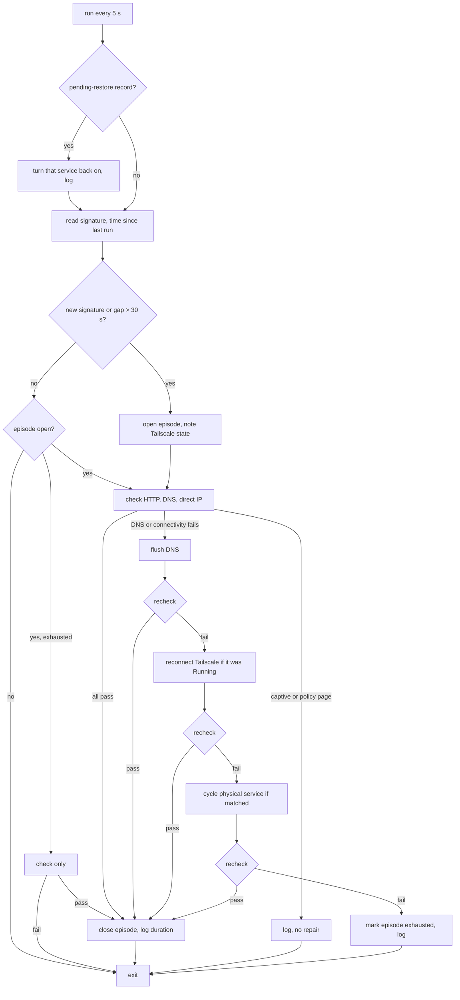

# macOS Network Switch Recovery - Plan

## Goal Capsule

- **Objective:** On the work MacBook, switching networks (Wi-Fi to Wi-Fi, or Wi-Fi to iPhone tethering) no longer needs a manual Wi-Fi toggle, a reboot, or a restart of T3 Code and its agents: the Mac's internet comes back on its own, and Codex and Claude Code sessions that were running keep working.
- **Means:** a root launchd daemon that runs a packaged one-shot recovery script every few seconds (KTD1-KTD6), plus a shorter Claude Code stream idle timeout (KTD7).
- **Product authority:** the user, in the 2026-10-28 brainstorm. Root-cause diagnosis is tracked as a separate GitHub issue and is not active scope here; installing AdGuard is a later piece of work. The Product Contract outranks the Planning Contract; the Planning Contract outranks unit text.
- **Execution profile:** one branch, units in U-ID order, autonomous through PR. Applying the generation to the Mac and the live switch tests are the user's.
- **Stop conditions:** stop if the daemon cannot run the repairs as root without a prompt, or if any change would put an SSID, internal address, or host name into the repository.
- **Open blockers:** none.

---

## Product Contract

### Summary

Add a recovery agent to the work MacBook that notices a network switch, confirms whether the Mac lost its internet, and repairs it with network-only steps that end at reconnecting Wi-Fi.
Make Codex and Claude Code recover their own connections once the network is back, so no running agent session has to be restarted.

### Problem Frame

Switching networks on the work MacBook cuts the whole Mac off the internet: the browser, other apps, and command-line tools all fail, and quitting T3 Code does not bring it back.
Only toggling Wi-Fi or rebooting restores it.
Even after the Mac is back online, Codex and Claude Code processes that were running stay stuck, so the user has to quit T3 Code (Cmd+Q) or stop every task and start again, losing work in progress.

Four layers sit in the traffic path when the switch happens, and none has been shown to be the cause:

- Netwrix Endpoint Protector's transparent proxy network extension, which also inspects TLS (see the TLS inspection CA plan below).
- Microsoft Defender's network extension.
- Tailscale's network extension, which changes DNS and routes while connected.
- macOS's per-interface DNS and routing.

Endpoint Protector and Defender are deployed and managed by Intune, so this repository cannot change them.
Today the repository installs the Tailscale app as a cask and leaves every Tailscale setting to the app.
The user plans to add AdGuard, which by default would add another network extension to the same path.

### Key Decisions

- **Recover without waiting for a diagnosis.** (session-settled: user-directed — chosen over diagnosing first and fixing only the failing layer: the user wants diagnosis tracked as its own issue, so this work must help whatever the cause turns out to be.) Governs R1, R2, R3, R4, R5.
- **Automatic repairs touch only the network, never agent processes.** (session-settled: user-directed — chosen over also restarting stuck Codex and Claude Code processes, and over configuration changes alone with no background agent.) Governs R4, R6.
- **Running agents must recover by themselves.** (session-settled: user-directed — chosen over accepting a manual restart and over only notifying which session is stuck.) Governs R7, R8.
- **AdGuard is a compatibility condition, not a deliverable.** (session-settled: user-directed — chosen over installing AdGuard and choosing its filtering mode in this work.) Governs R10.
- **The recovery agent's log is the evidence the diagnosis issue needs, and no separate diagnostic tool is built.** The issue gets data from every real switch at no extra carrying cost. Governs R5.

### Requirements

**Detecting a lost connection**

- R1. The recovery agent runs in the background on an enabled host from login onward, and reacts to every change of the active network interface or network, including Wi-Fi to Wi-Fi and Wi-Fi to iPhone tethering.
- R2. After a change, it checks whether the Mac can reach the internet, and checks name resolution apart from direct IP reachability.
- R3. When the checks pass, it does nothing beyond logging the result.

**Repairing it**

- R4. When the checks fail, the agent escalates through repairs from the least to the most disruptive, rechecking after each one and stopping at the first that restores the internet. The ladder covers flushing DNS caches, reconnecting Tailscale, and, as the last step, reconnecting the active Wi-Fi.
- R5. Each switch leaves a log entry with the network change, which checks failed, which repair restored the connection or that none did, and how long the outage lasted.
- R6. Apart from reconnecting Tailscale's tunnel and signaling the system DNS daemon to flush its cache in R4, the agent never quits, restarts, or signals T3 Code, Codex, Claude Code, or any other application process, and never changes Endpoint Protector or Defender.
- R11. When the network that carries the default route is not Wi-Fi, such as iPhone USB tethering, the last step reconnects that network service instead of Wi-Fi; when no physical service clearly carries it, the agent skips that step.

**Running agents**

- R7. Once the Mac's internet is back, a Codex or Claude Code session that was running before the switch succeeds on its next request without being restarted.
- R8. Settings from this repository, not patches to the tools, carry R7, and they apply to sessions T3 Code starts as well as ones started from a terminal.

**Host scope**

- R9. The feature sits behind a trait that defaults to off and is enabled on the work MacBook; NixOS hosts, non-NixOS Linux hosts, and bootstrap outputs carry none of it.
- R10. The recovery keeps working when AdGuard is later installed, so the repair ladder must not assume that only the current network extensions exist.

### Acceptance Examples

- AE1. Covers R2, R3. The user moves from one Wi-Fi network to another and the Mac stays online: the agent logs passing checks and runs no repair.
- AE2. Covers R4, R5. The user moves from Wi-Fi to iPhone tethering and DNS fails while direct IP connections work: the agent flushes DNS, the checks pass, it stops there, and the log names the DNS flush as the repair that worked.
- AE3. Covers R4, R6. After a switch nothing works until the last step: the agent reconnects Wi-Fi, the Mac comes back, and every T3 Code task that was running is still running.
- AE4. Covers R4, R5. Every repair fails: the agent logs that no repair restored the connection, leaves the network as it is, and tries again on the next network change.
- AE5. Covers R7. Claude Code was streaming a reply when the switch happened: once the Mac is back, the user's next message in the same session succeeds without restarting T3 Code.

### Success Criteria

- Within 30 seconds of a switch, the Mac's internet works again without any action by the user.
- Over a week of normal use, the user never has to toggle Wi-Fi, reboot, or restart T3 Code because of a network switch.

### Scope Boundaries

- Diagnosing which layer breaks on a switch is tracked in [issue #392](https://github.com/hyperlapse122/nix-config/issues/392). A cause it finds may let a later change remove repair steps or fix the layer directly.
- Installing AdGuard and choosing its filtering mode are deferred to the AdGuard work.
- Changing Endpoint Protector or Defender, or their Intune policies, is outside this repository's control.
- Restarting stuck application processes is excluded (R6).
- Considered and not built: a notification when recovery fails. The log (R5) and the diagnosis issue cover the evidence; add one if exhausted episodes turn out to be common.
- Considered and not built: overriding Codex's built-in provider to shorten its stream idle timeout (KTD7).
- Other Macs, NixOS hosts, and non-NixOS Linux hosts are not in scope (R9).

### Dependencies / Assumptions

- Reconnecting Wi-Fi restores the Mac after a Wi-Fi to Wi-Fi switch; the user has seen that. Whether the same step works after a switch to iPhone tethering, where Wi-Fi is no longer the active interface, has not been checked.
- Turning Wi-Fi off and on from a background agent is allowed by macOS and the device management policy on this Mac. Unverified.

### Sources / Research

- `.compound-engineering/artifacts/solutions/integration-issues/tailscale-up-refuses-omitted-nondefault-prefs-breaks-reauth.md`: `tailscale up` refuses only when it carries flags that omit a stored non-default pref, so a flagless `up` keeps the user's settings.
- `docs/macos.md`: the Tailscale app is installed as a cask, and its settings are the app's, not the repository's.
- `modules/shared/darwin-apps.nix`: the `tailscale-app` cask in `darwinOnly`.
- `.compound-engineering/artifacts/plans/2026-10-27-2230-feat-darwin-inspection-ca-trust-plan.md`: the Endpoint Protector TLS inspection context and the trait pattern for a single work Mac.
- The active network extensions on the work MacBook, from `systemextensionsctl list` on 2026-10-28: Microsoft Defender Network Extension, Endpoint Protector's TransparentProxy (`com.cososys.eppclient`), and the Tailscale Network Extension.

---

## Planning Contract

**Product Contract preservation:** changed: R6 now names the system DNS daemon signal that R4's DNS flush needs; R11 added to answer the deferred tethering question. Every other R, AE, and Key Decision is unchanged.

### Key Technical Decisions

- KTD1. **A root launchd daemon runs a one-shot script every 5 seconds.** `launchd.daemons` with `StartInterval` gives root for the DNS flush and service cycling without a prompt, and launchd never starts a second run of a job while one is running. A one-shot script keeps every run testable with `PATH` stubs; a long-lived loop would not be. It also runs before login, which is harmless. Governs R1, R4.
- KTD2. **A network change is a change of the signature: default-route interface, gateway IPv4 address, gateway MAC address, and the interface's own IPv4 address.** Two Wi-Fi networks can share a gateway address, but rarely a gateway MAC. Reading the SSID is avoided because macOS redacts it without location permission and it would put network names into the log. A gap of more than 30 seconds since the last run counts as a change too, which covers wake from sleep. A switch away and back between two runs goes unseen; that is accepted.
- KTD3. **Checks use plain HTTP and direct TCP, never HTTPS through the inspection proxy.** Internet is up when an HTTP GET of `http://captive.apple.com/hotspot-detect.html` returns its `Success` body. Name resolution is checked separately by resolving a well-known host through the system resolver. Direct IP reachability is a TCP connect to port 443 of either of two public resolver addresses. Any other HTTP body is a captive portal or a policy page; the run logs it and repairs nothing. Every command has a timeout, and one run stops after 25 seconds.
- KTD4. **Every failure that is not a captive or policy page runs the same ladder.** Flush DNS, then reconnect Tailscale, then cycle the physical service, rechecking after each and stopping at the first success. A DNS-only failure starts the same way and escalates when the flush does not fix it. Tailscale is reconnected only when it was in state `Running` at the start of the episode, as the console user through `launchctl asuser`, with a flagless `tailscale down` then `tailscale up` so stored preferences stay. With no console user, that step is skipped. Before `down`, the script writes a Tailscale pending-restore record, handled like KTD5's. Governs R4, R6, R10.
- KTD5. **The physical service comes from the network service order.** The default-route device is matched to exactly one enabled service through `networksetup -listnetworkserviceorder`, which pairs each service name with its device; `-listallhardwareports` only tells whether that device is Wi-Fi. Wi-Fi is cycled with `-setairportpower`, any other matched service such as iPhone USB with `-setnetworkserviceenabled` and its service name. A `utun` interface, no default route, or no single match skips the step. Before turning a service off, the script writes a pending-restore record; after turning it back on, it clears the record. A run that finds a pending-restore record, for a service or for Tailscale, restores it before anything else, keeps the record until the restore succeeds, and logs it. Governs R11.
- KTD6. **One episode per signature.** An episode opens on a change and closes when checks pass. When the ladder runs out, the episode is marked exhausted: later runs only check and log, and a new signature opens a new episode (AE4). After a repair, the script waits for the link to settle before rechecking, so its own Wi-Fi cycle does not open a new episode. State lives in a root-only directory under `/var/db`; the log goes to `/var/log/network-recovery.log`, rotated by `newsyslog`. Log lines carry no SSID, address, or raw command output. Governs R5.
- KTD7. **Claude Code gets `CLAUDE_BYTE_STREAM_IDLE_TIMEOUT_MS=60000`; Codex keeps its defaults.** Claude Code 2.1.312 already aborts a first-party stream after 180 seconds without bytes; 60 seconds frees a session faster, and the API's ping events keep a healthy stream far below that. T3-launched Claude sessions inherit `home.sessionVariables`. Codex 0.165.0 refuses to override its built-in `openai` provider ("Built-in providers cannot be overridden"), and shadowing it with a custom provider would change how T3 selects models. Its defaults already end a silent stream after 300 seconds and retry. Governs R7, R8.
- KTD8. **A new trait `my.networkRecovery.enable` gates everything, and bootstrap builds leave it out**, following `modules/darwin/tls-inspection-ca.nix`'s `enable && !config.my.bootstrap` pattern. The Home Manager side reads the same trait through `config.my`. Governs R9.

### High-Level Technical Design

One run of the script, as directional guidance:

### Assumptions

- Root can run `networksetup -setairportpower` and `-setnetworkserviceenabled` without a prompt on this managed Mac. If a policy blocks it, the step logs a failure and the rest of the ladder still runs.
- The Tailscale app's CLI can bring the tunnel down and up from the console user's launchd context. Unverified; U2's live check confirms it.
- `captive.apple.com` over HTTP and TCP 443 to the two public resolvers are reachable through Endpoint Protector's transparent proxy on a healthy network. Unverified; the first log lines after rollout confirm it.
- A 60-second Claude idle timeout does not cut healthy long generations. Anthropic's streaming API sends ping events, so a live stream is never silent that long.

### Risks

| Risk | Mitigation |
| --- | --- |
| A wrong check result cycles Wi-Fi on a healthy network | The cycle step runs only after the flush and the Tailscale step both failed to fix a failing check, and a captive or policy body never starts the ladder (KTD3, KTD4). |
| The script is killed between turning a service or Tailscale off and on | The pending-restore record makes the next run restore it (KTD4, KTD5). |
| Endpoint Protector or Defender intercept the checks differently from user apps | Logged per episode, so the diagnosis issue gets the evidence; the user can disable the trait. |
| An internal Claude Code environment variable is renamed in a future release | The value only shortens a default; losing it falls back to the 180-second default, not to a hang. |

---

## Implementation Units

### U1. Trait and host wiring

- **Goal:** declare `my.networkRecovery.enable` and turn it on for the work MacBook and the macOS fixture.
- **Requirements:** R9; KTD8.
- **Dependencies:** none.
- **Files:** `modules/shared/host.nix`, `hosts/MacBook-Pro-Mac17-9/default.nix`, `tests/fixtures/hosts/magnolia/default.nix`.
- **Approach:** add the option beside `tlsInspectionCa.enable` with a "macOS hosts only" description. Enable it in the host file and in the `magnolia` fixture so checks see an enabled host.
- **Patterns to follow:** the `tlsInspectionCa` trait.
- **Test scenarios:** Test expectation: none -- option declaration only; U3 and U4 test what it gates.
- **Verification:** the host and fixture evaluate with the trait on.

### U2. Recovery script and package

- **Goal:** a packaged one-shot script that implements one run of the High-Level Technical Design.
- **Requirements:** R1-R6, R10, R11; KTD2-KTD6; AE1-AE4.
- **Dependencies:** none.
- **Files:** `scripts/network-recovery`, `packages/network-recovery.nix`, `tests/network-recovery.nix`, `flake.nix`, `tests/check-shards.nix`.
- **Approach:**
  1. Package with `writeShellApplication`; macOS tools (`route`, `arp`, `networksetup`, `dscacheutil`, `killall`, `launchctl`, `ipconfig`, the Tailscale CLI) are called by name so tests can stub them, and the daemon's `PATH` supplies them (U3).
  2. State directory and log path are fixed constants, overridable only through the daemon's arguments that production also passes, never through a test-only variable.
  3. Bound each external command with a timeout and the whole run with a 25-second deadline.
- **Execution note:** write the stub scenarios first; the ladder's branching is the risk.
- **Patterns to follow:** `packages/tls-inspection-ca.nix`, `tests/tls-inspection-ca.nix` (stub directory first on `PATH`, call log), and the learning on putting the `PATH` assignment on the command under test.
- **Test scenarios:**
  - Covers AE1. New signature, HTTP check returns `Success`: no repair command is called, the log records a passing check.
  - Covers AE2. New signature, DNS fails, direct IP works, DNS passes after the flush: the flush runs, Tailscale and `networksetup` are never called, the log names the flush.
  - Both fail, Tailscale was `Running`, checks pass after its reconnect: `tailscale down` and `up` run as the console user with no flags, no service is cycled.
  - DNS fails while direct IP works and the flush does not fix it: the ladder continues to the Tailscale step.
  - Covers AE3. Both fail through every rung, Wi-Fi is the default interface: `-setairportpower` off then on is called, the pending-restore record exists between them and is gone after.
  - Covers AE4. Every rung fails: the episode is marked exhausted, the next run with the same signature calls no repair, and a run with a new signature opens a new episode.
  - Default device belongs to the iPhone USB service in `-listnetworkserviceorder`: the last step calls `-setnetworkserviceenabled` with that service name, never `-setairportpower`.
  - Two enabled services list the default device: the cycle step is skipped.
  - Default interface is `utun4`, or there is no default route: the cycle step is skipped and logged.
  - Tailscale was `Stopped` at episode start: the Tailscale step is skipped.
  - No console user: the Tailscale step is skipped, the cycle step still runs.
  - HTTP check returns a portal page: no repair runs, the log records a captive or policy result.
  - A pending-restore record exists from a killed run: the service is turned back on and the record is cleared.
  - A Tailscale pending-restore record exists and `tailscale up` fails: the record stays for the next run.
  - An exhausted episode whose check now passes: the episode closes and the log records the outage duration, with no repair.
  - Same signature, but the last run was 40 seconds ago: a new episode opens.
  - Log lines contain no SSID, IP address, or MAC address from the stubbed command output.
- **Verification:** `nix build .#checks.x86_64-linux.network-recovery` passes, and each scenario fails when the branch it covers is removed.

### U3. nix-darwin daemon module

- **Goal:** run the script as a root launchd daemon with log rotation on enabled, non-bootstrap hosts.
- **Requirements:** R1, R5, R9; KTD1, KTD6, KTD8.
- **Dependencies:** U1, U2.
- **Files:** `modules/darwin/network-recovery.nix`, `modules/darwin/profile.nix`, `tests/darwin-config.nix`, `tests/darwin-outputs.nix`.
- **Approach:**
  1. `launchd.daemons.network-recovery` with `StartInterval = 5`, `RunAtLoad`, a `PATH` that includes `/usr/sbin`, `/usr/bin`, `/sbin`, and the Tailscale app's `Contents/MacOS`, and stdout and stderr into the log.
  2. A `newsyslog` entry under `/etc/newsyslog.d/` that rotates the log by size and keeps a few files.
  3. Import the module from `profile.nix`; it stays inert without the trait.
- **Patterns to follow:** `modules/darwin/tls-inspection-ca.nix` for the gate; `tests/darwin-outputs.nix` for reading materialized plists.
- **Test scenarios:**
  - The enabled fixture's generation contains the daemon plist with the script's store path, `StartInterval` 5, and the `PATH` entries.
  - The bootstrap output and a host without the trait contain no such plist and no `newsyslog` entry.
  - The `newsyslog` entry names the log path the daemon writes to.
- **Verification:** `darwin-config` passes on Linux; `checks.aarch64-darwin.darwin-outputs` and `darwinConfigurations.MacBook-Pro-Mac17-9.system` build on the Mac.

### U4. Claude Code stream idle timeout

- **Goal:** running Claude Code sessions drop a dead stream after 60 seconds on enabled hosts.
- **Requirements:** R7, R8, R9; KTD7, KTD8.
- **Dependencies:** U1.
- **Files:** `home/h82/agents/claude.nix`, `tests/claude.nix`.
- **Approach:** add `CLAUDE_BYTE_STREAM_IDLE_TIMEOUT_MS = "60000"` to the session variables when `config.my.networkRecovery.enable` is true and the build is not a bootstrap build.
- **Patterns to follow:** `environmentTier` in `home/h82/agents/claude.nix`; the session-variable assertions in `tests/claude.nix`.
- **Test scenarios:**
  - The enabled fixture's materialized session variables contain the value 60000.
  - A host without the trait has no such variable.
- **Verification:** `tests/claude.nix` passes and fails when the variable is dropped.

### U5. Documentation

- **Goal:** document the feature and its log for the user and future readers.
- **Requirements:** R5, R9.
- **Dependencies:** U2, U3, U4.
- **Files:** `docs/macos.md`, `AGENTS.md`.
- **Approach:** add a `docs/macos.md` section after the TLS inspection CA section: what the trait does, the ladder, where the log is, how to read an exhausted episode, and how to turn the trait off. Add a troubleshooting row. List `network-recovery.nix` in `AGENTS.md`'s `modules/darwin/` paragraph.
- **Test scenarios:** Test expectation: none -- documentation; `agent-instructions` and Markdown lint cover `AGENTS.md`.
- **Verification:** Markdown lint passes and `agent-instructions` passes.

---

## Verification Contract

- `git diff --check` and Markdown lint on changed Markdown.
- `nix fmt -- --ci` runs in CI's `fmt` job; macOS has no formatter output.
- On the Mac: build `.#darwinConfigurations.MacBook-Pro-Mac17-9.system`, `.#darwinConfigurations.MacBook-Pro-Mac17-9-bootstrap.system`, and `.#checks.aarch64-darwin.darwin-outputs`.
- Linux-only checks (`network-recovery`, `darwin-config`, `claude`, `agent-instructions`, `host-name-guard`, `check-shards-guard`) run in CI; verify their inputs locally through `nix derivation show` when needed.
- Mutation check: remove one ladder branch and confirm `network-recovery` fails, per the mutation-testing learning.
- Live checks after the user applies the generation, reported separately from repository checks: a Wi-Fi to Wi-Fi switch, a Wi-Fi to iPhone USB switch, and a Claude Code and a Codex session that were streaming during the switch.

## Definition of Done

- U1-U5 are implemented with their test scenarios, and every repository check above passes or is recorded as deferred to CI.
- No SSID, internal address, or host name appears in the diff.
- No dead-end or experimental code is left in the diff.
- The PR body lists the live checks as pending for the user, with the Tailscale-as-console-user assumption called out.

## Implementation review corrections

- The pinned T3 desktop app imports selected shell variables, excluding the Claude stream timeout. KTD7's shell-inheritance assumption was incorrect. The implementation keeps the shell export and publishes the timeout through a macOS login agent and activation step. Disabling the trait removes the managed GUI value. Existing T3 processes need relaunching after apply.
- A 25-second run can end before the repair ladder finishes. The episode persists its next step, and incomplete service discovery retains the cycle step for the next run.
- Restore physical services before retrying Tailscale. Keep a failed Tailscale restore record without blocking the physical repair it may depend on, and never issue a fresh down while that record remains.
- Regression scenarios exercise production-created restore records, failed on/up retries, and gateway, gateway-MAC, and IPv4 changes on the same interface. The materialized Darwin check verifies GUI publication and removal as well as shell exports and trait gates.
