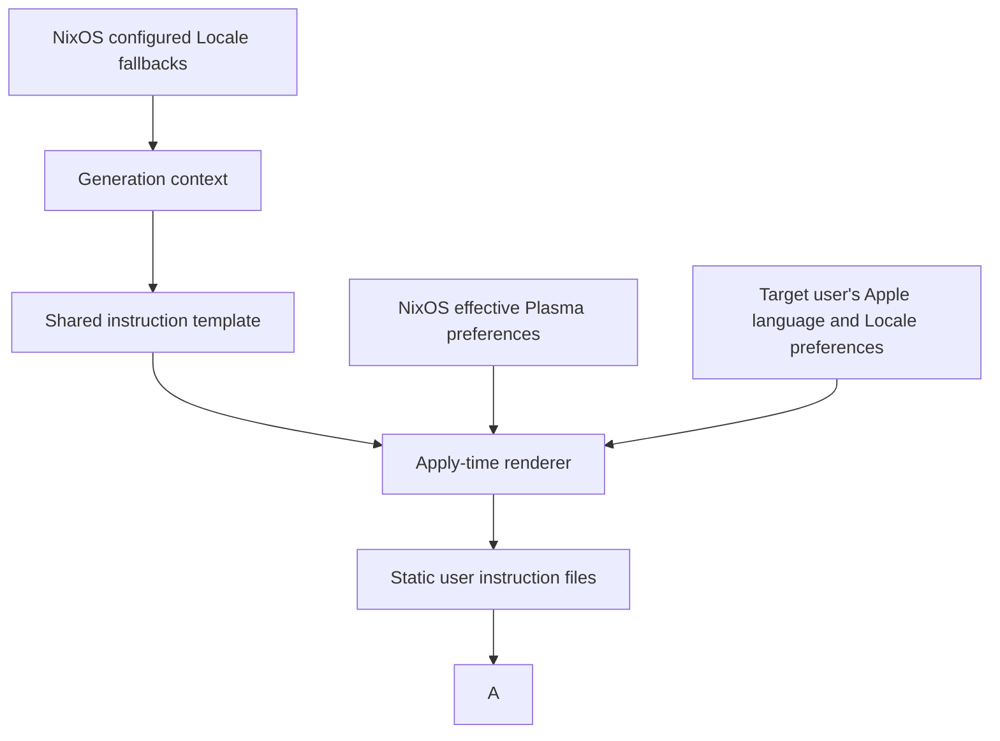

# OS Language in Shared Agent Instructions - Plan

## Goal Capsule

- **Objective:** Claude Code, Codex, and OMP converse with the user in the language the user prefers in their OS settings.
- **Means:** Render OS language context into the shared agent instructions during rebuild.
- **Product authority:** The confirmed scope in this conversation, recorded as R1-R7 below.
- **Open blockers:** None.
- **Execution:** The authorized LFG run implements, verifies, reviews, and opens a PR; merging remains with the user.

## Product Contract

### Summary

Include the user's OS Locale and preferred conversation language in the shared instructions for Claude Code, Codex, and OMP.
Capture this context during rebuild and keep the rendered instructions static between rebuilds.

### Key Decisions

- **OS-derived context.** Governs R1. (session-settled: user-directed — chosen over a separately declared per-host Locale: the user wants the actual OS settings to supply the context.)
- **Language determines conversation.** Governs R2. (session-settled: user-directed — chosen over inferring language from region: the user explicitly prefers the language setting.)
- **Static instructions.** Governs R3-R4. (session-settled: user-directed — chosen over refreshing at agent startup: the user wants static rendered prompts and does not expect lasting language changes.)
- **Conversation and artifact language have separate rules.** Governs R6-R7. (session-settled: user-approved — chosen over applying the OS language to every output: explicit requests and repository document-language rules must still work.)

### Requirements

**OS context and refresh**

- R1. On NixOS and macOS, the rendered shared instructions must identify the user's actual OS Locale and preferred language rather than use an independently maintained agent-language declaration.
- R2. The conversation language must follow the OS language preference, even when the region suggests a different language.
- R3. Rebuild must capture the OS context used for the rendered instructions, including a changed language preference on a subsequent rebuild.
- R4. The rendered instructions must remain static between rebuilds, with no OS-language lookup required at agent startup or during conversation.

**Conversation behavior**

- R5. Claude Code, Codex, and OMP must receive the same conversation-language rule through the shared instructions, without a conflicting managed fixed-language setting.
- R6. An explicit user request for another conversation language must override the OS-derived default.
- R7. Repository and task rules for the language of saved artifacts must remain effective independently of the default conversation language.

### Acceptance Examples

- AE1. **Covers R1-R5.** After rebuilding with Korean as the OS language preference, each agent's rendered instructions identify that preference and direct conversation in Korean; `ko_KR.UTF-8` and `ko-KR` must not imply different conversation languages.
- AE2. **Covers R1-R2, R5.** After rebuilding a Mac with English as its preferred language and South Korea as its region, each agent defaults to English conversation.
- AE3. **Covers R3-R4.** Changing the OS language preference without rebuilding leaves the rendered instructions unchanged, including when an agent starts again; rebuilding captures the new preference.
- AE4. **Covers R6.** With Korean as the rendered default, a user request to answer in English takes precedence for the requested conversation.
- AE5. **Covers R7.** With Korean as the rendered default, an agent converses in Korean while writing this repository's documentation in English, as required by its repository instructions.

### Scope Boundaries

- OS coverage for this change is NixOS and macOS; adding OS-language discovery for non-NixOS Linux is deferred.
- Changing the OS language, region, or formatting preferences is outside this change.
- Continuous monitoring, startup refresh, and switching the language of an already running session after an OS setting change are outside this change.
- Translating the shared instruction template or existing repository documents is outside this change.

### Dependencies / Assumptions

The target user has an OS language preference that can be determined during rebuild.
Live macOS and NixOS behavior needs separate confirmation from repository checks; generated instructions alone do not prove that an agent follows them.

### Sources / Research

- `home/h82/agents/instructions/default.nix`: renders the shared template separately for Claude Code, Codex, and OMP.
- `lib/host-facts.nix`: projects shared host options into the instruction-rendering context.
- `modules/nixos/system/base.nix`: declares the NixOS Locale and additional regional settings.
- `home/h82/default.nix`: declares a shared `LANGUAGE` preference that planning must distinguish from the requested OS source.
- `home/h82/agents/claude.nix`: currently declares `language = "korean"`, which must be reconciled with R5.
- `CONCEPTS.md`: defines host facts and distinguishes repository checks from hardware checks.

## Planning Contract

### Key Technical Decisions

- KTD1. **Read the owning OS source.** For R1-R2, read NixOS Plasma's effective translation language and formatting Locale through KConfig during apply. Use the user's configured session `LANGUAGE` as the language fallback, followed by persistent system `LANGUAGE`, `LC_MESSAGES`, and `i18n.defaultLocale`; derive fallback values from their owning Nix options without a second per-host agent-language declaration. On macOS, read the target user's global `AppleLocale` and ordered `AppleLanguages` preferences during Home Manager activation; its first language is authoritative. Ignore transient build-shell Locale variables.
- KTD2. **Publish static files during apply.** For R3-R4, keep immutable templates/context and a refresh helper in the generation, then render final user-owned instruction files during activation. On NixOS, order publication after the existing KDE session activation and package installation; additionally have `nr switch` and `nr test` invoke the installed refresh helper after successful activation so an unchanged generation captures live preferences. Home Manager's Darwin integration already runs activation on each apply, including an unchanged generation. Build-only and NixOS boot-only operations do not refresh the currently installed prompts; no agent-startup hook is added.
- KTD3. **Retain a single language policy.** For R5-R7, add Locale and preferred-language context plus the conversation rule to the shared template. Retire Claude Code's existing `language` settings key through its existing settings merger, including migration of already written values. Non-NixOS Linux keeps its current Home Manager language preference as compatibility input, without OS discovery.
- KTD5. **Preserve the preference being captured.** For R1-R3, retire the two unconditional translation-language writes in KDE session activation; existing user preferences and unrelated KDE settings remain untouched, with the existing system defaults supplying initial values.
- KTD4. **Keep fallback and writes small.** Normalize underscore/encoding variants to language tags while retaining raw Locale context. Treat C/POSIX as English; if a macOS preference is absent or unusable, render an explicit English fallback with a warning rather than infer language from region. Collect and render successfully before replacing destination files atomically; rendering or filesystem failures must remain visible. Honor Home Manager dry runs.

### High-Level Technical Design

### Assumptions and Risks

- A rebuild means applying the user environment; a build without activation does not refresh installed prompts.
- macOS language discovery must run as the configured user, never as root or the remote builder. Home Manager's Darwin integration supplies that user context.
- Relinquish final instruction destinations from `home.file` on NixOS and macOS, then publish after `linkGeneration` and `installPackages`; old managed symlinks must be removed before publication, and subsequent applies must accept the regular files.
- On NixOS, `nr switch` and `nr test` provide the unchanged-generation refresh contract; direct `nixos-rebuild` can skip Home Manager activation on an unchanged generation and is not an equivalent refresh entrypoint.
- The prompt is guidance to the model, so automated checks prove delivered context and rules; live conversations remain separate runtime evidence.
- No preference monitor, language catalog, or new agent tool is needed: the existing shared prompt provides context to all three agents.

### Research Grounding

- `.compound-engineering/artifacts/solutions/best-practices/home-manager-activation-does-not-run-on-every-rebuild.md` distinguishes NixOS's conditional activation from Darwin's unconditional apply and determines KTD2.
- `.compound-engineering/artifacts/solutions/best-practices/nix-check-reads-option-value-not-materialized-output.md` determines U3's delivered-file boundary.
- [Apple's language and region guide](https://support.apple.com/guide/mac-help/change-language-region-settings-on-mac-intl163/mac) distinguishes preferred languages from regional formats, supporting KTD1.
- [GNU gettext's LANGUAGE documentation](https://www.gnu.org/software/gettext/manual/html_node/The-LANGUAGE-variable.html) documents message-language preference precedence, supporting KTD1's configured NixOS preference.

## Implementation Units

### U1. Render OS language context into the shared policy

**Goal:** Deliver the language policy with OS-derived fallback context and preserve other Linux behavior.

**Requirements:** R1-R7; KTD1, KTD3-KTD4.

**Dependencies:** None.

**Files:** `modules/shared/host.nix`, `lib/nixos-host.nix`, `home/h82/agents/instructions/default.nix`, `home/h82/agents/instructions/instructions.md.tmpl`, `home/h82/agents/claude.nix`, `tests/agent-instructions.nix`, `tests/agent-instructions.py`, `tests/claude.nix`.

**Approach:** Extend the shared context with derived Locale facts, render language context and policy, and migrate the retired Claude language key using the existing merger. Reuse existing renderer and configuration boundaries; do not alter routing tables or model rosters.

**Test scenarios:**

- Covers AE1. Delivered instructions for all agents identify Korean from the configured NixOS source, including underscore/encoding normalization.
- Configured message-language preference wins when its language differs from regional Locale; transient shell language does not become a build input.
- Covers AE4-AE5. Delivered policy states explicit-request precedence and preserves artifact-language rules.
- Existing Claude settings containing `language = "korean"` lose that key while unrelated settings remain intact.
- Non-NixOS Linux fixtures still receive usable instructions.

**Verification:** Materialized instruction and Claude-settings checks enforce the new behavior and migration.

### U2. Capture macOS user preferences during apply

**Goal:** Produce static NixOS and macOS prompts from the target user's current preferences.

**Requirements:** R1-R5; KTD1-KTD2, KTD4.

**Dependencies:** U1.

**Files:** `home/h82/agents/instructions/default.nix`, `home/h82/desktop/kde/session.nix`, a focused helper beside that module or under `scripts/`, its package under `packages/` if needed, `scripts/nr`, `tests/nr.sh`, `tests/agent-instructions.nix`, `tests/agent-instructions.py`, and the native Darwin instruction-check caller in `flake.nix`.

**Approach:** Query native preferences once during activation and use the shared renderer to publish the three final instruction files. Apply KTD2's ownership, ordering, and NixOS helper contract. Keep the installed files static under R4.

**Test scenarios:**

- Covers AE2. English first in `AppleLanguages` with a Korean regional Locale yields English instruction context for all three agents.
- Covers AE3. Two activations of the same generation after changing stubbed OS preferences refresh all installed prompts; changing only the source without activation leaves their bytes unchanged.
- Plasma's translation language wins over a conflicting system Locale; `nr switch` and `nr test` refresh after an unchanged successful apply, while build, boot, dry-run, and failed apply do not refresh.
- A changed-generation apply preserves a pre-existing English Plasma translation preference through KDE activation before publishing English prompt context, per KTD5.
- An existing Home Manager instruction symlink migrates to the new ownership arrangement without writing into the store.
- Dry run leaves files unchanged; malformed or missing preference data uses the explicit KTD4 fallback, and renderer/write errors do not silently succeed.

**Verification:** Execute actual activation entries in scratch homes with native-command stubs and inspect final installed files; verify native Darwin integration through its platform checks.

### U3. Validate delivery and record operational limits

**Goal:** Prove the agreed static delivery behavior at the strongest existing boundaries.

**Requirements:** R1-R7; AE1-AE5.

**Dependencies:** U1-U2.

**Files:** `tests/agent-instructions.nix`, `tests/agent-instructions.py`, `tests/claude.nix`, `flake.nix` only as needed for existing check integration, and `docs/agent-routing.md` if documenting the shared conversation policy there fits its existing scope.

**Approach:** Extend existing instruction delivery checks instead of adding redundant checks. Keep host closure classification accurate if reading more generations. Document source and refresh semantics without claiming build checks prove live conversations.

**Execution note:** Prove the new assertions with focused mutations at their real rendering/activation boundary; follow `test-audit` and the repository's check-design learnings.

**Test scenarios:**

- Removing the language policy or selecting region instead of preferred language must fail the owning instruction check.
- Suppressing activation refresh or retaining Claude's fixed-language key must fail the relevant lifecycle or settings check.

**Verification:** Formatting, Markdown lint, relevant materialized checks, and platform CI pass; hardware/runtime evidence is reported separately.

## Verification Contract

- Run `git diff --check`, changed Markdown lint, and `nix fmt -- --ci` on Linux.
- Build `checks.x86_64-linux.agent-instructions` and `checks.x86_64-linux.claude`, plus any affected package install checks; use exact existing output names confirmed from `flake.nix`.
- Run flake evaluation and all declared checks, NixOS VM checks, and every production/bootstrap host output before declaring merge readiness, with CI supplying unsupported ARM and Darwin builds.
- Run the activation lifecycle checks from U2 against disposable homes and fake native preferences, without activating the developer's system.
- Record native OS preference reads and authenticated agent conversations separately when available; do not claim them from stubs or generated prompt checks.

## Definition of Done

- R1-R7 are implemented with AE1-AE5 represented by delivered-file, activation, or policy evidence at the appropriate boundary.
- U1's source plumbing and settings migration, U2's static macOS publication, and U3's meaningful regression guards pass their checks.
- No language lookup is introduced at agent startup, and no abandoned approach or temporary fixture remains in the branch.
- Review findings are assessed, eligible fixes applied, and remaining findings recorded with evidence.
- The branch is published as an open PR with current-head CI and platform evidence reported; merging remains with the user.
