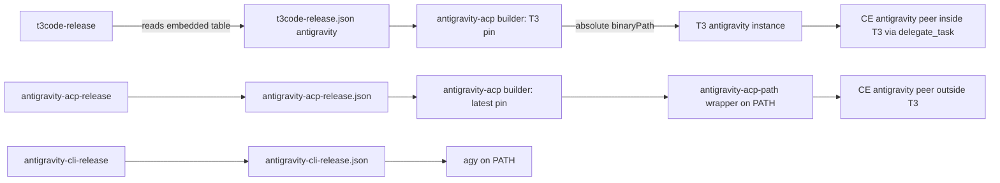

# Restore Antigravity for T3 Code and Narrow OMP - Plan

## Goal Capsule

- **Objective:** The user runs Gemini through Google's own Antigravity runtime in T3 Code, the shell, and Compound Engineering cross-model reviews, while OMP serves only Synthetic and OpenRouter models.
- **Means:** Reinstate Antigravity CLI and ACP packages, pin T3 Code's provider to the ACP release the pinned T3 Code embeds, and remove `google-antigravity` from OMP (KTD1-KTD9).
- **Authority:** The Product Contract governs behavior; Planning Contract KTDs govern mechanism within it; units override neither.
- **Execution profile:** Nix packaging, Home Manager modules, Python updaters, and the shared instruction template; repository checks with fake tokens and scratch homes, plus signed-in live probes reported separately.
- **Stop conditions:** Stop when the pinned T3 Code no longer embeds a readable Antigravity table, when an instance with an absolute `binaryPath` cannot start a session, or when a change would delete OMP credentials or user state.
- **Delivery:** `ce-work` implements U1-U8; the branch ships as one pull request after CI and the required platform evidence pass, and merging stays with the user.
- **Open blockers:** None.

---

## Product Contract

### Summary

Bring Antigravity back as a first-class harness: the latest CLI and ACP runtime on `PATH` for shell use and CE peer reviews, and a T3 Code `antigravity` provider instance pinned by absolute path to the ACP release T3 Code itself embeds.
OMP drops `google-antigravity` and keeps only `synthetic` and `openrouter`, with Synthetic models taking over standalone OMP's default and roles.
Routing tables move their Gemini entries from OMP to the restored T3 provider.

### Problem Frame

Commit `b92f04e` retired the standalone Antigravity provider and moved Gemini into OMP's `google-antigravity` route.
Since then Gemini is reachable only through OMP, so T3 Code has no native Antigravity provider, Compound Engineering cannot select `antigravity` as a review peer, and every OMP role depends on one provider.
The user wants Gemini served by Antigravity's own runtime again and OMP limited to the flat-rate and API providers.

T3 Code pins its own Antigravity ACP release: the pinned nightly `0.1.4-nightly.20261027.3796` embeds version `1.3.0` with per-platform URLs, sha256 digests, archive sizes, and binary sizes, and downloads it into `~/.t3/tools/antigravity-acp/` on demand.
Google's newest ACP and CLI releases move independently of that pin, so a single runtime cannot satisfy both "latest" and "what T3 Code supports".

### Key Decisions

- **Two Antigravity ACP versions coexist with separate consumers.** The latest CLI and ACP go on `PATH` for the shell and CE peer reviews; T3 Code gets its compatible ACP by absolute path, never through `PATH`. (session-settled: user-directed — chosen over CLI-only on `PATH`, nothing on `PATH`, and two T3 instances: the user wants CE peer reviews to use the latest runtime while T3 Code keeps the release it supports.) Governs R1-R4.
- **T3 Code's ACP pin follows T3 Code's own embedded table.** The T3 Code pin update writes the ACP pin from the same release, so the two cannot drift. (session-settled: user-approved — chosen over a separate ACP updater plus a divergence check: one writer cannot disagree with itself.) Governs R4.
- **Antigravity gets parity with the other harnesses.** (session-settled: user-approved — chosen over restoring execution only or instructions only: the shared rules and skills must reach every active harness.) Governs R7.
- **Standalone OMP becomes Synthetic-centered.** (session-settled: user-directed — chosen over OpenRouter-centered, a Synthetic-then-OpenRouter chain, and no managed default.) Governs R9, R10.
- **T3 routing entries that named OMP Gemini move to the T3 `antigravity` provider.** (session-settled: user-approved — chosen over deleting the entries or replacing them with Synthetic or OpenRouter models: the same Gemini models stay in the chains through their native runtime.) Governs R13.
- **Inside T3 Code, CE `antigravity` peers run on the T3 instance.** T3 delegates every cross-model review through `delegate_task`, so the latest `PATH` runtime serves CE peers only outside T3. (session-settled: user-directed — chosen over an `antigravity`-only exception that runs the CE CLI worker inside T3: the existing T3 delegation rule stays uniform.) Governs R2, R13.
- **OpenRouter stays explicit-request-only in standalone OMP.** The existing rule against automatically using separately billed API providers keeps covering OpenRouter, while Synthetic becomes the automatic choice. Governs R9.

### Requirements

**Antigravity runtimes**

- R1. The latest Antigravity CLI is installed on every host kind and reachable on `PATH`.
- R2. The latest complete Antigravity ACP runtime is installed on every host kind and reachable on `PATH`, so Compound Engineering's `antigravity` peer route outside T3 Code finds it.
- R3. T3 Code's `antigravity` provider instance is declared enabled, and its binary is set by absolute path to the ACP release the pinned T3 Code embeds; it resolves neither through `PATH` nor through T3 Code's own download.
- R4. Whenever the T3 Code pin changes, the T3 Code ACP pin takes its version, URLs, and digests from that release's embedded table in the same change, and an update that cannot read the table fails instead of leaving the pins mismatched.
- R5. Automated updaters keep the `PATH` CLI and ACP at Google's newest complete releases, as the retired release scripts did.
- R6. ACP sessions from both runtimes start and answer prompts on NixOS and non-NixOS Linux without hanging for a missing CA bundle.

**Harness parity**

- R7. The Antigravity CLI, the `PATH` ACP runtime, and the T3 Code instance receive the shared instructions, the pinned Compound Engineering skills, the Korean skills, and `test-audit`, as Claude Code, Codex, and OMP do.
- R8. The cross-model peer allowlist includes `antigravity`.

**OMP providers**

- R9. Standalone OMP's default model and every role and subagent override use Synthetic models; OpenRouter models run only on explicit request.
- R10. An OMP-led T3 Code session starts on a Synthetic model.
- R11. Standalone OMP and T3 Code's OMP instance offer only `synthetic` and `openrouter` models, and explicitly selecting `google-antigravity` fails before any model request, as `openai-codex` does today.
- R12. Removing `google-antigravity` from OMP preserves OMP's stored credentials, conversation history, and other user state.

**Routing, instructions, and usage**

- R13. The T3 Code routing table replaces each `omp` `google-antigravity` entry with an `antigravity` entry, using the model IDs the T3 Code ACP release offers (AE3).
- R14. The OMP instructions describe only `synthetic` and `openrouter` as OMP execution routes, and the cross-model identity rule no longer depends on an attested `google-antigravity` model in an OMP session.
- R15. `agent-usage` reports Antigravity quota from a source that does not depend on OMP's `google-antigravity` provider, or reports it as `unknown` when none exists.
- R16. `docs/agent-routing.md` reflects every routing-table and OMP-provider change in the same change.

### Acceptance Examples

- AE1. **Covers R3, R4.** **Given** the T3 Code pin moves to a nightly whose embedded table names ACP `1.4.0`, **when** the dependency update runs, **then** the same commit pins ACP `1.4.0` for T3 Code and the instance's binary path resolves to that release.
- AE2. **Covers R2, R3.** **Given** the `PATH` runtime is newer than the T3 Code ACP release, **when** a shell runs the ACP binary by name and T3 Code starts an Antigravity session, **then** the shell gets the newest release and T3 Code runs the embedded release.
- AE3. **Covers R13.** **Given** the T3 Code ACP `1.3.0` model list (`gemini-4-argon-low`, `-medium`, `-high` and `gemini-3.8-flash-low`, `-medium`, `-high`), **then** `writing` and `visual` start with `antigravity` `gemini-4-argon-low`, the last `implement` entry becomes `antigravity` `gemini-3.8-flash-high`, and the last `implement-high` entry becomes `antigravity` `gemini-4-argon-high`.
- AE4. **Covers R11, R12.** **Given** OMP still holds Antigravity OAuth credentials, **when** the user runs OMP with `--model google-antigravity/gemini-4-argon`, **then** OMP rejects the provider before sending a request and the credentials remain stored.

### Scope Boundaries

- A replacement for Synthetic after its 2026-11-18 expiry is deferred; standalone OMP will then have no automatic model until a later change picks one.
- The OMP-led session's CE host family drops from `gemini` to `unknown` for Synthetic models; automatic cross-model review from OMP sessions stops, and explicitly requested unknown-host reviews keep their current rule.
- Gemini CLI stays as it is; this work restores Antigravity, not Gemini CLI.
- T3 Code's downloaded `model-manifest.json` still recommends ACP `=1.1.1`; the embedded table governs, and the manifest is not consulted.
- Native Codex, Claude Code, Grok, and their T3 instances are unchanged.
- Historical plans, learnings, and usage fixtures are not rewritten.

### Dependencies / Assumptions

- T3 Code continues to ship a machine-readable Antigravity release table inside its release; if a release drops it, R4's update fails by design until the extraction is adapted.
- The `antigravity` T3 instance accepts a user-specified binary path, as the retired configuration did.
- The ACP model IDs carry effort in the ID and expose no separate effort option; routing entries name the ID only.

### Outstanding Questions

**Deferred to Implementation**

- Whether the 1.3.0 runtime in a T3 instance home reads rule files from `$GEMINI_HOME/config/rules/`; U5 decides from a signed-in probe whether the instance-home link ships.
- Whether `agy` or the ACP runtime exposes a read-only quota surface; U8 uses one only if the probe finds it.

### Sources / Research

- Retirement commit `b92f04e` and its parent's `home/h82/t3code.nix`, `packages/antigravity-acp-path.nix`, `packages/antigravity-acp-release.json`, `packages/antigravity-cli-release.json`, `scripts/antigravity-acp-release`, and `scripts/antigravity-cli-release`.
- Prior plans: `.compound-engineering/artifacts/plans/2026-10-26-1022-feat-integrate-antigravity-into-omp-plan.md`, `.compound-engineering/artifacts/plans/2026-10-28-1248-refactor-limit-omp-providers-plan.md`, `.compound-engineering/artifacts/plans/2026-10-21-1133-feat-antigravity-acp-latest-plan.md`, `.compound-engineering/artifacts/plans/2026-10-14-0144-feat-antigravity-agent-parity-plan.md`.
- Learnings: `.compound-engineering/artifacts/solutions/integration-issues/t3code-antigravity-acp-openssl-missing-ca-bundle-hangs-sessions.md`, `.compound-engineering/artifacts/solutions/best-practices/shebang-script-stub-cannot-observe-argv0.md`.
- Current owners: `home/h82/agents/omp-model-catalogs.nix` (OMP selection and `disabledProviders`), `home/h82/agents/omp-roles.nix`, `home/h82/t3code.nix` (`retiredPaths` lists `antigravity`; the OMP launch sets `--model google-antigravity/gemini-4-argon`), `home/h82/agents/instructions/instructions.md.tmpl`, `home/h82/agents/cross-model-peers.nix`, `scripts/agent-usage`, `scripts/t3code-release`.
- The pinned T3 Code CLI binary embeds `ANTIGRAVITY_RELEASE_VERSION = "1.3.0"` with each platform's URL, sha256, `archiveBytes`, and binary sizes; T3 Code's managed install at `~/.t3/tools/antigravity-acp/darwin-arm64/` records the same release ID.
- An ACP `session/new` against that runtime on 2026-10-28 reported agent version `1.3.0` and the six model IDs listed in AE3.

**Product Contract preservation:** Changed R2: the latest `PATH` runtime serves CE peers outside T3 Code, after the user chose that during review. Also restructured with no scope change. Two Key Decision links now point at the requirements they govern (parity: R6 to R7; routing: R11 to R13). The deferred planning questions are answered by KTD1-KTD9 and removed. Two execution-time questions remain.

---

## Planning Contract

### Key Technical Decisions

- KTD1. **One ACP builder, two pins.** Restore `packages/antigravity-acp.nix` as a builder that takes a pin set. The `PATH` package uses `packages/antigravity-acp-release.json`, which `scripts/antigravity-acp-release` keeps at the newest complete release. The T3 instance uses the `antigravity` section of `packages/t3code-release.json`. The builder keeps `dontFixup`, because T3 Code checks exact binary sizes. It also keeps both binaries in one `libexec/antigravity-acp/` directory. Governs R2, R3, R5.
- KTD2. **The `PATH` wrapper keeps argv[0], the CA default, and run-home links.** Restore `packages/antigravity-acp-path.nix` with these parts:
  - `bin/agy_acp_server.par`, which `exec`s the store runtime by absolute path without `-a`;
  - `bin/localharness_external` beside it;
  - on Linux, an `SSL_CERT_FILE` fallback when the caller set none;
  - when `GEMINI_HOME` is a CE run home, links of each `my.agentSkills` skill and of the Antigravity rule directory (KTD5) into it.

  Drop only the token seeding: CE v3.33.1 builds its own run home and copies the token itself (`cross-model-adversarial-review.sh`, `acpx_antigravity_home`). Update the run-home prefix list to CE v3.33.1's names, including `xmodel-doc-peer-`. Governs R2, R6, R7. See `.compound-engineering/artifacts/solutions/best-practices/shebang-script-stub-cannot-observe-argv0.md` and `.compound-engineering/artifacts/solutions/integration-issues/t3code-antigravity-acp-openssl-missing-ca-bundle-hangs-sessions.md`.
- KTD3. **T3 `binaryPath` names the raw T3-pinned runtime.** Set `providerInstances.antigravity.config.binaryPath` to `<T3 runtime>/libexec/antigravity-acp/agy_acp_server.par`. T3 Code resolves an explicit `binaryPath` before its managed download. It requires `localharness_external` in the real directory and sets its own `SSL_CERT_FILE` for the child on Linux, so the instance needs no wrapper. Do not restore `scripts/t3code-antigravity-install`, because nothing reads the managed layout once `binaryPath` is set. (session-settled: user-directed — chosen over CLI-only on `PATH`, nothing on `PATH`, and two T3 instances: the instance must never resolve through `PATH`.) Governs R3.
- KTD4. **`scripts/t3code-release` extracts the embedded table.** After resolving the release, the script downloads one CLI tarball it already pins and reads `ANTIGRAVITY_RELEASE_VERSION` and the `releaseAssets` map from the bundled CLI with a narrow literal parser. It maps T3 platform keys to the flake's systems and writes the `antigravity` section in the retired record shape plus an SRI `hash`. The script rewrites that section when it is missing or differs from the table, even at an unchanged T3 version, so the first run fills it. Before parsing, the script checks the tarball against the release's pinned `cli` sha256. It rejects any extracted URL outside `https://dl.google.com/agy-extensions/releases/`. A digest mismatch, a foreign URL, a parse failure, or a missing supported system exits with a status reserved for an unreadable table. The workflow then keeps the whole old pin file, so the T3 Code and ACP pins never split, and prints a warning title distinct from routine publication lag. (session-settled: user-approved — chosen over a separate ACP updater plus a divergence check: one writer cannot disagree with itself.) Governs R4.
- KTD5. **Antigravity gets a fourth instruction delivery, split into rule files.** Add an `antigravity` delivery and template flag. The delivery packs top-level sections into `~/.gemini/config/rules/nix-config-NN.md` files, each under 24,000 bytes and each opening with `trigger: always_on` frontmatter. The runtime truncates a rule file at 24,000 bytes, and today's render is 28.8-36.7 KB. A top-level section over the limit fails the render. The live refresh deletes prefixed files the current render did not produce. The static path links the rendered directory recursively, so Home Manager prunes them. An activation step links the directory into each declared T3 instance home, and the KTD2 wrapper links it into CE run homes. `.gemini/config/AGENTS.md` stays a retired path, so the rules are never delivered twice. Governs R7.
- KTD6. **Skills reach Antigravity through `~/.gemini/antigravity-cli/skills`.** Re-add that root to `home/h82/agents/skills.nix` for the contributed, Korean, and `test-audit` skills. Link the pinned CE skills into the same root from the existing pinned tree. Do not restore the `agy plugin install` adapter, because the ACP runtime does not load plugins. T3 Code already links this directory into every instance home. A small activation step ordered before `checkLinkTargets` retires the old install. It removes only symlinks in that directory whose target lies under `~/.gemini/config/plugins/`, which is what the retired linker left behind. When `~/.gemini/config/plugins/compound-engineering` exists, it runs `agy plugin uninstall compound-engineering` with the packaged `agy`. It reports the result and never fails the apply. Governs R7.
- KTD7. **OMP drops `google-antigravity` through the existing selection module.** Add it to `disabledProviders` in `home/h82/agents/omp-model-catalogs.nix` and remove its globs. Delete its block in `omp-declarations.py`. Map roles to automatic-use Synthetic models with these effort ladders: Kimi K3, GLM 5.3, and GLM 5.3 Flash take `low`, `high`, `max`; DeepSeek V4.1 Flash takes `none` through `max`. None offers `medium`.

  | OMP role | Model | Effort |
  | --- | --- | --- |
  | `default`, `slow`, `plan`, `architect` | `synthetic/hf:moonshotai/Kimi-K3` | `high` |
  | `task`, `reviewer`, `security-reviewer` | `synthetic/hf:zai-org/GLM-5.3` | `high` |
  | `smol`, `scout`, `seance`, `sonic` | `synthetic/hf:deepseek-ai/DeepSeek-V4.1-Flash` | `low` |
  | `commit` | `synthetic/hf:deepseek-ai/DeepSeek-V4.1-Flash` | `low` |

  The T3 OMP launch `--model` and `omp-writer.md`/`omp-designer.md` use `synthetic/hf:moonshotai/Kimi-K3`. (session-settled: user-directed — chosen over OpenRouter-centered, a Synthetic-then-OpenRouter chain, and no managed default.) Governs R9-R12.
- KTD8. **Routing text changes in one commit with its docs.** The template's T3 table takes AE3's rows. The OMP-led `root` row becomes `omp` `synthetic/hf:moonshotai/Kimi-K3` `high` (S), and a new `{{ if .antigravity }}` `root` row reads `antigravity` `gemini-4-argon-high`. The shared-role OMP table follows KTD7:
  - `root`, `writing`, `visual`, `hard-decision`, `review-gate`, and `architect` use `synthetic/hf:moonshotai/Kimi-K3` `high` (S);
  - `implement`, `implement-high`, `deep`, and `review` use `synthetic/hf:zai-org/GLM-5.3` `high` (S);
  - `scout` and `quick` use `synthetic/hf:deepseek-ai/DeepSeek-V4.1-Flash` `low` (S);
  - `peer` stays CE selection.

  KTD7's per-model effort ladders replace the Gemini-only effort-validation line. The T3 table records that its `antigravity` IDs come from ACP `1.3.0`, and the `<id>-<effort>` peer mapping applies to that version. The dispatch rules state that `antigravity` entries set `target.model` only and verify the returned ID. Inside T3, a CE `antigravity` peer runs on the T3 instance by mapping CE's bare ID and effort to `<id>-<effort>`. The (S) sentence that forbids automatic Synthetic outside T3 changes to allow standalone OMP. After 2026-11-18, standalone OMP starts no new work and asks the user. `docs/agent-routing.md` changes in the same commit (AGENTS.md rule). Governs R13, R14, R16.
- KTD9. **`agent-usage` reports Antigravity as `unknown` unless a read-only source exists.** Remove the `omp usage --provider google-antigravity` call and the OMP `agent.db` identity read. Keep the `gemini` output key so existing consumers still match it. Governs R15.

### High-Level Technical Design

### Assumptions

- The T3 `releaseAssets` keys map `linux-x64` to `x86_64-linux`, `linux-arm64` to `aarch64-linux`, and `darwin-arm64` to `aarch64-darwin`; U2 verifies them against the pinned 3796 bundle before writing the mapping.
- The 24,000-byte rule-file limit comes from the 1.3.0 bundle; U5's probe confirms it and the split keeps a margin either way.
- A missing Synthetic key fails the OMP session instead of falling back to an OpenRouter model. U6 checks this with fake credentials. If OMP falls back, U6 adds the smallest guard that stops the session with a message naming the missing key.

### Sequencing

U1 comes first. U2 and U3 follow in order. U4 and U5 can proceed in parallel after U1. U6 follows U3, because both edit `home/h82/t3code.nix`. U7 follows U5 and U6, because it edits the same template. U8 lands with U7 so the usage text and the routing tables agree.

---

## Implementation Units

### U1. Antigravity packages and updaters on `PATH`

- **Goal:** Install the latest `agy` CLI and the latest ACP runtime on `PATH` on every host kind and keep them current.
- **Requirements:** R1, R2, R5, R6; KTD1, KTD2.
- **Dependencies:** None.
- **Files:**
  - `packages/antigravity-cli.nix`, `packages/antigravity-cli-release.json`, `scripts/antigravity-cli-release`
  - `packages/antigravity-acp.nix`, `packages/antigravity-acp-release.json`, `scripts/antigravity-acp-release`, `packages/antigravity-acp-path.nix`
  - `packages/agent-tools.nix`, `home/h82/default.nix`, `flake.nix`, `tests/check-shards.nix`, `.github/workflows/update-dependencies.yml`
  - tests: `tests/test_antigravity_cli_release.py`, `tests/test_antigravity_acp_release.py`, `tests/antigravity-acp-path.nix`, `tests/darwin-outputs.nix`, `tests/update-dependencies-reconcile.sh`
- **Approach:**
  1. Restore each file from `b92f04e^`, then refresh both release pins with their updaters.
  2. Strip the wrapper's token seeding, and update its run-home prefixes and links (KTD2).
  3. Remove the ACP updater's `--t3code-output` option and its read and write of `packages/t3code-release.json`, so KTD4 stays the only writer of the T3 pin.
  4. Restore the two update steps in the dependency workflow with warn-and-keep handling, without the retired step's save-and-restore of the T3 `antigravity` section or its joint commit block.
  5. Merge `auth.type = "oauth-personal"` into `~/.gemini/antigravity-acp/settings.json` through `agent-settings`, keeping other keys.
- **Patterns to follow:** `git show b92f04e^:<path>` for every restored file; `packages/codex.nix` for current package style.
- **Execution note:** Load `test-audit` before restoring tests, and audit each restored test before re-registering it.
- **Test scenarios:**
  - The CLI package's install check runs `agy --version` with auto-update disabled and prints the pinned version.
  - The CLI updater refuses a downgrade, a manifest missing one system, and a fetch failure, and writes nothing in each case.
  - The ACP updater picks the highest version every system serves, ignores a 404, and refuses an archive that lacks either runtime member.
  - On Linux, the wrapper sets `SSL_CERT_FILE` to the first existing bundle when it is unset, falls back to the nixpkgs bundle when none exists, and leaves a preset value untouched.
  - The wrapper passes the absolute store path as argv[0], checked through a compiled stub, not a shell script.
  - The ACP updater leaves `packages/t3code-release.json` byte-identical.
  - With `GEMINI_HOME` set to an `xmodel-doc-peer-` scratch home, the wrapper links every named skill and the rule directory into it, and with any other `GEMINI_HOME` it links nothing.
  - The settings merge sets `auth.type` and preserves an existing key in a scratch `HOME`.
  - On macOS, the wrapper sets no `SSL_CERT_FILE`, and `localharness_external` sits beside `agy_acp_server.par`.
  - `command -v agy_acp_server.par` in a Home Manager generation resolves to the wrapper, and `localharness_external` is executable in the same directory.
- **Verification:** Both packages build for every supported system; the restored checks pass and fail on their mutations.

### U2. T3 Code ACP pin from the embedded table

- **Goal:** `scripts/t3code-release` writes the `antigravity` section from the pinned T3 Code release's own table.
- **Requirements:** R4, AE1; KTD4.
- **Dependencies:** U1.
- **Files:** `scripts/t3code-release`, `packages/t3code-release.json`, `tests/test_t3code_release.py`, `flake.nix`.
- **Approach:**
  1. Add the tarball download, the narrow parser, and the platform-key mapping.
  2. Fill the section at the current pin, `0.1.4-nightly.20261027.3796`, by running the script.
  3. Update the module docstring.
- **Test scenarios:**
  - Covers AE1. A fixture bundle naming ACP `1.4.0` with a new T3 version produces an `antigravity` section whose version, URLs, sha256, `hash`, and byte sizes match the fixture.
  - At an unchanged T3 version with the `antigravity` key missing, the script writes the section.
  - At an unchanged T3 version with a matching section, the script writes nothing.
  - A bundle whose table variable was renamed, or that lacks a supported system, exits non-zero and leaves the pin file byte-identical.
  - The `hash` field is the SRI form of `sha256`.
  - A tarball whose digest mismatches the pinned `cli` sha256, or a table URL on another host, exits with the unreadable-table status and leaves the pin file byte-identical.
- **Verification:** The `antigravity` section equals the embedded table of the T3 version the pin file names after the run. While the pin stays at `0.1.4-nightly.20261027.3796`, that is ACP 1.3.0 with `aarch64-darwin` sha256 `7cd97045f7b4fe81175a107cdf16f9c51484e3c78a5162cae415338bb6aa5b88`. If the run bumps T3 Code, rerun the AE3 model-list probe against the new release before U7.

### U3. T3 Code `antigravity` instance

- **Goal:** The T3 Code settings declare an enabled `antigravity` instance whose binary is the T3-pinned runtime by absolute store path.
- **Requirements:** R3, R6, AE2; KTD3.
- **Dependencies:** U1, U2.
- **Files:** `home/h82/t3code.nix`, `tests/t3code-traits.nix`.
- **Approach:**
  1. Build the runtime from the `antigravity` section with the KTD1 builder.
  2. Declare `providerInstances.antigravity` with `driver`, `enabled`, and `config.binaryPath`.
  3. Remove the `antigravity` entry from `retiredPaths`, and update the comment that names Antigravity.
- **Test scenarios:**
  - Covers AE2. The materialized settings name a `binaryPath` inside the T3-pinned runtime, whose `localharness_external` sits beside it, and which differs from the store path behind the `PATH` wrapper when the two pins differ.
  - The `binaryPath` does not resolve through `PATH` or `~/.t3/tools`.
  - After applying settings that already hold an `antigravity` instance, the reconciler keeps it.
- **Verification:** A signed-in T3 session on the `antigravity` instance starts and answers a prompt on macOS and on Linux. On Linux it relies on T3's own `SSL_CERT_FILE`. These are live checks, reported apart from repository checks.

### U4. Skills and settings parity for Antigravity

- **Goal:** Contributed, Korean, `test-audit`, and pinned CE skills appear in `~/.gemini/antigravity-cli/skills`, and stale retired links never block activation.
- **Requirements:** R7; KTD6.
- **Dependencies:** U1.
- **Files:**
  - `home/h82/agents/skills.nix`, `home/h82/agents/gemini.nix`
  - tests: `tests/korean-skills.nix`, `tests/test-audit-skill.nix`, `tests/darwin-config.nix`, `tests/gemini.nix`
- **Approach:**
  1. Re-add the skills root, and add the pinned CE skill links beside it.
  2. Add the cleanup activation before `checkLinkTargets`, covering both the retired links and the retired plugin copy.
  3. Restore the `agy` settings merge (`disableAutoGenerateMemories = true`) that `b92f04e` removed.
- **Execution note:** Exercise the cleanup activation in a scratch `HOME` seeded with retired links, not by grepping its text.
- **Test scenarios:**
  - Every Korean skill, `test-audit`, and every pinned CE skill name is a materialized entry under `.gemini/antigravity-cli/skills`.
  - With a scratch `HOME` holding a symlink there into `~/.gemini/config/plugins/compound-engineering/...`, activation removes it and links the declared skill in its place.
  - A symlink there into any other target, and a regular file, survive activation and are reported.
  - With a seeded `~/.gemini/config/plugins/compound-engineering` tree and a stub `agy`, activation calls the uninstall once, and a failing uninstall still lets the apply finish.
  - The merged `agy` settings keep user keys and set `disableAutoGenerateMemories` to `true`.
- **Verification:** The skill and settings checks pass and fail on their mutations.

### U5. Antigravity instruction delivery

- **Goal:** The shared instructions reach the Antigravity CLI, and the T3 instance when it reads them, as rule files that the runtime never truncates.
- **Requirements:** R7; KTD5.
- **Dependencies:** U1.
- **Files:**
  - `scripts/agent-instructions`, `home/h82/agents/instructions/default.nix`, `home/h82/agents/instructions/instructions.md.tmpl`
  - tests: `tests/agent-instructions.nix`, `tests/agent-instructions.py`
- **Approach:**
  1. Add the `antigravity` delivery and flag.
  2. Add an Antigravity harness section. It says an Antigravity-led session passes `CROSS_MODEL_HOST_HARNESS=antigravity` with family `gemini`.
  3. Split the render into prefixed rule files with pruning (KTD5).
  4. Add the activation step that links the rule directory into each declared T3 instance home.
  5. Run the signed-in probes: `agy -p` with a marker rule in `~/.gemini/config/rules/`, and a 1.3.0 session in a scratch `GEMINI_HOME`, once with real files and once with symlinks. Each must show the marker text loaded inline.
- **Execution note:** The probes need a human Google sign-in. R7 is not complete until they pass for the CLI and the T3 instance. A negative or unavailable probe blocks completion and goes back to the user, and is never recorded as done.
- **Test scenarios:**
  - The Antigravity render contains its own harness section and none of the claude, codex, or omp sections, and the other three renders do not contain the Antigravity section.
  - Each Antigravity rule file is under 24,000 bytes and opens with `trigger: always_on`, and the concatenation of their bodies equals the unsplit render.
  - A top-level section over 24,000 bytes fails the render and the check.
  - A render that drops a section leaves no stale prefixed file after the live refresh.
  - `.gemini/config/AGENTS.md` remains a retired path that no generation declares.
- **Verification:** The rendered rule files appear under `~/.gemini/config/rules/` in a Home Manager generation and in the live refresh path on macOS.

### U6. OMP limited to Synthetic and OpenRouter

- **Goal:** OMP offers only `synthetic` and `openrouter`, rejects `google-antigravity`, and starts on Synthetic models.
- **Requirements:** R9-R12, AE4; KTD7.
- **Dependencies:** U3.
- **Files:**
  - OMP config: `home/h82/agents/omp-model-catalogs.nix`, `home/h82/agents/omp-roles.nix`, `home/h82/agents/omp-declarations.py`, `home/h82/agents/omp-writer.md`, `home/h82/agents/omp-designer.md`, `home/h82/t3code.nix`
  - tests: `tests/omp-settings.nix`, `tests/omp-activation.nix`, `tests/omp_settings_applied.py`, `tests/omp_models_load.py`, `tests/omp-acp.py`, `tests/omp-headless.py`
- **Approach:** Apply KTD7's table, and rewrite each obsolete `google-antigravity` expectation in the existing owners instead of adding a new check.
- **Test scenarios:**
  - Covers AE4. With fake `google-antigravity` OAuth credentials, `--model google-antigravity/gemini-4-argon` fails before any request, and the credential rows survive.
  - The ACP session's model options list only `synthetic/` and `openrouter/` IDs.
  - The managed roles name the KTD7 models, and every effort lies on that model's ladder.
  - With no Synthetic key, a session does not start on an OpenRouter model.
- **Verification:** The OMP checks pass on a Linux builder, and the restoration hook in `modules/nixos/system/omp.nix` reapplies the policy.

### U7. Routing tables, peer token, and docs

- **Goal:** Agents read one consistent routing contract that names the restored `antigravity` provider and the Synthetic-only OMP.
- **Requirements:** R8, R13, R14, R16, AE3; KTD8.
- **Dependencies:** U5, U6.
- **Files:**
  - routing and peers: `home/h82/agents/instructions/instructions.md.tmpl`, `docs/agent-routing.md`, `AGENTS.md`, `home/h82/agents/cross-model-peers.nix`, `home/h82/default.nix` or the Antigravity agent module that adds the peer token
  - tests: `tests/agent-instructions.py`, `tests/lib/cross-model-peers.nix`
- **Approach:** Apply KTD8 to the T3 table, the OMP section and table, the (S) sentence, the peer rules that forbade Antigravity in an allowlist, the Gemini-ID validation line, and the peer option docstring. Rewrite the `home/h82/` bullet in `AGENTS.md`: Antigravity becomes a fourth active harness, OMP uses only Synthetic and OpenRouter, and the retired-Antigravity sentence goes.
- **Test scenarios:**
  - Covers AE3. The rendered T3 table's `writing`, `visual`, `implement`, and `implement-high` rows hold the AE3 `antigravity` entries, and no row names `google-antigravity`.
  - `CROSS_MODEL_PEERS` contains `antigravity` in the session variables on Linux and in the `launchd` agent on macOS.
  - The OMP section names only `synthetic` and `openrouter`, and states the post-expiry stop.
  - Every `antigravity` and `omp` row in `docs/agent-routing.md` matches the rendered template.
  - The check fails when `antigravity.version` in `packages/t3code-release.json` differs from the ACP version the T3 table records, so a T3 Code bump that changes the ACP release goes to the workflow's reconciliation PR instead of `main`.
- **Verification:** `agent-instructions` passes and fails when one table row in either file is changed.

### U8. Antigravity usage reporting

- **Goal:** `agent-usage` keeps working after OMP drops the provider and never reads OMP credentials for Gemini.
- **Requirements:** R15; KTD9.
- **Dependencies:** U6.
- **Files:** `scripts/agent-usage`, `tests/test_agent_usage.py`, `docs/agent-routing.md`.
- **Approach:** Make the `gemini` reader report `unknown` with a reason. Use a read-only quota source instead only if the probe finds one.
- **Test scenarios:**
  - With OMP's provider disabled and no Antigravity source, `agent-usage --json` reports `gemini` as `unknown` with a reason and exits 0.
  - No code path opens OMP's `agent.db` for the Gemini reader.
- **Verification:** `tests/test_agent_usage.py` passes, and the docs' usage list says that `unknown` skips nothing.

---

## System-Wide Impact

- Every harness reads `CROSS_MODEL_PEERS`, so Claude Code, Codex, and OMP sessions can pick `antigravity` as a peer once U7 lands. That peer sends repository content to Google, which the existing recipient-disclosure rule covers.
- The template change re-renders the instructions for all four deliveries. Claude Code, Codex, and OMP see new rows and a changed (S) sentence.
- Hosts that ran the pre-`b92f04e` generation may hold retired links. U4's cleanup runs on them, and only there can the problem show.

## Risks & Dependencies

| Risk | Mitigation |
| --- | --- |
| A later T3 nightly renames the embedded table | U2 fails the update closed and keeps the old pin file |
| The 1.3.0 instance ignores instance-home rule files | U5 ships no fake link and records the channel as unapplied |
| Synthetic expires on 2026-11-18 | KTD8's post-expiry stop, plus the deferred replacement in Scope Boundaries |
| The latest `PATH` ACP changes CE's model IDs | CE's own fallback handles it; routing tables use only the T3 ID set |
| The runtime's shared 20,000-token budget for always-on rules turns long rules into file pointers in repositories with large `AGENTS.md` files | U5's probes record whether the marker loads inline; a later change can shorten the Antigravity render |

## Planning Non-Goals

- Considered and not built: restoring `scripts/t3code-antigravity-install`. With KTD3, T3 never reads the managed layout. Evidence that T3 ignores `binaryPath` would change this call.
- Google sign-in for the CLI, the `PATH` runtime, and the T3 instance stays a human step.

---

## Verification Contract

| Gate | Command or evidence | Where |
| --- | --- | --- |
| Whitespace and Markdown | `git diff --check`; `mise run lint-staged-markdown` | Local |
| Formatting | `nix fmt -- --ci` | Linux CI `fmt` job (no `formatter.aarch64-darwin`) |
| Evaluation | `nix flake check --no-build` | Local and CI `flake-check` |
| Checks | `nix build --no-link .#checkShards.<name>` for every shard holding a touched check | CI `check-shards`; Linux builder in a Podman Nix container for spot runs |
| macOS outputs | `nix build --no-link .#darwinConfigurations.<host>.system` and `checks.aarch64-darwin` | Local Mac and CI `build-darwin` |
| Host outputs | every `nixosConfigurations`, `homeConfigurations`, and `systemConfigs` output per AGENTS.md | CI |
| VM tests | `nix build --no-link .#vmChecks.all` | Linux with `/dev/kvm` or CI |
| Live | signed-in T3 `antigravity` session; CE `antigravity` peer outside T3; U5 probes | Mac, reported separately |
| Live, Linux | signed-in prompt through the `PATH` runtime and the T3-pinned runtime, with the CA environment recorded | MS-7D91 (NixOS) and a non-NixOS Linux host when available; R6 stays pending until they pass |

## Definition of Done

- Every unit's verification holds, and each new or restored check fails on its targeted mutation.
- No `google-antigravity` reference remains in active routing, OMP configuration, or tests, except the `disabledProviders` entry (KTD7) and the checks that assert it, AE4's rejection test, stored-credential fixtures, and the historical usage fixtures that Scope Boundaries leaves unchanged.
- Current-head CI is green, and the live checks are reported apart from repository evidence.
- Abandoned-attempt code and unused restored files are removed from the diff.
