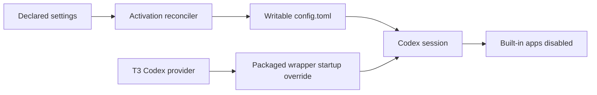

# Disable Codex Built-in Apps - Plan

## Summary

Disable Codex's built-in app connectors through the writable user settings and the packaged command. Extend existing checks and document which evidence covers standalone Codex and T3 Code.

## Goal Capsule

**Objective:** Fresh Codex sessions stop exposing built-in connector tools while ordinary MCP servers and local skills remain usable.

**Means:** Reconcile `features.apps = false` and pass `--disable apps` from the package wrapper.

**Source:** [Issue #400](https://github.com/hyperlapse122/nix-config/issues/400).

---

## Product Contract

### Problem Frame

Codex currently enables built-in connectors by default. Neither the managed user settings nor the packaged wrapper disables them, including when T3 starts Codex.

### Requirements

- R1. The materialized writable user configuration disables `features.apps`, replacing a previous true value without removing unrelated settings.
- R2. The packaged command disables apps under the default home and an alternate `CODEX_HOME`, including a home whose config enables apps.
- R3. Fresh standalone and T3 Code sessions must be checked for connector tool exposure and callability; report any host-injected tools or upstream limitation separately.
- R4. Preserve ordinary MCP servers, local skills, unrelated plugin capabilities, credentials, and installed plugins.
- R5. Cover the existing settings and wrapper boundaries with focused regressions and document the behavior and verification limits.

### Scope Boundaries

Do not change the Codex pin, remove credentials, uninstall plugins, or change T3's provider configuration without evidence that the packaged wrapper is bypassed. A universal filter for host-injected tools is considered and not built: the requested Codex setting controls its own app integration; independent injection requires separate evidence and an upstream fix.

---

## Planning Contract

### Key Technical Decisions

- KTD1. Extend `declaredPaths` in `home/h82/agents/codex.nix`; the existing reconciler preserves writable settings and undeclared keys. Governs R1 and R4.
- KTD2. Add `--disable apps` beside existing feature flags in `packages/codex.nix`; startup overrides cover homes that never receive activation. Per-app defaults alone permit individual overrides. Governs R2.
- KTD3. Use actual activation output and the pinned binary's effective feature list for regressions. Inspect offline prompt/tool output when supported, then distinguish authenticated standalone evidence from live T3 evidence. Governs R3 and R5.

### High-Level Technical Design

### Assumptions and Risks

T3's current provider uses Codex from PATH and shares `~/.codex` (`home/h82/t3code.nix`). Verify the actual launch independently from that declaration. Changes affect new processes; do not claim that this running session loses its existing tools. Runtime probes may require authenticated access; unavailable live evidence remains pending rather than becoming a repository-check pass.

---

## Implementation Units

### U1. Disable apps in reconciled user settings

**Goal:** Implement R1 and preserve R4.

**Dependencies:** None.

**Files:** `home/h82/agents/codex.nix`, `tests/codex-settings.nix`.

**Approach:** Follow KTD1. Extend the existing activation fixture and expected materialized TOML, including unrelated MCP and plugin settings.

**Test scenarios:**

1. Start with apps enabled, run the actual activation block in a scratch home, and parse apps as false afterward.
2. Confirm the same operation preserves unrelated project, MCP, and plugin entries and remains idempotent.

**Verification:** The existing `codex-settings` check passes and removing the new declaration makes its own assertion fail.

### U2. Disable apps at startup and verify capabilities

**Goal:** Implement R2, R3, R4, and R5.

**Dependencies:** U1 for combined verification.

**Files:** `packages/codex.nix`, `tests/codex.nix`, `docs/codex.md` (new).

**Approach:** Follow KTD2 and KTD3. Extend existing wrapper behavior coverage, preserve its skill-discovery proof, and add a focused ordinary MCP smoke check at the existing boundary. Record live standalone and T3 findings separately in the PR.

**Execution note:** This is package configuration; prefer binary and session smoke evidence over mock-only tests.

**Test scenarios:**

1. The unwrapped pinned binary reports apps enabled; the wrapper reports disabled with default and alternate homes even when their configs enable apps.
2. Existing skill discovery still lists the probe skill once, and an ordinary local MCP server remains configured and usable with apps disabled.
3. A fresh session's offered tools exclude Codex app connectors. Report host-injected tools independently and never invoke a real connector to obtain proof.

**Verification:** The `codex` check passes; removing the startup flag fails the effective feature assertion. Inspect the pinned release's handling of apps when interpreting fresh-session evidence.

---

## Verification Contract

Run `git diff --check`, changed Markdown lint, `nix fmt -- --ci`, and the affected `codex` and `codex-settings` checks locally. Keep the existing checks as contract owners and inspect their derivation closures if dependencies widen. Before relying on checks, read the check learnings required by `AGENTS.md` and load `test-audit`.

Before merge readiness, require current-head CI, flake evaluation, all declared checks, VM tests, and every production/bootstrap host output on supported builders. Linux, ARM, and Darwin evidence must be reported separately when local builders cannot supply it. Do not activate a host generation or change a live provider just to validate this branch.

For live evidence, inspect a fresh standalone Codex tool list and a fresh T3 Codex tool list using the changed package when the host supports that launch. If the host cannot select the uninstalled package, record T3 verification as pending and identify the limitation explicitly.

## Definition of Done

Both settings and startup boundaries disable apps. Regression checks distinguish the changed behavior from the old behavior and preserve MCP/skill/plugin support. Documentation states process lifetime and tool-injection boundaries. The PR reports actual validation, unavailable live checks, and unresolved findings without claiming merge readiness prematurely. Remove any exploratory code before shipping.

## Sources

- [OpenAI configuration basics](https://learn.chatgpt.com/docs/config-file/config-basic): the app feature switch.
- [OpenAI developer commands](https://learn.chatgpt.com/docs/developer-commands): the supported `--disable` startup override.
- `tests/codex.nix` and `tests/codex-settings.nix`: existing boundary owners.
- `.compound-engineering/artifacts/solutions/best-practices/mutation-testing-reveals-decorative-nix-check-assertions.md`: prove each guard distinguishes broken behavior.
