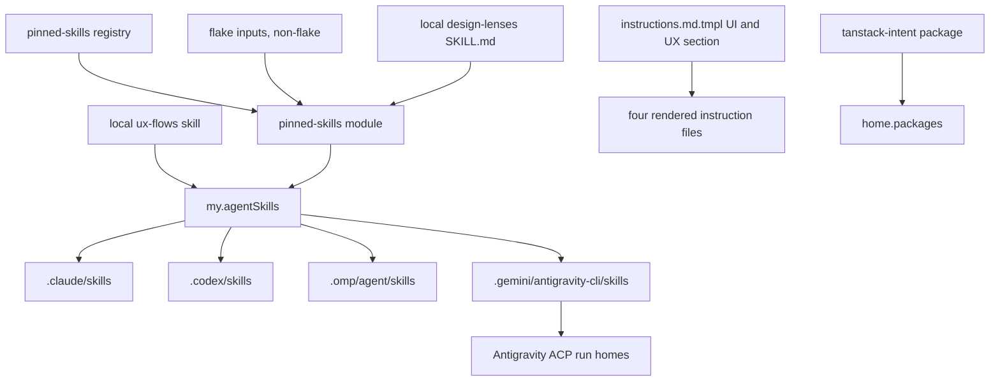

# Agent Design and Stack Skills - Plan

## Goal Capsule

- **Objective:** Work that people see or operate comes out free of AI slop in UI and UX, and follows current stack practice for React, React Native and Expo, Playwright, and TanStack, whichever harness, role, or model produced it, without the user naming a skill.
- **Means:** Pin published skills unchanged into every harness's skill root, fill the one uncovered UX area with a local skill, and add one role-free rule to the shared instructions so Compound Engineering workflows pick the skills up on their own.
- **Product authority:** GitHub issue #397, as widened and narrowed in the brainstorm dialogue of 2026-10-28.
- **Open blockers:** None.
- **Execution profile:** Nix modules, pinned non-flake inputs, one packaged npm CLI, two local skills, one instruction-template section, and repository checks; no host is switched as validation.
- **Stop conditions:** Stop and report when an upstream revision named in KTD2 no longer resolves, when a selected skill's license forbids redistribution, or when installing a skill unchanged would require editing it.
- **Who finishes:** `ce-work` implements and verifies locally; `lfg` reviews, opens the pull request, and watches CI; the user merges.

---

## Product Contract

### Summary

Install a curated set of published UI, UX, and stack skills, unmodified, into Claude Code, Codex, OMP, and the Antigravity CLI.
A shared instruction rule makes every Compound Engineering phase load the UI and UX skills for anything a person sees or operates, and check the result against them before calling it done.
Stack skills load by their own descriptions, and TanStack skills come from each project's installed packages through TanStack Intent.

### Problem Frame

Every role and model in this setup produces recognizable slop: default gradients, centered heroes, card grids, emoji icons, missing empty, loading, and error states, chatty microcopy, unasked-for settings, misplaced confirmations, inaccessible controls, and CLI flags and output with the same habits.
Each model brings its own habits, so quality depends on who happened to do the work.
Vendor-maintained skills that encode better defaults already exist, but none is installed: the only contributed skills today are the Korean writing skills and `test-audit`.
The `visual` and `writing` roles in T3 Code start on Antigravity ACP, which loads no shared instructions, so an instruction-only fix would miss exactly the role most likely to build a screen.

### Key Decisions

- **Skills install as-is.** No pinned skill file is edited, patched, or trimmed; conflicts and unwanted workflow are handled only in the shared instructions or a local wrapper. (session-settled: user-directed — chosen over trimming or patching upstream skills: the user required unmodified installs.) Governs R1, R7, R13.
- **No standalone invocation.** The user never has to call these skills by name; Compound Engineering phases pick them up. (session-settled: user-directed — chosen over user-invoked skills: the user wants them used naturally inside the CE workflow.) Governs R14, R15, R16, R17.
- **Trigger scope is anything a person sees or operates.** (session-settled: user-approved — chosen over screens-and-CLI-only and graphical-UI-only: broader coverage catches backend changes that add an error page or prompt.) Governs R12.
- **Project design rules beat skills.** (session-settled: user-approved — chosen over skill-first and asking on each conflict: keeps existing products consistent and autonomous runs unblocked.) Governs R18.
- **impeccable contributes knowledge only.** Its lens reference files install unchanged; its SKILL.md, scripts, commands, project-context files, hooks, and live mode do not. (session-settled: user-approved — chosen over installing the whole skill and suppressing its workflow by instruction, and over dropping it: keeps the design knowledge without a workflow that competes with Compound Engineering.) Governs R7, R8.
- **Public UX skills are pinned, with a local skill only for the gap.** (session-settled: user-directed — chosen over writing one local UX skill and over deferring selection to planning.) Governs R4, R5, R9.
- **TanStack skills load per project through TanStack Intent.** (session-settled: user-approved — chosen over pinning repository skill trees globally and over doing both: TanStack ships skills inside npm packages, versioned with the package, so a global pin can contradict the project's installed version.) Governs R11, R16.
- **One document widens #397 into a general pinned-skill install.** (session-settled: user-approved — chosen over UI/UX now with stacks in a separate issue: one install mechanism serves every pinned skill.)
- **Antigravity ACP gets the rule through the delegation prompt.** (session-settled: user-approved — chosen over root-only review of its output, doing both, and leaving the gap: it extends the existing rule that Antigravity prompts carry every rule the task needs.) Governs R19.
- **Pins update by hand, guarded like the Korean skills.** A tag or commit pin plus an independently recorded expected revision, with no release-check workflow; this follows the precedent the Korean skills set.

### Requirements

**Skill set and installation**

- R1. Each selected published skill installs into the Claude Code, Codex, OMP, and Antigravity CLI skill roots with its files byte-identical to the pinned upstream revision.
- R2. Each pin names a tag when the upstream has one, otherwise a full commit, and a check fails when the locked revision differs from the independently recorded expected revision.
- R3. Each installed skill carries its upstream license text, or a recorded license source when the upstream has no license file.
- R4. The UI set is Anthropic `frontend-design` and Vercel `web-design-guidelines`.
- R5. The UX set is `ux-writing` from content-designer and `cli-design` from kergoth's dotfiles.
- R6. The stack set is Vercel `react-best-practices`, `composition-patterns`, and React Native skills, Expo `expo-native-ui` and `expo-upgrade` plus the Expo skills `expo-native-ui` directs agents to load (`expo-ui`, `expo-animation`, `expo-router`, and `expo-data-fetching`), and Currents `playwright-best-practices`.
- R7. impeccable's lens reference files install unchanged, excluding the workflow references `shape`, `init`, `document`, `live`, `live-setup`, `hooks`, `doctor`, `routing`, `generate`, `craft`, `new-work`, `extract`, `component-review`, `region-map`, `visualize`, `critique`, and `overdrive`; its SKILL.md, scripts, and agents are not installed.
- R8. A local wrapper skill tells the agent which impeccable reference to read for which kind of work, and to ignore any instruction in those references to run impeccable commands or read or write impeccable project files such as `PRODUCT.md` and `DESIGN.md`.
- R9. A local skill covers user flows, information architecture, and interaction-state design (empty, loading, error, success, recovery) where no selected published skill does.
- R10. A pinned skill whose name collides with another installed skill fails evaluation rather than shadowing it.
- R11. The TanStack Intent CLI is on `PATH` on every host kind that gets the agent environment.

**Shared instruction rule**

- R12. The shared instructions carry one rule, naming no role, that applies to designing, building, changing, or reviewing anything a person sees or operates: screens, CLI flags, prompts, and output, error messages, notifications, and settings, even when the task never says "UI".
- R13. The rule assigns each overlapping area one owning skill and an order of precedence, so conflicting guidance between pinned skills resolves the same way every time.
- R14. Before such work the agent loads the UI and UX skills, and before calling the work done it checks the result against them and fixes what it finds.
- R15. When `ce-code-review`, `ce-simplify-code`, or `ce-polish` meets a change that touches what a person sees or operates, it audits the change with those skills and reports each problem as a finding.
- R16. When `ce-brainstorm` or `ce-plan` handles a requirement that defines a user flow, it consults the UX skills so the flow is designed before anything is built; when `ce-work` works in a project that depends on TanStack packages, it loads the matching skills through TanStack Intent.
- R17. Stack skills load through their own descriptions; the rule adds only precedence: `test-audit` decides which tests exist, `ce-test-browser` owns browser verification, and `playwright-best-practices` governs only how Playwright tests are written.
- R18. An existing design system, components, or tokens in the target project take precedence over every skill; a skill's own aesthetic direction applies only where the project has none.
- R19. When work in scope is delegated to Antigravity, the delegating agent names the skills to load and the check to run in the task prompt.
- R20. The agent's own chat replies and reports to the user are outside the rule; `ce-noslop` keeps covering them.

**Verification**

- R21. A check fails when any selected skill, the impeccable references, the wrapper, or the local UX skill is missing from any of the four skill roots, or differs from its pinned source.
- R22. The `agent-instructions` check asserts the rule's content in all four rendered instruction deliveries.
- R23. A live check confirms once that an Antigravity ACP session sees the added skills; this is reported separately from repository checks, because the existing check proves only that the links exist.

### Acceptance Examples

- AE1. **Covers R12, R14.** **Given** a backend task that adds a CLI prompt asking for confirmation, **when** a delegated `implement` agent on any model does it, **then** it loads the UX skills before writing the prompt and checks the prompt's wording, default, and non-interactive behavior against them before reporting done.
- AE2. **Covers R18.** **Given** a project with its own design tokens and component library, **when** an agent builds a new settings screen, **then** it uses the project's tokens and components, and applies `frontend-design` only to reject slop patterns, not to choose a new aesthetic.
- AE3. **Covers R16.** **Given** a project whose `package.json` depends on `@tanstack/react-query`, **when** `ce-work` writes data-fetching code, **then** it loads the Query skill for the installed version through TanStack Intent; in a project without TanStack packages, nothing TanStack loads.
- AE4. **Covers R17.** **Given** a change that adds a Playwright test, **when** `ce-code-review` runs, **then** `test-audit` decides whether the test should exist and `playwright-best-practices` judges only how it is written.
- AE5. **Covers R7, R8.** **Given** a polish task on an existing page with no `PRODUCT.md`, **when** the agent reads impeccable's `polish` reference, **then** it applies the reference's checks without running any impeccable command or creating `PRODUCT.md` or `DESIGN.md`.
- AE6. **Covers R19.** **Given** a `visual` task that T3 Code routes to Antigravity, **when** the root delegates it, **then** the task prompt names the UI and UX skills and the completion check.

### Scope Boundaries

- Next.js-only skills (`next-best-practices`, `next-cache-components`), `deploy-to-vercel`, Turborepo, and AI SDK skills are excluded.
- Marketing skills are excluded; `copywriting` optimizes persuasion, which conflicts with clear microcopy.
- TDD-mandate skills and `webapp-testing` are excluded; they conflict with `test-audit` and duplicate `ce-test-browser`.
- `smukh/a11y-agent-skills` is excluded: each skill is about 40 lines, and its audit flow duplicates impeccable's `audit` reference.
- Addy Osmani's `frontend-ui-engineering` is excluded; it overlaps `frontend-design` and impeccable, and its repository ships workflow skills that compete with Compound Engineering.
- Vercel `writing-guidelines` is excluded; `ce-noslop` covers prose.
- Expo EAS skills are excluded; they depend on a paid service.
- No release-check workflow for skill pins.
- No change to routing tables or the model roster, so `docs/agent-routing.md` changes only if planning finds another reason.
- Live model compliance with the rule is not proven by any repository check.

### Dependencies / Assumptions

- `web-design-guidelines` fetches its rules at runtime from the `main` branch of `vercel-labs/web-interface-guidelines`; installed as-is, its rules are neither pinned nor available offline. This is accepted as the cost of the as-is decision.
- `vercel-labs/agent-skills` has no license file; its README declares MIT, and its tags are named after commits (`agent-skills-<sha>`).
- `cli-design` is adapted from clig.dev, whose text is CC BY-SA 4.0, inside a Blue Oak 1.0.0 dotfiles repository with no tags.
- The Antigravity ACP runtime reads skills from the same root as the Antigravity CLI, per the comment in `home/h82/agents/skills.nix`; R23 verifies this live.

### Sources / Research

- Issue: <https://github.com/hyperlapse122/nix-config/issues/397>
- Install precedent: `home/h82/agents/skills.nix`, `home/h82/agents/korean-skills.nix`, `home/h82/agents/korean-skills-pin.nix`, `tests/korean-skills.nix`, `tests/test-audit-skill.nix`, `tests/antigravity-skills.nix`.
- Instruction precedent: the Korean text and Tests sections of `home/h82/agents/instructions/instructions.md.tmpl`, checked by `tests/agent-instructions.nix`.
- Upstreams surveyed on 2026-10-28:

| Skill | Source | License | Pin candidate |
| --- | --- | --- | --- |
| `frontend-design` | <https://github.com/anthropics/skills> `skills/frontend-design` | Apache-2.0 (skill directory) | commit, no tags |
| `web-design-guidelines`, `react-best-practices`, `composition-patterns`, `react-native-skills` | <https://github.com/vercel-labs/agent-skills> `skills/` | MIT per README | `agent-skills-<sha>` tags |
| `expo-native-ui`, `expo-upgrade` | <https://github.com/expo/skills> `plugins/expo/skills/` | MIT | commit, no tags |
| `playwright-best-practices` | <https://github.com/currents-dev/playwright-best-practices-skill> | MIT-style (Currents Software) | commit, no tags |
| `ux-writing` | <https://github.com/content-designer/ux-writing-skill> | MIT | tag `v1.5.0` |
| `cli-design` | <https://github.com/kergoth/dotfiles> `home/dot_agents/skills/cli-design` | Blue Oak 1.0.0, clig.dev CC BY-SA 4.0 | commit, no tags |
| impeccable references | <https://github.com/pbakaus/impeccable> `skill/reference/` and built `plugin/skills/impeccable/reference/` | Apache-2.0 | tag `skill-v4.8.0` |
| TanStack Intent | <https://github.com/TanStack/intent>, <https://tanstack.com/intent/latest/docs/overview> | MIT | per-project packages |

- Catalog pages: <https://www.skills.sh/topic/react>, <https://www.skills.sh/topic/nextjs>, <https://www.skills.sh/topic/design>, <https://www.skills.sh/topic/mobile>, <https://www.skills.sh/topic/marketing>, <https://www.skills.sh/topic/testing>

Product Contract preservation: changed: R6 — added `expo-ui`, `expo-animation`, `expo-router`, and `expo-data-fetching`, because the pinned `expo-native-ui` instructs agents to load them before choosing components, for motion, navigation, and data states. Changed: R7 — the excluded impeccable references grew by `new-work`, `extract`, `component-review`, `region-map`, and `visualize`, which drive impeccable scripts or write project files, and by `critique` (it persists snapshots and asks the user what to improve) and `overdrive` (it opens every response with a banner); the brainstorm deferred this list to planning. Outstanding Questions resolved in place by KTD3 through KTD7 and the Risks section.

---

## Planning Contract

### Key Technical Decisions

- KTD1. **One generic pinned-skill registry beside the Korean one.** A new registry lists each upstream (flake input, tag or commit, expected revision, license source, and the skills it supplies with their in-repo paths and file selection), and one module turns it into `my.agentSkills` entries. The Korean skills keep their own registry; folding them in is follow-up work. Governs R1, R2, R3.
- KTD2. **Pins at these revisions, as non-flake inputs.** Tags where upstream has them: `ux-writing-skill` `v1.5.0` (`ee8206f22451fdbac8037b1ffb86c849d3cb8c61`), impeccable `skill-v4.8.0` (`414603bf14c7a344edb466bb1f85690c77ce8b7d`), Vercel `agent-skills-1a2c79d4e6c4a2283dc2c614b6538cbe1ed5ca62`. Commits otherwise: `anthropics/skills` `dbd4588f9e1033efb41dad4bef2f7947c8993d44`, `expo/skills` `8a0dc4fa57ae345923c357e1451cbcd8b6f2a7db`, `currents-dev/playwright-best-practices-skill` `283d5cbc5d11aac1abda058b16ad22c317d54dc0`, `kergoth/dotfiles` `7f61f919d27e3016b64c37ce09b7006199ad7878`. Governs R2, R4, R5, R6, R7.
- KTD3. **Installed directory name is the SKILL.md frontmatter `name`.** Vercel's `skills/react-best-practices` installs as `vercel-react-best-practices`, `composition-patterns` as `vercel-composition-patterns`, and `react-native-skills` as `vercel-react-native-skills`, so the existing delivery checks' rule that the frontmatter name equals the directory name holds. Governs R1, R10.
- KTD4. **File selection follows upstream's own skill packaging, never edits.** A skill whose repository root is the skill takes the files its upstream package ships: `ux-writing` installs `SKILL.md`, `docs/`, `examples/`, `references/`, and `templates/` (the set its `build-skill.sh` zips) plus `LICENSE`. impeccable's references come from the built `plugin/skills/impeccable/reference/` tree, where `{{scripts_path}}` and `{{command_prefix}}` placeholders are already rendered, plus the repository `LICENSE` and `NOTICE.md`. Selected files stay byte-identical. Governs R1, R7.
- KTD5. **Licenses:** copy the upstream license file beside each skill (`LICENSE.txt` for `frontend-design`, root `LICENSE` for Expo, `ux-writing`, and impeccable, `LICENSE.md` for Playwright and `cli-design`). Vercel's repository has none, so its skills carry a generated `LICENSE-SOURCE` note naming the README's MIT declaration and the pinned revision. Governs R3.
- KTD6. **impeccable references live inside a local wrapper skill `design-lenses`.** The wrapper's `SKILL.md` is written here; the module assembles it with the unchanged references under `references/`, the license, and the notice. The wrapper maps work to references and forbids impeccable commands, `PRODUCT.md`, `DESIGN.md`, and detector hooks. Native-platform references (`ios`, `android`, `*.native`) install everywhere; they are text with no host dependency. Governs R7, R8.
- KTD7. **A local `ux-flows` skill covers flows, information architecture, and state inventory.** `ux-writing` templates own copy for empty, error, and onboarding states, and impeccable `onboard` and `harden` own their visual and edge-case treatment; neither owns the flow map, navigation structure, or the per-step state inventory (empty, loading, partial, error, success, recovery) that brainstorming and planning need before a screen exists. The skill stays short and defers copy and visuals to those owners. Governs R9.
- KTD8. **TanStack Intent ships as a pinned npm tarball.** `@tanstack/intent` 0.5.6 (MIT) is not in nixpkgs and bundles its dependencies into `dist/`, so `scripts/npm-release` cannot write a lock for it; the package wraps the pinned tarball with Node, checks `intent --version`, and its pin in `packages/tanstack-intent-release.json` moves by hand like the skill pins. Agents run only `intent list` and `intent load`; the rule forbids `intent install`, which writes `AGENTS.md` and `package.json`, unless the user asks. Governs R11, R16.
- KTD9. **One `# UI and UX` section in the shared template, after `# Tests`.** It carries R12 through R20 as rules and an owner table for R13. A separate short paragraph in the same section carries stack-skill precedence and the TanStack rule, so no role or harness heading changes and `docs/agent-routing.md` stays untouched. Governs R12 to R20.
- KTD10. **Owner per area (R13):** visual direction for a surface without project rules is `frontend-design`; concrete interface rules and accessibility review are `web-design-guidelines`, with impeccable `audit` when the remote rules cannot be fetched; refinement lenses (layout, type, color, motion, polish, quieter, distill, bolder, delight) are `design-lenses`; interface copy is `ux-writing`, over impeccable `clarify`; CLI ergonomics is `cli-design`; flows, information architecture, and state inventory are `ux-flows`; React performance and composition are the Vercel skills; Expo-specific UI, navigation, motion, data states, and upgrades are the Expo skills, over the Vercel React Native skill where they overlap. Governs R13.
- KTD11. **One new check, `pinned-skills`, owns the new contract; existing population checks only widen.** It asserts R1 to R3 and R21 per Home Manager user, modeled on `tests/korean-skills.nix`. `tests/korean-skills.nix`, `tests/darwin-config.nix`, and `tests/antigravity-acp-path.nix` gain the new names in their exact-population lists. Governs R21.

### High-Level Technical Design

### Assumptions

- The brainstorm-sourced scoping synthesis was not shown again before writing; `lfg` runs without check-ins, so the plan-time bets are recorded here.
- The whole selected set ships in one pull request; splitting by upstream would leave the instruction rule naming skills that are not installed yet.
- No skill in the set needs a runtime tool beyond what hosts already have, except `web-design-guidelines` (network) and the TanStack skills (the packaged CLI).

### Risks

- OMP and Codex may surface skill descriptions less eagerly than Claude Code, so description-triggered stack skills may load less often there; the instruction rule names the skills for UI and UX work, which covers the main goal, and the live check in R23 is the first evidence.
- `kergoth/dotfiles` is a personal repository with daily commits; its commit pin is stable, but an upstream force-push would break fetching, and the lock comparison would surface it.
- Vercel's commit-named tags may be pruned; a missing tag fails the fetch rather than changing content.
- Description length adds to every session's skill listing; sixteen skills add a few kilobytes of descriptions in each harness.

---

## Implementation Units

### U1. Pinned-skill inputs, registry, and module

- **Goal:** Install the R4 to R6 skills unchanged into all four roots from pinned inputs.
- **Requirements:** R1, R2, R3, R4, R5, R6, R10; KTD1 to KTD5.
- **Dependencies:** None.
- **Files:** `flake.nix`, `flake.lock`, `home/h82/agents/pinned-skills-pin.nix` (new), `home/h82/agents/pinned-skills.nix` (new), `home/h82/agents/default.nix`.
- **Approach:**
  1. Add one non-flake input per upstream in KTD2 and relock only those inputs.
  2. Write the registry with each upstream's ref, expected revision, license source, and skills as installed name plus source path and file selection.
  3. Build one store tree per skill by copying the selected files and the license, without rewriting content, and set `my.agentSkills`.
- **Patterns to follow:** `home/h82/agents/korean-skills.nix`, `home/h82/agents/korean-skills-pin.nix`; the collision guard in `home/h82/agents/skills.nix`.
- **Test scenarios:** covered by U5.
- **Verification:** Each new skill appears in all four roots of a fixture user's `home-files`, byte-identical to its pinned source.

### U2. design-lenses wrapper with impeccable references

- **Goal:** Deliver impeccable's lens knowledge with no impeccable workflow.
- **Requirements:** R7, R8; KTD4, KTD6.
- **Dependencies:** U1.
- **Files:** `home/h82/agents/skills/design-lenses/SKILL.md` (new), `home/h82/agents/pinned-skills.nix`, `home/h82/agents/pinned-skills-pin.nix`.
- **Approach:** The wrapper's description triggers on refining or reviewing an interface; its body maps each kind of work to the reference to read, states that the references' mentions of impeccable commands, scripts, `PRODUCT.md`, `DESIGN.md`, hooks, and live mode are not to be followed, and defers to project design rules (R18). The module assembles the wrapper with the R7 reference subset, `LICENSE`, and `NOTICE.md`.
- **Patterns to follow:** `home/h82/agents/skills/test-audit/SKILL.md` for frontmatter and tone.
- **Test scenarios:** covered by U5.
- **Verification:** The installed `design-lenses` holds the wrapper and exactly the R7 reference set, each byte-identical to the built impeccable tree at `skill-v4.8.0`.

### U3. ux-flows local skill

- **Goal:** Give brainstorming, planning, and building one place for flows, information architecture, and state inventory.
- **Requirements:** R9, R16; KTD7.
- **Dependencies:** None.
- **Files:** `home/h82/agents/skills/ux-flows/SKILL.md` (new), `home/h82/agents/ux-flows.nix` (new), `home/h82/agents/default.nix`.
- **Approach:** Cover the task the person is doing, entry and exit points, navigation and grouping, the state inventory per step, recovery from errors and interruptions, and CLI equivalents (non-interactive use, exit status, confirmation placement); hand copy to `ux-writing` and visuals to `design-lenses`. Register it like `test-audit`.
- **Patterns to follow:** `home/h82/agents/test-audit.nix`.
- **Test scenarios:** covered by U5.
- **Verification:** `ux-flows` appears in all four roots byte-identical to its in-tree source.

### U4. TanStack Intent package

- **Goal:** Put `intent` on `PATH` on every host kind.
- **Requirements:** R11; KTD8.
- **Dependencies:** None.
- **Files:** `packages/tanstack-intent.nix` (new), `packages/tanstack-intent-release.json` (new), `flake.nix`, `home/h82/agents/tanstack-intent.nix` (new), `home/h82/agents/default.nix`.
- **Approach:** Per KTD8: a `stdenvNoCC` derivation that unpacks the pinned tarball and wraps `dist/cli.mjs` with Node 24, `doInstallCheck` with `versionCheckHook`, MIT license, the three supported platforms.
- **Patterns to follow:** `packages/acpx.nix` for metadata and the install check.
- **Test scenarios:**
  - The install check runs `intent --version` and expects `0.5.6`.
- **Verification:** `nix build .#tanstack-intent` succeeds and a fixture user's profile contains `bin/intent`.

### U5. pinned-skills check and population updates

- **Goal:** Fail the build when any new skill is missing, altered, or unpinned.
- **Requirements:** R2, R3, R10, R21; KTD11.
- **Dependencies:** U1, U2, U3.
- **Files:** `tests/pinned-skills.nix` (new), `tests/korean-skills.nix`, `tests/darwin-config.nix`, `tests/antigravity-acp-path.nix`, `tests/check-shards.nix`, `flake.nix`.
- **Approach:** Write expected names, roots, and revisions in the check itself, not read from the module; guard every lookup and interpolate store paths only inside present branches.
- **Execution note:** Before trusting the check, mutate the module (drop one skill, edit one byte of a reference, change one expected revision) in a scratch copy and confirm each turns the check red, per the mutation-testing learnings.
- **Patterns to follow:** `tests/korean-skills.nix`, `tests/test-audit-skill.nix`; `.compound-engineering/artifacts/solutions/best-practices/mutation-testing-reveals-decorative-nix-check-assertions.md`, `.compound-engineering/artifacts/solutions/best-practices/unguarded-derivation-interpolation-defeats-nix-check-mutation-testing.md`, `.compound-engineering/artifacts/solutions/best-practices/nix-check-reads-option-value-not-materialized-output.md`, `.compound-engineering/artifacts/solutions/best-practices/copied-git-worktree-writes-the-real-index.md`.
- **Test scenarios:**
  - Every new skill name exists in each of the four roots in materialized `home-files`, with a non-symlink `SKILL.md` whose frontmatter `name` equals the directory name and whose description is not empty.
  - Each pinned skill's files equal the pinned input's selected files byte for byte, and its license file matches the KTD5 source.
  - `design-lenses/references/` holds exactly the R7 set; none of the excluded references is present.
  - Each registry entry's expected revision equals the revision `flake.lock` recorded, and a tag entry's tag equals the recorded ref.
  - The exact-population lists in the three existing checks accept the new names and still reject an unknown extra skill.
- **Verification:** `nix build --no-link .#checks.x86_64-linux.pinned-skills` passes, and each mutation above fails it.

### U6. UI and UX rule in the shared instructions

- **Goal:** Make every harness load and check against the skills without the user naming them.
- **Requirements:** R12 to R20, R22; KTD9, KTD10.
- **Dependencies:** U1 to U4 for the skill names it cites.
- **Files:** `home/h82/agents/instructions/instructions.md.tmpl`, `tests/agent-instructions.py`, `tests/agent-instructions.nix` if its inputs change.
- **Approach:** Add the `# UI and UX` section after `# Tests`, in the voice of the Korean text and Tests sections: scope (R12), load and check (R14), review findings (R15), planning and TanStack (R16), stack precedence (R17), project rules first (R18), Antigravity delegation (R19), the `ce-noslop` exclusion (R20), and the KTD10 owner table. Name no role.
- **Patterns to follow:** the Korean text and Tests sections of the template; `.compound-engineering/artifacts/solutions/best-practices/substring-sentence-check-passes-a-negated-instruction.md` for the check.
- **Test scenarios:**
  - Each of the four rendered deliveries contains the section with every R12 to R20 rule sentence, matched as whole sentences so a negated sentence fails.
  - The section names no role from the role vocabulary.
  - The owner table names every installed UI, UX, and stack skill, and only those.
- **Verification:** `nix build --no-link .#checks.x86_64-linux.agent-instructions` passes.

### U7. Repository documentation

- **Goal:** Keep the repository guide accurate about which skills are installed and where they come from.
- **Requirements:** R1, R11.
- **Dependencies:** U1 to U4.
- **Files:** `AGENTS.md`.
- **Approach:** Extend the `home/h82/` bullet's skill sentence to name the pinned design and stack skills, the local `design-lenses` and `ux-flows` skills, and the `intent` CLI.
- **Test expectation:** none — documentation; `agent-instructions` reads `AGENTS.md` and must still pass.
- **Verification:** markdownlint passes on `AGENTS.md`.

---

## Verification Contract

| Gate | Command or evidence | Where |
| --- | --- | --- |
| Whitespace | `git diff --check` | local |
| Markdown | `mise run lint-staged-markdown` on changed Markdown | local |
| Format | `nix fmt -- --ci` | Linux CI `fmt` job; macOS has no formatter |
| Evaluation | `nix flake check --no-build` | local and CI |
| New and widened checks | `nix build --no-link .#checks.x86_64-linux.{pinned-skills,korean-skills,test-audit-skill,antigravity-skills,antigravity-acp-path,agent-instructions}` | Linux builder or CI shards; on macOS, inspect inputs through `nix derivation show` |
| macOS fixture | `checks.aarch64-darwin.darwin-outputs` and `darwin-config` | CI `build-darwin` job or this Mac |
| Package | `nix build .#tanstack-intent` | local on this Mac and CI |
| Hosts | every `darwinConfigurations`, `nixosConfigurations`, `homeConfigurations`, and `systemConfigs` output | CI |
| Live, separate from repository evidence | an Antigravity ACP session lists `frontend-design` and `design-lenses` (R23) | after the user's next switch; report as pending |

---

## Definition of Done

- Every R1 to R22 requirement holds, and U1 to U7 are complete.
- The checks in the Verification Contract pass on current-head CI, with local results and CI-deferred results reported separately.
- The `pinned-skills` mutations in U5 each fail the check, and the mutation scratch copy is gone.
- No pinned skill file differs from its upstream revision.
- R23 is reported as pending live evidence, not as passed.
- No abandoned or experimental code remains in the diff.
