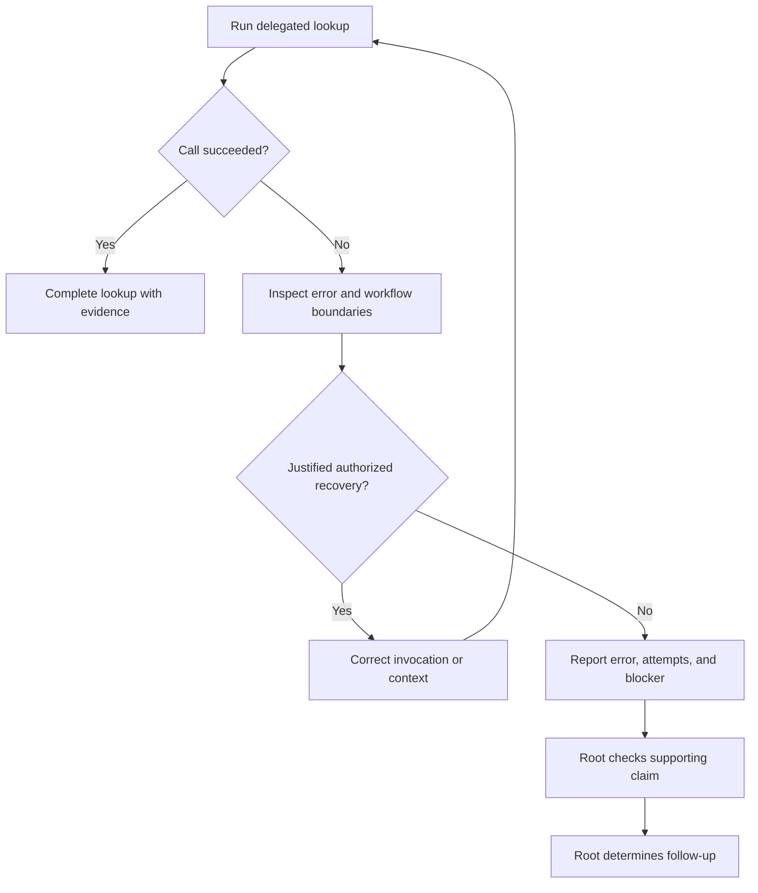

# Delegated Research Recovery - Plan

## Goal Capsule

- **Objective:** Delegated research completes through recoverable tool errors, reducing investigations the root has to repeat.
- **Means:** Evidence-led recovery by the child and higher effort for the two Luna lookup roles.
- **Product authority:** The user confirmed both role changes and the revised recovery scope on 2026-10-28, identifying premature abandonment during `ce-sweep` as the motivating problem.
- **Open blockers:** None for implementation planning.

---

## Product Contract

Product Contract unchanged; the planning-owned verification question is resolved in KTD2, KTD3, and U2.

### Summary

Let a research child diagnose and correct recoverable tool failures before returning an unresolved task.
Use Luna medium Fast for both `scout` and `quick`, with matching instruction delivery and documentation.

### Problem Frame

The motivating incident was a `ce-sweep` source-fetch child abandoning its investigation after one failed tool attempt, leaving the root to repeat the work.
[Issue #402](https://github.com/hyperlapse122/nix-config/issues/402) records a built-in connector error despite a brief naming `glab`; it does not establish that `glab` itself was executed and failed.
The user's concern covers either failure path: the child stopped without working through the cause.

The current shared delegation section already contains the issue's five briefing rules, but its tool-error rule tells the child to report the error and stop its task immediately.
Both Luna lookup roles still use low effort in the T3 and native Codex routing tables.
Higher effort alone leaves the immediate-stop instruction in force.

### Key Decisions

- **Keep Luna and Fast while increasing effort for both roles.** (session-settled: user-directed — chosen over switching to Sol medium Fast or retaining quick at low effort: the user selected an effort-only change and explicitly included quick.) Governs R1.
- **Make recovery part of the child's job.** (session-settled: user-approved — chosen over an effort-only change and immediate termination after any failed call: the user wants the child to reason through a recoverable failure before handing work back.) Governs R2-R6.

### Actors

- A1. Research child: performs the delegated lookup, including source fetching assigned to `quick` during `ce-sweep`.
- A2. Root: owns the overall investigation and evaluates an unresolved child return.

### Requirements

**Role defaults**

- R1. Set the `gpt-6-luna` entry for both `scout` and `quick` to medium effort with Fast (`serviceTier: priority`) in the shared T3 table and the native Codex table.

**Recovery behavior**

- R2. After a failed research call, the child inspects the observed error and relevant tool usage or execution context before declaring the task blocked.
- R3. The child corrects recoverable invocation or context errors and retries through the tool named in its brief when that action is authorized and supported by the diagnosis.
- R4. Recovery attempts must have a reason to expect progress; repeated unchanged failures without new evidence end recovery rather than forming an indefinite retry loop.
- R5. The child returns an unresolved result when no justified authorized recovery remains or the owning workflow requires a stop or handoff.
- R6. An unresolved return includes the observed error with secrets redacted, the recovery attempted, and the remaining blocker; a failed query never counts as a successful empty result.

**Root ownership and delivery**

- R7. Before relying on an unresolved or negative child return, the root directly checks the cheapest supporting claim and determines the follow-up investigation from that evidence.
- R8. Preserve existing limits on unnamed connector substitution, protected authentication and permissions, role selection, source reading, and skill-owned recovery boundaries while applying R2-R7.
- R9. Keep the recovery policy in the common delegation section at its existing managed delivery paths, and synchronize routing documentation with R1.

### Key Flow

- F1. Recover a delegated lookup. **Covers R2-R8.** A failed call leads to diagnosis and, where justified, a corrected attempt through the named tool; success resumes the original lookup, while an unresolved result goes to the root for direct checking and follow-up.

### Acceptance Examples

- AE1. Correct a failed CLI invocation. **Covers R2, R3, R6.** Given a source-fetch brief naming `glab`, when the first call fails on an unsupported option and the tool's usage identifies the correction, the child corrects the call, completes the lookup, and reports the fetched records with evidence.
- AE2. Report a real blocker. **Covers R5-R8.** Given a failure requiring permission the child does not have, the child returns the redacted error, its diagnostic evidence, and the remaining blocker; the root checks the supporting claim before relying on it.
- AE3. Stop unproductive repetition. **Covers R4-R6.** Given a failed lookup with no remaining justified recovery, the child reports an unresolved task instead of repeating the same failing call or reporting zero records.
- AE4. Keep the named access path. **Covers R3, R8.** Given a brief naming `glab` and an available look-alike connector, a failed call leads to diagnosis within the authorized access path rather than a switch to that connector.

### Success Criteria

- Materialized instructions show R1 and R9 consistently across their intended delivery paths.
- Fresh T3 behavioral evidence covers AE1, an unresolved outcome under AE2 or AE3, and the root's check under R7, with the loaded instruction revision recorded.
- Repository checks establish instruction delivery; they do not establish that a model follows the policy or that medium effort improves completion rates.

### Scope Boundaries

- This work updates delegated research behavior and the two Luna role entries; other role defaults and fallback chains are outside scope.
- Connector installation or removal, including the configuration work discussed in issue #400, is outside scope.
- A new runner, retry service, telemetry system, or model benchmark is outside scope.
- Host activation and deployment are outside scope.

### Sources / Research

- [Issue #402](https://github.com/hyperlapse122/nix-config/issues/402): motivating failures and the five original briefing requirements.
- `home/h82/agents/instructions/instructions.md.tmpl`, "When to delegate": existing immediate-stop, connector, and root-verification rules.
- `home/h82/agents/instructions/instructions.md.tmpl`, "T3 Code table" and "Codex table": current Luna role entries.
- `docs/agent-routing.md`: maintained routing reference that must change with the template.
- `.compound-engineering/artifacts/plans/feedback-sweep-plan.md`, R58 and its delivery slice: earlier briefing work; this plan replaces its deferred effort choice and immediate-stop behavior for the current task.
- `CONCEPTS.md`, "Verification" and "Delivery path": separation of generated instruction evidence from runtime behavior.

---

## Planning Contract

### Key Technical Decisions

- KTD1. **Edit the existing shared policy and tables.** Implement R1-R9 in `home/h82/agents/instructions/instructions.md.tmpl`, using separate diagnostic/recovery and unresolved-result bullets so the stop condition does not override recovery. Keep skill-owned stops explicit and preserve the connector prohibition. No runner or provider configuration change is needed.
- KTD2. **Extend the existing prompt-byte contract.** `tests/agent-instructions.py` already independently specifies the complete routing section and role chains; update those expectations rather than adding another sentence inventory. Its self-test and `tests/agent-instructions.nix` remain the primary owners of contract and materialized-delivery proof. Governs verification of R1 and R9.
- KTD3. **Exercise recovery in a fresh T3 child with candidate instructions.** Use a disposable fake `glab` on PATH and candidate policy supplied in the child brief, with fake data and no network or account access. Record the policy digest, requested and returned model settings, actual tool attempts, and outcome. This checks behavior under the candidate policy without activating a host generation; installed-host instruction loading remains separate evidence. Covers AE1-AE4.

### Assumptions and Execution Limits

- Medium effort is a requested quality change, not a measured completion-rate improvement.
- Native Darwin checks can run locally; Linux checks, VM checks, and Linux host outputs require CI or a supported builder.
- Reviewer and exercise children inspect the shared checkout without editing production files; read-only access is prompt-instructed, not technically enforced.

## Implementation Units

### U1. Deliver the revised delegation contract

- **Goal:** Implement the confirmed policy and role defaults.
- **Requirements:** R1-R9; F1.
- **Dependencies:** None.
- **Files:** `home/h82/agents/instructions/instructions.md.tmpl`, `tests/agent-instructions.py`, `docs/agent-routing.md`.
- **Approach:** Follow KTD1 and KTD2, updating the guide's delegation explanation, current tables, and comparison differences without changing the historical upstream defaults.
- **Execution note:** Update the independent expected contract first and establish that the old template fails for the intended routing contract before editing the template.
- **Patterns to follow:** `routing_contract`, `T3_CHAINS`, and `HARNESS_CHAINS` in the existing Python check; the guide's "When delegation starts" section.
- **Test scenarios:**
  1. The old template fails against the revised independent expectations.
  2. Every rendered harness carries the revised common recovery policy.
  3. Both Luna role entries request medium Fast in the T3 and native Codex tables, while fallback entries retain their values.
  4. Removing or contradicting a recovery clause fails the routing-section guard.
- **Verification:** The Python self-test, guide table validation, affected materialized instruction checks, and changed Markdown lint pass.

### U2. Establish behavior and platform evidence

- **Goal:** Distinguish policy delivery from recovery observed in a running model.
- **Requirements:** R2-R8; F1; AE1-AE4; Success Criteria.
- **Dependencies:** U1.
- **Files:** `tests/agent-instructions.py` and `tests/agent-instructions.nix` are used unchanged after U1; disposable exercise artifacts stay outside the checkout.
- **Approach:** Follow KTD3, assess every child return against its command evidence, and leave unsupported platform evidence explicitly pending until CI supplies it.
- **Test scenarios:**
  1. Covers AE1 and AE4. A fake CLI rejects the initial option, its usage identifies a supported form, and the child uses that form to retrieve the fake records through the same CLI.
  2. Covers AE2 and AE3. A fake CLI presents a persistent blocker; the child reports the error, diagnostic attempts, and unresolved work without claiming an empty successful result.
  3. Covers R7. The root checks the cheapest claim in that unresolved return directly before deciding the follow-up.
- **Verification:** Save the exercise transcript and candidate policy identity, run locally supported checks, and require the repository's full current-head platform evidence before calling the PR merge-ready.

---

## Verification Contract

| Boundary | Evidence | Interpretation |
| --- | --- | --- |
| Independent prompt contract | Python self-test and pre-fix failure | Guards the authored policy and role defaults |
| Materialized instructions | Existing `agent-instructions` check on supported systems | Proves delivery through existing paths |
| Routing guide | Existing Python guide-table validator and Markdown lint | Keeps current tables consistent |
| Candidate model behavior | Fresh T3 child exercises under KTD3 | Proves the observed runs, with serving identity limitations reported |
| Repository integration | Current-head CI and all required platform builds/checks | Required before merge readiness |

Host activation is not validation for this change.
If an exercise cannot run, record the missing behavioral evidence separately from passing repository checks.

---

## Definition of Done

- U1 implements the confirmed defaults and recovery policy with no unrelated role changes.
- U2 records supported checks and actual exercise outcomes, including any pending evidence.
- Review findings are assessed and substantiated defects are fixed; remaining findings have explicit dispositions.
- The PR describes behavior, validation, and limits, and remains unmerged for the user.
