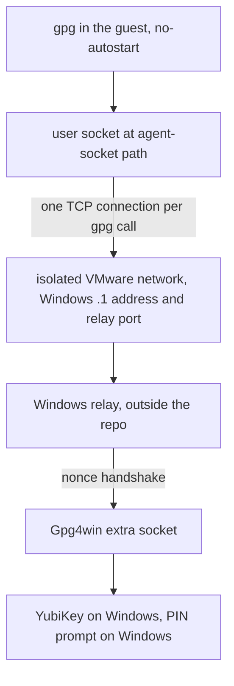
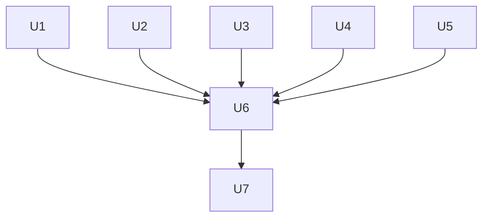

# MS-7D91 to Windows with a VMware NixOS Guest - Plan

## Goal Capsule

- **Objective:** The MS-7D91 work PC runs Windows, and the user still gets this repository's Linux environment (Plasma on Wayland, T3 Code, a Linux home of its own) inside a VMware Workstation virtual machine, with YubiKey GPG signing and decryption working on Windows and in the VM at the same time.
- **Means:** Remove the bare-metal `MS-7D91` NixOS host and the hardware modules only it used, add the `MS-7D91-VM` NixOS host for the VMware guest, and point the guest's GPG at the Windows Gpg4win agent through a relay on an isolated VMware network (KTD1, KTD3).
- **Product authority:** The user, through the 2026-10-28 brainstorm. Windows-side setup (Gpg4win, the relay program, VMware networks) is outside this repository.
- **Execution profile:** Deep. Seven units across host removal, boot, checks, GPG relay, SSH, the new host, and docs. One pull request.
- **Stop conditions:** Stop and report instead of improvising when re-encrypting SOPS files fails (card missing, PIN rejected), when a change would need a real plaintext credential in a build, or when a check can only be made green by removing its guard.
- **Who finishes:** `ce-work` implements and verifies in repository checks; the user runs the Windows and VMware runtime checks in Definition of Done.
- **Open blockers:** None.

---

## Product Contract

Product Contract preservation: changed R6 — clipboard sharing is dropped from acceptance; the user chose not to track it after research showed open-vm-tools documents clipboard as Xorg-only. Otherwise unchanged; Outstanding Questions resolved in place.

### Summary

Replace the bare-metal `MS-7D91` host with a NixOS host built to run as a VMware Workstation guest on the same PC, now running Windows.
The guest keeps Plasma and T3 Code, drops every hardware and network service the desktop alone needed, and uses the Windows gpg-agent for every YubiKey operation through a relay reachable only on an isolated VMware network.

### Problem Frame

MS-7D91 is the user's work PC, and work now requires Windows on it.
Today this repository manages that machine only as bare-metal NixOS, so moving to Windows would end the Linux environment the user develops in.

The user also develops on Windows, so the YubiKey has to serve both systems.
USB passthrough hands the card to one side at a time, which rules it out as the everyday path.

WSL was considered and rejected.
Its GUI apps run as individual windows through WSLg rather than as a full Wayland session, and its Linux and Windows homes are separate yet partly cross-mounted, which the user found unnatural.
WSL 3.0 (released 2026-09-29) adds Linux containers (`wslc`) but changes neither of these.

### Key Decisions

- **NixOS guest, not a non-NixOS distribution.** Keeps the Plasma desktop and the shared NixOS profile, except the hardware modules and services the requirements remove, and keeps one NixOS host in `hosts/`. (session-settled: user-directed — chosen over a `kind = "linux"` distribution guest and over deferring the guest: the guest should keep the NixOS desktop.) Governs R4, R5.
- **VMware Workstation as the hypervisor.** Better 3D acceleration and Plasma responsiveness on a Windows host than VirtualBox. (session-settled: user-directed — chosen over VirtualBox and over supporting both: one hypervisor keeps verification to one target.) Governs R6.
- **VMware VM, not WSL.** (session-settled: user-directed — chosen over NixOS-WSL on WSL 3.0: WSLg gives no full Wayland session and WSL's split home folders feel unnatural.)
- **Windows owns the card; the guest forwards to the Windows agent.** Both systems can sign and decrypt at once, and the PIN prompt appears on Windows. (session-settled: user-directed — chosen over switching the card by USB passthrough and over supporting both: passthrough locks Windows out of the card.) Governs R8, R9, R10.
- **One always-on relay serves both console and SSH use.** The user works both in the VMware console and over SSH from Windows. (session-settled: user-directed — chosen over SSH-session-only forwarding.) Governs R9, R11.
- **The relay is plain TCP on an isolated VMware network, not an SSH reverse tunnel.** The isolated network is the security boundary for an unauthenticated TCP hop. (session-settled: user-directed — chosen over a persistent Windows-to-guest `ssh -R` tunnel: the user preferred the simpler transport and asked to rely on VMware's host-only style isolation.) Governs R9, R10.
- **Windows-side setup stays out of the repository.** The repository defines only what the guest expects of the relay. (session-settled: user-directed — chosen over a Windows setup guide and over a PowerShell script.) Governs R12.
- **No disk encryption inside the guest.** Windows BitLocker or VMware VM encryption protects the virtual disk instead of LUKS. (session-settled: user-directed — chosen over keeping guest LUKS: no passphrase at every VM boot.) Governs R7.
- **Delete the hardware modules only MS-7D91 used.** Git history restores them if bare-metal hardware returns. (session-settled: user-directed — chosen over keeping them inert behind traits.) Governs R2.
- **The guest carries only Plasma and T3 Code from MS-7D91's roles.** (session-settled: user-directed — the user selected T3 Code alone, leaving out the Tailscale subnet route, the office printer queue, and `/mnt/data`, then also removed Tailscale, Proton VPN, and WiFiman entirely.) Governs R5.

### Requirements

**Host removal**

- R1. The `MS-7D91` host, its secrets, bootstrap identity, `.sops.yaml` recipient, and every document that describes it as a current host are removed.
- R2. The hardware modules only MS-7D91 used (NVIDIA, NuPhy Gem80, Sennheiser BTD, DualSense, Bluetooth audio, iPhone DFU restore), their traits, and the checks that exist only for them are deleted.

**The VMware guest host**

- R3. A new x86_64 NixOS host for the VMware Workstation guest is added under `hosts/`, with production and bootstrap outputs like any NixOS host.
- R4. The guest runs the shared NixOS profile with the default Plasma desktop on Wayland.
- R5. The guest enables the T3 Code desktop and CLI traits and installs none of Tailscale, Proton VPN, WiFiman, printing, or the `/mnt/data` mount.
- R6. The guest gets VMware guest integration through open-vm-tools: the display resizes with the VMware console window. Clipboard sharing under Wayland is not required.
- R7. The guest disk has no LUKS layer, and the documentation that says ordinary rebuilds use a LUKS-protected age identity is updated to say this host relies on Windows-side disk encryption instead.

**GPG through the Windows agent**

- R8. The guest runs no local gpg-agent card access (no scdaemon or pcscd use of a YubiKey), so nothing in the guest competes with the forwarded agent.
- R9. A user service in the guest connects to the Windows relay over the isolated VMware network and presents it as the guest's gpg-agent socket for every login session, whether started from the VMware console or over SSH.
- R10. The guest expects the relay on its own isolated VMware network adapter, separate from the adapter that gives internet access, and expects it to expose only Gpg4win's restricted extra socket.
- R11. The guest accepts SSH logins from Windows over the isolated network.
- R12. The relay's address, port, and the extra-socket-only requirement are recorded where a reader setting up Windows can find them, without a Windows setup guide in the repository.

**Install and recovery**

- R13. The installation documentation covers bringing up the guest when the card is attached to Windows, including how the guest's bootstrap age identity is restored without passing the card into the VM.

**Checks**

- R14. Every check that today reads the MS-7D91 generation covers the guest host instead, and no check passes vacuously because a trait or partition lost its only NixOS host.

### Key Flows

- F1. Signing a commit from the VMware console
  - **Trigger:** The user runs `git commit -S` in a Plasma terminal in the guest.
  - **Steps:** gpg in the guest talks to its agent socket; the user service relays the request over the isolated network; the Windows relay hands it to the Gpg4win extra socket; Gpg4win shows its PIN prompt on the Windows desktop if needed; the YubiKey signs.
  - **Outcome:** The commit is signed, and Windows kept the card the whole time.
  - **Covered by:** R8, R9, R10
- F2. Signing over SSH from Windows
  - **Trigger:** The user opens an SSH session from Windows into the guest and signs or decrypts.
  - **Steps:** Same agent socket and relay as F1; no per-session forwarding is set up.
  - **Outcome:** Same result as F1.
  - **Covered by:** R9, R11
- F3. First install with the card on Windows
  - **Trigger:** The user installs the bootstrap output into a new VMware VM.
  - **Steps:** Boot the bootstrap output and log in at the VMware console; the relay socket already exists because the bootstrap output carries it; run the existing age identity recovery, which decrypts through the relay while Windows prompts for the PIN; switch to the production output.
  - **Outcome:** The guest holds its age identity and builds production secrets locally from then on.
  - **Covered by:** R9, R13

### Acceptance Examples

- AE1. **Covers R9, R10.** Given the relay is running on Windows and the guest is logged in, when the user signs or decrypts in the guest while Windows is also using the card, then both succeed without moving the YubiKey.
- AE2. **Covers R9.** Given the relay is not running on Windows, when the user signs in the guest, then gpg fails with an agent connection error and the guest does not fall back to looking for a local card.
- AE3. **Covers R10.** Given a second VM attached only to the NAT network, when it tries to reach the relay port, then the connection fails.
- AE4. **Covers R9, R13.** Given the guest has recovered its age identity, when the relay is stopped and the user rebuilds, then the rebuild still decrypts its secrets with the local age identity.

### Scope Boundaries

- Windows-side setup: installing Gpg4win, choosing and running the relay program, creating the isolated VMware network, Windows firewall rules, and Gpg4win's SSH support for the YubiKey authentication key.
- USB passthrough of the YubiKey into the guest.
- VirtualBox support and NixOS-WSL hosts.
- Tailscale, Proton VPN, WiFiman, printing, the Tailscale subnet route, and the `/mnt/data` disk in the guest. Without Tailscale, only Windows on the same PC can reach the guest.
- SSH agent forwarding through Gpg4win; the guest's outgoing SSH keeps its current agents.
- Authentication on the relay's TCP hop; the isolated network is the boundary.
- Considered and not built: a per-request timeout policy in the guest for a relay that accepts and then stalls. gpg already returns when the TCP connection drops, and a stalled relay is visible to the user as a hung command; build one only if runtime use shows hangs.
- Considered and not built: changing `scripts/gpg-git`'s best-effort `gpg --card-status` probe on the guest. It ignores failure and the restricted extra socket refuses the command quickly; revisit if runtime signing shows a delay.

### Dependencies / Assumptions

- VMware's host-only DHCP gives the guest an address with no default gateway or DNS, so the host-only adapter needs no per-interface configuration in the guest and the NAT adapter keeps the default route.
- The Windows host's address on the isolated network is that network's `.1` address, and the relay listens on a fixed port there; the guest records both as one host value (KTD3).
- Gpg4win exposes its agent as a localhost TCP port plus a nonce in a socket file, so the Windows relay must speak that protocol. [gpg-bridge](https://github.com/BusyJay/gpg-bridge) does this but was last updated 2024-02.
- The extra socket supports signing and decryption; `gpg --card-status` and card learning may fail through it, so neither is a health check.
- With the guest's own pinentry and cache settings unused, Gpg4win's configuration decides PIN caching for guest operations.
- No other VM is attached to the isolated network the relay listens on.
- VMware's virtual NVMe disk appears under `/dev/disk/by-id/` with a stable VMware model name; the install guide's existing `lsblk` confirmation step catches a different path before disko runs.

### Outstanding Questions

**Deferred to Planning**

All earlier planning questions are resolved in the Planning Contract: relay address and network (KTD3), bootstrap recovery (KTD4, F3), host directory name (KTD7), YubiKey module and pcscd (KTD5), and Podman and minikube (they stay on, per the shared profile).

### Sources / Research

- `hosts/MS-7D91/default.nix`, `hosts/MS-7D91/hardware.nix`: the host's traits and NVIDIA setup.
- `modules/nixos/profile.nix`: profile defaults for printing, Tailscale, Proton VPN, and WiFiman.
- `modules/nixos/system/boot.nix`: LUKS, TPM, and Lanzaboote assumptions.
- `home/h82/security/gpg.nix`: current gpg-agent, pinentry, and scdaemon settings.
- `tests/lib/configurations.nix`: how host-dependent checks enumerate NixOS configurations.
- Commit `e857618`: the ThinkPad removal, the template for removing a host and its traits.
- [microsoft/WSL releases](https://github.com/microsoft/WSL/releases): WSL 3.0.x release notes.
- [NixOS VMware wiki](https://wiki.nixos.org/wiki/VMware) and the nixpkgs `virtualisation/vmware-guest.nix` module: guest tools, `vmw_pvscsi`, Wayland clipboard limitation.
- [GnuPG AgentForwarding](https://wiki.gnupg.org/AgentForwarding): extra socket, public key on the remote side, `no-autostart`.

---

## Planning Contract

### Key Technical Decisions

- KTD1. **One unencrypted boot model for NixOS hosts.** `modules/nixos/system/boot.nix` drops the LUKS container, TPM2 unlock, and Lanzaboote, and boots plain systemd-boot on both production and bootstrap outputs; the shared disk layout becomes an ESP plus Btrfs subvolumes directly on the disk. The guest is the only NixOS host after this change, so a trait-gated encrypted path would have no production configuration and could be tested only through fixtures; Git history restores it, as with the hardware modules. VMware's firmware also makes custom Secure Boot key enrollment impractical. Implements R7.
- KTD2. **VMware guest integration lives in the host's `hardware.nix`.** `virtualisation.vmware.guest.enable` (graphical, not headless) and the guest's initrd modules sit in `hosts/MS-7D91-VM/hardware.nix`, the same place MS-7D91 selected NVIDIA. No new trait: this is per-machine hardware, and modules must not branch on host names. Implements R6.
- KTD3. **The relay endpoint is a shared host option, and the guest proxies it with a socket-activated user service.** A trait `my.gpgAgentRelay.enable` with a required `my.gpgAgentRelay.endpoint` (`host:port`) is declared in `modules/shared/host.nix`, so Home Manager sees it through host facts. When on, Home Manager runs a systemd user socket at the path `gpgconf --list-dirs agent-socket` reports, with `Accept=yes` so each gpg connection opens a fresh TCP connection to the endpoint (survives suspend and relay restarts without a stale stream). The guest sets the endpoint to the isolated network's `.1` address and a fixed port. Implements R9, R10, R12.
- KTD4. **The bootstrap output carries the relay, so recovery needs no new path.** The relay is Home Manager configuration with no secrets, so it is present on `MS-7D91-VM-bootstrap`; `scripts/recover-age-identity` keeps its unprivileged `gpg --decrypt` pipeline unchanged and reaches the card through the relay. Implements R13, F3.
- KTD5. **The relay trait turns off the local agent, not pcscd.** With the trait on, Home Manager's `services.gpg-agent` and its socket units are off, `scdaemon.conf` is not written, and `gpg.conf` gains `no-autostart`, so gpg never starts a local agent that would replace the relay socket. `pcscd` from `modules/nixos/system/base.nix` and `modules/nixos/hardware/yubikey.nix` stay: with no local agent, nothing asks pcscd for a card. Implements R8.
- KTD6. **Incoming SSH is a NixOS trait whose authorized key comes from the repository's public key.** A NixOS-only trait `my.sshServer.enable` turns on OpenSSH with key-only login, no root login, and the `h82` user's authorized key derived at build time from the `[A]` authentication subkey in `keys/signing.asc`. Windows authenticates with the same YubiKey through Gpg4win's SSH support, so no new secret or invented key enters the repository. Port 22 is open on all guest interfaces: the NAT network is not reachable from outside the PC without VMware port forwarding. Implements R11.
- KTD7. **The guest host is named `MS-7D91-VM`.** Existing host names follow the machine's product identity; the guest runs on MS-7D91 and the name says so. Renaming later is a directory rename plus secrets paths.
- KTD8. **Trait checks fall back to a forced-on variant when no production host enables a trait.** `withTrait` in `tests/lib/configurations.nix` already re-evaluates production configurations with a trait forced off when none leaves it off; the positive side gets the mirror image, `withTraitForcedOn`. The guard then fails only when the forced-on variant is also missing, so printing, WiFiman, Tailscale, and Proton VPN keep positive coverage after the guest turns them off, and the guest's own configuration covers their negative side. Implements R14.

### High-Level Technical Design

How a guest gpg call reaches the card:

Which configuration owns each piece:

| Piece | Owner |
| --- | --- |
| VMware guest tools, initrd modules | `hosts/MS-7D91-VM/hardware.nix` (KTD2) |
| Unencrypted disk layout | `hosts/MS-7D91-VM/disko.nix`, checked by `tests/lib/disko-invariants.nix` (KTD1) |
| Relay endpoint value | `hosts/MS-7D91-VM/default.nix` through `my.gpgAgentRelay` (KTD3) |
| Relay socket, local agent off | `home/h82/security/gpg.nix` (KTD3, KTD5) |
| SSH server and authorized key | `my.sshServer` NixOS module (KTD6) |
| Windows relay, VMnet, firewall | User, outside the repository |

### Assumptions

- `ce-work` runs on a host with the YubiKey available to re-encrypt SOPS files (CLAUDE.md allows running GPG decryption with the pinentry reaching the user).
- The repository's CI builds every NixOS output and runs the `vm-checks` matrix on the pushed branch.

### Sequencing

U1 and U2 change shared code that MS-7D91 still exercises, so they land before U6 swaps the host. U3 must land before U6 turns traits off. U4 and U5 are independent of U1-U3. U6 depends on U2-U5. U7 comes last.

---

## Implementation Units

### U1. Remove MS-7D91-only hardware modules and traits

**Goal:** Delete the hardware modules, traits, helpers, and checks that only MS-7D91 used.

**Requirements:** R2

**Dependencies:** None

**Files:**

- Delete: `modules/nixos/hardware/nvidia.nix`, `nuphy-gem80.nix`, `sennheiser-btd.nix`, `dualsense.nix`, `bluetooth-audio.nix`, `iphone-restore.nix`, `idevicerestore-yonkers-ir1-generic.patch`
- Modify: `modules/nixos/profile.nix`, `modules/shared/host.nix`, `lib/host-facts.nix` (comment example), `modules/nixos/system/boot-splash.nix`, `flake.nix`, `tests/check-shards.nix`
- Delete or modify: `tests/iphone-restore.nix`, `tests/wireplumber-bluetooth.nix`, `tests/udev-device-access.nix`, `tests/boot-splash.nix`, `tests/non-nixos-outputs.nix` (the `nvidia` prefix exception), and any other check that exists only for these modules
- Modify: `docs/adding-a-host.md` (NuPhy trait example)

**Approach:**

1. Mirror commit `e857618`: delete each module, its trait option, its profile import, and its checks; drop the flake registrations and shard entries together.
2. `boot-splash.nix` loses its NVIDIA initrd branch, and `tests/boot-splash.nix` loses the NVIDIA partition and its `withIntelDriver` variant; the remaining assertions cover the single generic path.
3. Read each check that mentions a deleted module before deleting it: keep any assertion about a surviving module (for example udev rules for the YubiKey) and remove only the parts tied to deleted hardware.
4. `hosts/MS-7D91/` still exists here, so remove its `my.nuphyGem80.enable` line and the NVIDIA lines in its `hardware.nix` to keep it evaluating until U6 deletes it.

**Patterns to follow:** commit `e857618`; `.compound-engineering/artifacts/solutions/best-practices/removing-a-host-empties-one-side-of-a-partitioned-check.md`.

**Test scenarios:**

- `nix flake check --no-build` evaluates with no reference to a deleted module or trait.
- `tests/boot-splash.nix` still fails when the production splash configuration is broken (mutation: disable Plymouth on production), and still passes for the bootstrap output's menu and text log.
- `check-shards-guard` passes with the deleted checks removed from every shard.

**Verification:** No file outside `.compound-engineering/` names a deleted module or trait; the remaining checks build.

### U2. Replace the encrypted boot model with plain systemd-boot

**Goal:** NixOS hosts boot unencrypted Btrfs with systemd-boot, and the layout checks and VM boot test follow.

**Requirements:** R7; KTD1

**Dependencies:** None

**Files:**

- Modify: `modules/nixos/system/boot.nix`, `lib/nixos-host.nix`, `flake.nix`, `flake.lock`, `modules/nixos/system/base.nix` (`sbctl`), `hosts/MS-7D91/disko.nix` (kept consistent until U6 deletes it)
- Modify: `tests/lib/disko-invariants.nix`, `tests/boot-layout.nix`, `tests/boot-layout-invariants.nix`, `tests/nix-cleanup.nix`
- Modify: `docs/recovery.md`, `docs/install.md` (LUKS, TPM, sbctl steps), `docs/adding-a-host.md` (disko description)

**Approach:**

1. Remove `boot.initrd.luks`, TPM crypttab options, and every Lanzaboote setting; systemd-boot is enabled on production and bootstrap alike, keeping the configuration limit.
2. Remove the Lanzaboote module import and flake input; update `flake.lock` deliberately for that removal only.
3. The disko invariants require the vfat ESP at `/boot` and the Btrfs subvolumes (`/`, `/home`, `/nix`, `/var/log`, `/swap` with a swapfile) on a partition of disk `main`, and reject a LUKS layer.
4. `tests/boot-layout.nix` drops the password file and LUKS prompt and boots the first host's layout to a working root.
5. `tests/nix-cleanup.nix` reads the systemd-boot limit only.
6. Remove LUKS header backup, TPM enrollment, and sbctl sections from `docs/recovery.md` and `docs/install.md`.

**Patterns to follow:** the existing bootstrap branch of `boot.nix`, which already boots plain systemd-boot.

**Test scenarios:**

- Boot-layout VM test: the first host's layout formats, installs, and boots to multi-user with `/`, `/home`, `/nix`, `/var/log` mounted from their subvolumes and the swapfile active.
- `boot-layout-invariants` fails on a layout that adds a LUKS partition, and on one missing the `/nix` subvolume (mutation tests).
- `nix-cleanup` still asserts the boot-entry limit on production and bootstrap outputs.

**Verification:** No NixOS output references `lanzaboote`, `cryptroot`, or `tpm2`; the boot-layout VM test passes under `nix build .#vmChecks.boot-layout`.

### U3. Keep trait checks two-sided when no production host enables a trait

**Goal:** Trait checks keep positive coverage after the guest turns printing, WiFiman, Tailscale, and Proton VPN off.

**Requirements:** R14; KTD8

**Dependencies:** None

**Files:**

- Modify: `tests/lib/configurations.nix`
- Modify as needed: `tests/printing.nix`, `tests/wifiman.nix`, and every other check using `withTrait` or a hand-made host partition (`tests/minikube-autostart.nix`, `tests/podman-containers.nix`, `tests/t3code-traits.nix`, `tests/plasma-taskbar.nix`, `tests/agent-api-key-secrets.nix`), plus any check that guards Tailscale or Proton VPN

**Approach:**

1. Add `withTraitForcedOn label entry`, the mirror of `withTraitForcedOff`.
2. `withTrait`'s `enabled` falls back to production configurations re-evaluated with the trait forced on when none enables it; the guard fails when that list is still empty.
3. Audit every hand-made partition (the learning above) and give each empty side a re-evaluated variant with its own guard, as `tests/printing.nix` already does for queues.

**Execution note:** Mutation-test each changed check twice, per the learning: break the module so the forced-on side misbehaves, then disable the variant so the guard fires.

**Patterns to follow:** `withTraitForcedOff` and its fallback in `tests/lib/configurations.nix`; the `withoutQueues` variant in `tests/printing.nix`.

**Test scenarios:**

- With every production host leaving `my.printing.enable` off, the printing check still asserts `ensure-printers.service` on the forced-on variant.
- Breaking the printing module (service never created) turns the check red through the forced-on variant.
- Removing the forced-on fallback makes the guard fail with its message.

**Verification:** Each trait check covers a production configuration on both sides, shown by the guard messages under mutation.

### U4. GPG agent relay trait

**Goal:** A host can point gpg at a remote agent over TCP instead of running a local agent.

**Requirements:** R8, R9, R10, R12; KTD3, KTD5

**Dependencies:** None

**Files:**

- Modify: `modules/shared/host.nix`, `home/h82/security/gpg.nix`
- Create: a check for the relay (for example `tests/gpg-agent-relay.nix`), registered in `flake.nix` and a shard in `tests/check-shards.nix`

**Approach:**

1. Declare `my.gpgAgentRelay.enable` and `my.gpgAgentRelay.endpoint` (string, `host:port`, no default) in the shared host module; an enabled trait without an endpoint fails evaluation with a clear message.
2. In `gpg.nix`, when the trait is on: turn `services.gpg-agent` off, skip `scdaemon.conf`, add `no-autostart` to gpg settings, and add a systemd user socket at the gpg agent socket path with `Accept=yes`, whose per-connection service pipes the connection to the endpoint (for example with `socat`) with a short connect timeout and no automatic retry.
3. The socket is wanted by `sockets.target`, not the graphical session, so SSH-only logins get it.
4. Off by default, so every other host keeps today's local agent.

**Execution note:** Prove the socket path and fresh-connection behavior with a small NixOS VM test before relying on it.

**Patterns to follow:** existing Home Manager systemd user units in `home/h82/security/ssh.nix`; host facts reaching Home Manager through `lib/host-facts.nix`.

**Test scenarios:**

- Covers AE1. In a VM test, a fake TCP agent stub on the endpoint answers an Assuan `GETINFO version`; `gpg-connect-agent` in the user session gets the stub's answer through the socket.
- Covers AE2. With nothing listening on the endpoint, a gpg operation fails with an agent connection error and no `gpg-agent` process starts in the user session.
- Two sequential connections reach the stub as two separate TCP connections.
- A host without the trait keeps the local gpg-agent socket units and `scdaemon.conf` (read from the materialized Home Manager files).
- Enabling the trait with no endpoint fails evaluation.

**Verification:** The new check builds and fails under a mutation that drops `no-autostart` or binds the socket to a different path.

### U5. SSH server trait with the YubiKey authentication key

**Goal:** A NixOS host can accept SSH logins for `h82` authenticated by the YubiKey's authentication subkey.

**Requirements:** R11; KTD6

**Dependencies:** None

**Files:**

- Modify: `modules/shared/host.nix` (or a NixOS-only option beside the module, following how other NixOS-only traits are declared)
- Create: `modules/nixos/services/ssh-server.nix`, imported by `modules/nixos/profile.nix`
- Create: a check for it (for example `tests/ssh-server.nix`), registered in `flake.nix` and a shard

**Approach:**

1. When on: OpenSSH enabled, password and keyboard-interactive login off, root login off, `AllowUsers h82`.
2. The authorized key is derived at build time from `keys/signing.asc`: import the key into a scratch keyring and export the `[A]` subkey with `gpg --export-ssh-key`; the build fails if the key has no authentication subkey.
3. Host keys persist in the default `/etc/ssh` location.

**Patterns to follow:** other `modules/nixos/services/*.nix` trait modules; `packages/gpg-tools.nix` for building from `keys/signing.asc`.

**Test scenarios:**

- The materialized `authorized_keys` for `h82` holds exactly the SSH form of the `[A]` subkey `0x1E305FCE7BE9F27D`.
- `sshd -T` on the built configuration reports `passwordauthentication no`, `permitrootlogin no`.
- A host without the trait has no sshd unit.

**Verification:** The check builds and fails under a mutation that enables password login or exports the signing subkey instead.

### U6. Swap the MS-7D91 host for MS-7D91-VM

**Goal:** `hosts/` holds the VMware guest instead of the bare-metal host, with its secrets.

**Requirements:** R1, R3, R4, R5, R6, R10, R11, R14; KTD2, KTD3, KTD6, KTD7

**Dependencies:** U1, U2, U3, U4, U5

**Files:**

- Delete: `hosts/MS-7D91/`, `secrets/hosts/MS-7D91/`, `secrets/bootstrap/MS-7D91/`
- Create: `hosts/MS-7D91-VM/default.nix`, `hardware.nix`, `disko.nix`; `secrets/bootstrap/MS-7D91-VM/` and `secrets/hosts/MS-7D91-VM/` per `docs/adding-a-host.md`
- Modify: `.sops.yaml` and every SOPS file whose recipients change (re-encrypted with `sops updatekeys`)
- Modify: `tests/host-name-guard.nix` or fixtures only if they name the old host

**Approach:**

1. `default.nix` enables `my.t3.cli`, `my.t3.desktop`, `my.gpgAgentRelay` with the isolated network endpoint, and `my.sshServer`, and sets printing, Tailscale, Proton VPN, and WiFiman off.
2. `hardware.nix` enables the VMware guest module (graphical), the initrd modules for VMware's virtual NVMe and PVSCSI, and Intel/AMD-neutral settings; no NVIDIA, Bluetooth, or microcode for a specific CPU.
3. `disko.nix` uses the U2 layout on the VMware virtual NVMe disk's by-id path, with a swapfile sized for a VM.
4. Generate the bootstrap age identity and SSH material with the documented helpers; add the recipient to `.sops.yaml`, remove MS-7D91's, and re-encrypt every affected file with `SOPS_AGE_KEY_CMD` as AGENTS.md describes.
5. Run the host-name guard and every host-dependent check against the new host.

**Execution note:** Re-encryption needs the YubiKey; stop and report if GPG cannot decrypt (Goal Capsule stop conditions).

**Patterns to follow:** `docs/adding-a-host.md` NixOS section; the ThinkPad removal in commit `e857618` for the secrets and `.sops.yaml` side.

**Test scenarios:**

- `nixosConfigurations` lists `MS-7D91-VM` and `MS-7D91-VM-bootstrap` and nothing for `MS-7D91`.
- The production guest has no `tailscaled`, Proton VPN, WiFiman, or CUPS units, and has the `vmtoolsd` service (read from the built system).
- The guest's Home Manager generation has the relay socket and no gpg-agent units; the bootstrap output has the same (F3).
- Every SOPS file intended for the guest decrypts for its new recipient; host-specific files of other hosts keep their existing recipient sets; no SOPS file lists the retired MS-7D91 recipient.

**Verification:** Both outputs build; `nix flake check` and the VM checks pass with the guest as the only NixOS host.

### U7. Documentation for the guest

**Goal:** The docs describe the guest as the NixOS host and record the relay contract.

**Requirements:** R1, R7, R12, R13

**Dependencies:** U6

**Files:**

- Modify: `README.md`, `AGENTS.md`, `CONCEPTS.md` (if it names MS-7D91 or LUKS-protected identities), `docs/install.md`, `docs/adding-a-host.md`, `secrets/README.md`, `home/h82/agents/instructions/instructions.md.tmpl` only if it names the host

**Approach:**

1. `README.md` host table and `AGENTS.md` project structure name `MS-7D91-VM` as the NixOS host on VMware Workstation.
2. AGENTS.md's security section says this host's age identity is protected by Windows-side disk encryption instead of LUKS (R7).
3. `docs/install.md` replaces the MS-7D91 per-host notes with the guest: VMware prerequisites as external conditions (UEFI, virtual NVMe, a NAT adapter and an isolated host-only adapter, 3D acceleration), the relay contract (endpoint, extra socket only, listening only on the isolated network) as what the guest expects (R12), console install, recovery through the relay (F3), and no local card PIN registration step.
4. `docs/adding-a-host.md` describes the unencrypted layout and the two new traits.
5. Run `agent-instructions` since it reads `AGENTS.md` and `CONCEPTS.md`.

**Test expectation:** none -- documentation; the `agent-instructions` check and markdownlint cover it.

**Verification:** No current-host document names MS-7D91 as a NixOS host; markdownlint and `agent-instructions` pass.

---

## Verification Contract

| Gate | Command | Applies to |
| --- | --- | --- |
| Formatting | `nix fmt -- --ci` | All Nix changes |
| Markdown | `mise run lint-staged-markdown` (pre-commit) | U7 and plan |
| Whitespace | `git diff --check` | All |
| Evaluation and checks | `nix flake check` | U1-U6 |
| One shard | `nix build --no-link .#checkShards.<name>` | Reproducing a CI shard |
| VM tests | `nix build --no-link .#vmChecks.all` (Linux with `/dev/kvm`) | U2, U4, U6 |
| Host outputs | build every `nixosConfigurations.<host>.config.system.build.toplevel`, every `homeConfigurations`, `systemConfigs`, and (in CI) `darwinConfigurations` per AGENTS.md | U6 |
| CI | `check.yml` on the pushed head | All |

Repository checks do not prove Windows, VMware, or Gpg4win behavior; those are runtime evidence for the user (Definition of Done).

## Definition of Done

- Every unit's Verification holds and every gate above passes on the final branch head, with CI green on the PR.
- No abandoned-attempt code, commented-out blocks, or leftover references to deleted modules remain.
- Every changed check was mutation-tested per the repository learnings and its guard shown to fire.
- Runtime evidence, reported separately and owned by the user: the guest boots in VMware Workstation; Plasma Wayland resizes with the window; AE1 signing and decryption through the relay while Windows uses the card; AE2 with the relay stopped; AE3 from a NAT-only VM; AE4 rebuild with the relay stopped; SSH login from Windows with the YubiKey.
