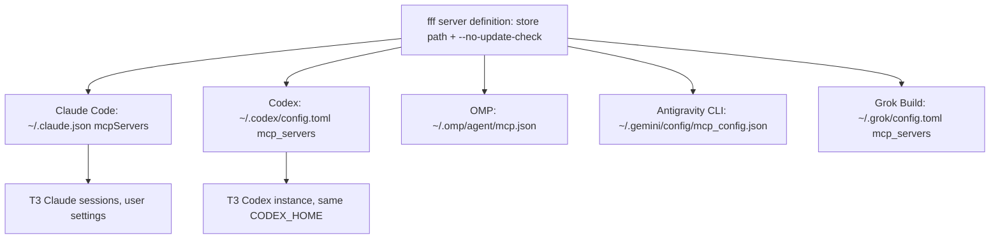

# fff Search for Every Agent Harness - Plan

## Goal Capsule

- **Objective:** Every active coding agent, on every host kind, searches files and file contents inside a git repository through one fast, resident search engine, and still has its own search tools when that engine is unavailable.
- **Means:** Register the `fff-mcp` MCP server from [fff](https://github.com/dmtrKovalenko/fff) declaratively in each harness through the existing activation-time settings merges, and tell agents through the shared instructions to prefer it (KTD1, KTD2).
- **Product authority:** This plan's Product Contract, confirmed by the user in the brainstorm. The Planning Contract decides mechanism within it.
- **Stop conditions:** Stop and report if a harness rejects the declared entry at runtime in a way no declaration in this repository can fix, or if `agent-settings` cannot merge a harness's file without discarding entries the harness or the user wrote.
- **Execution profile:** Configuration and packaging; the first proof for each unit is its materialized output in a scratch `HOME`, not a unit test.
- **Open blockers:** None.

---

## Product Contract

Product Contract preservation: restructured, no scope change. The Outstanding Questions were resolved by planning research and moved into the Planning Contract (KTD3 to KTD7). R1 to R8 are unchanged. The Summary and one Key Decision now name the Antigravity ACP exclusion that R4's own condition allows (KTD6).

### Summary

Install `fff-mcp` and register it as an MCP server in Claude Code, Codex, OMP, the Antigravity CLI, and Grok Build on NixOS, non-NixOS Linux, and macOS hosts.
The Antigravity ACP runtime is left out because it reads no user-level MCP configuration (KTD6).
The shared agent instructions gain one rule: inside a git-tracked directory, search files and contents with the fff tools first.
Built-in search tools stay available as the fallback.

### Problem Frame

Agents search constantly, and each built-in Grep or Glob call, or each ripgrep run through a shell, starts cold and walks the tree again.
fff keeps a resident index in one long-running process and ranks results by frecency, so repeated searches in the same repository are faster and their ordering is more useful.
Today no harness in this configuration has any MCP server declared; OMP ships an empty `mcpServers` map.
Each harness therefore searches its own way, and nothing makes the behavior the same across harnesses or hosts.

### Key Decisions

- **fff is added and preferred, not a replacement for built-in search.** Agents keep Grep, Glob, and shell search for when fff fails or the work is outside a git repository. Governs R5, R6. (session-settled: user-directed — chosen over blocking built-in search tools and over registering fff without an instruction: a hard block leaves agents unable to search when fff breaks, and registration alone leaves the choice to each model.)
- **The package comes from nixpkgs, not the upstream installer or Homebrew.** It keeps fff on every host kind under the same pinned source as everything else; the version follows nixpkgs unstable. Governs R1.
- **A harness that reads no shared instructions gets the server without the preference rule.** Grok Build loads no shared instruction files, so it gets the server alone; the Antigravity ACP runtime gets neither (KTD6). Governs R4, R6.

### Requirements

**Availability**

- R1. `fff-mcp` is installed from nixpkgs on every host kind: NixOS, non-NixOS Linux, and macOS.
- R2. Each harness launches the server by an absolute store path, so a session that does not inherit the login shell's `PATH`, such as a GUI or T3 Code session, still starts it.

**Registration**

- R3. Claude Code, Codex, OMP, and the Antigravity CLI each have the fff server declared in the configuration tier the harness already uses for declared settings, and the declaration survives the harness rewriting its own config at runtime.
- R4. Grok Build and the Antigravity ACP runtime have the fff server declared when the runtime supports MCP servers; a runtime that cannot load one is left out with its reason recorded.
- R5. A harness's built-in search tools stay enabled; no deny rule or tool block is added for them.

**Agent behavior**

- R6. The shared agent instructions tell agents to search files and contents with the fff tools inside a git-tracked directory, and to use built-in search when fff is unavailable or fails, or outside a git repository.
- R7. T3 Code sessions of each provider reach the same fff server as that harness's terminal sessions, without a T3-specific registration.

**Verification**

- R8. Repository checks prove, from materialized outputs, that each registered harness's effective configuration names the fff server with a store path that exists, and that the shared instructions carry the R6 rule.

### Acceptance Examples

- AE1. **Covers R5, R6.** Given a Claude Code session in a repository, when the fff server fails to start, then the agent still searches with Grep and Glob, and no permission rule stops it.
- AE2. **Covers R2, R7.** Given T3 Code started from the macOS Dock, when a Codex thread searches a repository, then fff answers even though the GUI session has no Homebrew or Nix profile on `PATH`.
- AE3. **Covers R3.** Given Codex has rewritten `~/.codex/config.toml` after a project trust prompt, when the next generation activates, then the fff server entry is still present.

### Scope Boundaries

- No block on built-in search tools (see Key Decisions).
- The fff Neovim plugin, the Pi extension, and the Node, Python, Rust, and C SDKs are out of scope; Pi provisioning is already retired.
- fff's index and frecency data stay unmanaged runtime state under the home directory.
- No per-repository fff configuration and no project-level MCP declarations.
- Retired harnesses (Pi, OpenCode) and their disabled T3 entries stay untouched.
- The Antigravity ACP runtime stays without fff (KTD6).

### Dependencies / Assumptions

- nixpkgs unstable ships `fff-mcp` 0.11.0 with `meta.platforms` covering x86_64-linux, aarch64-linux, and aarch64-darwin.
- Claude Code reads user-scope MCP servers from the top-level `mcpServers` of `~/.claude.json`, not from `settings.json`; see [global-config keys in settings.json](../solutions/integration-issues/claude-code-global-config-keys-ignored-in-settings-json.md).

### Sources / Research

- Upstream README: [dmtrKovalenko/fff](https://github.com/dmtrKovalenko/fff) — `fff-mcp` exposes `grep`, `find_files`, and `multi_grep`, and recommends an absolute command path for desktop sessions.
- `fff-mcp --help` (0.11.0): `fff-mcp [OPTIONS] [PATH]`, `PATH` defaults to the working directory; indexing `~` or `/` is refused without `--enable-home-scan`; an update check runs by default and `--no-update-check` turns it off; logs go to `$XDG_STATE_HOME/fff/`, not stderr.
- `home/h82/agents/omp.nix:87` — OMP's `mcp.json` declares an empty `mcpServers` map as `lib.mkDefault`.
- `scripts/agent-settings` — the merge every harness setting goes through; `ownEntries` with `--ledger` (lines 400-436, 552-570) upserts named entries under an object path and prunes only entries an earlier apply wrote.

---

## Planning Contract

### Key Technical Decisions

- KTD1. **One shared definition of the fff server, consumed by every harness module.** A small Nix file returns the server's command (the `fff-mcp` store path) and its arguments, `[ "--no-update-check" ]`; each harness module renders it into its own entry shape. The update check would tell agents to upgrade a binary that only nixpkgs can upgrade. Serves R1, R2.
- KTD2. **Mutable harness files get the server through `agent-settings` `ownEntries` with a ledger, never `own` or `setPaths`.** OMP is the exception: `omp-config-reconcile` already owns `~/.omp/agent/mcp.json` whole and restores the declared document, keeping `auth` only for declared servers whose identity is unchanged (`scripts/omp-config-reconcile:158-198`). `own` would wipe servers the user or the harness added (Codex already holds an app-written `[mcp_servers.node_repl]`), and `setPaths` refuses the `args` list. `ownEntries` upserts only `fff` and prunes it again if a later generation stops declaring it. Serves R3, AE3.
- KTD3. **Per-harness targets.** Each is a user-scope location the harness reads at session start:

  | Harness | File | Entry path | Mechanism |
  | --- | --- | --- | --- |
  | Claude Code | `~/.claude.json` | `mcpServers.fff` | existing `claudeGlobalConfig` merge, plus `ownEntries` and a ledger |
  | Codex | `~/.codex/config.toml` | `mcp_servers.fff` | existing `codexSettings` TOML merge, plus `ownEntries` and a ledger |
  | OMP | `~/.omp/agent/mcp.json` | `mcpServers.fff` | override the `lib.mkDefault` document that `omp-config-reconcile` restores |
  | Antigravity CLI | `~/.gemini/config/mcp_config.json` | `mcpServers.fff` | new `agent-settings` merge with `ownEntries` and a ledger |
  | Grok Build | `~/.grok/config.toml` | `mcp_servers.fff` | new `agent-settings` TOML merge with `ownEntries` and a ledger |

  The Antigravity CLI path was confirmed by running `agy mcp add` under a scratch `HOME`, which wrote `~/.gemini/config/mcp_config.json`. The Grok path comes from `grok mcp add --help` (`-s user` writes `~/.grok/config.toml`) and Grok's bundled user guide. Serves R3, R4.
- KTD4. **No T3-specific registration.** T3's Codex instance runs with `homePath = "~/.codex"` (`home/h82/t3code.nix:92-100`), so it reads the same `config.toml`. T3's Claude sessions load user settings, as the user-level `CLAUDE.md` they already receive shows, and user-scope `mcpServers` come from the same source. T3's OMP instance passes its own `--config` scope; whether that scope still loads `~/.omp/agent/mcp.json` is an execution-time check in U4. Serves R7.
- KTD5. **Codex keeps its default tool loading.** The installed Codex 0.165.0 knows the `omit_tools_from` key, but no evidence shows it accepts the `"deferred"` value upstream fff suggests, and a rejected value could stop Codex from loading the server. The entry declares no `omit_tools_from`.
- KTD6. **The Antigravity ACP runtime is left out.** Its binary takes MCP servers only through the ACP `session/new` request that T3 builds, and no user-level file it reads was found. No declaration in this repository can reach it. Serves R4.
- KTD7. **The preference rule lives in the File I/O section of the shared instructions template**, which is common to every rendered harness and already covers native tools versus shell. It touches no routing table, so `docs/agent-routing.md` does not change. Serves R6.

### High-Level Technical Design

One definition fans out to five harness files. Directional only.

### Assumptions

- `agent-settings` parses a 0-byte JSON file as an empty document, or can be made to. The Antigravity CLI ships `~/.gemini/config/mcp_config.json` as 0 bytes on this machine. U5 settles it.
- `ownEntries` over a TOML document upserts a `[mcp_servers.fff]` table the way it upserts a JSON object. No existing caller does this; U3 proves it.
- When a user already added a server named `fff` through a harness CLI, the declared entry replaces it on the next apply. That is acceptable: it points at the same tool.
- A session whose working directory is `~` gets no index, because fff refuses a home-directory scan. Agents fall back to built-in search per R6.

### Sequencing

U1 first. U2 to U5 depend only on U1 and can land in any order. U6 depends on U1 and on U3's TOML `ownEntries` proof. U7 is independent. U8 depends on U2 to U6.

---

## Implementation Units

### U1. Shared fff server definition and package

- **Goal:** One source for the server's command and arguments, and `fff-mcp` on `PATH` for manual use.
- **Requirements:** R1, R2, KTD1.
- **Dependencies:** None.
- **Files:** `home/h82/agents/fff.nix` (new module: installs the package), `home/h82/agents/fff-server.nix` (new: returns `{ command; args; }` from `pkgs`), `home/h82/agents/default.nix` (import the module).
- **Approach:** Follow how `home/h82/agents/default.nix` imports its other modules. Keep the definition a plain function of `pkgs` rather than a new `options.my.*` option, so no test-only option appears.
- **Test scenarios:** Covered by U8: each harness entry's `command` is the same existing store path ending in `/bin/fff-mcp`, and its arguments include `--no-update-check`.
- **Verification:** The home generation's package list contains `fff-mcp` on every fixture host kind.

### U2. Claude Code registration

- **Goal:** The fff server in the user-scope `mcpServers` of `~/.claude.json`.
- **Requirements:** R3, R5, R7, KTD2, KTD3, KTD4.
- **Dependencies:** U1.
- **Files:** `home/h82/agents/claude.nix`, `tests/claude.nix`.
- **Approach:** Extend the declaration that `claudeGlobalConfig` already merges with an `ownEntries` set on `["mcpServers"]` holding `fff = { type = "stdio"; command; args; }`, and pass `--ledger` to that merge, as `home/h82/t3code.nix:341-351` does. Add no permission rule, hook, or deny entry; per the [dangerous-rm learning](../solutions/integration-issues/claude-code-dangerous-rm-prompt-survives-bypass-while-permission-request-hook-remains.md), any such rule would also void bypass mode.
- **Test scenarios:**
  - Applying to a `~/.claude.json` that holds other top-level keys and a user-added server `other` leaves both, and adds `mcpServers.fff`.
  - A second apply changes nothing.
  - The declared `settings.json` still holds no permission rule mentioning Grep or Glob.
- **Verification:** U8 reads the applied file.

### U3. Codex registration

- **Goal:** The fff server as `[mcp_servers.fff]` in `~/.codex/config.toml`.
- **Requirements:** R3, R7, AE2, AE3, KTD2, KTD3, KTD4, KTD5.
- **Dependencies:** U1.
- **Files:** `home/h82/agents/codex.nix`, `tests/codex-settings.nix`.
- **Approach:** Add an `ownEntries` set on `["mcp_servers"]` to the declaration the `codexSettings` TOML merge already uses, and add `--ledger`. Update the hardcoded `declared` expectation in `tests/codex-settings.nix`.
- **Execution note:** Prove TOML `ownEntries` first in a scratch `HOME`. If the tool cannot upsert a TOML table, fix it in `scripts/agent-settings` with a case in `tests/test_agent_settings.py` before wiring Codex.
- **Test scenarios:**
  - Applying to a `config.toml` that holds `[mcp_servers.node_repl]` and a `[projects."/x"]` trust entry keeps both and adds `[mcp_servers.fff]` with `command` and `args`.
  - TOML comments in the file survive the apply.
  - Re-applying after Codex rewrote the file without `fff` restores it (AE3).
- **Verification:** U8 reads the applied file.

### U4. OMP registration

- **Goal:** The fff server in `~/.omp/agent/mcp.json`.
- **Requirements:** R3, R7, KTD3, KTD4.
- **Dependencies:** U1.
- **Files:** `home/h82/agents/omp.nix`, `tests/omp-settings.nix`.
- **Approach:** Replace the `lib.mkDefault` empty document with one declaring `mcpServers.fff` (`type`, `command`, `args`). `omp-config-reconcile` already restores the file on apply and keeps per-server `auth`.
- **Execution note:** Check whether T3's OMP instance, which passes `--config` with its own scope file, still loads `~/.omp/agent/mcp.json`. If it does not, R7 is unmet for OMP: report it as a blocker for the user's decision, and do not add a T3-specific registration on your own (KTD4).
- **Test scenarios:** After activation in a scratch `HOME`, the restored `mcp.json` names `fff` with the shared command; `tests/omp-settings.nix` expectations change from the empty map to that entry.
- **Verification:** `omp-settings` passes for every fixture host.

### U5. Antigravity CLI registration

- **Goal:** The fff server in `~/.gemini/config/mcp_config.json`.
- **Requirements:** R3, KTD2, KTD3.
- **Dependencies:** U1.
- **Files:** `home/h82/agents/gemini.nix`, `tests/gemini.nix`, and `scripts/agent-settings` with `tests/test_agent_settings.py` only if the empty-file case needs it.
- **Approach:** Add a third activation entry beside the two existing Antigravity merges, with its own `--label`, an `ownEntries` set on `["mcpServers"]`, and a ledger. The entry shape matches what `agy mcp add` writes: `command`, `args`, `disabled = false`.
- **Execution note:** Test the 0-byte file first. If `agent-settings` rejects it, treat empty text as an empty document in the tool and add a test case for it.
- **Test scenarios:**
  - A missing file, a 0-byte file, and a file holding another server each end with `fff` present and any other server kept.
  - The two existing Antigravity merges still write their own files unchanged.
- **Verification:** `gemini` passes; U8 reads the applied file.

### U6. Grok Build registration

- **Goal:** The fff server as `[mcp_servers.fff]` in `~/.grok/config.toml`.
- **Requirements:** R4, KTD2, KTD3.
- **Dependencies:** U1, and U3 for the TOML `ownEntries` proof.
- **Files:** `home/h82/agents/grok.nix`, plus the test file U8 adds.
- **Approach:** Add the first activation entry for Grok, ordered `entryAfter [ "installPackages" ]` and skipped on dry runs like the others, running a TOML merge with `ownEntries` on `["mcp_servers"]` and a ledger. The entry carries `command`, `args`, and `enabled = true`.
- **Test scenarios:** Applying to a `config.toml` that holds `[marketplace]` and `[[marketplace.sources]]` keeps them and adds `[mcp_servers.fff]`.
- **Verification:** U8 reads the applied file.

### U7. Shared instruction rule and repository docs

- **Goal:** Agents that read the shared instructions prefer fff for search inside a git repository.
- **Requirements:** R5, R6, R8, KTD7.
- **Dependencies:** None.
- **Files:** `home/h82/agents/instructions/instructions.md.tmpl`, `tests/agent-instructions.py`, `AGENTS.md`.
- **Approach:** Add one bullet to the File I/O section: inside a git-tracked directory, search file names and contents with the fff MCP tools first; use the harness's built-in search when fff is unavailable or fails, or outside a git repository. Mention fff in the `home/h82/` paragraph of `AGENTS.md`, including which harnesses get the server and why the Antigravity ACP runtime does not. Phrase both in this repository's instruction style.
- **Test scenarios:**
  - `agent-instructions` fails when the rule is removed from the template, and also when it is negated; read the [negated-sentence learning](../solutions/best-practices/substring-sentence-check-passes-a-negated-instruction.md) before writing the assertion.
  - All four rendered deliveries (`CLAUDE.md`, Codex `AGENTS.md`, OMP `AGENTS.md`, Antigravity CLI rules) carry the rule.
- **Verification:** `agent-instructions` passes.

### U8. Materialized-output check for every registration

- **Goal:** One check proves that every registered harness's applied file names the fff server with an existing executable.
- **Requirements:** R2, R3, R4, R8.
- **Dependencies:** U2 to U6.
- **Files:** `tests/agent-mcp.nix` (new), `flake.nix` (register under `checks` and in `hostClosureChecks`), `tests/check-shards.nix` if the shard list is not derived.
- **Approach:** Run each host's `home.activationPackage` in a scratch `HOME` seeded with harness-written content, as `tests/omp-settings.nix` and `tests/lib/agent-activation.nix` do, then parse each of the five files and assert on the parsed entry. Read the learnings on [mutation testing](../solutions/best-practices/mutation-testing-reveals-decorative-nix-check-assertions.md), [echo-only activation steps](../solutions/best-practices/activation-step-grep-check-passes-an-echo-only-step.md), and [converged fixture state](../solutions/best-practices/converged-fixture-state-defeats-nix-check-mutation-testing.md) first.
- **Test scenarios:**
  - For each of the five files, `fff.command` is an existing executable store path ending in `/bin/fff-mcp`, and the arguments include `--no-update-check`.
  - A seeded foreign server survives the apply in the four `agent-settings` files (Claude Code, Codex, Antigravity CLI, Grok Build).
  - OMP's `mcp.json` ends as the declared document, and a seeded `auth` on `fff` survives when its identity is unchanged.
  - A second apply leaves every file byte-identical.
  - Mutation: deleting any one harness's declaration, or swapping its command for a non-existent path, fails the check.
- **Verification:** `nix build --no-link .#checkShards.hosts` includes and passes `agent-mcp`; `check-shards-guard` passes.

---

## Verification Contract

| Gate | Command | Where |
| --- | --- | --- |
| Whitespace | `git diff --check` | local |
| Markdown lint | `mise run lint-staged-markdown` (pre-commit) | local |
| Formatting | `nix fmt -- --ci` | Linux CI `fmt` job; macOS has no formatter output |
| Flake evaluation | `nix flake check --no-build` | local and CI |
| Agent settings tool | `checks.<system>.agent-settings` | CI `check-shards` (light) |
| Harness checks | `claude`, `codex-settings`, `gemini`, `omp-settings`, `agent-instructions`, `agent-mcp` | CI `check-shards` (light, hosts) |
| macOS outputs | `nix build --no-link .#darwinConfigurations.<host>.system` and `checks.aarch64-darwin` | local on the Mac and CI `build-darwin` |
| Linux host outputs | every `nixosConfigurations`, `homeConfigurations`, `systemConfigs` output per `AGENTS.md` | CI |

Runtime checks after the user's next switch, reported apart from repository checks: `claude mcp list`, `codex mcp list`, `agy mcp list`, and `grok mcp list` each show `fff` connected, and a T3 Codex thread can call `find_files`.

## Definition of Done

- Every unit's verification passes, and every gate above has a result or is recorded as deferred to CI.
- No permission rule, hook, or deny entry names a built-in search tool.
- The PR body lists the Antigravity ACP exclusion (KTD6).
- The U4 T3 OMP check passed, or its failure was reported to the user as an R7 blocker.
- Code from abandoned approaches is gone from the diff.
