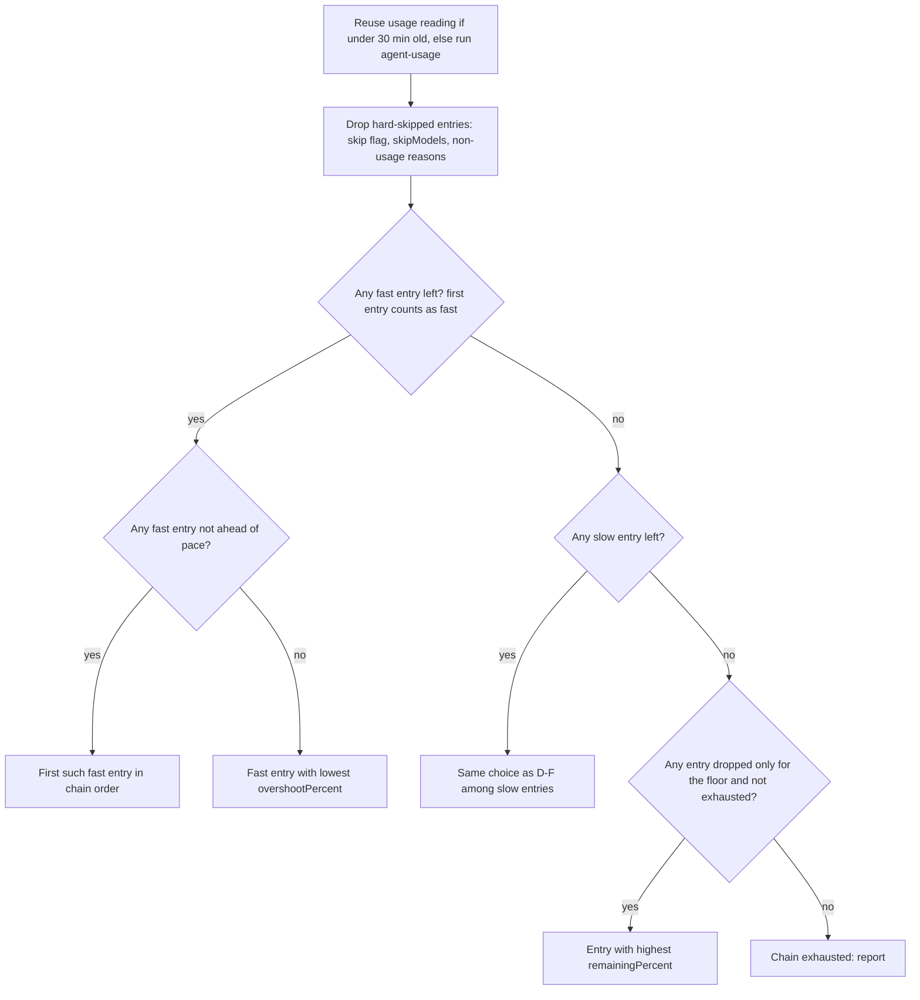

# Usage-Aware Provider Preference - Plan

## Goal Capsule

- **Objective:** Delegated work lands on the fast providers (Codex and Claude) whenever they have allowance to spare, and agents stop treating usage as a gate that slows or interrupts their work.
- **Product authority:** The user chose every behavior below in the brainstorm on 2026-10-29. It supersedes two decisions of `.compound-engineering/artifacts/plans/2026-10-28-1530-feat-usage-pace-routing-plan.md`: the 10 percentage point tolerance and "pace only skips; it never reorders a chain".
- **Means:** `agent-usage` reports hard skips and pace separately at a 25 point tolerance (KTD1, KTD2), and the shared instructions walk each chain fast-first under the new posture rules (KTD3, KTD4).
- **Execution profile:** Standard; two implementation units in `scripts/agent-usage`, the shared instructions template, `docs/agent-routing.md`, and their tests.
- **Stop conditions:** Stop and report if the `agent-instructions` check cannot express a requirement without new template data, or if a provider payload contradicts the window durations `agent-usage` already assigns.
- **Open blockers:** None.
- **Product Contract preservation:** Product Contract unchanged; its two Deferred to Planning questions are resolved by KTD1 and KTD4 and removed.

---

## Product Contract

### Summary

Usage becomes a preference, not a gate.
Pace tolerance widens to 25 percentage points, and only the 10% floor, exhausted usage, or unavailability hard-skips a fast provider.
Slow providers (Antigravity, Synthetic through OMP, Grok) take delegated work only when no fast entry in the chain can, unless the chain deliberately puts one first.
The root reads usage at most every 30 minutes, never pauses work over usage, and reports a choice only when it leaves the chain's first entry.

### Problem Frame

On 2026-10-29 `agent-usage --json` marked Codex (74% remaining, 26% used with 13.6% of its weekly window elapsed), Grok (69% remaining), and Claude (47% remaining on its 7-day window) as `skip: true`, `ahead of pace`.
With all three skipped, chains fell through to the entries the rules left standing: Antigravity, whose `gemini` status is `unknown` and so skips nothing, and Synthetic, which had 15% of its rolling quota left.
Those providers run noticeably slower, so delegated work slowed down while fast providers sat on most of their allowance.
GPT root sessions made it worse by following the rules to the letter: they re-ran `agent-usage` before every delegation and reported every skipped entry.

### Key Decisions

- **Widen the pace tolerance and demote slow providers, instead of dropping pace or turning pace into reordering.** (session-settled: user-directed — chosen over hard-skipping only at the floor, and over moving ahead-of-pace entries to the end of the chain, which would pull Grok and Synthetic forward: pace still catches heavy overspend while speed decides between providers.) Governs R1, R3, R5.
- **The tolerance is 25 percentage points.** (session-settled: user-directed — chosen over 20 and 30: it lets an early-week burst through and still blocks spending half a week's allowance in two days.) Governs R1.
- **A fast entry that is only ahead of pace beats a usable slow entry.** (session-settled: user-directed — chosen over sending work to the slow entry once every fast entry is ahead of pace: slow providers are for when fast ones truly cannot run.) Governs R3, R5.
- **A slow entry placed first in its chain keeps its place.** (session-settled: user-directed — chosen over demoting it in every chain and over rewriting the routing tables: `writing` and `visual` lead with Antigravity on purpose.) Governs R6.
- **Usage is read at most every 30 minutes.** (session-settled: user-directed — chosen over once per user turn and once per session: it covers parallel batches and long tasks without staleness that matters at weekly scale.) Governs R8.
- **Cross-model review is unchanged.** (session-settled: user-directed — stated by the user while choosing the approach.) Governs R12.
- **Agents are told outright that usage is a preference, skip reports shrink, and usage-free work reads no usage.** (session-settled: user-approved — proposed against GPT's literal rule-following; the user accepted.) Governs R9, R10, R11.
- **Gemini's `unknown` status keeps today's handling.** (session-settled: user-approved — proposed for omission because R5 and R6 leave Antigravity reachable only as a leading entry or a last resort.) Governs R7.

### Requirements

**Pace judgment**

- R1. A window is ahead of pace when its used percent is strictly greater than its elapsed percent plus 25; the floor (less than 10% remaining), window durations, Synthetic's floor-only judgment, and stale-window handling stay as they are.
- R2. Fast entries are `codex` and `claudeAgent` entries; slow entries are `antigravity`, `omp` (Synthetic), and `grok` entries.

**Entry selection**

- R3. Being ahead of pace never hard-skips an entry; an entry is hard-skipped only below the floor, on exhausted usage, or for the existing non-usage reasons (disabled provider, unoffered model, passed Synthetic expiry, confirmed launch rejection, Grok `402`).
- R4. Among a chain's usable fast entries, the root takes the first one in chain order that is not ahead of pace, or, when every one is ahead of pace, the one with the smallest overshoot.
- R5. A slow entry that follows a fast entry runs only when every fast entry in the chain is hard-skipped; the slow entries are then chosen among themselves by R4's rule.
- R6. When a chain's first entry is slow, that entry counts as fast for R4 and R5 in that chain.
- R7. When every entry is hard-skipped for usage, the root uses the floor-skipped entry with the most remaining and never revives an exhausted entry or one skipped for a non-usage reason; Gemini's `unknown` status skips nothing, as today.

**Agent posture**

- R8. The root reads `agent-usage --json` at most once every 30 minutes and reuses that reading for every delegation in the window, parallel batches included.
- R9. Work that makes no delegated model call, such as the root's own work or a deterministic command, reads no usage.
- R10. The instructions state that usage rules are routing preferences, and that an agent never stops, defers delegation, or asks the user because of usage.
- R11. The root reports a usage choice in one line only when the chosen entry is not the chain's first, naming why the earlier entries were passed over, and otherwise says nothing about usage.

**Consistency and scope**

- R12. The `peer` role, CE-selected cross-model reviews, and OMP's own Synthetic role assignments are unchanged.
- R13. `agent-usage` output, the routing rules in `home/h82/agents/instructions/instructions.md.tmpl` for every harness render, the "Usage pace" section of `docs/agent-routing.md`, and the tests that pin them describe these rules, and none still describes the 10 point tolerance or a chain order that never changes.

### Acceptance Examples

- AE1. **Covers R1, R4.** **Given** Codex's weekly window is 26% used with 13.6% elapsed, **when** the root delegates `deep` work, **then** it uses Codex `gpt-6.1-sol`, because Codex is within pace.
- AE2. **Covers R1, R4, R5.** **Given** Claude's 7-day window is 53% used with 15.2% elapsed and Codex is within pace, **when** the root delegates `implement` work, **then** it uses Codex `gpt-6.1-sol` ahead of Grok and GLM-5.3.
- AE3. **Covers R3, R4.** **Given** Claude overshoots by 12 points and Codex by 5, and Grok and Synthetic are within pace, **when** the root delegates `implement` work, **then** it uses Codex `gpt-6.1-sol`.
- AE4. **Covers R3, R5.** **Given** Claude has 6% remaining and Codex's weekly usage is exhausted, **when** the root delegates `implement` work, **then** it uses Grok `grok-4.7`.
- AE5. **Covers R6, R7.** **Given** Antigravity's status is `unknown`, **when** the root delegates `writing` work, **then** it uses Antigravity `gemini-4-argon-low`.
- AE6. **Covers R8.** **Given** the root read usage 10 minutes ago, **when** it starts three parallel delegations, **then** it reads usage zero more times.
- AE7. **Covers R11.** **Given** the root uses the first entry of the `review` chain, **when** it reports the delegation, **then** the report says nothing about usage.

### Scope Boundaries

- Routing table order, models, and efforts stay as they are; only how the root walks a chain changes.
- Gemini usage visibility (the `unknown` status without an Antigravity ACP sign-in) is not addressed.
- The Claude Code harness table holds only Claude models, so the fast/slow rule changes nothing there.

### Sources / Research

- `scripts/agent-usage` sets `PACE_TOLERANCE = 10` and `FLOOR = 10` near line 423; `overshootPercent` is already net of the tolerance.
- `home/h82/agents/instructions/instructions.md.tmpl` "Model chains" holds the current skip and fallback rules; the T3 Code table follows it.
- `tests/test_agent_usage.py` and `tests/agent-instructions.py` pin the current behavior and wording.
- `.compound-engineering/artifacts/plans/2026-10-28-1530-feat-usage-pace-routing-plan.md` introduced the pace rule this plan revises.

---

## Planning Contract

### Key Technical Decisions

- KTD1. **`skip` means hard skip only; pace travels in separate fields.** A provider's `skip` and `skipReason` are set only below the floor, `skipModels` lists only models below the floor, and a new provider-level `aheadOfPace` plus an `aheadModels` map (same combined `overshootPercent` and `remainingPercent` values `skipModels` carries today) report pace. Keeping `skip` for the hard case lets the existing "the usage check skips it" chain rule stay true without rewording. Governs R3, R4, R7.
- KTD2. **The tolerance changes in one constant.** `PACE_TOLERANCE` becomes 25, so `overshootPercent` stays net of the tolerance and `aheadOfPace` stays `overshootPercent > 0`. Governs R1.
- KTD3. **The fast and slow tiers live in the instructions, not in `agent-usage`.** `agent-usage` keys are usage accounts (`codex`, `claude`, `gemini`, `grok`, `synthetic`), while tiers belong to T3 providers in a chain and the R6 exception depends on chain position, which only the root sees. Governs R2, R5, R6.
- KTD4. **The 30-minute reuse is an instruction, not a cache.** `agent-usage` already caches each provider for 60 seconds; the cost the user saw is the agent's repeated tool calls, which only an instruction removes. A longer cache would also hide a provider crossing the floor from the human-readable output. Governs R8.
- KTD5. **The posture rule leads the usage bullets.** R10's sentence comes first among the usage bullets in "Model chains", so a model reading top-down meets "preference, never a reason to stop" before any skip mechanics. Governs R10.

### High-Level Technical Design

The root's walk over one chain, as directional guidance:

### Assumptions

- T3 provider names map to usage accounts as `codex` to `codex`, `claudeAgent` to `claude`, `antigravity` to `gemini`, `grok` to `grok`, and `omp` to `synthetic`; the instructions state this mapping once.

---

## Implementation Units

### U1. Split hard skips from pace in agent-usage

**Goal:** `agent-usage --json` judges pace at 25 points and reports hard skips and pace separately.

**Requirements:** R1, R3, R7, R13; KTD1, KTD2.

**Dependencies:** None.

**Files:**

- Modify: `scripts/agent-usage`
- Test: `tests/test_agent_usage.py`

**Approach:**

1. Set `PACE_TOLERANCE` to 25.
2. Make `skip_reason` return only `below floor`; add provider-level `aheadOfPace` from the provider `overshootPercent`.
3. Build `skipModels` from models whose combined state is below the floor, and `aheadModels` from models whose own windows are ahead of pace and are not below the floor, each with the combined values.
4. Leave the human-readable output's per-window "ahead of pace" and "below floor" text as it is.

**Patterns to follow:** the existing `judge`, `scope_state`, and `skip_reason` helpers; the `codex_weekly` fixture helper in the test file.

**Test scenarios:**

- Covers AE1. Weekly window 26% used with 13.6% elapsed: `aheadOfPace` false, `skip` false.
- Weekly window 78% used with 2/7 elapsed (about 28.6%): overshoot about 24.4, `aheadOfPace` true, `skip` false.
- Weekly window with 2 weeks to reset on a 1-week duration (0% elapsed): 25% used is not ahead, 25.1% is ahead.
- Claude 7-day window 53% used with 15.2% elapsed: `aheadOfPace` true, `skip` false, `skipReason` null.
- 5-hour window 10% elapsed: 35% used is not ahead, 35.1% is ahead.
- 90.1% used one hour before reset: `skip` true, `skipReason` `below floor`, `aheadOfPace` false.
- A model-scoped Fable window ahead of pace with healthy provider windows: Fable appears in `aheadModels` with combined values and not in `skipModels`; when the provider's 7-day window drops below the floor, Fable moves to `skipModels` with `below floor`.
- Rolling Synthetic quota at 8% remaining: `skip` true; at 30%: `skip` false; unknown-length windows never set `aheadOfPace`.
- Stale windows past reset and `unknown` Gemini still set neither `skip` nor `aheadOfPace`.

**Verification:** the `agent-usage` flake check passes, and a mutation of the tolerance back to 10 or of `skip_reason` back to returning `ahead of pace` fails at least one scenario.

### U2. Rewrite the routing rules and their record

**Goal:** every harness render of the shared instructions, and `docs/agent-routing.md`, describe the fast-first, preference-only usage rules.

**Requirements:** R2, R3, R4, R5, R6, R7, R8, R9, R10, R11, R12, R13; KTD1, KTD3, KTD4, KTD5.

**Dependencies:** U1 (field names).

**Files:**

- Modify: `home/h82/agents/instructions/instructions.md.tmpl`
- Modify: `docs/agent-routing.md`
- Test: `tests/agent-instructions.py`

**Approach:**

1. In "Model chains", replace "Report each skipped entry with its reason." with the R11 reporting rule.
2. Replace the two usage bullets with, in order: the R10 posture sentence; the R8 and R9 reading cadence; the hard-skip rule on `skip` and `skipModels`, keeping "A `stale` or `unknown` status alone skips nothing."; the R2 tiers with the R6 exception and the account mapping from Assumptions; the R4 and R5 choice on `aheadOfPace`, `aheadModels`, and `overshootPercent`; the R7 fallback.
3. Leave the `peer` sentence, the Synthetic expiry rules, and every routing table untouched (R12).
4. Rewrite the "Usage pace" section of `docs/agent-routing.md` to match, dropping the 10 point tolerance and "Chain order never changes."
5. Update `ROUTING_SENTENCES` and `routing_contract` in the test to the new wording, one sentence per entry so the existing sentence-mutant check covers each.

**Patterns to follow:** the sentence-list plus full-contract structure already in `tests/agent-instructions.py`; one rule per bullet as in the surrounding "Model chains" bullets.

**Test scenarios:**

- Every render (`claude`, `codex`, `omp`) contains each new usage sentence exactly as listed.
- Deleting or negating any one new sentence fails the sentence-mutant check.
- No render still contains "Report each skipped entry with its reason.", "the lowest `overshootPercent` among those skipped `ahead of pace`", or the 10 point tolerance.
- The `peer` sentence and the T3 Code table rows are unchanged.

**Verification:** the `agent-instructions` flake check passes, and `docs/agent-routing.md` has no sentence that contradicts the template.

---

## Verification Contract

- `nix build --no-link .#checks.<system>.agent-usage` and `.#checks.<system>.agent-instructions` on a supported builder; on macOS, these are Linux checks, so verify their inputs per `.compound-engineering/artifacts/solutions/best-practices/verify-linux-only-nix-check-inputs-on-macos-through-derivation-show.md` where they are not exposed for `aarch64-darwin`, and leave the build to CI.
- `python3 tests/test_agent_usage.py` runs directly against `scripts/agent-usage` for a fast local loop.
- `git diff --check`, markdownlint on changed Markdown, and `nix fmt -- --ci` where a formatter exists.
- CI on the PR head: every `check.yml` job terminal and green.

---

## Definition of Done

- R1 to R13 hold, and AE1 to AE7 are each true of the written rules or enforced by a U1 scenario.
- Both flake checks pass on the current head, locally or in CI.
- No active instruction, current routing document, or test still describes a 10 point tolerance or a chain order that never changes; historical plans and learnings keep their record of the superseded rule.
- No abandoned-attempt code or test remains in the diff.
